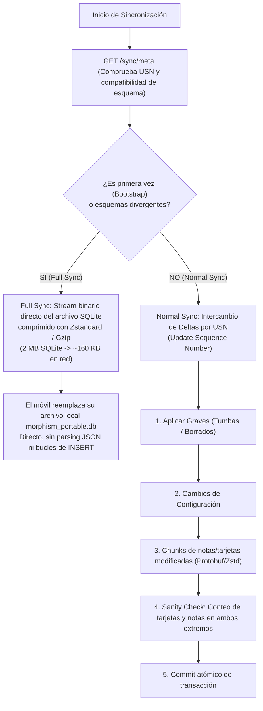
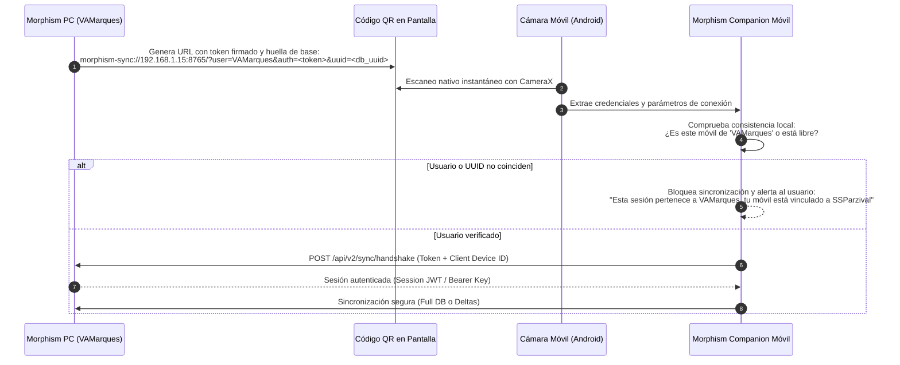
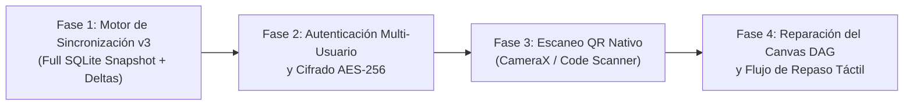

# Plan Arquitectónico: Sincronización Eficiente, Multi-Usuario y Compañero Móvil v3

> [!NOTE]
> Este documento técnico recoge el análisis de la arquitectura de sincronización de **Anki** (`anki/rslib/src/sync`) y **AnkiDroid** (`Anki-Android`), el análisis del payload de 1.93 MB de [`pull_delta.json`](file:///c:/repos/Morphism%20SRS/Morphism%20SRS%20proto2/specZ/pull_delta.json), el diagnóstico del visor de grafos móvil y la propuesta para el aislamiento multi-usuario y escaneo de códigos QR.

---

## 1. Auditoría de Anki / AnkiDroid: ¿Cómo resuelven la sincronización?

Al analizar el código fuente de Anki (`anki/rslib/src/sync/`) y AnkiDroid (`Anki-Android`), se evidencian patrones arquitectónicos consolidados tras más de 15 años de evolución en GPL-3.0:

### 1.1. Separación Radical: "Full Sync" vs. "Normal Sync" (Deltas)

Anki nunca serializa toda la base de datos en un JSON masivo. Cuenta con dos modos totalmente diferenciados:



#### Ventajas del modelo de Anki sobre el actual `pull_delta.json`:
1. **El problema de [`pull_delta.json`](file:///c:/repos/Morphism%20SRS/Morphism%20SRS%20proto2/specZ/pull_delta.json) (1.93 MB)**:
   - Contiene 2,248 filas de `tags`, 1,062 `review_logs`, 719 `cards` y 214 `notes` en texto plano JSON.
   - El motor JavaScript del `WebView` sufre una degradación de rendimiento severa al parsear 2 MB en un solo hilo móvil.
   - [`PortableDatabase.kt`](file:///C:/repos/Morphism%20SRS/Morphism%20SRS%20proto2/src/morphism-portable/kotlin/org/morphism/srs/portable/db/PortableDatabase.kt) ejecuta más de 5,000 sentencias SQL individuales `INSERT/UPDATE` en el dispositivo, bloqueando el hilo de la base de datos durante segundos.
2. **La solución Anki para Morphism**:
   - **En Bootstrap**: La PC realiza un `VACUUM INTO` de SQLite a un archivo temporal, lo comprime con `zlib`/`zstd` y lo transmite como un archivo binario `/api/v2/sync/download_db`. El teléfono descarga ~150 KB, cierra su conexión SQLite previa y sobreescribe directamente `morphism_portable.db`. El inicio es prácticamente instantáneo.
   - **En Repasos Diarios**: Solo viajan los `review_logs` nuevos creados en el móvil y las notas/aristas que hayan cambiado en el PC desde el último número de secuencia (`sync_oplog.id`).

---

## 2. Aislamiento Multi-Usuario, Autenticación y Cifrado

### 2.1. El Riesgo en Red Local (Colisión `VAMarques` vs `SSParzival`)
Actualmente el servidor efímero [`EphemeralMobileServer`](file:///c:/repos/Morphism%20SRS/Morphism%20SRS%20proto2/src/morphism_srs/services/mobile_server.py) escucha en un puerto de red local (`0.0.0.0:8765`) con un token efímero simple en la URL. Si dos usuarios en la misma residencia o universidad abren el servidor:
- Un escaneo accidental de la IP equivocada sincronizaría los mazos de una persona sobre el teléfono de la otra.
- No existe validación de a qué colección o propietario pertenece la sesión.

### 2.2. Cómo lo estructura Anki (`anki/rslib/src/sync/http_server/user.rs`)
En el servidor de Anki:
```rust
pub struct User {
    pub name: String,
    pub password_hash: String,
    pub col: Option<Collection>,
    pub folder: PathBuf,
}
```
- Cada usuario tiene una **carpeta aislada en disco** con su propio archivo SQLite (`<folder>/collection.anki2`).
- Las peticiones se autentican mediante un `hkey` (Host Key criptográfico) emitido tras validar credenciales.

### 2.3. Diseño de Autenticación Propuesto para Morphism SRS



#### Medidas de Seguridad Clave:
1. **Huella de Colección (`db_uuid`)**: El móvil guarda el UUID canónico de la colección con la que está emparejado. Si intenta conectarse a otra PC o a otro usuario con diferente UUID, exige confirmación explícita advirtiendo que se reemplazará la colección.
2. **Cifrado en Tránsito Local**:
   - En lugar de requerir certificados HTTPS públicos en redes locales (que fallan con IPs `192.168.x.x`), el código QR comparte una **clave simétrica efímera (AES-256-GCM)** de 256 bits.
   - El payload HTTP viaja cifrado de extremo a extremo entre el proceso Python de la PC y el código Kotlin del teléfono, volviendo inmune la sincronización a escuchas maliciosas en Wi-Fi públicas.

---

## 3. Escáner de Código QR con Cámara en Android

### 3.1. Estado Actual vs. Solución Nativa
Actualmente, el usuario debe copiar y pegar manualmente la URL con el token alfabético de 32 caracteres.

### 3.2. Implementación Técnica en Kotlin
En lugar de usar navegadores o APIs complejas de HTML5 (`getUserMedia` en WebView, que exige permisos WebRTC lentos), se integrará **Google Code Scanner** o **CameraX + ML Kit Barcode** en el lado nativo:

```kotlin
// Flujo nativo en MainActivity.kt / SyncDialog
class QrScannerLauncher(private val activity: Activity) {
    fun startScan(onResult: (String) -> Unit) {
        val scanner = GmsBarcodeScanning.getClient(activity)
        scanner.startScan()
            .addOnSuccessListener { barcode ->
                barcode.rawValue?.let { uriString -> onResult(uriString) }
            }
            .addOnFailureListener { /* Fallback a entrada manual */ }
    }
}
```
- **Ventajas**:
  - No requiere permisos manuales intrusivos de cámara si se usa Google Code Scanner (Google Play Services gestiona la vista de cámara).
  - Tiempos de lectura inferiores a 100 milisegundos.
  - Al escanear, parsea directamente el esquema `morphism-sync://`, llena los datos y dispara la sincronización automáticamente.

---

## 4. Diagnóstico y Reparación del Explorador de Grafo en el Móvil

### 4.1. ¿Por qué no aparecen los grafos? (Causas Raíz)

1. **Coordenadas Negativas Fuera del Viewport**:
   En [`pull_delta.json`](file:///c:/repos/Morphism%20SRS/Morphism%20SRS%20proto2/specZ/pull_delta.json), los nodos de los cursos tienen coordenadas espaciales como `x = -1500.0, y = -520.0` o `x = -2100.0, y = -650.0`.
   - En [`graph_canvas.js`](file:///C:/repos/Morphism%20SRS/Morphism%20SRS%20proto2/src/morphism-portable/assets/web/graph_canvas.js#L17-L19), los valores iniciales son fijos: `offsetX = 50`, `offsetY = 80`, `scale = 0.85`.
   - En el arranque (`MorphismApp.refresh()`), **nunca se ejecuta `this.graphView.fitAll()`**.
   - Por tanto, todos los nodos se dibujan en coordenadas de pantalla como $X = 50 + (-1500 \times 0.85) = -1225\text{ px}$, quedando miles de píxeles fuera de la pantalla táctil visible.
2. **Dimensionamiento del `<canvas>` antes de la resolución del layout**:
   `this.canvas.getBoundingClientRect()` se ejecuta durante el constructor de `TouchGraphView`. Si los elementos flexibles de CSS (`flex: 1` en `main`) aún no han calculado su altura en el dispositivo móvil, el canvas se inicializa con dimensiones mínimas o distorsionadas.
3. **Fórmulas Matemáticas en el Canvas 2D**:
   El canvas 2D dibuja los títulos con `ctx.fillText(node.title)`. Los nodos que contienen macros o sintaxis LaTeX cruda (ej. `$\mathbb{R}^n$`) se dibujan como texto literal sin renderizar, provocando superposiciones visuales.

### 4.2. ¿Por qué el repaso (Review) presenta errores?
1. **Reseteo prematuro de cola (`this.refresh()`)**:
   En [`portable_ui.js`](file:///C:/repos/Morphism%20SRS/Morphism%20SRS%20proto2/src/morphism-portable/assets/web/portable_ui.js#L106), al calificar la última tarjeta de una secuencia, se invoca `this.refresh()`, lo que recarga todos los datos de los cursos desde SQLite y reinicializa la cola a medio camino si quedan repasos pendientes en otros nodos.
2. **Pasos huérfanos sin horario**:
   Si una tarjeta de una nota con modo `serial` o `cloze` no tiene una fila en `card_schedules`, el método `ReviewQueueDao.getCardPromptContextJson` no encuentra el horario para predecir intervalos (`intervals_preview`), arrojando una excepción en el puente que congela los botones de calificación.

---

## 5. Plan de Ejecución por Fases (Prioridad Diferida)

Como la versión móvil no es prioritaria en esta etapa del desarrollo, el plan se estructura en fases secuenciales listas para implementarse cuando se retome este componente:



### Fase 1: Motor de Sincronización v3 (Arquitectura Anki)
- [ ] Implementar endpoint `/api/v2/sync/snapshot` en el PC (`mobile_server.py`) que entregue una base SQLite comprimida en `gzip`/`zstd`.
- [ ] En Kotlin (`DeltaSyncEngine.kt`), añadir soporte para recibir el snapshot y reemplazar el archivo local `morphism_portable.db` en el primer sincronizado.
- [ ] Reducir `/api/v2/sync/pull_delta` para que únicamente devuelva registros del `sync_oplog` posteriores a `since_seq`, sin volver a enviar tablas estáticas completas.

### Fase 2: Autenticación Multi-Usuario y Cifrado
- [ ] Enriquecer el diálogo del código QR en el PC (`MobileQRDialog.py`) para incluir:
  - Nombre de perfil de usuario activo.
  - UUID canónico de la base de datos.
  - Clave simétrica de sesión efímera.
- [ ] Incorporar verificación en Kotlin para validar que el móvil pertenece al mismo `user` y `db_uuid`.
- [ ] Añadir capa de cifrado simétrico AES-256-GCM para la transferencia de datos en la red local.

### Fase 3: Escáner QR Nativo con Cámara en Android
- [ ] Añadir botón "📷 Escanear QR" en el diálogo de sincronización de [`index.html`](file:///C:/repos/Morphism%20SRS/Morphism%20SRS%20proto2/src/morphism-portable/assets/web/index.html).
- [ ] Conectar la acción mediante `@JavascriptInterface` a un flujo nativo en Kotlin que abra el escáner de códigos de barras.
- [ ] Completar automáticamente los campos de conexión y disparar la sincronización tras la lectura.

### Fase 4: Reparación del Canvas DAG y Repaso en Móvil
- [ ] En [`portable_ui.js`](file:///C:/repos/Morphism%20SRS/Morphism%20SRS%20proto2/src/morphism-portable/assets/web/portable_ui.js), invocar `this.graphView.fitAll()` inmediatamente después de cargar los datos de los cursos.
- [ ] Añadir un observador de tamaño (`ResizeObserver`) sobre el contenedor del canvas para asegurar que sus dimensiones internas coincidan con la resolución física del dispositivo (`devicePixelRatio`).
- [ ] Proteger el cálculo de intervalos en `ReviewQueueDao.kt` ante tarjetas sin historial para evitar excepciones en la pantalla de repaso.
