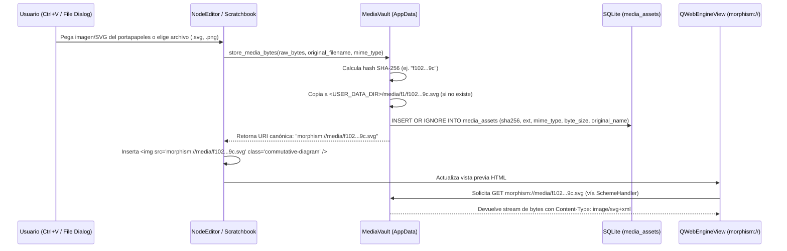
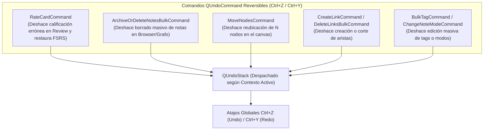

# 01 — Arquitectura del Sistema, Estructura del Proyecto, Gestión de AppData y Adaptabilidad

> [!NOTE]
> Este documento define la arquitectura de software de **Morphism SRS Prototype 2**, diseñada para erradicar el *spaghetti code* del Prototipo 1, establecer fronteras estrictas entre capas, garantizar compatibilidad multiplataforma (`Windows`, `Linux`, `macOS`) en el almacenamiento `AppData`, dar soporte nativo a diagramas vectoriales **SVG**, implementar deshacer/rehacer universal (`Ctrl+Z` vía `QUndoStack`) y asegurar adaptabilidad elástica en pantallas compactas (**720p**).

---

## 1. Principios Arquitectónicos Fundamentales (Anti-Spaghetti)

En el Prototipo 1, la lógica de negocio, las consultas de archivos JSON, el cálculo de colas de estudio y los estilos CSS estaban entrelazados dentro de las clases de interfaz gráfica (`main.py`, `courses_widget.py`, `review_view.py`). Para evitar esto por completo, el Prototipo 2 impone **4 Reglas de Oro**:

1. **Separación Estricta en 4 Capas Unidireccionales**:
   - **Presentation Layer (`ui/`)**: Widgets de PySide6 y vistas `QWebEngineView`. **Prohibido** escribir consultas SQL, abrir archivos en disco o calcular intervalos FSRS directamente en un widget.
   - **Application / Controller Layer (`controllers/`, `services/`)**: Orquesta casos de uso (`ReviewSessionController`, `ExplorerController`, `BrowserController`, `DSLCompilerService`, `ImportExportService`). Se comunica con la UI mediante señales tipadas de Qt (`Signal`), comandos reversibles (`QUndoCommand`) y DTOs inmutables.
   - **Domain Layer (`domain/`)**: Modelos de datos puros (`dataclass`), enumeraciones (`NoteMode`, `FSRSState`, `RatingEnum`, `EdgeRelation`) y el motor matemático FSRS (`SchedulerEngine`). No importa `PySide6` ni `sqlite3`.
   - **Infrastructure / Persistence Layer (`storage/`, `web_engine/`)**: Gestión de SQLite (`DatabaseManager`, Repositorios, `UnitOfWork`), bóveda de imágenes y SVGs en `AppData` (`MediaVault`) y el manejador de esquemas URL (`MorphismUrlSchemeHandler`).
2. **Prohibición de "God Classes"**:
   - `MainWindow` actúa **exclusivamente** como contenedor visual (Shell), barra de navegación superior y despachador de atajos globales (`Ctrl+Z`, `Ctrl+Y`, `Ctrl+F`). No contiene lógica de estudio ni manipulación de datos.
3. **Cero Estilos Inline (`setStyleSheet`) en Código Python de Vistas**:
   - Ningún widget en `ui/` puede definir colores hexadecimales o reglas CSS inline. Todo el estilizado ocurre mediante `objectName`, propiedades dinámicas (`setProperty("variant", "danger")`) y el `ThemeManager` centralizado basado en parámetros generales (detallado en [`03_THEMING_QSS_AND_CSS_ARCHITECTURE.md`](file:///c:/repos/Morphism%20SRS%20proto2/specZ/03_THEMING_QSS_AND_CSS_ARCHITECTURE.md)).
4. **Cero HTML/CSS/JS Multilínea Hardcodeado en Archivos `.py`**:
   - Todas las plantillas HTML, scripts JS y hojas CSS residen como archivos estáticos reales en `src/morphism_srs/resources/web/`, permitiendo resaltado de sintaxis, linting y recarga limpia sin escapes `{{ }}` de f-strings.

---

## 2. Estructura Completa de Directorios del Proyecto

```text
Morphism SRS proto2/
├── pyproject.toml                     # Configuración del paquete, dependencias (PySide6, fsrs, platformdirs)
├── README.md                          # Índice maestro del Whitepaper
├── specZ/                             # Documentación técnica detallada (Whitepaper) y recursos de especificación
│   ├── 01_ARCHITECTURE_AND_PROJECT_STRUCTURE.md
│   ├── 02_DATABASE_AND_SQL_SPECIFICATION.md
│   ├── 03_THEMING_QSS_AND_CSS_ARCHITECTURE.md
│   ├── 04_MATHJAX_AND_WEBENGINE_PERFORMANCE.md
│   ├── 05_SCHEDULING_AND_REVIEW_ENGINE.md
│   ├── 06_DSL_COMPILER_AND_IMPORT_EXPORT.md
│   ├── 07_UI_VIEWS_AND_MASS_BROWSER_SPEC.md
│   ├── 08_MOBILE_COMPANION_AND_ROADMAP.md
│   ├── tags_default.csv               # Catálogo curado de 2,000 tags estándar en inglés (snake_case)
│   ├── TODO/
│   │   └── SEED_DECKS_AND_ONBOARDING.md
│   └── old/                           # Referencias históricas iniciales
│       ├── Future_version.md
│       └── morphism_srs_schema.sql
│
├── src/
│   └── morphism_srs/
│       ├── __init__.py
│       ├── app.py                     # Bootstrap de QApplication, registro de URL schemes, ThemeManager
│       ├── config.py                  # Gestión multiplataforma de rutas AppData (platformdirs) y preferencias
│       │
│       ├── domain/                    # CAPA 1: Dominio Puro (Sin dependencias de UI ni SQL)
│       │   ├── __init__.py
│       │   ├── enums.py               # NoteMode (STANDARD, SERIAL, CLOZE), FSRSState, RatingEnum, EdgeRelation
│       │   ├── models.py              # Dataclasses: Course, Folder, Note, Card (atómica), NoteLink, ReviewLog
│       │   ├── ids.py                 # Generador UUIDv4 canónico e ID64 (Snowflake-like) con formateo Hex
│       │   └── scheduler_engine.py    # Wrapper de PyFSRS, cálculo de R(t), R_min(t), R_mean(t), P_joint(t), Kahn Sort
│       │
│       ├── storage/                   # CAPA 2: Infraestructura y Persistencia SQLite + AppData
│       │   ├── __init__.py
│       │   ├── database.py            # Conexión SQLite (WAL, FK=ON, busy_timeout), migraciones y seed de tags_default.csv
│       │   ├── schema_v2.sql          # DDL canónico versión 2
│       │   ├── unit_of_work.py        # Context manager transaccional atómico (with uow.transaction(): ...)
│       │   ├── media_vault.py         # Almacenamiento SHA-256 en AppData/media/ (SVG, PNG, WebP), GC de huérfanos
│       │   └── repositories/
│       │       ├── __init__.py
│       │       ├── folder_repo.py     # CRUD, herencia de scheduler_preset_id y validación acíclica de course_folders
│       │       ├── course_repo.py     # CRUD de courses y membresía course_notes (x, y, display_order)
│       │       ├── note_repo.py       # CRUD de notes (standard/serial/cloze), note_links, tags, borrado masivo
│       │       ├── card_repo.py       # CRUD de cards atómicas, card_revisions, card_schedules
│       │       ├── review_repo.py     # Inserción y reversión (Undo) en review_logs y review_sessions
│       │       ├── browser_repo.py    # Consultas paginadas/filtradas con FTS5 para el NoteBrowserView
│       │       └── scratch_repo.py    # Persistencia de páginas del Scratchbook en SQLite
│       │
│       ├── services/                  # CAPA 3A: Servicios de Aplicación (Casos de Uso Complejos)
│       │   ├── __init__.py
│       │   ├── safe_html.py           # SafeMathHtmlParser: preserva tags HTML seguros y convierte <, > a \lt, \gt
│       │   ├── dsl_compiler/          # Compilador del lenguaje declarativo .mdsl
│       │   │   ├── __init__.py
│       │   │   ├── lexer.py           # Tokenizador con seguimiento de línea/columna
│       │   │   ├── parser.py          # Generador de AST (NoteDecl, CardDecl, LinkDecl, Directives)
│       │   │   ├── validator.py       # Validación semántica, normalización de tags y resolución de nombres
│       │   │   └── compiler.py        # Traducción de AST a comandos de UnitOfWork + auto-layout topológico
│       │   ├── import_export/
│       │   │   ├── __init__.py
│       │   │   └── mpkg_service.py    # Empaquetado/desempaquetado ZIP (.mpkg) 100% SQL puro (morphism.db + media/
│       │   ├── layout_service.py      # Algoritmo Sugiyama / jerárquico topológico para posicionar grafos
│       │   └── mobile_server.py       # Servidor HTTP efímero (activo sólo mientras el diálogo QR está abierto)
│       │
│       ├── controllers/               # CAPA 3B: Controladores de Estado de UI y Bus de Eventos
│       │   ├── __init__.py
│       │   ├── event_bus.py           # QObject singleton con señales globales tipadas
│       │   ├── commands.py            # Implementaciones QUndoCommand (RateCard, MoveNodes, DeleteNotes, BulkTag)
│       │   ├── review_controller.py   # Máquina de estados de estudio (Standard, Serial, Cloze, Custom Study, Undo)
│       │   ├── explorer_controller.py # Selección múltiple Marquee, edición de grafo, operaciones en lote
│       │   └── browser_controller.py  # Filtros FTS5, selección masiva, acciones en masa sobre notas/tarjetas
│       │
│       ├── web_engine/                # Puente seguro QWebEngineView + Esquema URL Personalizado
│       │   ├── __init__.py
│       │   ├── scheme_handler.py      # QWebEngineUrlSchemeHandler para morphism://assets y morphism://media
│       │   ├── web_profile.py         # QWebEngineProfile compartido con pre-calentamiento en segundo plano
│       │   └── mathjax_bridge.py      # Puente JS para renderizado incremental O(1) sin lag
│       │
│       ├── theming/                   # Motor de Temas Basado en Parámetros Generales (Tokens)
│       │   ├── __init__.py
│       │   ├── theme_manager.py       # Carga tokens JSON, compila app.qss.tmpl e inyecta CSS vars (:root)
│       │   └── delegates.py           # QStyledItemDelegate y filtro global para QComboBox, QTreeView y QTableView
│       │
│       ├── ui/                        # CAPA 4: Vistas y Widgets PySide6 (Cero SQL, Cero CSS Inline, 720p-Ready)
│       │   ├── __init__.py
│       │   ├── main_window.py         # Shell principal, barra de navegación y atajos globales
│       │   ├── window_sizing.py       # Helper apply_relative_geometry() basado en QScreen.availableGeometry()
│       │   ├── components/            # Widgets reutilizables
│       │   │   ├── flow_layout.py     # Layout dinámico envolvente para barras de herramientas en pantallas estrechas
│       │   │   ├── html_toolbar.py    # Barra de formato HTML/LaTeX configurable vía JSON
│       │   │   ├── tag_chips.py       # Editor visual de etiquetas con autocompletado sobre los 2,000 tags estándar
│       │   │   └── search_bar.py      # Barra de búsqueda con sintaxis de filtros (tag:, course:, mode:, is:due)
│       │   ├── views/
│       │   │   ├── courses_view.py    # Árbol de carpetas y cursos, presets FSRS, acciones de paquete
│       │   │   ├── explorer_view.py   # QGraphicsView DAG (Rectángulos/Rombos/Elipses), Marquee, barra flotante
│       │   │   ├── browser_view.py    # Tabla FTS5 de notas/tarjetas para gestión y borrado masivo
│       │   │   ├── review_view.py     # Vista de estudio optimizada con controles FSRS y botón Undo (Ctrl+Z)
│       │   │   └── stats_view.py      # Heatmap anual, histograma de vencimientos y métricas FSRS
│       │   └── dialogs/
│       │       ├── node_editor_dialog.py        # Editor no-modal de Nota y Tarjetas con soporte Ctrl+V de imágenes/SVG
│       │       ├── scratchbook_dialog.py        # Scratchbook multi-página + Estudio Compilador DSL en vivo
│       │       ├── retrievability_dialog.py     # Curvas R_min(t), R_mean(t), P_joint(t) e individuales R_i(t)
│       │       ├── custom_study_dialog.py       # Configurador de sesiones personalizadas (por R_min, tags, leeches)
│       │       ├── mobile_qr_dialog.py          # Diálogo modal que inicia/detiene el servidor móvil bajo demanda
│       │       ├── delete_prereqs_dialog.py     # Selector de aristas de prerrequisito a eliminar
│       │       └── settings_dialog.py           # Selector de tema, macros MathJax, pesos FSRS y backups
│       │
│       └── resources/                 # Recursos Estáticos Empaquetados (Read-Only)
│           ├── icons/                 # Iconos SVG/ICO de la aplicación
│           ├── defaults/
│           │   ├── tags_default.csv   # Copia empaquetada de specZ/tags_default.csv (2,000 tags estándar)
│           │   ├── mathjax_config.json
│           │   └── editor_buttons.json
│           ├── themes/
│           │   ├── dark_slate.json    # Parámetros Generales (Design Tokens) del tema oscuro principal
│           │   ├── light_paper.json   # Parámetros Generales del tema claro académico
│           │   └── oled_midnight.json # Parámetros Generales del tema negro OLED
│           ├── styles/
│           │   └── app.qss.tmpl       # Hoja QSS maestra única parametrizada con @tokens para toda la UI Qt
│           └── web/                   # Plantillas HTML, JS y CSS reales (sin f-strings)
│               ├── vendor/
│               │   ├── mathjax/
│               │   │   └── tex-svg-full.js
│               │   └── chartjs/
│               │       └── chart.umd.min.js
│               ├── css/
│               │   └── cards.css      # Hoja CSS3 unificada para tarjetas, MathJax SVG y gráficas
│               ├── js/
│               │   ├── review_renderer.js
│               │   ├── preview_renderer.js
│               │   └── stats_charts.js
│               └── html/
│                   ├── review.html
│                   ├── preview.html
│                   ├── heatmap.html
│                   ├── barplot.html
│                   └── decay_chart.html
│
├── tools/                             # Herramientas Externas Desacopladas del Core
│   └── migrate_proto1.py              # Migrador autónomo Prototipo 1 -> SQLite v2 (100% separado de src/)
│
└── tests/                             # Suite de Pruebas Automatizadas (pytest + unittest)
    ├── test_sql_schema_and_repos.py
    ├── test_safe_html_sanitizer.py
    ├── test_dsl_compiler.py
    ├── test_scheduler_engine.py
    ├── test_media_vault.py
    └── test_proto1_migration.py
```

---

## 3. Gestión Multiplataforma de `AppData` y Bóveda de Medios con Soporte SVG (`Future_version.md` #27)

### 3.1 El Problema en el Prototipo 1
En el Prototipo 1:
1. Todos los datos del usuario (`Courses/`, `scheduling/`, `scratchbook/`) se guardaban en rutas relativas al directorio de trabajo actual (`os.getcwd()`). Si la aplicación se ejecutaba desde un acceso directo o se instalaba en `Program Files` / `/usr/bin`, fallaba por permisos de escritura o creaba carpetas en lugares arbitrarios.
2. En `node_editor_dialog.py` (`prompt_insert_image`), al insertar una imagen se inyectaba la ruta absoluta del archivo original del usuario:
   ```html
   
   ```
   Si el usuario borraba o movía `captura1.png` de su Escritorio, o exportaba el curso a otra computadora, **la imagen quedaba rota permanentemente**.

### 3.2 Compatibilidad Multiplataforma Completa (`Windows`, `Linux`, `macOS`)
En el Prototipo 2 utilizamos `platformdirs` (o `QStandardPaths.writableLocation(QStandardPaths.AppDataLocation)`) para mapear automáticamente el concepto de `"AppData"` al estándar oficial de cada sistema operativo:

| Sistema Operativo | Ruta Canónica del Directorio de Datos (`<USER_DATA_DIR>`) | Estándar de la Plataforma |
| :--- | :--- | :--- |
| **Windows** | `C:\Users\<username>\AppData\Roaming\MorphismSRS\` | Windows Known Folders (`%APPDATA%` unificado, eliminando `%APPDATA%\Morphism`) |
| **Linux** | `~/.local/share/MorphismSRS/` | Especificación **XDG Base Directory** (`$XDG_DATA_HOME`) |
| **macOS** | `~/Library/Application Support/MorphismSRS/` | Apple File System Hierarchy Standard |

> [!NOTE]
> **Unificación de Carpetas Roaming**: Morphism SRS utiliza exclusivamente `%APPDATA%\MorphismSRS\` como directorio único de datos y perfil en Windows. Se configura explícitamente `app.setOrganizationName("")` para evitar la creación de carpetas duplicadas como `%APPDATA%\Morphism\`, y `AppPaths` limpia automáticamente cualquier directorio residual antiguo al iniciar.

*(Nota: También se soporta un **"Portable Mode"**: si existe un archivo vacío `portable.flag` junto al ejecutable o en la raíz del repositorio durante el desarrollo, `<USER_DATA_DIR>` apunta a `./user_data/` relativo al ejecutable para permitir pruebas aisladas o ejecución desde USB sin tocar el sistema).*

#### Estructura Interna de `<USER_DATA_DIR>`:
```text
<USER_DATA_DIR>/
├── morphism.db                # Base de datos SQLite 3 principal (modo WAL)
├── morphism.db-wal            # Write-Ahead Log activo
├── morphism.db-shm            # Shared-memory index
├── media/                     # Bóveda de medios direccionada por contenido (SHA-256)
│   ├── a3/
│   │   └── a3f89c12...4b.png  # Subdirectorios por prefijo de 2 caracteres (como Git)
│   └── f1/
│       └── f102e48a...9c.svg  # Diagramas conmutativos vectoriales SVG
├── config/
│   ├── settings.json          # Preferencias de UI, tema activo, geometría relativa de ventanas
│   ├── mathjax_macros.json    # Macros LaTeX personalizados del usuario
│   └── editor_buttons.json    # Botones personalizados de la barra de herramientas
├── themes/                    # Temas JSON personalizados añadidos por el usuario
├── backups/                   # Snapshots automáticos comprimidos (.db.zst / .zip) al iniciar/cerrar
└── logs/
    └── morphism.log           # RotatingFileHandler para diagnóstico de errores
```

### 3.3 Soporte Nativo de Primer Nivel para Diagramas Vectoriales **SVG** en `MediaVault`
En matemáticas avanzadas (teoría de categorías, álgebra homológica, topología algebraica), los diagramas conmutativos complejos se portan mal con los entornos básicos de MathJax (`ams_cd` no soporta flechas diagonales ni adjunciones curvadas). Por ello, `MediaVault` trata los archivos **`.svg`** como ciudadanos de primera clase:

1. **Ingesta de SVGs**:
   - El usuario puede insertar o pegar (`Ctrl+V`) archivos `.svg` exportados desde **Quiver (`q.uiver.app`)**, **TikZ (`tikz-cd` compilado a SVG)**, **Inkscape** o **GeoGebra**.
   - `MediaVault` valida que el archivo sea un XML/SVG bien formado, sanitiza cualquier etiqueta `<script>` por seguridad, calcula su hash `SHA-256` y lo guarda en `<USER_DATA_DIR>/media/<sha[:2]>/<sha>.svg`.
2. **Renderizado Vectorial y Adaptación Automática a Tema Oscuro**:
   - Se inserta en la tarjeta como `.svg" class="commutative-diagram invert-on-dark" />`.
   - `MorphismUrlSchemeHandler` sirve el recurso con `Content-Type: image/svg+xml`.
   - En `cards.css`, la clase `.commutative-diagram.invert-on-dark` aplica automáticamente `filter: invert(0.92) hue-rotate(180deg)` cuando el tema activo es oscuro (`is_dark: true`), logrando que las flechas y etiquetas negras de un diagrama TikZ/Quiver se vean blancas y nítidas sobre el fondo oscuro sin que el usuario tenga que editar el SVG manualmente.

### 3.4 Flujo de la Bóveda de Medios (`MediaVault`) y Esquema `morphism://`



#### Ventajas Críticas de este Diseño:
1. **Independencia Total del Sistema Operativo y de Rutas**: El HTML de las tarjetas nunca contiene `C:\Users\...` ni `/home/...`. Contiene únicamente `.<ext>">`.
2. **Deduplicación Automática**: Si el mismo diagrama conmutativo o figura se inserta en 5 tarjetas distintas, solo ocupa espacio una vez en disco gracias a su hash `SHA-256`.
3. **Resolución Sin Conflictos de `baseUrl` en `QWebEngineView`**:
   - En el Prototipo 1, `QWebEngineView.setHtml(html, QUrl.fromLocalFile(ASSETS_DIR + "/"))` fijaba `baseUrl` a la carpeta `assets/` del programa, causando problemas de seguridad CORS / `LocalFileAccess` al cargar imágenes desde otros directorios.
   - En el Prototipo 2, registramos el esquema personalizado `morphism://` al arrancar la aplicación (`QWebEngineUrlScheme.registerScheme`):
     - `morphism://assets/...` sirve archivos estáticos de la aplicación (`tex-svg-full.js`, `chart.umd.min.js`, `cards.css`).
     - `morphism://media/<sha256>.<ext>` sirve imágenes y SVGs desde `<USER_DATA_DIR>/media/`.
     - **Aislamiento de Seguridad**: `QWebEngineSettings` bloquea todo acceso a Internet (`http://`, `https://`) y a archivos arbitrarios del sistema (`file://`).

---

## 4. Bus de Eventos Tipado (`AppEventBus`) y Sistema Universal `Ctrl+Z` (`QUndoStack`)

Para evitar que los widgets mantengan referencias cruzadas entre sí (como ocurría en el Prototipo 1 donde `NodeEditorDialog` llamaba métodos privados `self.parent()._open_scratchbook_dialog()`), toda comunicación entre módulos de UI pasa por dos mecanismos limpios:

### 4.1 `AppEventBus` (Singleton `QObject`)
```python
class AppEventBus(QObject):
    # Eventos de Curso y Estructura
    active_course_changed = Signal(int)          # course_id
    course_tree_mutated = Signal()               # Recargar árbol de cursos/carpetas
    
    # Eventos de Notas y Grafo
    notes_created = Signal(list)                 # list[int] (note_ids)
    notes_updated = Signal(list)                 # list[int] (note_ids)
    notes_deleted = Signal(list)                 # list[int] (note_ids)
    links_mutated = Signal(int)                  # course_id
    
    # Eventos de Estudio y Planificación
    review_session_started = Signal(int)         # session_id
    card_reviewed = Signal(int, int)             # card_id, rating
    review_undone = Signal(int)                  # card_id
    schedule_recalculated = Signal(int)          # course_id
    
    # Eventos de Ventanas y Temas
    theme_changed = Signal(str)                  # theme_id ("dark_slate", "light_paper", "oled_midnight")
    open_note_editor_requested = Signal(int)     # note_id
    open_scratchbook_requested = Signal(str)     # optional initial_page_or_dsl
```

### 4.2 Pila de Comandos Reversibles (`QUndoStack` — Soporte Universal para `Ctrl+Z` y `Ctrl+Y`)
Aprovechando que el esquema SQLite v2 guarda instantáneas diferenciales (`state_before_json` y `state_after_json` en `review_logs`, además de `deleted_at` para *Soft Delete*), todas las operaciones de mutación en la aplicación se encapsulan como subclases de `QUndoCommand`:



- **En la Pantalla de Estudio (`ReviewView`)**: Si presionas `Space` o `1` (`Again`) por error, presionar `Ctrl+Z` ejecuta `RateCardCommand.undo()`: restaura `card_schedules` con `state_before_json`, elimina el registro de `review_logs` y, si la tarjeta había sido promovida al contenedor `#past-steps-list`, la devuelve como tarjeta activa en `< 2 ms`.
- **En el Explorador y Navegador (`GraphExplorerView` / `NoteBrowserView`)**: Si borras 40 notas seleccionadas o mueves un subgrafo por accidente, `Ctrl+Z` revierte la transacción SQLite (`deleted_at = NULL` o coordenadas previas `(x, y)`) y refresca la vista instantáneamente.

---

## 5. Adaptabilidad Elástica para Pantallas Pequeñas (720p / Laptops Compactas)

En el Prototipo 1, varios diálogos definían tamaños estáticos como `resize(1120, 820)` o alturas mínimas rígidas que se desbordaban en pantallas de laptops de resolución $1366 \times 768$ o $1280 \times 720$ (o con escalado DPI del 125%–150%).

En el Prototipo 2 se imponen **4 Reglas de Dimensionamiento Elástico** en `ui/window_sizing.py`:

1. **Prohibición de Dimensiones Fijas que Excedan 660px de Altura**:
   Ninguna ventana ni diálogo puede declarar un `setMinimumSize` mayor a `640x460`.
2. **Dimensionamiento Relativo al Área Disponible del Monitor (`QScreen.availableGeometry()`)**:
   Toda ventana principal y diálogo calcula su tamaño inicial descontando automáticamente la barra de tareas del sistema operativo:
   ```python
   from PySide6.QtGui import QGuiApplication
   from PySide6.QtWidgets import QWidget

   def apply_relative_geometry(
       window: QWidget,
       width_ratio: float = 0.86,
       height_ratio: float = 0.86,
       max_w: int = 1280,
       max_h: int = 860,
   ) -> None:
       screen_geom = QGuiApplication.primaryScreen().availableGeometry()
       w = max(640, min(max_w, int(screen_geom.width() * width_ratio)))
       h = max(460, min(max_h, int(screen_geom.height() * height_ratio)))
       window.resize(w, h)
       # Centrar limpiamente dentro de availableGeometry
       x = screen_geom.x() + (screen_geom.width() - w) // 2
       y = screen_geom.y() + (screen_geom.height() - h) // 2
       window.move(x, y)
   ```
3. **Barras de Herramientas Envolventes (`FlowLayout`) y `QScrollArea` Elásticos**:
   - Las barras de botones (como la barra de inserción de comandos LaTeX/HTML en `NodeEditorDialog` o la barra de acciones masivas) utilizan `FlowLayout`, envolviendo los botones en múltiples filas si el ancho de la ventana se reduce.
   - Los paneles de formularios laterales están envueltos en `QScrollArea(widgetResizable=True)` con `Qt.ScrollBarAsNeeded`.
4. **Botón de Maximizar y Persistencia de `QSplitter`**:
   - Todos los diálogos no-modales (`NodeEditorDialog`, `ScratchbookDialog`, `RetrievabilityPlotDialog`, `CustomStudyDialog`) habilitan `Qt.WindowMaximizeButtonHint` y guardan las proporciones de sus `QSplitter` en `settings.json`.
