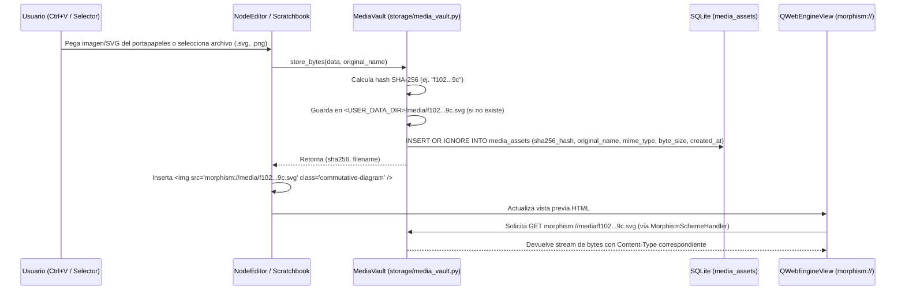
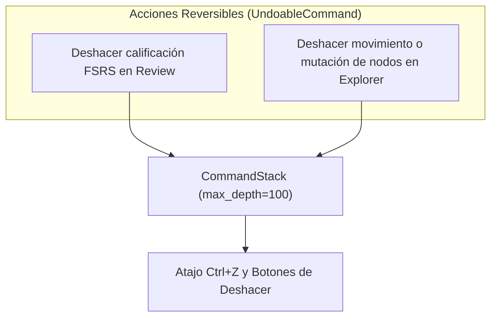

# 01 — Arquitectura del Sistema, Estructura del Proyecto, Gestión de AppData y Adaptabilidad

> [!NOTE]
> Este documento define la arquitectura de software de **Morphism SRS**, estableciendo fronteras estrictas entre capas, compatibilidad multiplataforma (`Windows`, `Linux`, `macOS`) en el almacenamiento `AppData`, soporte nativo para diagramas vectoriales **SVG**, deshacer/rehacer universal (`Ctrl+Z`) y adaptabilidad elástica en pantallas compactas (**720p**).

---

## 1. Principios Arquitectónicos Fundamentales

La arquitectura de **Morphism SRS** desacopla de forma estricta la lógica de negocio, la persistencia, la planificación de estudio y los estilos visuales de los componentes de interfaz gráfica, organizándose bajo **4 Reglas de Oro**:

1. **Separación Estricta en 4 Capas Unidireccionales**:
   - **Presentation Layer ([`ui/`](../src/morphism_srs/ui/))**: Widgets de PySide6 y vistas `QWebEngineView`. No ejecuta consultas SQL, no abre archivos de usuario en disco ni calcula intervalos FSRS directamente en los widgets.
   - **Application / Controller Layer ([`controllers/`](../src/morphism_srs/controllers/), [`services/`](../src/morphism_srs/services/))**: Orquesta los casos de uso a través de controladores ([`ReviewController`](../src/morphism_srs/controllers/review_controller.py), [`ExplorerController`](../src/morphism_srs/controllers/explorer_controller.py), [`BrowserController`](../src/morphism_srs/controllers/browser_controller.py)), el compilador DSL en [`services/dsl_compiler/`](../src/morphism_srs/services/dsl_compiler/) y el servicio de empaquetado en [`services/import_export/mpkg_service.py`](../src/morphism_srs/services/import_export/mpkg_service.py). Se comunica con la UI mediante el bus de señales tipadas ([`EventBus`](../src/morphism_srs/controllers/event_bus.py)), comandos reversibles ([`CommandStack`](../src/morphism_srs/controllers/commands.py)) y DTOs inmutables.
   - **Domain Layer ([`domain/`](../src/morphism_srs/domain/))**: Modelos de datos puros (`dataclass` en [`models.py`](../src/morphism_srs/domain/models.py)), enumeraciones (`NoteMode`, `FSRSState`, `RatingEnum`, `EdgeRelation` en [`enums.py`](../src/morphism_srs/domain/enums.py)) y el motor matemático FSRS ([`SchedulerEngine`](../src/morphism_srs/domain/scheduler_engine.py)). No contiene dependencias de `PySide6` ni de `sqlite3`.
   - **Infrastructure / Persistence Layer ([`storage/`](../src/morphism_srs/storage/), [`web_engine/`](../src/morphism_srs/web_engine/))**: Gestión de SQLite en [`database.py`](../src/morphism_srs/storage/database.py), repositorios especializados en [`storage/repositories/`](../src/morphism_srs/storage/repositories/), contexto transaccional en [`unit_of_work.py`](../src/morphism_srs/storage/unit_of_work.py), bóveda de medios en [`media_vault.py`](../src/morphism_srs/storage/media_vault.py) y el manejador de esquemas URL [`MorphismSchemeHandler`](../src/morphism_srs/web_engine/scheme_handler.py).
2. **Prohibición de "God Classes"**:
   - [`MainWindow`](../src/morphism_srs/ui/main_window.py) actúa **exclusivamente** como contenedor visual (Shell), barra de navegación superior y despachador de atajos globales (`Ctrl+F`, navegación entre vistas). No contiene lógica de estudio ni manipulación directa de base de datos.
3. **Cero Estilos Inline (`setStyleSheet`) en Código Python de Vistas**:
   - Los widgets en [`ui/`](../src/morphism_srs/ui/) no definen colores hexadecimales ni reglas CSS inline. Todo el estilizado ocurre mediante `objectName`, propiedades dinámicas (`setProperty("variant", "danger")`) y el gestor centralizado [`ThemeManager`](../src/morphism_srs/theming/theme_manager.py) (detallado en [`03_THEMING_QSS_AND_CSS_ARCHITECTURE.md`](03_THEMING_QSS_AND_CSS_ARCHITECTURE.md)).
4. **Cero HTML/CSS/JS Multilínea Hardcodeado en Archivos `.py`**:
   - Todas las plantillas HTML, scripts JS y hojas CSS residen como archivos estáticos reales en [`src/morphism_srs/resources/web/`](../src/morphism_srs/resources/web/), permitiendo resaltado de sintaxis, linting y recarga limpia sin escapes de cadenas de formato.

---

## 2. Estructura Completa de Directorios del Proyecto

```text
Morphism SRS/
├── pyproject.toml                     # Configuración del paquete y dependencias (PySide6, fsrs, platformdirs)
├── README.md                          # Índice maestro del proyecto
├── DEUDA_TECNICA.md                   # Registro estructurado de deuda técnica y código legacy
├── specZ/                             # Documentación técnica y especificaciones del sistema
│   ├── 01_ARCHITECTURE_AND_PROJECT_STRUCTURE.md
│   ├── 02_DATABASE_AND_SQL_SPECIFICATION.md
│   ├── 03_THEMING_QSS_AND_CSS_ARCHITECTURE.md
│   ├── 04_MATHJAX_AND_WEBENGINE_PERFORMANCE.md
│   ├── 05_SCHEDULING_AND_REVIEW_ENGINE.md
│   ├── 06_DSL_COMPILER_AND_IMPORT_EXPORT.md
│   ├── 07_UI_VIEWS_AND_MASS_BROWSER_SPEC.md
│   ├── 08_MOBILE_COMPANION_AND_ROADMAP.md
│   ├── tags_default.csv               # Catálogo curado de 2,000 tags estándar en inglés (snake_case)
│   ├── TODO/
│   │   └── SEED_DECKS_AND_ONBOARDING.md
│   └── old/                           # Especificaciones y esquemas históricos de referencia
│       ├── Future_version.md
│       └── morphism_srs_schema.sql
│
├── src/
│   ├── morphism_srs/
│   │   ├── __init__.py
│   │   ├── app.py                     # Bootstrap de QApplication, registro de esquemas URL y temas
│   │   ├── config.py                  # Gestión multiplataforma de rutas AppData (platformdirs) y preferencias
│   │   │
│   │   ├── domain/                    # CAPA 1: Dominio Puro (Sin dependencias de UI ni SQL)
│   │   │   ├── __init__.py
│   │   │   ├── enums.py               # NoteMode (STANDARD, SERIAL, CLOZE), FSRSState, RatingEnum, EdgeRelation
│   │   │   ├── models.py              # Dataclasses: Course, Folder, Note, Card, NoteLink, ReviewLog, CardSchedule
│   │   │   ├── ids.py                 # Generador UUIDv4 canónico e ID64 con formateo Hex
│   │   │   └── scheduler_engine.py    # Algoritmo FSRS v5, ordenamiento topológico Kahn, R_min, R_mean, P_joint
│   │   │
│   │   ├── storage/                   # CAPA 2: Infraestructura y Persistencia SQLite + AppData
│   │   │   ├── __init__.py
│   │   │   ├── database.py            # Conexión SQLite (WAL, FK=ON, busy_timeout), inicialización y migraciones
│   │   │   ├── schema_v2.sql          # DDL canónico de la base de datos
│   │   │   ├── unit_of_work.py        # Manejador transaccional atómico (with uow.transaction(): ...)
│   │   │   ├── media_vault.py         # Bóveda de medios direccionada por hash SHA-256 en AppData/media/
│   │   │   └── repositories/
│   │   │       ├── __init__.py
│   │   │       ├── folder_repo.py     # CRUD de carpetas y validación de jerarquía acíclica
│   │   │       ├── course_repo.py     # CRUD de cursos y membresía en course_notes (coordenadas x, y)
│   │   │       ├── note_repo.py       # CRUD de notas, enlaces (note_links), tags y borrado masivo
│   │   │       ├── card_repo.py       # CRUD de tarjetas atómicas, revisiones y estados FSRS (card_schedules)
│   │   │       ├── review_repo.py     # Inserción de logs de estudio (review_logs) y sesiones
│   │   │       ├── browser_repo.py    # Consultas paginadas y filtrado FTS5 para NoteBrowserView
│   │   │       ├── scratch_repo.py    # Persistencia de páginas del Scratchbook
│   │   │       └── gamification_repo.py # Rachas de estudio, estadísticas agregadas y gamificación
│   │   │
│   │   ├── services/                  # CAPA 3A: Servicios de Aplicación (Casos de Uso Complejos)
│   │   │   ├── __init__.py
│   │   │   ├── safe_html.py           # SafeMathHtmlParser: sanitización HTML y preservación de fórmulas LaTeX
│   │   │   ├── layout_service.py      # Algoritmo jerárquico Sugiyama para auto-posicionamiento de grafos
│   │   │   ├── mobile_server.py       # Servidor HTTP/WebSocket efímero para sincronización móvil
│   │   │   ├── delta_sync.py          # Cálculo de deltas y resolución de conflictos para sincronización
│   │   │   ├── qr_generator.py        # Generación de códigos QR para emparejamiento móvil
│   │   │   ├── sync_crypto.py         # Cifrado autenticado de transferencias con cliente móvil
│   │   │   ├── sync_snapshot.py       # Generación de snapshots completos e incrementales de base de datos
│   │   │   ├── dsl_compiler/          # Compilador declarativo para archivos .mdsl
│   │   │   │   ├── __init__.py
│   │   │   │   ├── lexer.py           # Tokenizador con seguimiento de línea y columna
│   │   │   │   ├── parser.py          # Generador de AST (declaraciones de notas, tarjetas y links)
│   │   │   │   ├── validator.py       # Validación semántica, tags estándar y resolución de nombres
│   │   │   │   └── compiler.py        # Compilación de AST a operaciones transaccionales UnitOfWork
│   │   │   └── import_export/
│   │   │       ├── __init__.py
│   │   │       └── mpkg_service.py    # Importación y exportación de paquetes .mpkg con medios vinculados
│   │   │
│   │   ├── controllers/               # CAPA 3B: Controladores de Estado y Orquestación
│   │   │   ├── __init__.py
│   │   │   ├── event_bus.py           # Singleton EventBus con señales Qt desacopladas
│   │   │   ├── commands.py            # Pila de acciones reversibles CommandStack y UndoableCommand
│   │   │   ├── review_controller.py   # Controlador de sesiones de estudio FSRS y soporte de deshacer
│   │   │   ├── explorer_controller.py # Manipulación de grafos, selección interactiva y edición visual
│   │   │   └── browser_controller.py  # Filtrado por búsqueda FTS5 y operaciones masivas
│   │   │
│   │   ├── web_engine/                # Integración con QWebEngineView y Esquema URL
│   │   │   ├── __init__.py
│   │   │   ├── scheme_handler.py      # MorphismSchemeHandler para morphism://app y morphism://media
│   │   │   └── web_profile.py         # QWebEngineProfile compartido con configuración de aislamiento
│   │   │
│   │   ├── theming/                   # Sistema de Temas y Tokens de Diseño
│   │   │   ├── __init__.py
│   │   │   ├── theme_manager.py       # Carga de tokens JSON, compilación de QSS y variables CSS
│   │   │   └── delegates.py           # Delegados visuales QStyledItemDelegate para tablas y listas
│   │   │
│   │   ├── ui/                        # CAPA 4: Vistas y Widgets PySide6 (Elásticos 720p)
│   │   │   ├── __init__.py
│   │   │   ├── main_window.py         # Shell principal, navegación superior y atajos globales
│   │   │   ├── window_sizing.py       # Dimensionamiento relativo elástico y configuración de splitters
│   │   │   ├── components/            # Widgets reutilizables
│   │   │   │   ├── flow_layout.py     # Layout envolvente para barras de herramientas compactas
│   │   │   │   ├── html_toolbar.py    # Barra de botones para edición de fórmulas y formato
│   │   │   │   ├── tag_chips.py       # Editor interactivo de tags con sugerencias automáticas
│   │   │   │   └── search_bar.py      # Barra de búsqueda con soporte de tokens y filtros
│   │   │   ├── views/
│   │   │   │   ├── courses_view.py    # Árbol jerárquico de carpetas y cursos
│   │   │   │   ├── explorer_view.py   # Visualizador y editor de grafos DAG (QGraphicsView)
│   │   │   │   ├── browser_view.py    # Tabla de exploración masiva de notas y tarjetas con FTS5
│   │   │   │   ├── review_view.py     # Vista de estudio con botones FSRS y atajo de deshacer
│   │   │   │   └── stats_view.py      # Panel de analíticas, heatmaps y proyecciones de retención
│   │   │   └── dialogs/
│   │   │       ├── node_editor_dialog.py    # Editor no-modal de notas y tarjetas con soporte de pegado
│   │   │       ├── scratchbook_dialog.py    # Bloc de notas multi-página y compilación de DSL en vivo
│   │   │       ├── retrievability_dialog.py # Visualizador de curvas de retención R_min, R_mean y P_joint
│   │   │       ├── custom_study_dialog.py   # Creador de sesiones de estudio personalizado
│   │   │       ├── mobile_qr_dialog.py      # Diálogo para emparejamiento con cliente móvil vía QR
│   │   │       ├── delete_prereqs_dialog.py # Diálogo para confirmación de eliminación de prerrequisitos
│   │   │       └── settings_dialog.py       # Preferencias generales, selección de temas y respaldos
│   │   │
│   │   └── resources/                 # Recursos Estáticos Empaquetados (Lectura)
│   │       ├── icons/                 # Iconos de la aplicación (.ico, .png)
│   │       ├── defaults/
│   │       │   ├── tags_default.csv   # Catálogo curado de 2,000 etiquetas
│   │       │   ├── mathjax_macros.json # Configuración base de macros LaTeX
│   │       │   └── editor_buttons.json # Configuración de botones de edición rápida
│   │       ├── themes/                # Tokens JSON de temas (dark_slate, light_paper, oled_midnight, etc.)
│   │       ├── styles/
│   │       │   └── app.qss.tmpl       # Plantilla maestra de hoja de estilos QSS
│   │       └── web/                   # Recursos web para QWebEngineView
│   │           ├── vendor/            # MathJax (tex-svg-full.js) y Chart.js
│   │           ├── css/
│   │           │   └── cards.css      # Estilos de tarjetas, diagramas y máscaras SVG
│   │           ├── js/                # Renderizadores JS para tarjetas y gráficos
│   │           └── html/              # Plantillas HTML de estudio, vista previa y estadísticas
│   │
│   └── morphism-portable/             # Aplicación complementaria Android (Kotlin + WebView)
│       ├── AndroidManifest.xml
│       ├── build_portable.py
│       ├── assets/web/                # Interfaz web móvil compartida
│       ├── kotlin/org/morphism/srs/   # Lógica Android, Room DB, FSRS y sincronización
│       └── res/                       # Recursos visuales Android
│
├── tools/                             # Herramientas de soporte y migración
│   ├── build_apk.py                   # Script de compilación para la aplicación móvil
│   └── migrate_proto1.py              # Script de migración desde formatos de almacenamiento anteriores
│
└── tests/                             # Suite de Pruebas Automatizadas
    ├── test_database.py
    ├── test_delta_sync_and_portable.py
    ├── test_dsl_and_safe_html.py
    ├── test_gamification.py
    ├── test_migrate_proto1.py
    ├── test_mobile_sync_v3.py
    ├── test_mpkg_and_mobile.py
    ├── test_portable_scheduler_parity.py
    ├── test_portable_sync_crypto.py
    ├── test_portable_web.py
    ├── test_remerge_v2_features.py
    ├── test_review_learning_and_serial.py
    ├── test_scheduler.py
    ├── test_svg_mask_rendering.py
    ├── test_ui_and_theming.py
    └── test_version_and_fixes.py
```

---

## 3. Gestión Multiplataforma de `AppData` y Bóveda de Medios con Soporte SVG

### 3.1 Principios de Almacenamiento y Rutas Canónicas
El almacenamiento en **Morphism SRS** se rige por la desacoplación estricta entre la ubicación física de los archivos en el disco y las referencias persistidas en la base de datos y tarjetas:
1. **Rutas Independientes de la Plataforma**: El HTML de las tarjetas nunca almacena rutas absolutas del sistema operativo (`C:\Users\...` o `/home/...`). Toda referencia a medios utiliza el esquema canónico `morphism://media/<sha256_hash>.<ext>`.
2. **Deduplicación por Contenido**: Cada archivo ingresado se indexa mediante su hash `SHA-256`, garantizando que imágenes y diagramas idénticos utilizados en múltiples notas solo se almacenen una vez en disco.
3. **Portabilidad y Empaquetado**: Al exportar o sincronizar notas (mediante `.mpkg` o hacia clientes móviles), los identificadores hash permiten validar la integridad de cada asset sin romper hipervínculos.

### 3.2 Compatibilidad Multiplataforma Completa (`Windows`, `Linux`, `macOS`)
La clase [`AppPaths`](../src/morphism_srs/config.py#L30-L98) en [`config.py`](../src/morphism_srs/config.py) resuelve automáticamente la ubicación del directorio de usuario `<USER_DATA_DIR>` siguiendo el estándar nativo de cada sistema operativo (vía `platformdirs` con fallback a directorio local):

| Sistema Operativo | Ruta Canónica del Directorio de Datos (`<USER_DATA_DIR>`) | Estándar de la Plataforma |
| :--- | :--- | :--- |
| **Windows** | `C:\Users\<username>\AppData\Roaming\MorphismSRS\` | Windows Known Folders (`%APPDATA%` unificado) |
| **Linux** | `~/.local/share/MorphismSRS/` | Especificación **XDG Base Directory** (`$XDG_DATA_HOME`) |
| **macOS** | `~/Library/Application Support/MorphismSRS/` | Apple File System Hierarchy Standard |

> [!NOTE]
> **Unificación de Perfil de Datos**: Morphism SRS utiliza `%APPDATA%\MorphismSRS\` como directorio único de datos y perfil en Windows. Se configura explícitamente `app.setOrganizationName("")` para evitar la creación de carpetas dispersas, asegurando consistencia entre sesiones.

*(Soporte de **"Portable Mode"**: Si existe el archivo `portable.flag` en la raíz del proyecto o junto al ejecutable, `<USER_DATA_DIR>` apunta a `./user_data/` para permitir ejecuciones portables o aisladas sin alterar el sistema).*

#### Estructura Interna de `<USER_DATA_DIR>`:
```text
<USER_DATA_DIR>/
├── morphism_v2.sqlite3        # Base de datos SQLite 3 principal (modo WAL)
├── morphism_v2.sqlite3-wal    # Write-Ahead Log activo
├── morphism_v2.sqlite3-shm    # Shared-memory index
├── media/                     # Bóveda de medios direccionada por hash SHA-256
│   ├── a3f89c12...4b.png      # Archivos guardados como <sha256>.<ext>
│   └── f102e48a...9c.svg      # Diagramas conmutativos vectoriales SVG
├── config/
│   ├── settings.json          # Preferencias de UI, tema activo, geometría relativa
│   ├── mathjax_macros.json    # Macros LaTeX personalizados del usuario
│   └── editor_buttons.json    # Botones personalizados de la barra de herramientas
├── themes/                    # Temas JSON personalizados añadidos por el usuario
├── backups/                   # Snapshots automáticos de la base de datos
└── logs/
    └── morphism.log           # Diagnóstico y registro de errores
```

### 3.3 Soporte Nativo de Primer Nivel para Diagramas Vectoriales **SVG** en `MediaVault`
En matemáticas avanzadas (teoría de categorías, álgebra homológica, topología algebraica), los diagramas conmutativos complejos requieren fidelidad vectorial. La clase [`MediaVault`](../src/morphism_srs/storage/media_vault.py) en [`storage/media_vault.py`](../src/morphism_srs/storage/media_vault.py) trata los archivos **`.svg`** como ciudadanos de primer orden:

1. **Ingesta de SVGs**:
   - El usuario inserta o pega (`Ctrl+V`) archivos `.svg` exportados desde herramientas especializadas (**Quiver**, **TikZ**, **Inkscape** o **GeoGebra**).
   - [`MediaVault.store_bytes`](../src/morphism_srs/storage/media_vault.py#L27-L50) calcula el hash `SHA-256`, almacena el archivo en `<USER_DATA_DIR>/media/<sha256>.<ext>` y registra el recurso en la tabla `media_assets`.
2. **Renderizado Vectorial y Tintado CSS con Máscaras**:
   - En [`cards.css`](../src/morphism_srs/resources/web/css/cards.css#L222-L245), los diagramas vectoriales se integran mediante la clase `.commutative-diagram` o a través del contenedor `.diagram-mask-container` y la máscara `.commutative-diagram-mask`.
   - La propiedad CSS `mask-image` / `-webkit-mask-image` con `background-color: var(--text-primary)` permite que los diagramas monocromáticos adopten dinámicamente el color de texto del tema activo (oscuro o claro) con nitidez vectorial absoluta y sin artefactos de inversión de color.

### 3.4 Flujo de la Bóveda de Medios (`MediaVault`) y Esquema `morphism://`



#### Ventajas Críticas de este Diseño:
1. **Independencia Total del Sistema Operativo y de Rutas**: Las tarjetas no dependen de rutas de disco locales variables.
2. **Deduplicación Automática**: Archivos idénticos sólo ocupan espacio una vez gracias al direccionamiento por contenido.
3. **Aislamiento Seguro en `QWebEngineView`**:
   - El esquema personalizado `morphism://` registrado en [`register_morphism_scheme`](../src/morphism_srs/web_engine/scheme_handler.py#L21-L36) separa los recursos de la aplicación de los medios del usuario:
     - `morphism://app/...` sirve recursos estáticos empaquetados (`cards.css`, `mathjax_init.js`, scripts de gráficos).
     - `morphism://media/<sha256>.<ext>` sirve imágenes y diagramas desde `<USER_DATA_DIR>/media/`.
   - Se restringe el acceso a la red externa y a esquemas de archivo local arbitrarios (`file://`).

---

## 4. Bus de Eventos Tipado (`EventBus`) y Sistema de Acciones Reversibles (`CommandStack`)

Para desacoplar las vistas y evitar dependencias circulares directas entre diálogos y controladores, la comunicación interna se canaliza a través de dos mecanismos:

### 4.1 `EventBus` (Singleton `QObject`)
Definido en [`src/morphism_srs/controllers/event_bus.py`](../src/morphism_srs/controllers/event_bus.py#L6-L17), centraliza las señales de notificación para cambios de estado global:

```python
class EventBus(QObject):
    """Bus central de señales Qt que desacopla vistas, diálogos y controladores."""

    courses_updated = Signal()
    course_selected = Signal(int)
    notes_updated = Signal(int)  # course_id
    review_session_started = Signal()
    review_session_finished = Signal()
    review_state_changed = Signal()
    status_message = Signal(str, int)  # message, timeout_ms
    navigate_to_tab = Signal(str)  # "courses" | "explorer" | "review" | "browser" | "stats"
    open_node_in_explorer = Signal(int, int)  # course_id, note_id
```

### 4.2 Pila de Comandos Reversibles (`CommandStack` y Atajos `Ctrl+Z`)
La gestión de acciones reversibles se implementa mediante [`CommandStack`](../src/morphism_srs/controllers/commands.py#L14-L42) y [`UndoableCommand`](../src/morphism_srs/controllers/commands.py#L7-L12) en [`controllers/commands.py`](../src/morphism_srs/controllers/commands.py):



- **En la Pantalla de Estudio ([`ReviewView`](../src/morphism_srs/ui/views/review_view.py#L99-L102))**: Si el usuario califica una tarjeta por error, presionar `Ctrl+Z` o el botón de la barra superior invoca `review_controller.undo_last_review()`, restaurando el estado FSRS anterior en `card_schedules`, eliminando el último log en `review_logs` y regresando la tarjeta como activa en la vista.
- **En el Explorador de Grafo ([`ExplorerView`](../src/morphism_srs/ui/views/explorer_view.py#L641-L644))**: Al desplazar nodos o modificar relaciones, las coordenadas o estados previos se apilan como comandos reversibles ejecutables mediante `explorer_controller.undo_last_action()`.

---

## 5. Adaptabilidad Elástica para Pantallas Pequeñas (720p / Laptops Compactas)

La interfaz de **Morphism SRS** está diseñada para operar con fluidez en pantallas de resolución compacta ($1280 \times 720$ o $1366 \times 768$) y con factores de escala DPI elevados (125%–150%). Las reglas de dimensionamiento se centralizan en [`src/morphism_srs/ui/window_sizing.py`](../src/morphism_srs/ui/window_sizing.py):

1. **Dimensionamiento Relativo al Área Disponible (`QScreen.availableGeometry()`)**:
   [`apply_relative_geometry`](../src/morphism_srs/ui/window_sizing.py#L8-L39) calcula el tamaño inicial respetando la barra de tareas del sistema operativo:
   ```python
   def apply_relative_geometry(
       widget: QWidget,
       width_ratio: float = 0.85,
       height_ratio: float = 0.85,
       min_width: int = 860,
       min_height: int = 560,
       center: bool = True,
   ) -> None:
       screen = widget.screen() or QGuiApplication.primaryScreen()
       if screen is None:
           widget.setMinimumSize(min_width, min_height)
           widget.resize(min_width, min_height)
           return

       avail = screen.availableGeometry()
       eff_min_w = min(min_width, int(avail.width() * 0.96))
       eff_min_h = min(min_height, int(avail.height() * 0.94))
       widget.setMinimumSize(eff_min_w, eff_min_h)

       target_w = max(eff_min_w, min(int(avail.width() * width_ratio), int(avail.width() * 0.96)))
       target_h = max(eff_min_h, min(int(avail.height() * height_ratio), int(avail.height() * 0.94)))
       widget.resize(target_w, target_h)

       if center:
           x = avail.x() + (avail.width() - target_w) // 2
           y = avail.y() + (avail.height() - target_h) // 2
           widget.move(max(avail.x(), x), max(avail.y(), y))
   ```
2. **Protección de Paneles con `configure_splitter`**:
   [`configure_splitter`](../src/morphism_srs/ui/window_sizing.py#L41-L67) desactiva el colapso accidental a tamaño 0 (`splitter.setChildrenCollapsible(False)`) e impone anchos mínimos a cada panel hijo.
3. **Contenedores con Desplazamiento Fluido (`wrap_in_scroll_area`)**:
   [`wrap_in_scroll_area`](../src/morphism_srs/ui/window_sizing.py#L69-L89) envuelve formularios y paneles densos en `QScrollArea(widgetResizable=True)` para que aparezcan barras de desplazamiento según la necesidad de la pantalla.
4. **Barras de Herramientas Envolventes ([`FlowLayout`](../src/morphism_srs/ui/components/flow_layout.py))**:
   Las barras de acciones y botones LaTeX/HTML en [`html_toolbar.py`](../src/morphism_srs/ui/components/html_toolbar.py) distribuyen los elementos en filas adicionales cuando el ancho de ventana disponible se restringe.
