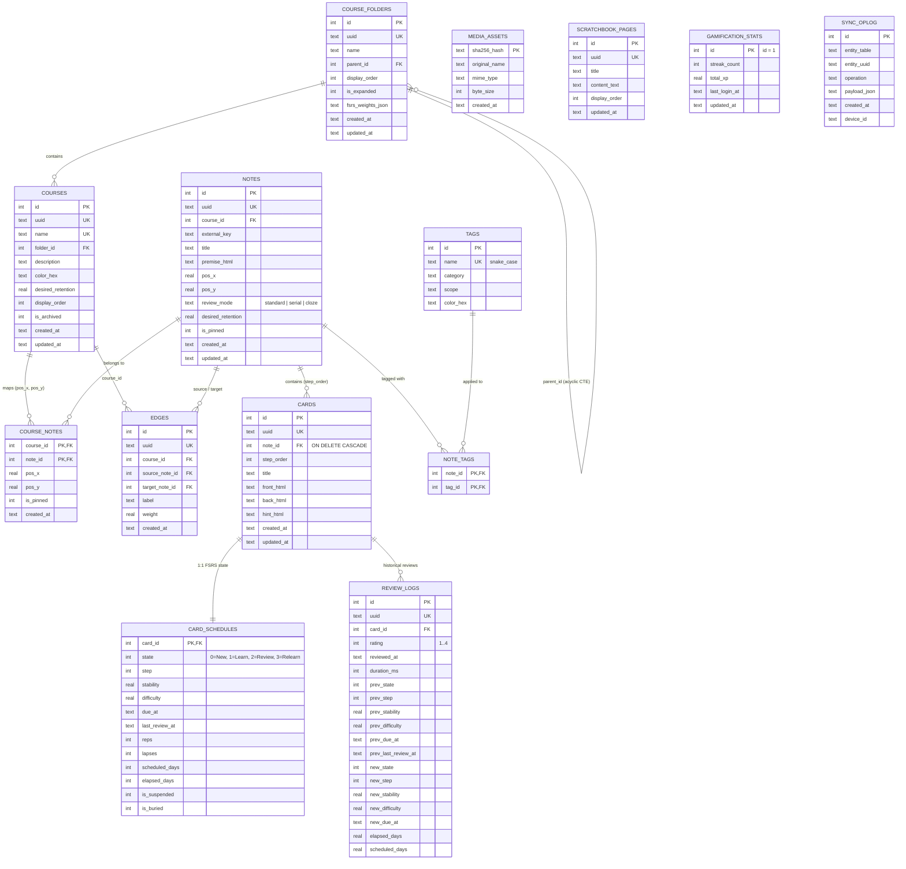

# 02 — Especificación de Base de Datos SQLite, Esquema Relacional y Persistencia

> [!IMPORTANT]
> Este documento define la arquitectura y especificación completa de la capa de persistencia relacional en SQLite para **Morphism SRS**, detallando el esquema canónico DDL ([`schema_v2.sql`](../src/morphism_srs/storage/schema_v2.sql)), los diagramas Entidad-Relación, las reglas de integridad referencial, las consultas FTS5 y el funcionamiento de los repositorios y el contexto transaccional [`UnitOfWork`](../src/morphism_srs/storage/unit_of_work.py).

---

## 1. Principios de Diseño Relacional y Decisiones del Esquema

El motor de almacenamiento de **Morphism SRS** se fundamenta en SQLite 3 con un modelo relacional normalizado que asegura integridad estricta, consultas reactivas de alto rendimiento y sincronización distribuida libre de conflictos.

### 1.1 Fundamentos del Modelo de Datos
1. **Uso de Tablas `STRICT` y Modo WAL (`PRAGMA journal_mode = WAL`)**:
   Todas las tablas declaran la cláusula `STRICT` de SQLite ($\ge 3.38$), garantizando tipado fuerte a nivel de motor. La conexión configurada en [`DatabaseManager`](../src/morphism_srs/storage/database.py#L10-L40) establece `foreign_keys = ON`, `journal_mode = WAL`, `synchronous = NORMAL` y `temp_store = MEMORY`, permitiendo lecturas concurrentes sin bloqueo desde la interfaz gráfica.
2. **Separación de Notas (`notes`) y Membresía en Cursos (`course_notes`)**:
   Las coordenadas del grafo `(pos_x, pos_y)` y el estado `is_pinned` residen tanto como valores por defecto en `notes` como de forma específica por curso en la tabla de asociación `course_notes(course_id, note_id)`. Esto permite que una misma nota matemática (por ejemplo, un teorema fundamental) pertenezca simultáneamente a varios cursos con diferentes posiciones espaciales en cada lienzo, compartiendo el mismo historial de estudio FSRS.
3. **Separación entre Estado Mutable (`card_schedules`) e Historial Inmutable (`review_logs`)**:
   El estado dinámico de repetición espaciada se almacena en `card_schedules`, mientras que cada evento de calificación se registra como una fila inmutable en `review_logs`. Esto permite recalcular proyecciones FSRS y revertir calificaciones erróneas mediante `Ctrl+Z` restaurando los campos previos sin pérdida de datos.
4. **Tarjetas Atómicas y Modos Epistémicos de Nota (`notes.review_mode`)**:
   Toda tarjeta en Morphism SRS es una entidad atómica en la tabla `cards` con `(title, front_html, back_html, hint_html)` y su propia entrada en `card_schedules`. La nota padre (`notes`) define el condicionamiento pedagógico mediante la columna `review_mode`:
   - `standard`: Tarjetas evaluadas de forma independiente, $P(A_i)$.
   - `serial`: Cadena secuencial de pasos de una demostración, $P(A_i \mid A_1, \dots, A_{i-1})$.
   - `cloze`: Oclusión holística contextual, $P(A_i \mid \{A_j : j \ne i\})$.

---

### 1.2 Reglas de Integridad y Operaciones Relacionales

1. **Integridad Referencial y Borrado en Cascada**:
   - `cards.note_id`, `edges.source_note_id`, `edges.target_note_id`, `course_notes.note_id` y `note_tags.note_id` declaran `ON DELETE CASCADE`. La eliminación física de una nota purga automáticamente sus tarjetas, aristas y asociaciones sin violaciones de clave foránea.
   - En `review_logs`, la columna `card_id` cuenta con `ON DELETE CASCADE`, garantizando limpieza íntegra al remover tarjetas individuales.
2. **Configuración FSRS Jerárquica y Modular**:
   - Los pesos optimizados de FSRS se gestionan a nivel de carpeta en `course_folders.fsrs_weights_json`.
   - La retención deseada se define a nivel de curso en `courses.desired_retention` (con restricción `CHECK (desired_retention >= 0.70 AND desired_retention <= 0.99)`) y permite sobreescritura específica en `notes.desired_retention`.
3. **Bóveda de Medios y Soporte Vectorial (`media_assets`)**:
   - La tabla `media_assets` indexa los archivos multimedia por su hash SHA-256 (`sha256_hash TEXT PRIMARY KEY CHECK (length(sha256_hash) = 64)`), registrando `mime_type`, `byte_size` y `original_name`. Los medios se integran en el contenido mediante el protocolo `morphism://media/<sha256_hash>.<ext>`.
4. **Columnas Indexadas de Planificación (`card_schedules`)**:
   - Para evitar deserializaciones en tiempo de ejecución, `card_schedules` almacena campos explícitos e indexados: `state` (`0=New, 1=Learning, 2=Review, 3=Relearning`), `step`, `stability`, `difficulty`, `due_at`, `last_review_at`, `reps`, `lapses`, `is_suspended` e `is_buried`, cubiertos por el índice compuesto `idx_schedules_due`.
5. **Búsqueda de Texto Completo FTS5 (`cards_fts`)**:
   - La tabla virtual `cards_fts` utiliza el tokenizador `unicode61 remove_diacritics 2` y se mantiene sincronizada en tiempo real mediante los triggers `trg_cards_fts_insert`, `trg_cards_fts_delete` y `trg_cards_fts_update` sobre la tabla `cards`.
6. **Persistencia del Bloc de Notas (`scratchbook_pages`)**:
   - El bloc de notas se almacena en SQLite mediante `scratchbook_pages(id, uuid, title, content_text, display_order, updated_at)`.
7. **Normalización de Etiquetas y Catálogo Estándar (`tags`)**:
   - La clasificación temático-epistémica se realiza mediante `tags` y `note_tags`. El inicializador [`DatabaseManager._seed_default_tags`](../src/morphism_srs/storage/database.py#L122-L149) puebla inicialmente la tabla desde [`specZ/tags_default.csv`](tags_default.csv) con 2,000 tags científicos en formato `snake_case`.
8. **Identificadores Universales (`uuid`) y Sincronización Móvil (`sync_oplog`)**:
   - Las entidades principales incorporan `uuid TEXT NOT NULL UNIQUE` (UUID v4), preservando `id INTEGER PRIMARY KEY` para velocidad de JOINs locales.
   - Cada operación de inserción, actualización o eliminación en las entidades del sistema dispara un trigger `trg_sync_*` que alimenta la tabla `sync_oplog`, habilitando sincronización delta con dispositivos móviles y clientes remotos.
9. **Triggers Automáticos de Integridad**:
   - `trg_course_folders_prevent_cycles`: Trigger con CTE recursivo (`WITH RECURSIVE ancestors`) que aborta cualquier intento de generar un ciclo en la jerarquía de carpetas.
   - `trg_cards_auto_schedule`: Trigger que genera automáticamente el registro inicial en `card_schedules` al insertar una nueva tarjeta.

## 2. Diagrama Entidad-Relación Completo (Esquema SQLite v2)



---

## 3. Especificación Canónica del DDL SQLite (`schema_v2.sql`)

El esquema DDL canónico de **Morphism SRS** reside en [`src/morphism_srs/storage/schema_v2.sql`](../src/morphism_srs/storage/schema_v2.sql) y es ejecutado durante la inicialización de [`DatabaseManager`](../src/morphism_srs/storage/database.py). Requiere SQLite $\ge 3.38$ (soporte nativo para tablas `STRICT`, `FTS5`, funciones `JSON` y CTEs recursivos):

### 3.1 PRAGMAs de Conexión y Rendimiento
En cada apertura de conexión, [`DatabaseManager._apply_pragmas`](../src/morphism_srs/storage/database.py#L33-L40) ejecuta:
```sql
PRAGMA foreign_keys = ON;
PRAGMA journal_mode = WAL;
PRAGMA synchronous = NORMAL;
PRAGMA temp_store = MEMORY;
PRAGMA cache_size = -64000;
```

### 3.2 DDL Canónico Completo (`schema_v2.sql`)

```sql
-- ============================================================================
-- Morphism SRS — Canonical SQLite Schema (Version 2)
-- Target: SQLite >= 3.38 (STRICT tables, FTS5, Recursive CTEs, WAL)
-- ============================================================================

CREATE TABLE IF NOT EXISTS app_meta (
    key         TEXT PRIMARY KEY,
    value_json  TEXT NOT NULL
) STRICT;

CREATE TABLE IF NOT EXISTS course_folders (
    id                  INTEGER PRIMARY KEY AUTOINCREMENT,
    uuid                TEXT NOT NULL UNIQUE,
    name                TEXT NOT NULL CHECK (length(trim(name)) > 0),
    parent_id           INTEGER REFERENCES course_folders(id) ON DELETE SET NULL,
    display_order       INTEGER NOT NULL DEFAULT 0,
    is_expanded         INTEGER NOT NULL DEFAULT 1 CHECK (is_expanded IN (0, 1)),
    fsrs_weights_json   TEXT,
    created_at          TEXT NOT NULL DEFAULT (strftime('%Y-%m-%dT%H:%M:%fZ','now')),
    updated_at          TEXT NOT NULL DEFAULT (strftime('%Y-%m-%dT%H:%M:%fZ','now')),
    CHECK (parent_id IS NULL OR parent_id <> id)
) STRICT;

CREATE TRIGGER IF NOT EXISTS trg_course_folders_prevent_cycles
BEFORE UPDATE OF parent_id ON course_folders
WHEN NEW.parent_id IS NOT NULL
BEGIN
    SELECT RAISE(ABORT, 'Cycle detected in course_folders hierarchy')
    WHERE EXISTS (
        WITH RECURSIVE ancestors(fid) AS (
            SELECT NEW.parent_id
            UNION ALL
            SELECT cf.parent_id FROM course_folders cf
            JOIN ancestors a ON cf.id = a.fid
            WHERE cf.parent_id IS NOT NULL
        )
        SELECT 1 FROM ancestors WHERE fid = OLD.id
    );
END;

CREATE TABLE IF NOT EXISTS courses (
    id                  INTEGER PRIMARY KEY AUTOINCREMENT,
    uuid                TEXT NOT NULL UNIQUE,
    name                TEXT NOT NULL UNIQUE CHECK (length(trim(name)) > 0),
    folder_id           INTEGER REFERENCES course_folders(id) ON DELETE SET NULL,
    description         TEXT NOT NULL DEFAULT '',
    color_hex           TEXT NOT NULL DEFAULT '#89b4fa',
    desired_retention   REAL NOT NULL DEFAULT 0.80 CHECK (desired_retention >= 0.70 AND desired_retention <= 0.99),
    display_order       INTEGER NOT NULL DEFAULT 0,
    is_archived         INTEGER NOT NULL DEFAULT 0 CHECK (is_archived IN (0, 1)),
    created_at          TEXT NOT NULL DEFAULT (strftime('%Y-%m-%dT%H:%M:%fZ','now')),
    updated_at          TEXT NOT NULL DEFAULT (strftime('%Y-%m-%dT%H:%M:%fZ','now'))
) STRICT;

CREATE INDEX IF NOT EXISTS idx_courses_folder ON courses(folder_id, display_order);

CREATE TABLE IF NOT EXISTS notes (
    id                  INTEGER PRIMARY KEY AUTOINCREMENT,
    uuid                TEXT NOT NULL UNIQUE,
    course_id           INTEGER REFERENCES courses(id) ON DELETE SET NULL,
    external_key        TEXT,
    title               TEXT NOT NULL CHECK (length(trim(title)) > 0),
    premise_html        TEXT NOT NULL DEFAULT '',
    pos_x               REAL NOT NULL DEFAULT 0.0,
    pos_y               REAL NOT NULL DEFAULT 0.0,
    review_mode         TEXT NOT NULL DEFAULT 'standard' CHECK (review_mode IN ('standard', 'serial', 'cloze')),
    desired_retention   REAL CHECK (desired_retention IS NULL OR (desired_retention >= 0.70 AND desired_retention <= 0.99)),
    is_pinned           INTEGER NOT NULL DEFAULT 0 CHECK (is_pinned IN (0, 1)),
    created_at          TEXT NOT NULL DEFAULT (strftime('%Y-%m-%dT%H:%M:%fZ','now')),
    updated_at          TEXT NOT NULL DEFAULT (strftime('%Y-%m-%dT%H:%M:%fZ','now')),
    UNIQUE (course_id, external_key)
) STRICT;

CREATE INDEX IF NOT EXISTS idx_notes_course ON notes(course_id);
CREATE INDEX IF NOT EXISTS idx_notes_mode ON notes(review_mode);

CREATE TABLE IF NOT EXISTS course_notes (
    course_id           INTEGER NOT NULL REFERENCES courses(id) ON DELETE CASCADE,
    note_id             INTEGER NOT NULL REFERENCES notes(id) ON DELETE CASCADE,
    pos_x               REAL NOT NULL DEFAULT 0.0,
    pos_y               REAL NOT NULL DEFAULT 0.0,
    is_pinned           INTEGER NOT NULL DEFAULT 0 CHECK (is_pinned IN (0, 1)),
    created_at          TEXT NOT NULL DEFAULT (strftime('%Y-%m-%dT%H:%M:%fZ','now')),
    PRIMARY KEY (course_id, note_id)
) STRICT;

CREATE INDEX IF NOT EXISTS idx_course_notes_course ON course_notes(course_id);
CREATE INDEX IF NOT EXISTS idx_course_notes_note ON course_notes(note_id);

CREATE TABLE IF NOT EXISTS cards (
    id                  INTEGER PRIMARY KEY AUTOINCREMENT,
    uuid                TEXT NOT NULL UNIQUE,
    note_id             INTEGER NOT NULL REFERENCES notes(id) ON DELETE CASCADE,
    step_order          INTEGER NOT NULL DEFAULT 0 CHECK (step_order >= 0),
    title               TEXT NOT NULL DEFAULT '',
    front_html          TEXT NOT NULL DEFAULT '',
    back_html           TEXT NOT NULL DEFAULT '',
    hint_html           TEXT NOT NULL DEFAULT '',
    created_at          TEXT NOT NULL DEFAULT (strftime('%Y-%m-%dT%H:%M:%fZ','now')),
    updated_at          TEXT NOT NULL DEFAULT (strftime('%Y-%m-%dT%H:%M:%fZ','now'))
) STRICT;

CREATE INDEX IF NOT EXISTS idx_cards_note_step ON cards(note_id, step_order);

CREATE TABLE IF NOT EXISTS card_schedules (
    card_id             INTEGER PRIMARY KEY REFERENCES cards(id) ON DELETE CASCADE,
    state               INTEGER NOT NULL DEFAULT 0 CHECK (state IN (0, 1, 2, 3)),
    step                INTEGER DEFAULT 0,
    stability           REAL,
    difficulty          REAL,
    due_at              TEXT NOT NULL DEFAULT (strftime('%Y-%m-%dT%H:%M:%fZ','now')),
    last_review_at      TEXT,
    reps                INTEGER NOT NULL DEFAULT 0,
    lapses              INTEGER NOT NULL DEFAULT 0,
    scheduled_days      INTEGER NOT NULL DEFAULT 0,
    elapsed_days        INTEGER NOT NULL DEFAULT 0,
    is_suspended        INTEGER NOT NULL DEFAULT 0 CHECK (is_suspended IN (0, 1)),
    is_buried           INTEGER NOT NULL DEFAULT 0 CHECK (is_buried IN (0, 1))
) STRICT;

CREATE INDEX IF NOT EXISTS idx_schedules_due ON card_schedules(is_suspended, is_buried, state, due_at);

CREATE TRIGGER IF NOT EXISTS trg_cards_auto_schedule
AFTER INSERT ON cards
BEGIN
    INSERT OR IGNORE INTO card_schedules (card_id, state, step, due_at)
    VALUES (NEW.id, 0, 0, NEW.created_at);
END;

CREATE TABLE IF NOT EXISTS edges (
    id                  INTEGER PRIMARY KEY AUTOINCREMENT,
    uuid                TEXT NOT NULL UNIQUE,
    course_id           INTEGER NOT NULL REFERENCES courses(id) ON DELETE CASCADE,
    source_note_id      INTEGER NOT NULL REFERENCES notes(id) ON DELETE CASCADE,
    target_note_id      INTEGER NOT NULL REFERENCES notes(id) ON DELETE CASCADE,
    label               TEXT NOT NULL DEFAULT '',
    weight              REAL NOT NULL DEFAULT 1.0,
    created_at          TEXT NOT NULL DEFAULT (strftime('%Y-%m-%dT%H:%M:%fZ','now')),
    CHECK (source_note_id <> target_note_id),
    UNIQUE (source_note_id, target_note_id)
) STRICT;

CREATE INDEX IF NOT EXISTS idx_edges_course ON edges(course_id);
CREATE INDEX IF NOT EXISTS idx_edges_source ON edges(source_note_id);
CREATE INDEX IF NOT EXISTS idx_edges_target ON edges(target_note_id);

CREATE TABLE IF NOT EXISTS tags (
    id                  INTEGER PRIMARY KEY AUTOINCREMENT,
    name                TEXT NOT NULL COLLATE NOCASE UNIQUE CHECK (length(trim(name)) > 0),
    category            TEXT NOT NULL DEFAULT 'general',
    scope               TEXT NOT NULL DEFAULT 'standard',
    color_hex           TEXT NOT NULL DEFAULT '#cba6f7'
) STRICT;

CREATE TABLE IF NOT EXISTS note_tags (
    note_id             INTEGER NOT NULL REFERENCES notes(id) ON DELETE CASCADE,
    tag_id              INTEGER NOT NULL REFERENCES tags(id) ON DELETE CASCADE,
    PRIMARY KEY (note_id, tag_id)
) STRICT;

CREATE INDEX IF NOT EXISTS idx_note_tags_tag ON note_tags(tag_id);

CREATE TABLE IF NOT EXISTS review_logs (
    id                  INTEGER PRIMARY KEY AUTOINCREMENT,
    uuid                TEXT NOT NULL UNIQUE,
    card_id             INTEGER NOT NULL REFERENCES cards(id) ON DELETE CASCADE,
    rating              INTEGER NOT NULL CHECK (rating BETWEEN 1 AND 4),
    reviewed_at         TEXT NOT NULL,
    duration_ms         INTEGER NOT NULL DEFAULT 0,
    prev_state          INTEGER NOT NULL DEFAULT 0,
    prev_step           INTEGER,
    prev_stability      REAL,
    prev_difficulty     REAL,
    prev_due_at         TEXT,
    prev_last_review_at TEXT,
    new_state           INTEGER NOT NULL DEFAULT 1,
    new_step            INTEGER,
    new_stability       REAL,
    new_difficulty      REAL,
    new_due_at          TEXT NOT NULL,
    elapsed_days        REAL NOT NULL DEFAULT 0.0,
    scheduled_days      REAL NOT NULL DEFAULT 0.0
) STRICT;

CREATE INDEX IF NOT EXISTS idx_review_logs_card ON review_logs(card_id, reviewed_at);
CREATE INDEX IF NOT EXISTS idx_review_logs_date ON review_logs(reviewed_at);

CREATE TABLE IF NOT EXISTS media_assets (
    sha256_hash         TEXT PRIMARY KEY CHECK (length(sha256_hash) = 64),
    original_name       TEXT NOT NULL DEFAULT '',
    mime_type           TEXT NOT NULL DEFAULT 'image/png',
    byte_size           INTEGER NOT NULL DEFAULT 0,
    created_at          TEXT NOT NULL DEFAULT (strftime('%Y-%m-%dT%H:%M:%fZ','now'))
) STRICT;

CREATE TABLE IF NOT EXISTS scratchbook_pages (
    id                  INTEGER PRIMARY KEY AUTOINCREMENT,
    uuid                TEXT NOT NULL UNIQUE,
    title               TEXT NOT NULL DEFAULT 'Scratchpad',
    content_text        TEXT NOT NULL DEFAULT '',
    display_order       INTEGER NOT NULL DEFAULT 0,
    updated_at          TEXT NOT NULL DEFAULT (strftime('%Y-%m-%dT%H:%M:%fZ','now'))
) STRICT;

CREATE TABLE IF NOT EXISTS gamification_stats (
    id                  INTEGER PRIMARY KEY CHECK (id = 1),
    streak_count        INTEGER NOT NULL DEFAULT 0,
    total_xp            REAL NOT NULL DEFAULT 0.0,
    last_login_at       TEXT,
    updated_at          TEXT NOT NULL DEFAULT (strftime('%Y-%m-%dT%H:%M:%fZ','now'))
) STRICT;

CREATE TABLE IF NOT EXISTS sync_oplog (
    id                  INTEGER PRIMARY KEY AUTOINCREMENT,
    entity_table        TEXT NOT NULL,
    entity_uuid         TEXT NOT NULL,
    operation           TEXT NOT NULL,
    payload_json        TEXT NOT NULL DEFAULT '{}',
    created_at          TEXT NOT NULL DEFAULT (strftime('%Y-%m-%dT%H:%M:%fZ','now')),
    device_id           TEXT NOT NULL DEFAULT 'desktop-local'
) STRICT;

CREATE VIRTUAL TABLE IF NOT EXISTS cards_fts USING fts5(
    title,
    front_html,
    back_html,
    hint_html,
    content='cards',
    content_rowid='id',
    tokenize='unicode61 remove_diacritics 2'
);

CREATE TRIGGER IF NOT EXISTS trg_cards_fts_insert AFTER INSERT ON cards BEGIN
    INSERT INTO cards_fts(rowid, title, front_html, back_html, hint_html)
    VALUES (NEW.id, NEW.title, NEW.front_html, NEW.back_html, NEW.hint_html);
END;

CREATE TRIGGER IF NOT EXISTS trg_cards_fts_delete AFTER DELETE ON cards BEGIN
    INSERT INTO cards_fts(cards_fts, rowid, title, front_html, back_html, hint_html)
    VALUES ('delete', OLD.id, OLD.title, OLD.front_html, OLD.back_html, OLD.hint_html);
END;

CREATE TRIGGER IF NOT EXISTS trg_cards_fts_update AFTER UPDATE OF title, front_html, back_html, hint_html ON cards BEGIN
    INSERT INTO cards_fts(cards_fts, rowid, title, front_html, back_html, hint_html)
    VALUES ('delete', OLD.id, OLD.title, OLD.front_html, OLD.back_html, OLD.hint_html);
    INSERT INTO cards_fts(rowid, title, front_html, back_html, hint_html)
    VALUES (NEW.id, NEW.title, NEW.front_html, NEW.back_html, NEW.hint_html);
END;

CREATE TRIGGER IF NOT EXISTS trg_sync_course_folders_insert AFTER INSERT ON course_folders
BEGIN
 INSERT INTO sync_oplog(entity_table,entity_uuid,operation,payload_json)
 VALUES ('course_folders',coalesce(CAST(NEW.uuid AS TEXT),''),'UPSERT',json_object('id',NEW.id));
END;

CREATE TRIGGER IF NOT EXISTS trg_sync_course_folders_update AFTER UPDATE ON course_folders
BEGIN
 INSERT INTO sync_oplog(entity_table,entity_uuid,operation,payload_json)
 VALUES ('course_folders',coalesce(CAST(NEW.uuid AS TEXT),''),'UPSERT',json_object('id',NEW.id));
END;

CREATE TRIGGER IF NOT EXISTS trg_sync_course_folders_delete AFTER DELETE ON course_folders
BEGIN
 INSERT INTO sync_oplog(entity_table,entity_uuid,operation,payload_json)
 VALUES ('course_folders',coalesce(CAST(OLD.uuid AS TEXT),''),'DELETE',json_object('id',OLD.id));
END;

CREATE TRIGGER IF NOT EXISTS trg_sync_courses_insert AFTER INSERT ON courses
BEGIN
 INSERT INTO sync_oplog(entity_table,entity_uuid,operation,payload_json)
 VALUES ('courses',coalesce(CAST(NEW.uuid AS TEXT),''),'UPSERT',json_object('id',NEW.id));
END;

CREATE TRIGGER IF NOT EXISTS trg_sync_courses_update AFTER UPDATE ON courses
BEGIN
 INSERT INTO sync_oplog(entity_table,entity_uuid,operation,payload_json)
 VALUES ('courses',coalesce(CAST(NEW.uuid AS TEXT),''),'UPSERT',json_object('id',NEW.id));
END;

CREATE TRIGGER IF NOT EXISTS trg_sync_courses_delete AFTER DELETE ON courses
BEGIN
 INSERT INTO sync_oplog(entity_table,entity_uuid,operation,payload_json)
 VALUES ('courses',coalesce(CAST(OLD.uuid AS TEXT),''),'DELETE',json_object('id',OLD.id));
END;

CREATE TRIGGER IF NOT EXISTS trg_sync_notes_insert AFTER INSERT ON notes
BEGIN
 INSERT INTO sync_oplog(entity_table,entity_uuid,operation,payload_json)
 VALUES ('notes',coalesce(CAST(NEW.uuid AS TEXT),''),'UPSERT',json_object('id',NEW.id));
END;

CREATE TRIGGER IF NOT EXISTS trg_sync_notes_update AFTER UPDATE ON notes
BEGIN
 INSERT INTO sync_oplog(entity_table,entity_uuid,operation,payload_json)
 VALUES ('notes',coalesce(CAST(NEW.uuid AS TEXT),''),'UPSERT',json_object('id',NEW.id));
END;

CREATE TRIGGER IF NOT EXISTS trg_sync_notes_delete AFTER DELETE ON notes
BEGIN
 INSERT INTO sync_oplog(entity_table,entity_uuid,operation,payload_json)
 VALUES ('notes',coalesce(CAST(OLD.uuid AS TEXT),''),'DELETE',json_object('id',OLD.id));
END;

CREATE TRIGGER IF NOT EXISTS trg_sync_course_notes_insert AFTER INSERT ON course_notes
BEGIN
 INSERT INTO sync_oplog(entity_table,entity_uuid,operation,payload_json)
 VALUES ('course_notes',coalesce(CAST(NEW.course_id || ':' || NEW.note_id AS TEXT),''),'UPSERT',json_object('course_id',NEW.course_id,'note_id',NEW.note_id));
END;

CREATE TRIGGER IF NOT EXISTS trg_sync_course_notes_update AFTER UPDATE ON course_notes
BEGIN
 INSERT INTO sync_oplog(entity_table,entity_uuid,operation,payload_json)
 VALUES ('course_notes',coalesce(CAST(NEW.course_id || ':' || NEW.note_id AS TEXT),''),'UPSERT',json_object('course_id',NEW.course_id,'note_id',NEW.note_id));
END;

CREATE TRIGGER IF NOT EXISTS trg_sync_course_notes_delete AFTER DELETE ON course_notes
BEGIN
 INSERT INTO sync_oplog(entity_table,entity_uuid,operation,payload_json)
 VALUES ('course_notes',coalesce(CAST(OLD.course_id || ':' || OLD.note_id AS TEXT),''),'DELETE',json_object('course_id',OLD.course_id,'note_id',OLD.note_id));
END;

CREATE TRIGGER IF NOT EXISTS trg_sync_cards_insert AFTER INSERT ON cards
BEGIN
 INSERT INTO sync_oplog(entity_table,entity_uuid,operation,payload_json)
 VALUES ('cards',coalesce(CAST(NEW.uuid AS TEXT),''),'UPSERT',json_object('id',NEW.id));
END;

CREATE TRIGGER IF NOT EXISTS trg_sync_cards_update AFTER UPDATE ON cards
BEGIN
 INSERT INTO sync_oplog(entity_table,entity_uuid,operation,payload_json)
 VALUES ('cards',coalesce(CAST(NEW.uuid AS TEXT),''),'UPSERT',json_object('id',NEW.id));
END;

CREATE TRIGGER IF NOT EXISTS trg_sync_cards_delete AFTER DELETE ON cards
BEGIN
 INSERT INTO sync_oplog(entity_table,entity_uuid,operation,payload_json)
 VALUES ('cards',coalesce(CAST(OLD.uuid AS TEXT),''),'DELETE',json_object('id',OLD.id));
END;

CREATE TRIGGER IF NOT EXISTS trg_sync_card_schedules_insert AFTER INSERT ON card_schedules
BEGIN
 INSERT INTO sync_oplog(entity_table,entity_uuid,operation,payload_json)
 VALUES ('card_schedules',coalesce(CAST(NEW.card_id AS TEXT),''),'UPSERT',json_object('card_id',NEW.card_id));
END;

CREATE TRIGGER IF NOT EXISTS trg_sync_card_schedules_update AFTER UPDATE ON card_schedules
BEGIN
 INSERT INTO sync_oplog(entity_table,entity_uuid,operation,payload_json)
 VALUES ('card_schedules',coalesce(CAST(NEW.card_id AS TEXT),''),'UPSERT',json_object('card_id',NEW.card_id));
END;

CREATE TRIGGER IF NOT EXISTS trg_sync_card_schedules_delete AFTER DELETE ON card_schedules
BEGIN
 INSERT INTO sync_oplog(entity_table,entity_uuid,operation,payload_json)
 VALUES ('card_schedules',coalesce(CAST(OLD.card_id AS TEXT),''),'DELETE',json_object('card_id',OLD.card_id));
END;

CREATE TRIGGER IF NOT EXISTS trg_sync_edges_insert AFTER INSERT ON edges
BEGIN
 INSERT INTO sync_oplog(entity_table,entity_uuid,operation,payload_json)
 VALUES ('edges',coalesce(CAST(NEW.uuid AS TEXT),''),'UPSERT',json_object('id',NEW.id));
END;

CREATE TRIGGER IF NOT EXISTS trg_sync_edges_update AFTER UPDATE ON edges
BEGIN
 INSERT INTO sync_oplog(entity_table,entity_uuid,operation,payload_json)
 VALUES ('edges',coalesce(CAST(NEW.uuid AS TEXT),''),'UPSERT',json_object('id',NEW.id));
END;

CREATE TRIGGER IF NOT EXISTS trg_sync_edges_delete AFTER DELETE ON edges
BEGIN
 INSERT INTO sync_oplog(entity_table,entity_uuid,operation,payload_json)
 VALUES ('edges',coalesce(CAST(OLD.uuid AS TEXT),''),'DELETE',json_object('id',OLD.id));
END;

CREATE TRIGGER IF NOT EXISTS trg_sync_tags_insert AFTER INSERT ON tags
BEGIN
 INSERT INTO sync_oplog(entity_table,entity_uuid,operation,payload_json)
 VALUES ('tags',coalesce(CAST(NEW.name AS TEXT),''),'UPSERT',json_object('id',NEW.id));
END;

CREATE TRIGGER IF NOT EXISTS trg_sync_tags_update AFTER UPDATE ON tags
BEGIN
 INSERT INTO sync_oplog(entity_table,entity_uuid,operation,payload_json)
 VALUES ('tags',coalesce(CAST(NEW.name AS TEXT),''),'UPSERT',json_object('id',NEW.id));
END;

CREATE TRIGGER IF NOT EXISTS trg_sync_tags_delete AFTER DELETE ON tags
BEGIN
 INSERT INTO sync_oplog(entity_table,entity_uuid,operation,payload_json)
 VALUES ('tags',coalesce(CAST(OLD.name AS TEXT),''),'DELETE',json_object('id',OLD.id));
END;

CREATE TRIGGER IF NOT EXISTS trg_sync_note_tags_insert AFTER INSERT ON note_tags
BEGIN
 INSERT INTO sync_oplog(entity_table,entity_uuid,operation,payload_json)
 VALUES ('note_tags',coalesce(CAST(NEW.note_id || ':' || NEW.tag_id AS TEXT),''),'UPSERT',json_object('note_id',NEW.note_id,'tag_id',NEW.tag_id));
END;

CREATE TRIGGER IF NOT EXISTS trg_sync_note_tags_update AFTER UPDATE ON note_tags
BEGIN
 INSERT INTO sync_oplog(entity_table,entity_uuid,operation,payload_json)
 VALUES ('note_tags',coalesce(CAST(NEW.note_id || ':' || NEW.tag_id AS TEXT),''),'UPSERT',json_object('note_id',NEW.note_id,'tag_id',NEW.tag_id));
END;

CREATE TRIGGER IF NOT EXISTS trg_sync_note_tags_delete AFTER DELETE ON note_tags
BEGIN
 INSERT INTO sync_oplog(entity_table,entity_uuid,operation,payload_json)
 VALUES ('note_tags',coalesce(CAST(OLD.note_id || ':' || OLD.tag_id AS TEXT),''),'DELETE',json_object('note_id',OLD.note_id,'tag_id',OLD.tag_id));
END;

CREATE TRIGGER IF NOT EXISTS trg_sync_review_logs_insert AFTER INSERT ON review_logs
BEGIN
 INSERT INTO sync_oplog(entity_table,entity_uuid,operation,payload_json)
 VALUES ('review_logs',coalesce(CAST(NEW.uuid AS TEXT),''),'UPSERT',json_object('id',NEW.id));
END;

CREATE TRIGGER IF NOT EXISTS trg_sync_review_logs_update AFTER UPDATE ON review_logs
BEGIN
 INSERT INTO sync_oplog(entity_table,entity_uuid,operation,payload_json)
 VALUES ('review_logs',coalesce(CAST(NEW.uuid AS TEXT),''),'UPSERT',json_object('id',NEW.id));
END;

CREATE TRIGGER IF NOT EXISTS trg_sync_review_logs_delete AFTER DELETE ON review_logs
BEGIN
 INSERT INTO sync_oplog(entity_table,entity_uuid,operation,payload_json)
 VALUES ('review_logs',coalesce(CAST(OLD.uuid AS TEXT),''),'DELETE',json_object('id',OLD.id));
END;

CREATE TRIGGER IF NOT EXISTS trg_sync_media_assets_insert AFTER INSERT ON media_assets
BEGIN
 INSERT INTO sync_oplog(entity_table,entity_uuid,operation,payload_json)
 VALUES ('media_assets',coalesce(CAST(NEW.sha256_hash AS TEXT),''),'UPSERT',json_object('sha256_hash',NEW.sha256_hash));
END;

CREATE TRIGGER IF NOT EXISTS trg_sync_media_assets_update AFTER UPDATE ON media_assets
BEGIN
 INSERT INTO sync_oplog(entity_table,entity_uuid,operation,payload_json)
 VALUES ('media_assets',coalesce(CAST(NEW.sha256_hash AS TEXT),''),'UPSERT',json_object('sha256_hash',NEW.sha256_hash));
END;

CREATE TRIGGER IF NOT EXISTS trg_sync_media_assets_delete AFTER DELETE ON media_assets
BEGIN
 INSERT INTO sync_oplog(entity_table,entity_uuid,operation,payload_json)
 VALUES ('media_assets',coalesce(CAST(OLD.sha256_hash AS TEXT),''),'DELETE',json_object('sha256_hash',OLD.sha256_hash));
END;

CREATE TRIGGER IF NOT EXISTS trg_sync_scratchbook_pages_insert AFTER INSERT ON scratchbook_pages
BEGIN
 INSERT INTO sync_oplog(entity_table,entity_uuid,operation,payload_json)
 VALUES ('scratchbook_pages',coalesce(CAST(NEW.uuid AS TEXT),''),'UPSERT',json_object('id',NEW.id));
END;

CREATE TRIGGER IF NOT EXISTS trg_sync_scratchbook_pages_update AFTER UPDATE ON scratchbook_pages
BEGIN
 INSERT INTO sync_oplog(entity_table,entity_uuid,operation,payload_json)
 VALUES ('scratchbook_pages',coalesce(CAST(NEW.uuid AS TEXT),''),'UPSERT',json_object('id',NEW.id));
END;

CREATE TRIGGER IF NOT EXISTS trg_sync_scratchbook_pages_delete AFTER DELETE ON scratchbook_pages
BEGIN
 INSERT INTO sync_oplog(entity_table,entity_uuid,operation,payload_json)
 VALUES ('scratchbook_pages',coalesce(CAST(OLD.uuid AS TEXT),''),'DELETE',json_object('id',OLD.id));
END;
```

---

## 4. Consultas SQL Críticas y Patrones Transaccionales

### 4.1 Consulta de Carga de Nodos y Horarios para `GraphExplorerView`
Gracias a las columnas indexadas en `card_schedules`, la carga del grafo de un curso completo (modo de nota, tarjetas totales, tarjetas vencidas y estabilidad mínima) se resuelve mediante consultas SQL optimizadas ejecutadas por [`NoteRepository.list_by_course`](../src/morphism_srs/storage/repositories/note_repo.py#L65-L125):

```sql
-- Carga de notas y posicionamiento específico del curso
SELECT n.*, cn.pos_x, cn.pos_y, cn.is_pinned
FROM course_notes cn
JOIN notes n ON n.id = cn.note_id
WHERE cn.course_id = :course_id
ORDER BY n.id ASC;

-- Carga agregada de tarjetas y horarios FSRS en un solo pase
SELECT c.*, cs.card_id, cs.state, cs.step, cs.stability, cs.difficulty,
       cs.due_at, cs.last_review_at, cs.reps, cs.lapses,
       cs.scheduled_days, cs.elapsed_days, cs.is_suspended, cs.is_buried
FROM cards c
LEFT JOIN card_schedules cs ON cs.card_id = c.id
WHERE c.note_id IN (:note_ids)
ORDER BY c.note_id ASC, c.step_order ASC, c.id ASC;
```

### 4.2 Resolución Jerárquica de Parámetros FSRS
La retención deseada de una tarjeta se resuelve siguiendo la cadena de precedencia:
$$\text{Nota (`notes.desired_retention`)} \longrightarrow \text{Curso (`courses.desired_retention`)} \longrightarrow \text{Default Global (0.80)}$$

Los pesos personalizados de FSRS se gestionan a nivel de carpeta en `course_folders.fsrs_weights_json` o recurren a los valores por defecto del algoritmo FSRS v5:

```sql
SELECT
    n.id AS note_id,
    COALESCE(n.desired_retention, c.desired_retention, 0.80) AS effective_desired_retention,
    cf.fsrs_weights_json
FROM notes n
LEFT JOIN courses c ON c.id = n.course_id
LEFT JOIN course_folders cf ON cf.id = c.folder_id
WHERE n.id = :note_id;
```

### 4.3 Transacción Atómica al Calificar una Tarjeta (`record_review`) y Reversión (`Ctrl+Z`)
Al registrar una calificación (`Again`, `Hard`, `Good`, `Easy`), [`ReviewRepository.record_review`](../src/morphism_srs/storage/repositories/review_repo.py#L43-L77) actualiza el horario FSRS e inserta el registro histórico con el estado previo para permitir reversión limpia:

```sql
-- 1. Actualización de card_schedules
UPDATE card_schedules
SET state = :new_state,
    step = :new_step,
    stability = :new_stability,
    difficulty = :new_difficulty,
    due_at = :new_due_at,
    last_review_at = :reviewed_at,
    reps = reps + 1,
    lapses = lapses + :lapse_inc,
    scheduled_days = :scheduled_days,
    elapsed_days = :elapsed_days
WHERE card_id = :card_id;

-- 2. Inserción del hecho histórico inmutable con snapshot previo para Ctrl+Z
INSERT INTO review_logs (
    uuid, card_id, rating, reviewed_at, duration_ms,
    prev_state, prev_step, prev_stability, prev_difficulty, prev_due_at, prev_last_review_at,
    new_state, new_step, new_stability, new_difficulty, new_due_at,
    elapsed_days, scheduled_days
) VALUES (
    :uuid, :card_id, :rating, :reviewed_at, :duration_ms,
    :prev_state, :prev_step, :prev_stability, :prev_difficulty, :prev_due_at, :prev_last_review_at,
    :new_state, :new_step, :new_stability, :new_difficulty, :new_due_at,
    :elapsed_days, :scheduled_days
);
```

Y cuando el usuario presiona **`Ctrl+Z`** (`review_controller.undo_last_review()`), [`ReviewRepository.undo_review`](../src/morphism_srs/storage/repositories/review_repo.py#L79-L114) ejecuta la restauración desde los campos `prev_*` del registro:

```sql
-- 1. Restaurar card_schedules a partir de las columnas prev_* del log
UPDATE card_schedules
SET state = :prev_state,
    step = :prev_step,
    stability = :prev_stability,
    difficulty = :prev_difficulty,
    due_at = :prev_due_at,
    last_review_at = :prev_last_review_at,
    reps = max(0, reps - 1),
    lapses = max(0, lapses - :lapse_dec)
WHERE card_id = :card_id;

-- 2. Eliminar el log revertido
DELETE FROM review_logs WHERE id = :log_id;
```

### 4.4 Borrado Masivo de Notas en el Browser o Explorer (`Bulk Delete`)
Cuando el usuario selecciona $N$ notas en [`NoteBrowserView`](../src/morphism_srs/ui/views/browser_view.py) o mediante selección interactiva en [`ExplorerView`](../src/morphism_srs/ui/views/explorer_view.py):

1. **Desvincular del Curso Actual** (cuando una nota permanece en otros cursos del usuario):
   ```sql
   DELETE FROM course_notes WHERE course_id = :course_id AND note_id IN (...);
   ```
2. **Eliminación Física Permanente (Hard Delete)**:
   ```sql
   DELETE FROM notes WHERE id IN (...);
   ```
   Gracias a las restricciones del esquema relacional:
   - `course_notes`, `cards`, `edges`, `note_tags`, `card_schedules` y `review_logs` se eliminan automáticamente mediante `ON DELETE CASCADE`.
   - La tabla virtual `cards_fts` se actualiza de inmediato mediante `trg_cards_fts_delete`.
   - Cada entidad eliminada genera un registro de auditoría en `sync_oplog` para sincronización.

---

## 5. Herramienta de Migración de Formatos Legados (`tools/migrate_proto1.py`)

Para permitir la ingesta de cursos, tarjetas, horarios FSRS y registros de estudio generados en estructuras basadas en carpetas y archivos JSON sueltos, el repositorio incluye una herramienta CLI independiente en [`tools/migrate_proto1.py`](../tools/migrate_proto1.py) (con su suite de validación en [`tests/test_migrate_proto1.py`](../tests/test_migrate_proto1.py)):

### 5.1 Desacoplamiento del Runtime del Aplicativo
La herramienta está completamente separada del paquete `src/morphism_srs/` y opera como un proceso de transformación directo contra la base de datos `morphism_v2.sqlite3`:

1. **Siembra de Catálogo de Etiquetas**:
   - Carga las 2,000 etiquetas estándar desde [`specZ/tags_default.csv`](tags_default.csv) en la tabla `tags`.
2. **Escaneo y Creación de Jerarquías**:
   - Recorre las estructuras de carpetas legadas y crea los registros en `course_folders` y `courses` asignando identificadores UUIDv4 deterministas o nuevos.
3. **Conversión y Normalización de Notas, Tarjetas y Aristas**:
   - Mapea las notas antiguas asignando `review_mode` (`standard` o `serial`).
   - Normaliza secuencias de demostración dividiéndolas en tarjetas atómicas ordenadas por `step_order`.
   - Sanitiza fórmulas matemáticas mediante [`safe_html.py`](../src/morphism_srs/services/safe_html.py) convirtiendo desigualdades no escapadas (`<`, `>`) a `\lt` y `\gt`.
   - Inserta las relaciones y dependencias en la tabla `edges`.
4. **Ingesta a `MediaVault`**:
   - Detecta archivos de imagen locales referenciados en el contenido (`.png`, `.svg`, `.jpg`), los copia a `<USER_DATA_DIR>/media/<sha256>.<ext>`, los registra en `media_assets` y reescribe las rutas a URIs canónicas `morphism://media/<sha256>.<ext>`.
5. **Restauración de Estados FSRS e Historial**:
   - Transfiere los valores de estabilidad, dificultad, repasos, fallos y vencimientos a `card_schedules`.
   - Reconstruye el historial de estudio en `review_logs` preservando las marcas de tiempo ISO-8601 originales e importa páginas del bloc a `scratchbook_pages`.
