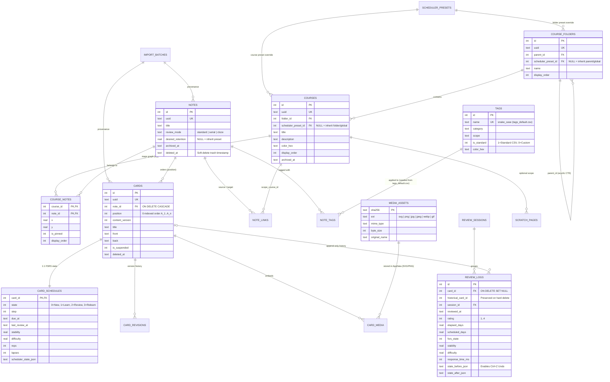

# 02 — Auditoría del Esquema SQL, Diseño SQLite v2 y Capa de Persistencia

> [!IMPORTANT]
> Este documento contiene la **revisión técnica completa** de la propuesta original [`specZ/old/morphism_srs_schema.sql`](file:///c:/repos/Morphism%20SRS%20proto2/specZ/old/morphism_srs_schema.sql) contrastada contra los requerimientos de [`specZ/old/Future_version.md`](file:///c:/repos/Morphism%20SRS%20proto2/specZ/old/Future_version.md) y las decisiones arquitectónicas del autor, seguida del **Esquema SQLite v2 Definitivo**, diagramas Entidad-Relación, consultas críticas optimizadas y el protocolo de migración desde el Prototipo 1.

---

## 1. Auditoría Técnica de `morphism_srs_schema.sql` (Propuesta v1) y Decisiones v2

### 1.1 Aciertos Fundamentales de la Propuesta v1 (Se Mantienen)
La propuesta inicial en [`specZ/old/morphism_srs_schema.sql`](file:///c:/repos/Morphism%20SRS%20proto2/specZ/old/morphism_srs_schema.sql) tiene una base relacional excelente que resuelve varios problemas del Prototipo 1:
1. **Uso de tablas `STRICT` y `PRAGMA journal_mode = WAL`**: Garantiza tipado fuerte en SQLite $\ge 3.38$ y lecturas concurrentes sin bloqueos.
2. **Separación de Notas (`notes`) y Membresía en Cursos (`course_notes`)**: Las coordenadas espaciales `(x, y)` viven en `course_notes(course_id, note_id)` y no en `notes`. Esto permite que un mismo teorema o definición (ej. *Desigualdad de Hölder*) pertenezca simultáneamente a *Análisis Real* y a *Ecuaciones Diferenciales Parciales* con distintas posiciones en el grafo de cada curso, compartiendo el mismo estado de memoria FSRS.
3. **Separación entre Estado Mutable (`card_schedules`) e Historial Inmutable (`review_logs`)**: Permite recalcular FSRS en cualquier momento y ejecutar **`Ctrl+Z` (Undo Rating)** sin destruir ni corromper la evidencia histórica de estudio.
4. **Historial de Versiones de Contenido (`card_revisions`)**: Incrementar `content_version` al editar una tarjeta permite correlacionar `review_logs` antiguos con la formulación exacta que tenía la pregunta en ese momento.

---

### 1.2 Los 10 Problemas Detectados en `morphism_srs_schema.sql` y Decisiones Arquitectónicas v2

Al cruzar [`specZ/old/morphism_srs_schema.sql`](file:///c:/repos/Morphism%20SRS%20proto2/specZ/old/morphism_srs_schema.sql) con [`specZ/old/Future_version.md`](file:///c:/repos/Morphism%20SRS%20proto2/specZ/old/Future_version.md) y con las revisiones de diseño, identificamos **10 puntos arquitectónicos críticos** que se corrigen en el esquema v2:

#### Problema 1: Conflicto entre `ON DELETE RESTRICT` y el Borrado Masivo de Notas (`Future_version.md` #31)
- **En v1**:
  - `cards.note_id REFERENCES notes(id) ON DELETE RESTRICT` (línea 83)
  - `note_links.source_note_id REFERENCES notes(id) ON DELETE RESTRICT` (línea 127)
  - `review_logs.card_id REFERENCES cards(id) ON DELETE RESTRICT` (línea 193)
- **Por qué falla**: En `Future_version.md` se pide explícitamente: *"Selección masiva de notas dentro del browser (esp. para borrar en masa)"*. Con `ON DELETE RESTRICT` en `cards`, `note_links` y `review_logs`:
  1. Ejecutar `DELETE FROM notes WHERE id IN (...)` lanzará inmediatamente `sqlite3.IntegrityError: FOREIGN KEY constraint failed`.
  2. Incluso si la aplicación intenta borrar primero las `cards`, si **cualquiera** de las tarjetas seleccionadas fue repasada al menos una vez en la historia, `review_logs` bloqueará el borrado con otro `FOREIGN KEY constraint failed`.
- **Solución en v2 (Doble Nivel: Papelera / Archival Reversible con `Ctrl+Z` + Hard Delete Limpio)**:
  1. `cards.note_id` y `note_links.(source_note_id, target_note_id)` cambian a **`ON DELETE CASCADE`**: si se elimina físicamente una nota, sus tarjetas y aristas asociadas se limpian automáticamente sin errores de integridad.
  2. En `review_logs`, `card_id` cambia a **`INTEGER REFERENCES cards(id) ON DELETE SET NULL`** añadiendo `historical_card_id INTEGER NOT NULL`. De esta forma:
     - **Borrado Estándar (Soft Delete / Papelera)**: Marca `notes.deleted_at = now` y `cards.deleted_at = now`, ocultándolas de la UI pero permitiendo revertir con **`Ctrl+Z`** en `< 5 ms`.
     - **Borrado Permanente (Hard Delete / Purga de Notas Erróneas)**: Ejecuta `DELETE FROM notes WHERE id IN (...)` en una sola sentencia SQL limpia; `cards` y `note_links` caen en cascada, y `review_logs` conserva los registros estadísticos del calendario anual con `card_id = NULL` y `historical_card_id = <id>`, sin jamás lanzar errores de clave foránea.

#### Problema 2: Configuración y Optimización de FSRS a Nivel Global y de Carpeta (`course_folders`)
- **En v1**: `notes` tenía `desired_retention REAL NOT NULL DEFAULT 0.85` heredado de *Joint Retrievability*, pero no existía tabla para almacenar los pesos optimizados de FSRS (`w`) ni heredarlos por jerarquía de carpetas.
- **Solución en v2**:
  1. Se añade la tabla **`scheduler_presets`** (con `id`, `uuid`, `name`, `desired_retention`, `maximum_interval_days`, `weights_json`, `enable_fuzzing`, `learning_steps_json`, `relearning_steps_json`).
  2. Tanto **`course_folders`** como **`courses`** referencian `scheduler_preset_id INTEGER REFERENCES scheduler_presets(id) ON DELETE SET NULL`.
  3. **Cadena de Herencia FSRS**:
     $$\text{Nota (`desired\_retention`)} \longrightarrow \text{Curso (`scheduler\_preset\_id`)} \longrightarrow \text{Carpeta Padre recursiva (`course\_folders`)} \longrightarrow \text{Preset Global (`id = 1`)}$$
     Así, el usuario puede optimizar los pesos de FSRS a **nivel Global** o para toda una **Carpeta** (ej. *Matemáticas Puras* vs *Física*), sin tener que configurar curso por curso.

#### Problema 3: Ausencia de Tablas para Imágenes y Diagramas Vectoriales SVG en `AppData` (`Future_version.md` #27, #29)
- **En v1**: No existía ninguna tabla que registrara los archivos multimedia de los cursos.
- **Solución en v2**: Se añaden las tablas **`media_assets`** (clave primaria `sha256`, `ext CHECK (ext IN ('svg', 'png', 'jpg', 'jpeg', 'webp', 'gif'))`, `mime_type`, `byte_size`, `original_name`, `created_at`) y **`card_media`** (`card_id`, `media_sha256` con `ON DELETE CASCADE` hacia `cards` y `ON DELETE RESTRICT` hacia `media_assets`). Esto permite exportar paquetes `.mpkg` con todos sus diagramas conmutativos `.svg` e imágenes `.png` sin escanear HTML con expresiones regulares, y recolectar archivos huérfanos de forma segura.

#### Problema 4: Falta de Columnas Indexadas de Estado en `card_schedules`
- **En v1**: `card_schedules` guardaba `due_at`, `last_review_at`, `stability`, `difficulty` y `scheduler_state_json`, pero no tenía columnas explícitas para `state` (`0=New, 1=Learning, 2=Review, 3=Relearning`), `step`, `reps` ni `lapses`.
- **Por qué falla**: Filtrar en el Browser o contar en el grafo cuántas tarjetas están en estado `New` o son `leeches` (`lapses >= 3`) obligaría a SQLite a deserializar `scheduler_state_json` en miles de filas.
- **Solución en v2**: Se añaden columnas explícitas e indexadas (`state`, `step`, `reps`, `lapses`) y el índice compuesto `ix_card_schedules_state_due ON card_schedules(state, due_at)`.

#### Problema 5: Ausencia de Búsqueda de Texto Completo (`FTS5`) para el Browser (`Future_version.md` #31)
- **En v1**: Buscar texto dentro de `cards.title`, `cards.front` o `cards.back` requeriría `LIKE '%termino%'` (*full table scan*).
- **Solución en v2**: Se incluye la tabla virtual **`cards_fts` (`USING fts5`)** sincronizada automáticamente mediante triggers `AFTER INSERT / UPDATE / DELETE` sobre `cards`.

#### Problema 6: Ausencia de Tabla para el Scratchbook y Borradores DSL (`scratch_pages`)
- **En v1**: El Scratchbook seguía fuera de SQLite (archivos `.txt` sueltos).
- **Solución en v2**: Se añade la tabla **`scratch_pages`** en SQLite, soportando páginas `'html_math'` o `'dsl_script'`, vinculables opcionalmente a un `course_id`.

#### Problema 7: Deprecación Total de `ProofSequenceCard` (`card_steps`), `card_type` y Extensión a `standard | serial | cloze`
- **En v1**: Existía duplicación (spaghetti code) entre:
  1. Una tarjeta con `card_type = 'proof_sequence'` cuyos pasos vivían en `card_steps` (compartiendo un único horario FSRS para toda la demostración), y
  2. Una nota con `review_mode IN ('serial_sequence', 'serial_sequence_single')` donde cada paso era una fila en `cards`.
- **Decisión Arquitectónica Definitiva en v2**:
  - **Se elimina por completo `card_type`** de `cards` y **se elimina la tabla `card_steps`**.
  - Toda tarjeta en Morphism SRS es simplemente una **`card` atómica** compuesta por `(title, front, back)` con su propio horario FSRS en `card_schedules`. Una tarjeta jamás sabe si pertenece a una nota estándar, serial o cloze.
  - La **Nota (`notes`)** define exclusivamente el modelo de condicionamiento pedagógico mediante `review_mode`:
    ```sql
    review_mode TEXT NOT NULL DEFAULT 'standard' CHECK (review_mode IN ('standard', 'serial', 'cloze'))
    ```
    - **`standard`**: Tarjetas evaluadas marginalmente de forma independiente, $P(A_i)$.
    - **`serial`**: Demostración paso a paso donde cada paso $A_i$ se evalúa condicionado en los pasos anteriores, $P(A_i \mid A_1, \dots, A_{i-1})$.
    - **`cloze`**: Estructura conceptual donde cada tarjeta $A_i$ se evalúa mostrando como contexto todas las demás tarjetas de la nota, $P(A_i \mid \{A_j : j \ne i\})$.

#### Problema 8: Eliminación de `content_kind` Arbitrario y Catálogo Externo de 2,000 Tags (`specZ/tags_default.csv`)
- **En v1**: `notes` forzaba una columna `content_kind CHECK (content_kind IN ('concept', 'definition', 'theorem', ...))`, lo cual era rígido y redundante con el sistema de etiquetas.
- **Decisión Arquitectónica en v2**:
  1. **Se elimina la columna `content_kind`** de `notes`.
  2. **Unificación con Tags Estandarizados**: La clasificación epistemológica y temática se realiza íntegramente mediante las tablas `tags` y `note_tags`.
  3. **Catálogo Estándar en CSV (`specZ/tags_default.csv`)**: Para evitar falta de estandarización entre usuarios (`#teor`, `#teorema`, `#theorem`), el proyecto define en [`specZ/tags_default.csv`](file:///c:/repos/Morphism%20SRS%20proto2/specZ/tags_default.csv) un catálogo curado y podado computacionalmente de **2,000 tags estándar en inglés bajo formato `name_of_tag_with_underscores`** (`definition`, `theorem`, `lemma`, `corollary`, `proof`, `counterexample`, `abstract_algebra`, `real_analysis`, `algebraic_topology`, `category_theory`, etc.).
  4. **DDL Limpio**: Las etiquetas estándar **no** se escriben hardcodeadas en el archivo `.sql`; el inicializador de base de datos (`database.py`) lee `tags_default.csv` al crear la base de datos e inserta las filas con `is_standard = 1`.

#### Problema 9: Identificadores Universales (`uuid`) y `sync_oplog` para Compartir Mazos y Sincronizar con Móvil
- **En v1**: Las tablas usaban únicamente `id INTEGER PRIMARY KEY` secuenciales, lo que causaría colisiones de claves al importar o actualizar un mazo compartido entre dos usuarios o al sincronizar con un teléfono.
- **Solución en v2**:
  - Todas las entidades principales (`scheduler_presets`, `import_batches`, `course_folders`, `courses`, `notes`, `cards`, `note_links`, `review_sessions`, `scratch_pages`) incorporan una columna **`uuid TEXT NOT NULL UNIQUE`** (UUID v4 canónico), manteniendo `id INTEGER PRIMARY KEY` para velocidad máxima en JOINs locales y `FTS5`.
  - Se añade la tabla **`sync_oplog`** que registra mutaciones por `entity_uuid` para sincronización diferencial libre de colisiones.

#### Problema 10: Nomenclatura Clara (`display_order` en vez de `sort_order`), Prevención de Ciclos en Carpetas y Triggers
- **En v1**: La columna `sort_order` podía confundirse con la dirección de ordenamiento (`ASC`/`DESC`), faltaba prevención automática de ciclos en `course_folders` y faltaba inicialización automática de `card_schedules`.
- **Solución en v2**:
  - Se renombra `sort_order` a **`display_order`** en `course_folders`, `courses`, `course_notes` y `scratch_pages`.
  - Se incluye el trigger recursivo `trg_course_folders_prevent_cycles` (`WITH RECURSIVE` CTE) que aborta cualquier intento de crear un ciclo en la jerarquía de carpetas.
  - Se incluye el trigger `trg_cards_init_schedule` que crea automáticamente la fila inicial en `card_schedules` al insertar cualquier `card`.

---

## 2. Diagrama Entidad-Relación Completo (Esquema SQLite v2)



---

## 3. Especificación Completa del DDL SQLite v2 (`schema_v2.sql`)

A continuación se presenta el esquema SQL completo, corregido y verificado para **Morphism SRS Prototype 2** (requiere SQLite $\ge 3.38$, incluido por defecto en Python 3.11–3.13):

```sql
-- ============================================================================
-- Morphism SRS Prototype 2 — Canonical SQLite Schema (Version 2 Refined)
-- Target: SQLite >= 3.38 (STRICT tables, JSON functions, FTS5, Recursive CTEs)
-- ============================================================================

-- Connection-level PRAGMAs (Execute on EVERY connection open in database.py):
PRAGMA foreign_keys = ON;
PRAGMA busy_timeout = 5000;
PRAGMA synchronous = NORMAL;
-- Database-level PRAGMA (Execute once outside transaction when initializing DB):
-- PRAGMA journal_mode = WAL;

BEGIN;

-- ----------------------------------------------------------------------------
-- 1. SCHEDULER PRESETS (Global, Folder-Level, or Course-Level FSRS Config)
-- ----------------------------------------------------------------------------
CREATE TABLE scheduler_presets (
    id                      INTEGER PRIMARY KEY,
    uuid                    TEXT NOT NULL UNIQUE,
    name                    TEXT NOT NULL COLLATE NOCASE UNIQUE CHECK (length(trim(name)) > 0),
    scheduler_name          TEXT NOT NULL DEFAULT 'fsrs',
    scheduler_version       TEXT NOT NULL DEFAULT '5.0',
    desired_retention       REAL NOT NULL DEFAULT 0.85 CHECK (desired_retention >= 0.70 AND desired_retention <= 0.99),
    maximum_interval_days   INTEGER NOT NULL DEFAULT 36500 CHECK (maximum_interval_days >= 1),
    enable_fuzzing          INTEGER NOT NULL DEFAULT 1 CHECK (enable_fuzzing IN (0, 1)),
    learning_steps_json     TEXT NOT NULL DEFAULT '[1, 10]' CHECK (json_valid(learning_steps_json)),
    relearning_steps_json   TEXT NOT NULL DEFAULT '[10]' CHECK (json_valid(relearning_steps_json)),
    weights_json            TEXT NOT NULL DEFAULT '[]' CHECK (json_valid(weights_json)),
    created_at              TEXT NOT NULL DEFAULT (strftime('%Y-%m-%dT%H:%M:%fZ','now')),
    updated_at              TEXT NOT NULL DEFAULT (strftime('%Y-%m-%dT%H:%M:%fZ','now'))
) STRICT;

-- Insert Global Default Preset (ID = 1)
INSERT INTO scheduler_presets (id, uuid, name, desired_retention)
VALUES (1, '00000000-0000-0000-0000-000000000001', 'Global Default (R=85%)', 0.85);

-- ----------------------------------------------------------------------------
-- 2. IMPORT PROVENANCE (AI / DSL / Package Batches)
-- ----------------------------------------------------------------------------
CREATE TABLE import_batches (
    id                      INTEGER PRIMARY KEY,
    uuid                    TEXT NOT NULL UNIQUE,
    source                  TEXT NOT NULL DEFAULT 'manual'
                            CHECK (source IN ('manual', 'dsl', 'ai_json', 'mpkg', 'proto1_migration', 'seed')),
    label                   TEXT NOT NULL DEFAULT '',
    model_name              TEXT,
    source_text             TEXT, -- Stores raw .mdsl script if compiled via DSL Compiler
    metadata_json           TEXT NOT NULL DEFAULT '{}' CHECK (json_valid(metadata_json)),
    created_at              TEXT NOT NULL DEFAULT (strftime('%Y-%m-%dT%H:%M:%fZ','now'))
) STRICT;

-- ----------------------------------------------------------------------------
-- 3. COURSE FOLDERS (Nested Hierarchy) & COURSES
-- ----------------------------------------------------------------------------
CREATE TABLE course_folders (
    id                      INTEGER PRIMARY KEY,
    uuid                    TEXT NOT NULL UNIQUE,
    parent_id               INTEGER REFERENCES course_folders(id) ON DELETE RESTRICT,
    scheduler_preset_id     INTEGER REFERENCES scheduler_presets(id) ON DELETE SET NULL,
    name                    TEXT NOT NULL CHECK (length(trim(name)) > 0),
    display_order           INTEGER NOT NULL DEFAULT 0,
    created_at              TEXT NOT NULL DEFAULT (strftime('%Y-%m-%dT%H:%M:%fZ','now')),
    updated_at              TEXT NOT NULL DEFAULT (strftime('%Y-%m-%dT%H:%M:%fZ','now')),
    CHECK (parent_id IS NULL OR parent_id <> id)
) STRICT;

CREATE UNIQUE INDEX uq_folder_siblings
    ON course_folders(coalesce(parent_id, -1), name COLLATE NOCASE);

-- Enforce strict acyclicity in course_folders via Recursive CTE Trigger
CREATE TRIGGER trg_course_folders_prevent_cycles
BEFORE UPDATE OF parent_id ON course_folders
WHEN NEW.parent_id IS NOT NULL
BEGIN
    SELECT RAISE(ABORT, 'Cycle detected in course_folders hierarchy')
    WHERE EXISTS (
        WITH RECURSIVE ancestors(fid) AS (
            SELECT NEW.parent_id
            UNION ALL
            SELECT cf.parent_id FROM course_folders cf
            JOIN ancestors a ON cf.id = a.fid
            WHERE cf.parent_id IS NOT NULL
        )
        SELECT 1 FROM ancestors WHERE fid = OLD.id
    );
END;

CREATE TABLE courses (
    id                      INTEGER PRIMARY KEY,
    uuid                    TEXT NOT NULL UNIQUE,
    folder_id               INTEGER REFERENCES course_folders(id) ON DELETE SET NULL,
    -- NULL means inherit from parent folder (or Global Default ID=1 if no folder defines one):
    scheduler_preset_id     INTEGER REFERENCES scheduler_presets(id) ON DELETE SET NULL,
    title                   TEXT NOT NULL CHECK (length(trim(title)) > 0),
    description             TEXT NOT NULL DEFAULT '',
    color_hex               TEXT NOT NULL DEFAULT '#6366f1',
    display_order           INTEGER NOT NULL DEFAULT 0,
    archived_at             TEXT,
    created_at              TEXT NOT NULL DEFAULT (strftime('%Y-%m-%dT%H:%M:%fZ','now')),
    updated_at              TEXT NOT NULL DEFAULT (strftime('%Y-%m-%dT%H:%M:%fZ','now'))
) STRICT;

CREATE UNIQUE INDEX uq_course_names_in_folder
    ON courses(coalesce(folder_id, -1), title COLLATE NOCASE);

-- ----------------------------------------------------------------------------
-- 4. NOTES & COURSE MEMBERSHIP (GRAPH NODES)
-- ----------------------------------------------------------------------------
CREATE TABLE notes (
    id                      INTEGER PRIMARY KEY,
    uuid                    TEXT NOT NULL UNIQUE,
    title                   TEXT NOT NULL CHECK (length(trim(title)) > 0),
    -- 3 Epistemic Conditioning Modes:
    -- 'standard' : P(A_i) independent evaluation
    -- 'serial'   : P(A_i | A_1, ..., A_{i-1}) sequential proof chain
    -- 'cloze'    : P(A_i | {A_j : j != i}) holistic contextual occlusion
    review_mode             TEXT NOT NULL DEFAULT 'standard'
                            CHECK (review_mode IN ('standard', 'serial', 'cloze')),
    -- NULL means inherit desired_retention from the resolved Course/Folder/Global scheduler_preset.
    desired_retention       REAL CHECK (desired_retention IS NULL OR (desired_retention >= 0.70 AND desired_retention <= 0.99)),
    import_batch_id         INTEGER REFERENCES import_batches(id) ON DELETE SET NULL,
    archived_at             TEXT,
    deleted_at              TEXT, -- Non-null when in Trash (Soft Delete, reversible via Ctrl+Z)
    created_at              TEXT NOT NULL DEFAULT (strftime('%Y-%m-%dT%H:%M:%fZ','now')),
    updated_at              TEXT NOT NULL DEFAULT (strftime('%Y-%m-%dT%H:%M:%fZ','now'))
) STRICT;

CREATE INDEX ix_notes_active ON notes(deleted_at, archived_at);
CREATE INDEX ix_notes_mode ON notes(review_mode);
CREATE INDEX ix_notes_import_batch ON notes(import_batch_id);

-- Notes are reusable across multiple courses; (x, y) canvas coordinates belong to the course mapping.
CREATE TABLE course_notes (
    course_id               INTEGER NOT NULL REFERENCES courses(id) ON DELETE CASCADE,
    note_id                 INTEGER NOT NULL REFERENCES notes(id) ON DELETE CASCADE,
    x                       REAL NOT NULL DEFAULT 0.0,
    y                       REAL NOT NULL DEFAULT 0.0,
    is_pinned               INTEGER NOT NULL DEFAULT 0 CHECK (is_pinned IN (0, 1)),
    display_order           INTEGER NOT NULL DEFAULT 0,
    added_at                TEXT NOT NULL DEFAULT (strftime('%Y-%m-%dT%H:%M:%fZ','now')),
    PRIMARY KEY (course_id, note_id)
) STRICT;

CREATE INDEX ix_course_notes_by_note ON course_notes(note_id);
CREATE INDEX ix_course_notes_order ON course_notes(course_id, display_order, note_id);

-- ----------------------------------------------------------------------------
-- 5. ATOMIC CARDS & REVISION SNAPSHOTS (No redundant card_type or card_steps)
-- ----------------------------------------------------------------------------
CREATE TABLE cards (
    id                      INTEGER PRIMARY KEY,
    uuid                    TEXT NOT NULL UNIQUE,
    note_id                 INTEGER NOT NULL REFERENCES notes(id) ON DELETE CASCADE,
    position                INTEGER NOT NULL DEFAULT 0 CHECK (position >= 0),
    content_version         INTEGER NOT NULL DEFAULT 1 CHECK (content_version >= 1),
    title                   TEXT NOT NULL DEFAULT '',
    front                   TEXT NOT NULL DEFAULT '',
    back                    TEXT NOT NULL DEFAULT '',
    import_batch_id         INTEGER REFERENCES import_batches(id) ON DELETE SET NULL,
    is_suspended            INTEGER NOT NULL DEFAULT 0 CHECK (is_suspended IN (0, 1)),
    archived_at             TEXT,
    deleted_at              TEXT,
    created_at              TEXT NOT NULL DEFAULT (strftime('%Y-%m-%dT%H:%M:%fZ','now')),
    updated_at              TEXT NOT NULL DEFAULT (strftime('%Y-%m-%dT%H:%M:%fZ','now'))
) STRICT;

CREATE INDEX ix_cards_note_position ON cards(note_id, position, id);
CREATE INDEX ix_cards_active ON cards(deleted_at, is_suspended);
CREATE INDEX ix_cards_import_batch ON cards(import_batch_id);

CREATE TABLE card_revisions (
    card_id                 INTEGER NOT NULL REFERENCES cards(id) ON DELETE CASCADE,
    version                 INTEGER NOT NULL CHECK (version >= 1),
    title                   TEXT NOT NULL,
    front                   TEXT NOT NULL,
    back                    TEXT NOT NULL,
    recorded_at             TEXT NOT NULL DEFAULT (strftime('%Y-%m-%dT%H:%M:%fZ','now')),
    PRIMARY KEY (card_id, version)
) STRICT;

-- ----------------------------------------------------------------------------
-- 6. FULL-TEXT SEARCH (FTS5) FOR INSTANT BROWSER SEARCH
-- ----------------------------------------------------------------------------
CREATE VIRTUAL TABLE cards_fts USING fts5(
    title,
    front,
    back,
    content='cards',
    content_rowid='id',
    tokenize='unicode61 remove_diacritics 2'
);

CREATE TRIGGER trg_cards_fts_insert AFTER INSERT ON cards BEGIN
    INSERT INTO cards_fts(rowid, title, front, back)
    VALUES (NEW.id, NEW.title, NEW.front, NEW.back);
END;

CREATE TRIGGER trg_cards_fts_delete AFTER DELETE ON cards BEGIN
    INSERT INTO cards_fts(cards_fts, rowid, title, front, back)
    VALUES ('delete', OLD.id, OLD.title, OLD.front, OLD.back);
END;

CREATE TRIGGER trg_cards_fts_update AFTER UPDATE OF title, front, back ON cards BEGIN
    INSERT INTO cards_fts(cards_fts, rowid, title, front, back)
    VALUES ('delete', OLD.id, OLD.title, OLD.front, OLD.back);
    INSERT INTO cards_fts(rowid, title, front, back)
    VALUES (NEW.id, NEW.title, NEW.front, NEW.back);
END;

-- ----------------------------------------------------------------------------
-- 7. GRAPH EDGES (NOTE LINKS) & STANDARDIZED TAGS
-- ----------------------------------------------------------------------------
CREATE TABLE note_links (
    id                      INTEGER PRIMARY KEY,
    uuid                    TEXT NOT NULL UNIQUE,
    source_note_id          INTEGER NOT NULL REFERENCES notes(id) ON DELETE CASCADE,
    target_note_id          INTEGER NOT NULL REFERENCES notes(id) ON DELETE CASCADE,
    scope_course_id         INTEGER REFERENCES courses(id) ON DELETE CASCADE,
    relation_type           TEXT NOT NULL DEFAULT 'prerequisite'
                            CHECK (relation_type IN ('prerequisite', 'related', 'uses', 'generalizes', 'interferes')),
    label                   TEXT NOT NULL DEFAULT '',
    strength                REAL CHECK (strength IS NULL OR (strength >= 0.0 AND strength <= 1.0)),
    created_at              TEXT NOT NULL DEFAULT (strftime('%Y-%m-%dT%H:%M:%fZ','now')),
    CHECK (source_note_id <> target_note_id),
    FOREIGN KEY (scope_course_id, source_note_id)
        REFERENCES course_notes(course_id, note_id) ON DELETE CASCADE,
    FOREIGN KEY (scope_course_id, target_note_id)
        REFERENCES course_notes(course_id, note_id) ON DELETE CASCADE
) STRICT;

CREATE UNIQUE INDEX uq_note_links_scope_relation
    ON note_links(source_note_id, target_note_id, relation_type, coalesce(scope_course_id, -1));
CREATE INDEX ix_links_target ON note_links(target_note_id);
CREATE INDEX ix_links_by_course ON note_links(scope_course_id);

CREATE TABLE tags (
    id                      INTEGER PRIMARY KEY,
    name                    TEXT NOT NULL COLLATE NOCASE UNIQUE CHECK (length(trim(name)) > 0),
    category                TEXT NOT NULL DEFAULT 'custom',
    scope                   TEXT NOT NULL DEFAULT 'user',
    is_standard             INTEGER NOT NULL DEFAULT 0 CHECK (is_standard IN (0, 1)),
    color_hex               TEXT NOT NULL DEFAULT '#38bdf8'
) STRICT;

-- NOTE: The 2,000 standard scientific/epistemic tags in English snake_case format
-- are NOT hardcoded in this DDL. They are seeded automatically on database initialization
-- from `specZ/tags_default.csv` (with `is_standard = 1`).

CREATE TABLE note_tags (
    note_id                 INTEGER NOT NULL REFERENCES notes(id) ON DELETE CASCADE,
    tag_id                  INTEGER NOT NULL REFERENCES tags(id) ON DELETE CASCADE,
    PRIMARY KEY (note_id, tag_id)
) STRICT;

CREATE INDEX ix_note_tags_tag ON note_tags(tag_id);

-- ----------------------------------------------------------------------------
-- 8. MEDIA VAULT (NATIVE SVG, PNG, WEBP ASSETS IN APPDATA)
-- ----------------------------------------------------------------------------
CREATE TABLE media_assets (
    sha256                  TEXT PRIMARY KEY CHECK (length(sha256) = 64),
    ext                     TEXT NOT NULL CHECK (ext IN ('svg', 'png', 'jpg', 'jpeg', 'webp', 'gif')),
    mime_type               TEXT NOT NULL DEFAULT 'image/png',
    byte_size               INTEGER NOT NULL CHECK (byte_size >= 0),
    original_name           TEXT NOT NULL DEFAULT '',
    created_at              TEXT NOT NULL DEFAULT (strftime('%Y-%m-%dT%H:%M:%fZ','now'))
) STRICT;

CREATE TABLE card_media (
    card_id                 INTEGER NOT NULL REFERENCES cards(id) ON DELETE CASCADE,
    media_sha256            TEXT NOT NULL REFERENCES media_assets(sha256) ON DELETE RESTRICT,
    PRIMARY KEY (card_id, media_sha256)
) STRICT;

CREATE INDEX ix_card_media_sha256 ON card_media(media_sha256);

-- ----------------------------------------------------------------------------
-- 9. FSRS SCHEDULING STATE & APPEND-ONLY REVIEW LOGS
-- ----------------------------------------------------------------------------
CREATE TABLE card_schedules (
    card_id                 INTEGER PRIMARY KEY REFERENCES cards(id) ON DELETE CASCADE,
    scheduler_name          TEXT NOT NULL DEFAULT 'fsrs',
    scheduler_version       TEXT NOT NULL DEFAULT '5.0',
    -- Explicit indexed state columns for fast SQL filtering:
    -- 0 = New, 1 = Learning, 2 = Review, 3 = Relearning
    state                   INTEGER NOT NULL DEFAULT 0 CHECK (state IN (0, 1, 2, 3)),
    step                    INTEGER NOT NULL DEFAULT 0 CHECK (step >= 0),
    due_at                  TEXT, -- UTC ISO-8601 (NULL or <= now when New/Due)
    last_review_at          TEXT, -- UTC ISO-8601 (NULL when state = 0 New)
    stability               REAL,
    difficulty              REAL,
    reps                    INTEGER NOT NULL DEFAULT 0 CHECK (reps >= 0),
    lapses                  INTEGER NOT NULL DEFAULT 0 CHECK (lapses >= 0),
    scheduler_state_json    TEXT NOT NULL DEFAULT '{}' CHECK (json_valid(scheduler_state_json)),
    updated_at              TEXT NOT NULL DEFAULT (strftime('%Y-%m-%dT%H:%M:%fZ','now'))
) STRICT;

CREATE INDEX ix_card_schedules_state_due ON card_schedules(state, due_at);
CREATE INDEX ix_card_schedules_due ON card_schedules(due_at);

-- Automatically initialize a card_schedules row whenever a new card is inserted
CREATE TRIGGER trg_cards_init_schedule AFTER INSERT ON cards BEGIN
    INSERT OR IGNORE INTO card_schedules (card_id, state, step, due_at)
    VALUES (NEW.id, 0, 0, NEW.created_at);
END;

CREATE TABLE review_sessions (
    id                      INTEGER PRIMARY KEY,
    uuid                    TEXT NOT NULL UNIQUE,
    course_id               INTEGER REFERENCES courses(id) ON DELETE SET NULL,
    note_id                 INTEGER REFERENCES notes(id) ON DELETE SET NULL,
    mode                    TEXT NOT NULL DEFAULT 'standard',
    device_id               TEXT NOT NULL DEFAULT 'desktop',
    started_at              TEXT NOT NULL DEFAULT (strftime('%Y-%m-%dT%H:%M:%fZ','now')),
    ended_at                TEXT
) STRICT;

CREATE INDEX ix_sessions_note_time ON review_sessions(note_id, started_at);

CREATE TABLE review_logs (
    id                      INTEGER PRIMARY KEY,
    -- Nullable on hard-delete of a card so historical heatmap stats are never lost or blocked:
    card_id                 INTEGER REFERENCES cards(id) ON DELETE SET NULL,
    historical_card_id      INTEGER NOT NULL, -- Always stores original card_id
    session_id              INTEGER REFERENCES review_sessions(id) ON DELETE SET NULL,
    reviewed_at             TEXT NOT NULL,    -- Canonical UTC ISO-8601
    rating                  INTEGER NOT NULL CHECK (rating BETWEEN 1 AND 4),
    elapsed_days            REAL,             -- Fractional days supported for intraday accuracy
    scheduled_days          REAL,
    fsrs_state              INTEGER,
    stability               REAL,
    difficulty              REAL,
    scheduler_name          TEXT NOT NULL DEFAULT 'fsrs',
    scheduler_version       TEXT,
    card_content_version    INTEGER NOT NULL DEFAULT 1 CHECK (card_content_version >= 1),
    sequence_position       INTEGER CHECK (sequence_position IS NULL OR sequence_position >= 0),
    response_time_ms        INTEGER CHECK (response_time_ms IS NULL OR response_time_ms >= 0),
    state_before_json       TEXT CHECK (state_before_json IS NULL OR json_valid(state_before_json)),
    state_after_json        TEXT CHECK (state_after_json IS NULL OR json_valid(state_after_json))
) STRICT;

CREATE INDEX ix_logs_card_time ON review_logs(card_id, reviewed_at);
CREATE INDEX ix_logs_hist_card_time ON review_logs(historical_card_id, reviewed_at);
CREATE INDEX ix_logs_session ON review_logs(session_id);
CREATE INDEX ix_logs_time ON review_logs(reviewed_at);

-- ----------------------------------------------------------------------------
-- 10. SCRATCHBOOK & DSL STUDIO PAGES
-- ----------------------------------------------------------------------------
CREATE TABLE scratch_pages (
    id                      INTEGER PRIMARY KEY,
    uuid                    TEXT NOT NULL UNIQUE,
    course_id               INTEGER REFERENCES courses(id) ON DELETE SET NULL,
    title                   TEXT NOT NULL COLLATE NOCASE UNIQUE CHECK (length(trim(title)) > 0),
    page_mode               TEXT NOT NULL DEFAULT 'html_math'
                            CHECK (page_mode IN ('html_math', 'dsl_script')),
    body                    TEXT NOT NULL DEFAULT '',
    display_order           INTEGER NOT NULL DEFAULT 0,
    created_at              TEXT NOT NULL DEFAULT (strftime('%Y-%m-%dT%H:%M:%fZ','now')),
    updated_at              TEXT NOT NULL DEFAULT (strftime('%Y-%m-%dT%H:%M:%fZ','now'))
) STRICT;

-- ----------------------------------------------------------------------------
-- 11. MOBILE & PEER SYNC OPLOG
-- ----------------------------------------------------------------------------
CREATE TABLE sync_oplog (
    seq_id                  INTEGER PRIMARY KEY AUTOINCREMENT,
    entity_table            TEXT NOT NULL,
    entity_uuid             TEXT NOT NULL,
    operation               TEXT NOT NULL CHECK (operation IN ('UPSERT', 'DELETE')),
    device_id               TEXT NOT NULL DEFAULT 'desktop',
    changed_at              TEXT NOT NULL DEFAULT (strftime('%Y-%m-%dT%H:%M:%fZ','now'))
) STRICT;

CREATE INDEX ix_sync_oplog_seq ON sync_oplog(seq_id);

PRAGMA user_version = 2;
COMMIT;
```

---

## 4. Consultas SQL Críticas y Patrones Transaccionales

### 4.1 Consulta Instantánea de Estado de Nodos para `GraphExplorerView` (`< 2 ms`)
Gracias a las columnas explícitas en `card_schedules`, el estado completo de todos los nodos de un curso (modo de revisión para elegir rectángulo/rombo/elipse, total de tarjetas, cuántas vencidas y estabilidad mínima) se obtiene en **una sola consulta SQL** sin deserializar JSONs en Python:

```sql
SELECT
    n.id AS note_id,
    n.uuid AS note_uuid,
    n.title,
    n.review_mode,
    cn.x,
    cn.y,
    cn.is_pinned,
    COUNT(c.id) AS total_cards,
    SUM(CASE
        WHEN c.id IS NOT NULL AND c.is_suspended = 0
             AND (cs.state = 0 OR cs.due_at <= :now_utc)
        THEN 1 ELSE 0
    END) AS due_cards_count,
    MIN(cs.stability) AS min_stability
FROM course_notes cn
JOIN notes n ON n.id = cn.note_id
LEFT JOIN cards c ON c.note_id = n.id AND c.deleted_at IS NULL AND c.archived_at IS NULL
LEFT JOIN card_schedules cs ON cs.card_id = c.id
WHERE cn.course_id = :course_id
  AND n.deleted_at IS NULL
  AND n.archived_at IS NULL
GROUP BY n.id, n.uuid, n.title, n.review_mode, cn.x, cn.y, cn.is_pinned
ORDER BY cn.display_order, n.id;
```

### 4.2 Resolución Jerárquica del Preset FSRS (`Curso -> Carpetas Ancestro -> Global`)
Para obtener el `scheduler_preset` efectivo de cualquier curso (heredando de la carpeta más cercana que defina uno, o del preset Global `id = 1`):

```sql
WITH RECURSIVE folder_chain(fid, preset_id, depth) AS (
    SELECT cf.parent_id, cf.scheduler_preset_id, 1
    FROM courses c
    JOIN course_folders cf ON cf.id = c.folder_id
    WHERE c.id = :course_id
    UNION ALL
    SELECT cf.parent_id, cf.scheduler_preset_id, fc.depth + 1
    FROM course_folders cf
    JOIN folder_chain fc ON cf.id = fc.fid
    WHERE fc.fid IS NOT NULL
)
SELECT sp.*
FROM scheduler_presets sp
WHERE sp.id = COALESCE(
    (SELECT scheduler_preset_id FROM courses WHERE id = :course_id AND scheduler_preset_id IS NOT NULL),
    (SELECT preset_id FROM folder_chain WHERE preset_id IS NOT NULL ORDER BY depth ASC LIMIT 1),
    1
);
```

### 4.3 Transacción Atómica al Calificar una Tarjeta (`record_review`) y Reversión (`Ctrl+Z`)
Cada vez que el usuario presiona `Again (1)`, `Hard (2)`, `Good (3)` o `Easy (4)`, `ReviewRepository` ejecuta en una única transacción atómica:
```sql
BEGIN IMMEDIATE;

-- 1. Actualizar el horario actual de la tarjeta
UPDATE card_schedules
SET state = :new_state,
    step = :new_step,
    due_at = :new_due_at,
    last_review_at = :reviewed_at,
    stability = :new_stability,
    difficulty = :new_difficulty,
    reps = reps + 1,
    lapses = lapses + CASE WHEN :rating = 1 AND state = 2 THEN 1 ELSE 0 END,
    scheduler_state_json = :state_after_json,
    updated_at = :reviewed_at
WHERE card_id = :card_id;

-- 2. Insertar el hecho histórico inmutable con snapshot previo para Ctrl+Z
INSERT INTO review_logs (
    id, card_id, historical_card_id, session_id, reviewed_at, rating,
    elapsed_days, scheduled_days, fsrs_state, stability, difficulty,
    card_content_version, sequence_position, response_time_ms,
    state_before_json, state_after_json
) VALUES (
    :log_id, :card_id, :card_id, :session_id, :reviewed_at, :rating,
    :elapsed_days, :scheduled_days, :prev_state, :new_stability, :new_difficulty,
    (SELECT content_version FROM cards WHERE id = :card_id),
    :sequence_position, :response_time_ms,
    :state_before_json, :state_after_json
);

COMMIT;
```

Y cuando el usuario presiona **`Ctrl+Z` (`RateCardCommand.undo()`)**, se ejecuta la transacción inversa exacta:
```sql
BEGIN IMMEDIATE;

UPDATE card_schedules
SET state = json_extract(:state_before_json, '$.state'),
    step = json_extract(:state_before_json, '$.step'),
    due_at = json_extract(:state_before_json, '$.due_at'),
    last_review_at = json_extract(:state_before_json, '$.last_review_at'),
    stability = json_extract(:state_before_json, '$.stability'),
    difficulty = json_extract(:state_before_json, '$.difficulty'),
    reps = json_extract(:state_before_json, '$.reps'),
    lapses = json_extract(:state_before_json, '$.lapses'),
    scheduler_state_json = :state_before_json,
    updated_at = strftime('%Y-%m-%dT%H:%M:%fZ','now')
WHERE card_id = :card_id;

DELETE FROM review_logs WHERE id = :log_id;

COMMIT;
```

### 4.4 Borrado Masivo de Notas en el Browser o Explorer (`Bulk Delete`)
Cuando el usuario selecciona $N$ notas en el `NoteBrowserView` o con el rectángulo de selección en el `GraphExplorerView`:
1. **Opción A — Desvincular del Curso Actual** (si la nota pertenece a varios cursos):
   ```sql
   DELETE FROM course_notes WHERE course_id = :course_id AND note_id IN (...);
   ```
   *(Las aristas locales del curso se eliminan automáticamente por la FK compuesta de `note_links`).*
2. **Opción B — Enviar a la Papelera (Soft Delete, reversible con `Ctrl+Z`)**:
   ```sql
   UPDATE notes SET deleted_at = :now_utc WHERE id IN (...);
   UPDATE cards SET deleted_at = :now_utc WHERE note_id IN (...);
   ```
3. **Opción C — Eliminar Permanentemente (Hard Delete)**:
   ```sql
   DELETE FROM notes WHERE id IN (...);
   ```
   Gracias a las correcciones de la versión 2:
   - `course_notes`, `cards`, `card_revisions`, `card_schedules`, `card_media`, `note_links` y `note_tags` se eliminan automáticamente vía `ON DELETE CASCADE`.
   - `cards_fts` se limpia automáticamente vía `trg_cards_fts_delete`.
   - `review_logs` pone `card_id = NULL` y preserva `historical_card_id`, manteniendo intacto el heatmap de actividad anual sin errores de clave foránea.

---

## 5. Módulo Autónomo de Migración Prototipo 1 $\to$ Prototipo 2 (`tools/migrate_proto1.py`)

> [!NOTE]
> **Desacoplamiento Estricto**: Dado que el Prototipo 2 reemplaza al 100% al Prototipo 1, el migrador **no forma parte del paquete `src/morphism_srs/`**. Reside como una herramienta externa e independiente en `tools/migrate_proto1.py` para evitar arrastrar código legacy o acoplamiento con el formato antiguo dentro del núcleo de la aplicación.

Para asegurar que ningún curso, tarjeta, horario FSRS ni historial de estudio creado en `c:\repos\New SRS Project` se pierda, `tools/migrate_proto1.py` ejecuta el siguiente flujo transaccional directo hacia `morphism.db`:

1. **Siembra Inicial del Catálogo de Tags (`specZ/tags_default.csv`)**:
   - Carga las 2,000 etiquetas estándar (`tag_name,category,scope`) en la tabla `tags` con `is_standard = 1`.
2. **Escaneo de `Courses/`**:
   - Recorre recursivamente subcarpetas y crea las filas correspondientes en `course_folders` y `courses` asignando UUIDs v4 deterministas o nuevos.
3. **Importación y Normalización de Notas, Tarjetas y Aristas**:
   - Lee cada `<CourseName>.json`.
   - **Normalización de Modos**: Mapea `serial_sequence_single` y `serial_sequence` del Prototipo 1 al modo unificado **`serial`**, y `standard` a **`standard`**.
   - **Conversión de `ProofSequenceCard`**: Si encuentra alguna tarjeta antigua de tipo `ProofSequenceCard` con array `steps`, convierte cada paso en una `card` atómica ordenada por `position` dentro de una nota `serial`.
   - **Sanitización de `<` y `>`**: Pasa `front` y `back` por `sanitize_math_html()` para convertir desigualdades sueltas a `\lt` y `\gt`.
   - **Ingesta a `MediaVault`**: Escanea etiquetas `` en `front` y `back`: si apuntan a archivos locales existentes (`.png`, `.svg`, `.jpg`), los copia a `MediaVault` (`AppData/media/`), registra en `media_assets` / `card_media` y reescribe el `src` a `morphism://media/<sha256>.<ext>`.
4. **Restauración de Estado FSRS (`scheduling/<CourseName>_scheduling.json`)**:
   - Lee el diccionario `card_id -> fsrs_card_dict` y actualiza `card_schedules` preservando `due`, `last_review`, `stability`, `difficulty`, `state`, `step`, `reps` y `lapses`.
5. **Restauración de Historial (`scheduling/<CourseName>_reviews.json`) y Scratchbook (`scratchbook/*.txt`)**:
   - Inserta todos los `ReviewLogRecord` en `review_logs` respetando sus timestamps originales e importa cada archivo `.txt` del Scratchbook como una fila en `scratch_pages`.
