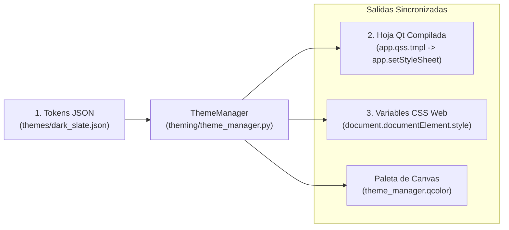

# 03 — Arquitectura de Estilos, Parámetros Generales (Design Tokens), QSS/CSS y Sanitización

> [!IMPORTANT]
> Este documento define la arquitectura unificada del sistema visual de **Morphism SRS**, integrando los parámetros de diseño ([`themes/*.json`](../src/morphism_srs/resources/themes/)), la compilación de la hoja maestra de estilos Qt ([`app.qss.tmpl`](../src/morphism_srs/resources/styles/app.qss.tmpl)), la sincronización de variables CSS en `QWebEngineView` ([`cards.css`](../src/morphism_srs/resources/web/css/cards.css)), la decoración semántica por etiquetas y la sanitización segura de fórmulas matemáticas en [`services/safe_html.py`](../src/morphism_srs/services/safe_html.py).

---

## 1. Principios del Sistema de Diseño y Prevención de Conflictos de Estilo

El sistema visual de **Morphism SRS** se fundamenta en principios estrictos de centralización y desacoplamiento para garantizar legibilidad, coherencia estética y soporte multiplataforma (`Windows`, `Linux`, `macOS`):

1. **Cero `setStyleSheet(...)` Inline en Vistas y Diálogos**:
   Los widgets no definen colores ni fuentes directamente en código Python. Asignar reglas CSS locales rompe la herencia de estilos de Qt y anula estados dinámicos como `:hover`, `:disabled` o `:focus`. Toda personalización se realiza mediante propiedades dinámicas procesadas por [`set_widget_props`](../src/morphism_srs/theming/delegates.py#L8-L16).
2. **Sincronización Centralizada entre Qt y WebEngine**:
   El gestor central [`ThemeManager`](../src/morphism_srs/theming/theme_manager.py) traduce un único catálogo de tokens JSON simultáneamente a la plantilla QSS nativa de Qt y a las variables CSS (`:root`) del motor Chromium, impidiendo desincronizaciones de color entre la interfaz de escritorio y las tarjetas de estudio.
3. **Blindaje de Elementos Desplegables (`QComboBox`) y Listas**:
   Las vistas de selección, árboles y menús emergentes (`QComboBox QAbstractItemView`, `QListView`, `QTreeView`, `QTableView`) cuentan con estilos explícitos en `app.qss.tmpl` para asegurar contraste tipográfico consistente en todas las plataformas.
4. **Paleta Unificada para el Canvas del Grafo**:
   Los elementos vectoriales interactivos del explorador de grafos ([`GraphNodeItem`](../src/morphism_srs/ui/views/explorer_view.py) y [`GraphEdgeItem`](../src/morphism_srs/ui/views/explorer_view.py)) obtienen sus colores mediante `theme_manager.qcolor(...)`, respondiendo en tiempo real al cambio de tema.

---

## 2. Arquitectura del Sistema de Diseño: Parámetros Generales y 3 Piezas Maestras

### 2.1 Coexistencia de QSS (Qt) y CSS (WebEngine)
La aplicación integra dos motores de presentación independientes que se sincronizan a través de un único catálogo de tokens:

| Motor | Ámbito de la UI | Tecnología | Requisitos Técnicos |
| :--- | :--- | :--- | :--- |
| **UI de Escritorio** | Ventanas, diálogos, barra de navegación, explorador DAG, tablas y árboles. | **PySide6 (Qt Widgets)** | **Usa QSS (Qt Style Sheets)**.<br>• Basado en un subconjunto de CSS 2.1.<br>• No soporta variables CSS nativas (`var(...)`). Las variables se compilan en tiempo de ejecución sustituyendo `{{ token_name }}`.<br>• Requiere selectores de sub-controles de Qt (`QScrollBar::handle:vertical`, `QComboBox::drop-down`, `QHeaderView::section`). |
| **Visor de Tarjetas y Gráficos** | Visor de estudio, vista previa en editores, fórmulas MathJax y gráficos. | **QWebEngine (Chromium)** | **Usa CSS3 estándar web**.<br>• Soporta `:root` y `var(--token-name)` dinámicas.<br>• Permite máscaras vectoriales SVG (`mask-image`), flexbox y layouts fluidos. |

El sistema se estructura en **3 piezas maestras**:

1. **[`resources/themes/<theme_id>.json`](../src/morphism_srs/resources/themes/) (Tokens de Diseño)**:
   Catálogo declarativo plano con los valores de color, tipografía y radios de borde.
2. **[`resources/styles/app.qss.tmpl`](../src/morphism_srs/resources/styles/app.qss.tmpl) (Plantilla Maestra QSS)**:
   Hoja de estilos única que contiene todas las reglas de los widgets Qt, parametrizadas mediante la sintaxis `{{ token_name }}`.
3. **[`resources/web/css/cards.css`](../src/morphism_srs/resources/web/css/cards.css) (CSS WebEngine)**:
   Hoja de estilos que consume las variables CSS (`var(--token-name)`) inyectadas por [`ThemeManager.compile_css_variables_js`](../src/morphism_srs/theming/theme_manager.py#L68-L75).



### Regla de Desarrollo UI:
> **Los archivos en `ui/views/` y `ui/dialogs/` no deben llamar a `.setStyleSheet(...)` de forma directa.**
> Todo widget se estiliza asignando propiedades semánticas mediante [`set_widget_props(widget, variant="...", role="...")`](../src/morphism_srs/theming/delegates.py#L8-L16).

---

## 3. Especificación de los Parámetros Generales (`themes/dark_slate.json`)

Cada tema es un archivo JSON con metadatos descriptivos y un diccionario plano de tokens:

```json
{
  "name": "Dark Slate (Catppuccin Mocha)",
  "id": "dark_slate",
  "is_dark": true,
  "tokens": {
    "bg_canvas": "#11111b",
    "bg_primary": "#1e1e2e",
    "bg_secondary": "#181825",
    "bg_surface_0": "#313244",
    "bg_surface_1": "#45475a",
    "bg_surface_2": "#585b70",
    "text_primary": "#cdd6f4",
    "text_secondary": "#bac2de",
    "text_muted": "#a6adc8",
    "accent_primary": "#89b4fa",
    "accent_primary_hover": "#b4befe",
    "accent_secondary": "#cba6f7",
    "semantic_success": "#a6e3a1",
    "semantic_warning": "#f9e2af",
    "semantic_danger": "#f38ba8",
    "semantic_info": "#89dceb",
    "border_subtle": "#313244",
    "border_focus": "#89b4fa",
    "node_due_border": "#f38ba8",
    "node_learned_border": "#a6e3a1",
    "node_new_border": "#585b70",
    "font_ui": "Segoe UI, Inter, system-ui, sans-serif",
    "font_mono": "Cascadia Code, JetBrains Mono, Consolas, monospace",
    "radius_sm": "6px",
    "radius_md": "10px",
    "radius_lg": "14px"
  }
}
```

La aplicación incorpora **10 temas predefinidos** en [`resources/themes/`](../src/morphism_srs/resources/themes/):
- **`dark_slate`**: Tema oscuro principal basado en Catppuccin Mocha.
- **`light_paper`**: Tema claro académico de alto contraste.
- **`oled_midnight`**: Tema negro puro (`#000000`) de máxima eficiencia.
- **`catppuccin_mocha`**, **`dracula`**, **`nord`**, **`tokyo_night`**, **`solarized_dark`**, **`github_light`**, **`bisexual_midnight`**.

---

## 4. Especificación de la Hoja Única QSS (`resources/styles/app.qss.tmpl`)

Toda la interfaz nativa de PySide6 se estiliza desde [`app.qss.tmpl`](../src/morphism_srs/resources/styles/app.qss.tmpl), compilada dinámicamente por [`ThemeManager.compile_qss`](../src/morphism_srs/theming/theme_manager.py#L60-L66) al sustituir las variables de token `{{ token_name }}`:

### 4.1 Uso de Propiedades Semánticas en Python (`variant` y `role`)
```python
# Ejemplo de uso en vistas (ui/views/courses_view.py):
from morphism_srs.theming.delegates import set_widget_props

btn_create = QPushButton("+ New Course")
set_widget_props(btn_create, variant="primary")

btn_delete = QPushButton("Delete Selected")
set_widget_props(btn_delete, variant="danger")

lbl_header = QLabel("Course Hierarchy")
set_widget_props(lbl_header, role="title")
```

### 4.2 Extracto de Reglas en `app.qss.tmpl`
```css
/* --- Contenedores Base --- */
QWidget {
    background-color: {{bg_primary}};
    color: {{text_primary}};
    font-family: {{font_ui}};
    font-size: 13px;
}

QMainWindow, QDialog {
    background-color: {{bg_primary}};
}

/* --- Paneles y Tarjetas --- */
QFrame[role="sidebar"] {
    background-color: {{bg_secondary}};
    border-right: 1px solid {{border_subtle}};
}

QFrame[role="card"], QFrame[role="panel"] {
    background-color: {{bg_surface_0}};
    border: 1px solid {{border_subtle}};
    border-radius: {{radius_md}};
}

/* --- Entradas de Texto y Desplegables --- */
QLineEdit, QTextEdit, QPlainTextEdit, QSpinBox, QDoubleSpinBox, QComboBox {
    background-color: {{bg_secondary}};
    color: {{text_primary}};
    border: 1px solid {{border_subtle}};
    border-radius: {{radius_sm}};
    padding: 6px 10px;
    selection-background-color: {{accent_primary}};
    selection-color: {{bg_canvas}};
}

QLineEdit:focus, QTextEdit:focus, QPlainTextEdit:focus, QSpinBox:focus, QDoubleSpinBox:focus, QComboBox:focus {
    border: 1px solid {{border_focus}};
}

QComboBox::drop-down {
    border: none;
    width: 22px;
}

QComboBox QAbstractItemView {
    background-color: {{bg_surface_0}};
    color: {{text_primary}};
    border: 1px solid {{border_subtle}};
    selection-background-color: {{accent_primary}};
    selection-color: {{bg_canvas}};
}

/* --- Botones y Estados Semánticos --- */
QPushButton {
    background-color: {{bg_surface_0}};
    color: {{text_primary}};
    border: 1px solid {{border_subtle}};
    border-radius: {{radius_sm}};
    padding: 6px 14px;
    font-weight: 600;
}

QPushButton:hover {
    background-color: {{bg_surface_1}};
    border-color: {{accent_primary}};
}

QPushButton[variant="primary"] {
    background-color: {{accent_primary}};
    color: {{bg_canvas}};
    border: 1px solid {{accent_primary}};
}
QPushButton[variant="primary"]:hover {
    background-color: {{accent_primary_hover}};
}

QPushButton[variant="danger"] {
    background-color: {{semantic_danger}};
    color: {{bg_canvas}};
    border: 1px solid {{semantic_danger}};
}

QPushButton[variant="ghost"] {
    background-color: transparent;
    border: 1px solid transparent;
    color: {{text_secondary}};
}
QPushButton[variant="ghost"]:hover {
    background-color: {{bg_surface_0}};
    color: {{text_primary}};
}
```

### 4.3 Helper `set_widget_props`
Ubicado en [`src/morphism_srs/theming/delegates.py`](../src/morphism_srs/theming/delegates.py#L8-L16), asigna propiedades dinámicas y fuerza el repintado del estilo Qt sin requerir recargar hojas completas:

```python
def set_widget_props(widget: QWidget, **props: Any) -> None:
    """Sets dynamic Qt properties on a widget and unpolishes/polishes its style."""
    for key, val in props.items():
        widget.setProperty(key, val)
    style = widget.style()
    if style is not None:
        style.unpolish(widget)
        style.polish(widget)
    widget.update()
```

---

## 5. Sincronización de CSS en `QWebEngineView` ([`cards.css`](../src/morphism_srs/resources/web/css/cards.css)), Tags y Diagramas SVG

Todas las vistas web ([`ReviewView`](../src/morphism_srs/ui/views/review_view.py), live preview en editor, exploradores y estadísticas) cargan la hoja de estilo principal mediante el esquema seguro `morphism://`:

```html
<link rel="stylesheet" href="morphism://app/css/cards.css">
```

El esquema personalizado `morphism://` es registrado por [`register_morphism_scheme()`](../src/morphism_srs/web_engine/scheme_handler.py#L21) y despachado por [`MorphismSchemeHandler`](../src/morphism_srs/web_engine/scheme_handler.py#L39), sirviendo recursos estáticos desde `morphism://app/...` y archivos del almacén multimedia desde `morphism://media/...`.

### 5.1 Inyección Dinámica de Variables CSS (`compile_css_variables_js`)
En lugar de depender de peticiones de red o recargas de hojas de estilo, [`ThemeManager.compile_css_variables_js()`](../src/morphism_srs/theming/theme_manager.py#L68-L75) compila las variables de diseño del tema activo en un snippet de JavaScript que manipula directamente `document.documentElement.style`:

```python
def compile_css_variables_js(self) -> str:
    """Returns a JS snippet that updates document.documentElement CSS variables."""
    assignments: list[str] = []
    for k, v in self.tokens.items():
        css_var = "--" + k.replace("_", "-")
        safe_val = v.replace('"', '\\"')
        assignments.append(f'document.documentElement.style.setProperty("{css_var}", "{safe_val}");')
    return "\n".join(assignments)
```

Las variables CSS resultantes coinciden exactamente con los tokens del tema:
```css
:root {
    --bg-canvas: #0b0f19;
    --bg-primary: #0f172a;
    --bg-surface-0: #1e293b;
    --bg-surface-1: #334155;
    --bg-surface-2: #475569;
    --border-subtle: #1e293b;
    --text-primary: #f8fafc;
    --text-secondary: #cbd5e1;
    --text-muted: #94a3b8;
    --accent-primary: #6366f1;
    --accent-secondary: #38bdf8;
    --semantic-success: #10b981;
    --semantic-warning: #f59e0b;
    --semantic-danger: #ef4444;
    --semantic-info: #06b6d4;
    --font-ui: "Segoe UI", Inter, system-ui, sans-serif;
    --font-mono: "Cascadia Code", "JetBrains Mono", Consolas, monospace;
}
```

### 5.2 Clases Semánticas, Cajas Matemáticas y Diagramas Vectoriales SVG en `cards.css`
La hoja de estilos [`cards.css`](../src/morphism_srs/resources/web/css/cards.css) estructura y decora semánticamente el contenido de estudio:

```css
/* Cajas de notas matemáticas semánticas */
.math-box-theorem { border-left: 4px solid var(--accent-primary); }
.math-box-definition { border-left: 4px solid var(--semantic-success); }
.math-box-proof { border-left: 4px solid var(--accent-secondary); }
.math-box-lemma { border-left: 4px solid var(--semantic-info); }

/* Fórmulas MathJax SVG (scroll horizontal limpio para ecuaciones extensas) */
mjx-container[jax="SVG"] {
    display: inline-block;
    max-width: 100%;
    overflow-x: auto;
    overflow-y: hidden;
    vertical-align: middle;
}
mjx-container[jax="SVG"][display="true"] {
    display: block;
    max-width: 100%;
    overflow-x: auto;
    overflow-y: hidden;
    margin: 0.8em 0;
    padding: 4px 0;
}

/* Soporte para diagramas conmutativos vectoriales SVG */
.commutative-diagram, img[src$=".svg"] {
    display: block;
    margin: 12px auto;
    max-height: 360px;
}

/* Tintado automático de diagramas vectoriales monocromáticos mediante CSS Mask */
.diagram-mask-container {
    display: flex;
    justify-content: center;
    align-items: center;
    margin: 1.2em auto;
    max-width: 100%;
}
.commutative-diagram-mask {
    display: inline-block;
    background-color: var(--text-primary, var(--theme-text-color, #cdd6f4));
    -webkit-mask-size: contain;
    mask-size: contain;
    -webkit-mask-repeat: no-repeat;
    mask-repeat: no-repeat;
    -webkit-mask-position: center;
    mask-position: center;
    width: 100%;
    min-height: 120px;
    max-height: 450px;
    transition: background-color 0.15s ease-in-out;
}
```

### 5.3 Cambio de Tema en Caliente (Live Theme Switching)
Cuando el usuario selecciona un nuevo tema en el diálogo de configuración:
1. [`ThemeManager.apply_theme(theme_id)`](../src/morphism_srs/theming/theme_manager.py#L77-L84) compila la plantilla QSS y actualiza `QApplication.setStyleSheet(qss)`.
2. Emite la señal `theme_changed(theme_id)`.
3. [`MorphismWebProfileManager._on_theme_changed`](../src/morphism_srs/web_engine/web_profile.py#L114-L117) recibe la señal e itera sobre todas las vistas web activas (`_tracked_views`):
   - Ajusta el color de fondo nativo de la página: `view.page().setBackgroundColor(theme_manager.qcolor("bg_primary"))`.
   - Inyecta y ejecuta el código JavaScript compilado: `view.page().runJavaScript(theme_manager.compile_css_variables_js())`.
4. El visor del grafo ([`GraphExplorerView`](../src/morphism_srs/ui/views/explorer_view.py)) y los widgets nativos se actualizan de inmediato **sin requerir recargar la página web ni re-ejecutar MathJax**.

---

## 6. Tratamiento de `<` y `>` en Texto Matemático: Conversión a `\lt` y `\gt`

> **Decisión de Diseño**: *En lugar de convertir `<` y `>` a entidades HTML `&lt;` y `&gt;`, se transforman a las macros LaTeX nativas `\lt ` y `\gt ` de forma exclusiva dentro de entornos matemáticos.*

### 6.1 Fundamento Técnico: Inmunidad frente al Parser de Chromium
Al inyectar contenido con fórmulas matemáticas en el DOM de `QWebEngineView`, los operadores de desigualdad (`<`, `>`, `<=`, `>=`) en expresiones como `$x < y$` o `$\varepsilon > 0$` pueden ser interpretados por el parser HTML de Chromium como el inicio de una etiqueta HTML no reconocida o malformada, corrompiendo el contenido subsiguiente.

Al convertir estos operadores dentro de los delimitadores matemáticos a **`\lt `**, **`\gt `**, **`\le `** y **`\ge `**:
1. **Inmunidad Absoluta frente al Parser HTML**: La barra invertida `\` convierte el símbolo en texto alfabético para el motor de renderizado HTML, eliminando cualquier ambigüedad de marcado.
2. **Renderizado Tipográfico Preciso en MathJax**: En LaTeX y MathJax, `\lt` y `\gt` son operadores relacionales reconocidos que garantizan el espaciado matemático exacto (`\mathrel`).
3. **Preservación Total del Marcado Externo**: Todas las etiquetas HTML estándar (`<b>`, `<i>`, `<br>`, `<div>`, etc.) fuera de entornos matemáticos se preservan sin ninguna alteración.

### 6.2 Implementación Canónica ([`src/morphism_srs/services/safe_html.py`](../src/morphism_srs/services/safe_html.py))

```python
from __future__ import annotations

import re

MATH_BLOCK_RE = re.compile(
    r"""
    (
        \$\$.*?\$\$                      # $$ display math $$
        |
        \\\[.*?\\\]                      # \[ display math \]
        |
        \\\(.*?\\\)                      # \( inline math \)
        |
        (?<!\\)\$(?!\$)(?:\\.|[^$\\])+\$ # $ inline math $
    )
    """,
    re.DOTALL | re.VERBOSE,
)


def sanitize_math_html(raw: str) -> str:
    r"""
    Converts mathematical comparison operators `<` and `>` into LaTeX commands `\lt ` and `\gt `
    EXCLUSIVELY inside mathematical environments ($...$, $$...$$, \(...\), \[...\]).
    Everything outside math mode (including standard and non-standard HTML tags, attributes,
    and plain text) is preserved 100% intact without modification.
    """
    if not raw:
        return ""

    def _sanitize_math_block(match: re.Match[str]) -> str:
        s = match.group(0)
        s = re.sub(r"(?<!\\)<=", r"\\le ", s)
        s = re.sub(r"(?<!\\)>=", r"\\ge ", s)
        s = re.sub(r"(?<!\\)<", r"\\lt ", s)
        s = re.sub(r"(?<!\\)>", r"\\gt ", s)
        return s

    return MATH_BLOCK_RE.sub(_sanitize_math_block, raw)
```

**Ejemplos de Transformación**:
- Entrada: `Sea $\varepsilon > 0$ tal que $|x - x_0| < \delta$`
  $\longrightarrow$ Salida: `Sea $\varepsilon \gt 0$ tal que $|x - x_0| \lt \delta$`
- Entrada: `<b>Paso 1:</b><br>Si $x < y$ y $a >= b$`
  $\longrightarrow$ Salida: `<b>Paso 1:</b><br>Si $x \lt y$ y $a \ge b$`
  *(Las etiquetas HTML `<b>` y `<br>` se conservan intactas, mientras que `<` y `>=` dentro de los delimitadores `$...$` se convierten en `\lt ` y `\ge `).*