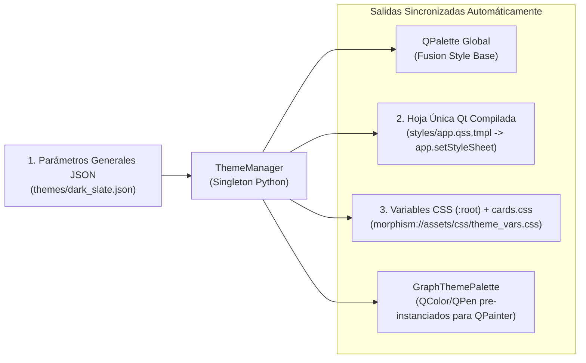

# 03 — Arquitectura de Estilos, Parámetros Generales (Design Tokens), QSS/CSS y Sanitización

> [!IMPORTANT]
> En [`specZ/old/Future_version.md`](file:///c:/repos/Morphism%20SRS%20proto2/specZ/old/Future_version.md) se establece como prioridad crítica: *"Make sure CSS is done right from the start (lazy implementation was detrimental to development where all UI was unreadable due to conflicts in CSS lists being white text on white bg)"*.
> Este documento especifica:
> 1. El diagnóstico completo de los fallos de estilo del Prototipo 1.
> 2. La **Arquitectura Simplificada en 3 Piezas Maestras** basada en **Parámetros Generales (`themes/*.json`)** que alimentan una única hoja QSS para PySide6 (`app.qss.tmpl`) y una única hoja CSS para Chromium/MathJax (`cards.css`), sin fragmentar en 7 archivos.
> 3. El catálogo completo de reglas QSS, propiedades semánticas (`variant`, `role`) y solución definitiva al bug de popups de `QComboBox` y listas en Windows/Linux/macOS.
> 4. **Solución definitiva al bug de `<` y `>` en texto matemático**: Sanitizador inteligente (`SafeMathHtmlParser`) que convierte operadores de desigualdad a macros LaTeX nativas **`\lt`** y **`\gt`**.
> 5. Clases semánticas vinculadas a **Tags Estandarizados** ([`specZ/tags_default.csv`](file:///c:/repos/Morphism%20SRS%20proto2/specZ/tags_default.csv)) y soporte de diagramas vectoriales **SVG** con inversión adaptativa en modo oscuro.

---

## 1. Diagnóstico: ¿Por qué Falló el Sistema de Estilos en el Prototipo 1?

Al auditar el código del Prototipo 1 (`styles.py` y los 9 módulos de UI), identificamos **4 causas raíz** que provocaron ilegibilidad y dificultad extrema para cambiar estilos:

1. **Fragmentación de `setStyleSheet(...)` Inline en el Código Python**:
   - Aunque existía `styles.py`, había **más de 35 llamadas directas a `.setStyleSheet("...")`** repartidas dentro de `main.py`, `node_editor_dialog.py`, `courses_widget.py`, `scratchbook_dialog.py`, `stats_widget.py` y `retrievability_plot_dialog.py`.
   - En Qt, cuando un widget hijo tiene su propio `setStyleSheet()` inline, **rompe la cascada de herencia del tema global** y sobreescribe estados como `:hover`, `:disabled` o `:focus`, dejando botones sin feedback visual o con texto ilegible.
2. **Duplicación Desincronizada entre QSS (Qt) y CSS (WebEngine)**:
   - Los colores de fondo y texto estaban escritos a mano en `styles.py` y copiados manualmente dentro de 5 strings HTML distintos (`review_view.py`, `node_editor_dialog.py`, `scratchbook_dialog.py`, `stats_widget.py`, `retrievability_plot_dialog.py`). Cambiar un color requería editar 10 archivos Python.
3. **El Bug Nativo de `QComboBox` y `QAbstractItemView` en Windows**:
   - En Windows, Qt usa por defecto un contenedor popup nativo del sistema para los desplegables de `QComboBox` y ciertas listas, el cual ignora partes del QSS y renderiza **texto blanco sobre fondo blanco (ilegible)**. En `styles.py` se creó la función `attach_dark_view(combo)`, pero **nunca se llamó en los `QComboBox` de `node_editor_dialog.py` ni `retrievability_plot_dialog.py`**.
4. **Colores Hardcodeados en el Pintado Manual (`QPainter`) del Grafo**:
   - `NoteNodeItem.paint()` y `NoteEdgeItem` en `graph_view.py` instanciaban objetos `QColor("#1e293b")` hardcodeados dentro de métodos de dibujo.

---

## 2. Arquitectura del Sistema de Diseño: Parámetros Generales y 3 Piezas Maestras

### 2.1 ¿Por qué se usan Parámetros Generales pero Separando `app.qss` (Qt) y `cards.css` (Web)?
La aplicación combina dos motores gráficos con requisitos técnicos fundamentalmente distintos:

| Motor | Ámbito de la UI | Tecnología | Requisitos Técnicos que Impiden Fusionar Ambos en 1 Solo Archivo |
| :--- | :--- | :--- | :--- |
| **UI de Escritorio** | Ventanas, diálogos, barra superior, explorador de grafos, árbol de cursos, tablas, listas. | **PySide6 (Qt Widgets)** | **Usa QSS (Qt Style Sheets)**.<br>• Es un dialecto propietario basado en CSS 2.1.<br>• **No soporta variables CSS nativas** (`var(--color)` es inválido en Qt).<br>• Requiere selectores de sub-controles exclusivos de Qt (`QScrollBar::handle:vertical`, `QComboBox::drop-down`, `QComboBox QAbstractItemView`, `QHeaderView::section`). |
| **Visor de Tarjetas y Gráficos** | Contenedor de la tarjeta activa, historial de pasos (`#past-steps-list`), contexto `cloze`, fórmulas MathJax y diagramas SVG. | **QWebEngine (Chromium)** | **Usa CSS3 estándar web**.<br>• Soporta `:root` y `var(--token)` nativos, Flexbox, Grid y `content-visibility: auto`.<br>• Estiliza contenedores SVG de MathJax (`mjx-container[jax="SVG"]`) y filtros vectoriales (`filter: invert(...)`). |

Sin embargo, **no hace falta dividir el QSS en 6 o 7 archivos pequeños**. Todo el sistema de estilos se consolida en **3 piezas únicas**:

1. **`resources/themes/<theme_id>.json` (Parámetros Generales / Design Tokens)**:
   - La **única fuente de verdad** para colores, fuentes, tamaños y radios de borde.
2. **`resources/styles/app.qss.tmpl` (1 solo archivo QSS para toda la UI nativa de PySide6)**:
   - Contiene todas las reglas de widgets Qt parametrizadas con `@token_name`.
3. **`resources/web/css/cards.css` (1 solo archivo CSS3 para todas las vistas Web/MathJax)**:
   - Consume las variables CSS (`var(--token-name)`) generadas automáticamente en memoria desde el mismo archivo JSON.



### Regla Inquebrantable de Desarrollo UI:
> **PROHIBIDO llamar a `.setStyleSheet(...)` con colores, bordes o fuentes dentro de cualquier archivo en `ui/views/` o `ui/dialogs/`.**
> Todo widget se estiliza exclusivamente asignándole:
> 1. Un `objectName` estructural (ej. `panel.setObjectName("ReviewControlFrame")`), o
> 2. Una propiedad semántica dinámica vía `set_widget_props(btn, variant="primary")`.

---

## 3. Especificación de los Parámetros Generales (`themes/dark_slate.json`)

Cada tema es un único archivo JSON plano y semántico. Modificar cualquier color, fuente o radio de borde en toda la aplicación (incluyendo el grafo, los gráficos de Chart.js y las tarjetas de MathJax) consiste simplemente en editar este JSON:

```json
{
  "meta": {
    "id": "dark_slate",
    "name": "Morphism Dark Slate",
    "is_dark": true
  },
  "colors": {
    "bg_canvas": "#0b0f19",
    "bg_window": "#0f172a",
    "bg_surface_1": "#1e293b",
    "bg_surface_2": "#334155",
    "bg_surface_hover": "#3b4f6b",
    "bg_input": "#0f172a",

    "border_subtle": "#1e293b",
    "border_default": "#334155",
    "border_strong": "#475569",
    "border_focus": "#6366f1",

    "text_primary": "#f8fafc",
    "text_secondary": "#cbd5e1",
    "text_muted": "#94a3b8",
    "text_disabled": "#64748b",
    "text_on_accent": "#ffffff",

    "accent_primary": "#6366f1",
    "accent_primary_hover": "#4f46e5",
    "accent_primary_pressed": "#4338ca",
    "accent_secondary": "#38bdf8",
    "accent_purple": "#8b5cf6",

    "status_again_bg": "#7f1d1d",
    "status_again_border": "#ef4444",
    "status_again_text": "#fecaca",

    "status_hard_bg": "#78350f",
    "status_hard_border": "#f59e0b",
    "status_hard_text": "#fde68a",

    "status_good_bg": "#064e3b",
    "status_good_border": "#10b981",
    "status_good_text": "#a7f3d0",

    "status_easy_bg": "#1e3a8a",
    "status_easy_border": "#3b82f6",
    "status_easy_text": "#bfdbfe",

    "node_due_start": "#991b1b",
    "node_due_end": "#450a0a",
    "node_due_border": "#fca5a5",

    "node_ok_start": "#1e293b",
    "node_ok_end": "#0f172a",
    "node_ok_border": "#10b981",

    "node_serial_start": "#1e1b4b",
    "node_serial_end": "#0f172a",
    "node_serial_border": "#818cf8",

    "node_cloze_start": "#2e1065",
    "node_cloze_end": "#0f172a",
    "node_cloze_border": "#c084fc",

    "node_empty_start": "#334155",
    "node_empty_end": "#1e293b",
    "node_empty_border": "#64748b",

    "edge_prereq": "#818cf8",
    "edge_related": "#38bdf8",
    "edge_active_draw": "#f59e0b"
  },
  "typography": {
    "font_sans": "-apple-system, BlinkMacSystemFont, 'Segoe UI', 'Inter', Roboto, Ubuntu, sans-serif",
    "font_mono": "'JetBrains Mono', 'Cascadia Code', 'Consolas', 'DejaVu Sans Mono', monospace",
    "font_math_scale": "105%",
    "size_xs": "11px",
    "size_sm": "12px",
    "size_base": "13px",
    "size_md": "15px",
    "size_lg": "18px",
    "size_xl": "20px",
    "review_body_size": "18px"
  },
  "metrics": {
    "radius_sm": "6px",
    "radius_md": "8px",
    "radius_lg": "12px",
    "control_height_sm": "28px",
    "control_height_md": "34px",
    "control_height_lg": "42px"
  }
}
```

Además de `dark_slate.json`, se incluyen de fábrica:
- `light_paper.json`: Tema claro de alto contraste estilo artículo académico ($\LaTeX$ negro `#0f172a` sobre fondo papel cálido `#faf8f5`), ideal para estudiar de día.
- `oled_midnight.json`: Tema negro puro (`#000000`) de ultra alto contraste.

---

## 4. Especificación de la Hoja Única QSS (`resources/styles/app.qss.tmpl`)

Toda la interfaz de PySide6 se gobierna desde `app.qss.tmpl`, dividida internamente por secciones comentadas claras:

### 4.1 Uso de Propiedades Semánticas en Python (`variant` y `role`)
```python
# Ejemplo en Python (ui/views/courses_view.py):
from morphism_srs.theming import set_widget_props

btn_create = QPushButton("+ New Course")
set_widget_props(btn_create, variant="success", size="lg")

btn_delete = QPushButton("Delete Selected")
set_widget_props(btn_delete, variant="danger")

lbl_header = QLabel("Course Hierarchy")
set_widget_props(lbl_header, role="view-title")
```

### 4.2 Extracto Canónico de `app.qss.tmpl` (Incluyendo Blindaje de Listas y Comboboxes)
```css
/* ============================================================================
   1. VENTANAS, DIÁLOGOS Y LISTAS (Blindaje contra texto blanco sobre blanco)
   ============================================================================ */
QMainWindow, QDialog {
    background-color: @bg_window;
    color: @text_primary;
    font-family: @font_sans;
    font-size: @size_base;
}

QWidget {
    color: @text_primary;
    font-family: @font_sans;
}

QToolTip {
    background-color: @bg_surface_1;
    color: @text_primary;
    border: 1px solid @border_strong;
    border-radius: @radius_sm;
    padding: 5px 8px;
    font-size: @size_sm;
}

/* Blindaje explícito para todas las vistas de listas, árboles, tablas y popups */
QListView, QListWidget, QTreeView, QTreeWidget, QTableView, QTableWidget,
QComboBox QAbstractItemView {
    background-color: @bg_input;
    alternate-background-color: @bg_window;
    color: @text_primary;
    border: 1px solid @border_default;
    border-radius: @radius_md;
    selection-background-color: @accent_primary;
    selection-color: @text_on_accent;
    outline: none;
}

QListView::item, QListWidget::item, QTreeView::item, QTreeWidget::item,
QComboBox QAbstractItemView::item {
    color: @text_primary;
    padding: 5px 8px;
    border-radius: @radius_sm;
}

QListView::item:hover, QListWidget::item:hover, QTreeView::item:hover,
QComboBox QAbstractItemView::item:hover {
    background-color: @bg_surface_hover;
    color: @text_primary;
}

QListView::item:selected, QListWidget::item:selected, QTreeView::item:selected,
QComboBox QAbstractItemView::item:selected {
    background-color: @accent_primary;
    color: @text_on_accent;
}

/* ============================================================================
   2. BOTONES Y VARIANTES SEMÁNTICAS ([variant="..."])
   ============================================================================ */
QPushButton {
    background-color: @bg_surface_1;
    color: @text_primary;
    border: 1px solid @border_default;
    border-radius: @radius_md;
    padding: 5px 12px;
    font-size: @size_base;
    font-weight: 600;
    min-height: @control_height_md;
}
QPushButton:hover {
    background-color: @bg_surface_hover;
    border-color: @border_focus;
}
QPushButton:disabled {
    background-color: @bg_window;
    color: @text_disabled;
    border-color: @border_subtle;
}

QPushButton[variant="primary"] {
    background-color: @accent_primary;
    color: @text_on_accent;
    border: 1px solid @accent_primary;
}
QPushButton[variant="primary"]:hover {
    background-color: @accent_primary_hover;
}

QPushButton[variant="success"], QPushButton[rating="good"] {
    background-color: @status_good_bg;
    color: @status_good_text;
    border: 1px solid @status_good_border;
}
QPushButton[variant="success"]:hover, QPushButton[rating="good"]:hover {
    background-color: @status_good_border;
    color: @text_on_accent;
}

QPushButton[variant="danger"], QPushButton[rating="again"] {
    background-color: @status_again_bg;
    color: @status_again_text;
    border: 1px solid @status_again_border;
}
QPushButton[variant="danger"]:hover, QPushButton[rating="again"]:hover {
    background-color: @status_again_border;
    color: @text_on_accent;
}

QPushButton[rating="hard"] {
    background-color: @status_hard_bg;
    color: @status_hard_text;
    border: 1px solid @status_hard_border;
}
QPushButton[rating="easy"] {
    background-color: @status_easy_bg;
    color: @status_easy_text;
    border: 1px solid @status_easy_border;
}

QPushButton[variant="ghost"] {
    background-color: transparent;
    border: 1px solid transparent;
    color: @text_secondary;
}
QPushButton[variant="ghost"]:hover {
    background-color: @bg_surface_1;
    color: @text_primary;
}

/* ============================================================================
   3. ROLES DE TIPOGRAFÍA EN ETIQUETAS (QLabel[role="..."])
   ============================================================================ */
QLabel[role="view-title"] {
    font-size: @size_xl;
    font-weight: 700;
    color: @accent_secondary;
}
QLabel[role="section-title"] {
    font-size: @size_md;
    font-weight: 600;
    color: @text_primary;
}
QLabel[role="muted"] {
    font-size: @size_sm;
    color: @text_muted;
}
QLabel[role="badge"] {
    background-color: @bg_surface_1;
    color: @accent_secondary;
    border: 1px solid @border_default;
    border-radius: @radius_sm;
    padding: 3px 8px;
    font-weight: 600;
}
```

### 4.3 Helper `set_widget_props` y Solución Global al Popup de `QComboBox`
1. **Re-polishing automático**:
   ```python
   def set_widget_props(widget: QWidget, **props) -> None:
       for key, val in props.items():
           widget.setProperty(key, val)
       widget.style().unpolish(widget)
       widget.style().polish(widget)
       widget.update()
   ```
2. **Filtro Global para `QComboBox` (`theming/delegates.py`)**:
   En lugar de tener que recordar llamar a `attach_dark_view(combo)` manualmente en cada diálogo como en el Prototipo 1, `ThemeManager` instala un `QObject.eventFilter` global en `QApplication` que intercepta `QEvent.Polish` sobre cualquier instancia de `QComboBox`, asignándole automáticamente un `QListView` con `QStyledItemDelegate` y desactivando la sombra nativa de Windows (`Qt.Popup | Qt.FramelessWindowHint | Qt.NoDropShadowWindowHint`). Así, **cualquier `QComboBox` en toda la aplicación se ve perfecto automáticamente en Windows, Linux y macOS**.

---

## 5. Sincronización de CSS en `QWebEngineView` (`cards.css`), Tags y Diagramas SVG

Todas las vistas web (`ReviewView`, `NodeEditor` preview, `Scratchbook` preview, `StatsView` y `RetrievabilityDialog`) cargan:

```html
<link rel="stylesheet" href="morphism://assets/css/theme_vars.css">
<link rel="stylesheet" href="morphism://assets/css/cards.css">
```

### 5.1 Generación Automática de `theme_vars.css` en Memoria
Cuando `ThemeManager.load_theme("dark_slate")` se ejecuta, construye en memoria el contenido de `morphism://assets/css/theme_vars.css` directamente desde el diccionario JSON de parámetros generales:

```css
:root {
    --bg-canvas: #0b0f19;
    --bg-window: #0f172a;
    --bg-surface-1: #1e293b;
    --bg-surface-2: #334155;
    --border-subtle: #1e293b;
    --border-default: #334155;
    --border-focus: #6366f1;
    --text-primary: #f8fafc;
    --text-secondary: #cbd5e1;
    --text-muted: #94a3b8;
    --accent-primary: #6366f1;
    --accent-secondary: #38bdf8;
    --accent-purple: #8b5cf6;
    --status-good-border: #10b981;
    --status-again-border: #ef4444;
    --font-sans: -apple-system, BlinkMacSystemFont, 'Segoe UI', 'Inter', Roboto, sans-serif;
    --font-mono: 'JetBrains Mono', 'Cascadia Code', 'Consolas', monospace;
    --review-body-size: 18px;
    --math-scale: 105%;
}
```

### 5.2 Clases Semánticas Vinculadas a Tags Estandarizados y Reglas SVG en `cards.css`
Al eliminarse la columna arbitraria `content_kind`, la decoración visual de las tarjetas se vincula automáticamente a los **Tags Epistémicos Estandarizados** de [`specZ/tags_default.csv`](file:///c:/repos/Morphism%20SRS%20proto2/specZ/tags_default.csv) (`theorem`, `definition`, `lemma`, `proof`, `corollary`, `axiom`, `exercise`, `counterexample`):

```css
/* Decoración automática de la tarjeta activa según sus Tags estándar */
.active-card.tag-theorem,
.active-card.tag-fundamental_theorem {
    border-top: 4px solid var(--accent-primary);
}
.active-card.tag-definition {
    border-top: 4px solid var(--accent-secondary);
}
.active-card.tag-lemma,
.active-card.tag-proposition,
.active-card.tag-corollary {
    border-top: 4px solid var(--accent-purple);
}
.active-card.tag-proof {
    border-top: 4px solid var(--status-good-border);
}
.active-card.tag-counterexample {
    border-top: 4px solid var(--status-again-border);
}

/* Reglas para fórmulas MathJax SVG (scroll limpio en ecuaciones largas) */
mjx-container[jax="SVG"] {
    font-size: var(--math-scale);
    color: inherit;
    overflow-x: auto;
    overflow-y: hidden;
    max-width: 100%;
}
mjx-container[jax="SVG"][display="true"] {
    margin: 1em 0 !important;
    padding: 4px 0;
}

/* Soporte para Diagramas Conmutativos Vectoriales SVG */
.commutative-diagram {
    display: block;
    margin: 14px auto;
    max-width: 95%;
    height: auto;
    border-radius: 6px;
    background: transparent;
}

/* Inversión inteligente para SVGs monocromáticos (TikZ/Quiver) en tema oscuro */
[data-theme="dark"] .commutative-diagram.invert-on-dark {
    filter: invert(0.92) hue-rotate(180deg);
}
```

### 5.3 Cambio de Tema en Caliente (Live Theme Switching)
Cuando el usuario cambia de tema en `SettingsDialog`:
1. `ThemeManager` actualiza `app.setPalette(...)` y `app.setStyleSheet(...)` a partir del nuevo JSON.
2. `ThemeManager` actualiza el buffer en memoria de `morphism://assets/css/theme_vars.css`.
3. `ThemeManager` emite `AppEventBus.theme_changed`:
   - `GraphExplorerView` actualiza su `GraphThemePalette` y llama a `viewport().update()`.
   - Cada `QWebEngineView` activo ejecuta `window.reloadThemeVariables()`, actualizando `:root` **instantáneamente sin recargar la página ni re-ejecutar MathJax**.

---

## 6. Solución Definitiva al Bug de `<` y `>` en Texto Matemático: Conversión a `\lt` y `\gt`

> **Decisión de Diseño**: *En vez de convertir `<` y `>` a `&lt;` y `&gt;`, es más seguro convertirlos a `\lt` y `\gt` (LaTeX nativo).*

### 6.1 Por qué `\lt` y `\gt` es la Solución Superior
En el Prototipo 1, escribir `Sea $\varepsilon > 0$ y $x < y$` e inyectarlo en `innerHTML` hacía que el parser HTML de Chromium viera `< y$` como la apertura de un tag HTML malformado, devorando el resto del texto.
Al convertir los operadores `<` y `>` que no pertenecen a tags HTML válidos directamente a **`\lt`** y **`\gt`**:
1. **Inmunidad Absoluta frente al Parser HTML**: Para Chromium, la barra invertida `\lt` es texto alfabético ordinario; **jamás puede confundirse con la apertura de una etiqueta HTML**.
2. **Renderizado Nativo en MathJax 3**: En LaTeX y MathJax 3, `\lt` y `\gt` son las macros canónicas para los operadores relacionales $<$ y $>$ con espaciado tipográfico `\mathrel` exacto.

### 6.2 Especificación del Sanitizador (`services/safe_html.py`)

```python
import re

ALLOWED_TAGS = {
    "b", "i", "u", "code", "pre", "br", "hr", "p", "span", "div",
    "ul", "ol", "li", "table", "thead", "tbody", "tr", "th", "td",
    "img", "strong", "em", "sub", "sup", "blockquote"
}

TAG_REGEX = re.compile(r'</?([a-zA-Z][a-zA-Z0-9]*)\b[^>]*>')
MATH_BLOCK_REGEX = re.compile(r'(\$\$.*?\$\$|\$.*?\$|\\\[.*?\\\]|\\\(.*?\\\))', re.DOTALL)

def _replace_operators_in_math(math_text: str) -> str:
    """Convierte < y > dentro de delimitadores matemáticos a macros LaTeX nativas \\lt y \\gt."""
    math_text = re.sub(r'<\s*=', r'\\le ', math_text)
    math_text = re.sub(r'>\s*=', r'\\ge ', math_text)
    math_text = re.sub(r'<(?![a-zA-Z])', r'\\lt ', math_text)
    math_text = re.sub(r'>(?![a-zA-Z])', r'\\gt ', math_text)
    return math_text

def sanitize_math_html(text: str) -> str:
    """
    Sanitiza el contenido de tarjetas y notas:
    1. Dentro de bloques matemáticos ($...$, $$...$$, \\(...\\), \\[...\\]), convierte < y > a \\lt y \\gt.
    2. Fuera de bloques matemáticos, preserva únicamente etiquetas HTML de ALLOWED_TAGS.
    3. Cualquier < o > suelto fuera de tags HTML válidos se convierte de forma segura.
    """
    # Paso 1: Reemplazar < y > por \lt y \gt dentro de entornos matemáticos
    parts = []
    last_idx = 0
    for match in MATH_BLOCK_REGEX.finditer(text):
        start, end = match.span()
        parts.append(text[last_idx:start])
        parts.append(_replace_operators_in_math(match.group(0)))
        last_idx = end
    parts.append(text[last_idx:])
    text = "".join(parts)

    # Paso 2: Preservar tags HTML permitidos y neutralizar < o > sueltos fuera de ellos
    tokens = []
    last_end = 0
    for match in TAG_REGEX.finditer(text):
        start, end = match.span()
        tag_name = match.group(1).lower()

        plain_prefix = text[last_end:start]
        plain_prefix = plain_prefix.replace("<", r"\lt ").replace(">", r"\gt ")
        tokens.append(plain_prefix)

        if tag_name in ALLOWED_TAGS:
            tokens.append(match.group(0))
        else:
            tokens.append(match.group(0).replace("<", r"\lt ").replace(">", r"\gt "))
        last_end = end

    tail = text[last_end:]
    tokens.append(tail.replace("<", r"\lt ").replace(">", r"\gt "))
    return "".join(tokens)
```

**Ejemplos Verificados**:
- Entrada: `Sea $\varepsilon > 0$ tal que $|x - x_0| < \delta$`
  $\longrightarrow$ Salida: `Sea $\varepsilon \gt 0$ tal que $|x - x_0| \lt \delta$`
- Entrada: `<b>Paso 1:</b><br>Si $x < y$ y $a >= b$`
  $\longrightarrow$ Salida: `<b>Paso 1:</b><br>Si $x \lt y$ y $a \ge b$`
  *(Los tags `<b>` y `<br>` se preservan intactos, mientras que `<` y `>=` se transforman a LaTeX nativo `\lt` y `\ge`)*.
