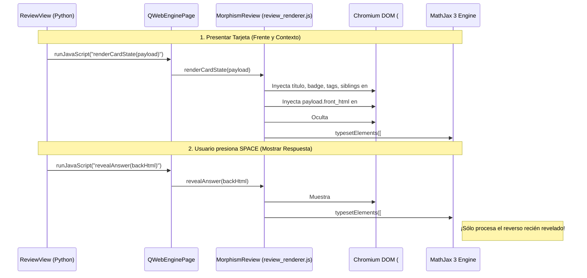

# 04 — Motor MathJax 3 Offline y Optimización de Rendimiento en Review Screen

> [!IMPORTANT]
> Este documento define la arquitectura y optimización de renderizado para fórmulas matemáticas y visualización web en **Morphism SRS**, garantizando funcionamiento offline 100% autónomo con **MathJax 3**, renderizado de alto rendimiento sin degradación por acumulación de elementos en sesiones extensas y pre-calentamiento mediante un perfil compartido de WebEngine.

---

## 1. Retos de Rendimiento en Renderizado Matemático y Principios de Diseño

El procesamiento y renderizado de fórmulas matemáticas complejas en entornos web locales basados en Chromium (`QWebEngineView`) presenta retos críticos cuando se combinan notas extensas (como demostraciones secuenciales en `MODE serial` o contextos holísticos en `MODE cloze`) con sesiones continuas de cientos de repasos. Morphism SRS aplica cuatro principios de diseño fundamentales:

### 1.1 Prevención de Re-compilación Cuadrática $O(N^2)$ en Vistas Secuenciales
En notas seriales con $N$ pasos, cada tarjeta $A_k$ condiciona su evaluación al conocimiento previo de los pasos anteriores $A_1, A_2, \dots, A_{k-1}$.
Si una interfaz destruyese el árbol DOM completo en cada revelación de respuesta o en cada avance de tarjeta volviendo a pasar `MathJax.typesetPromise([container])` sobre todo el contenedor, el número total de compilaciones LaTeX a SVG a lo largo de una nota de $N$ pasos crecería de forma cuadrática:
$$\sum_{k=1}^{N} 2k = N(N + 1) = O(N^2)$$
Para evitar este sobrecosto, Morphism SRS desacopla la revelación de respuestas mediante [`revealAnswer(backHtml)`](../src/morphism_srs/resources/web/js/review_renderer.js#L108-L119), la cual tipografía exclusivamente el reverso de la tarjeta activa (`typesetElements([backEl])`), dejando intacto el frente ya compilado.

### 1.2 Prevención de Fugas de Memoria en MathJax 3 (`MathJax.typesetClear`)
En MathJax 3, cada invocación a `MathJax.typesetPromise([elements])` registra cada ecuación procesada como una instancia de `MathItem` dentro de la lista enlazada interna `MathJax.startup.document.math`.
- Si se reemplaza `innerHTML` sin invocar previamente `MathJax.typesetClear([elements])`, los nodos visuales desaparecen del DOM visible, pero los objetos `MathItem` antiguos quedan retenidos en la memoria interna de MathJax.
- Tras decenas o cientos de repasos, `MathJax.startup.document.math` acumularía miles de referencias huérfanas, ralentizando cada nuevo cálculo de tipografiado.
- Morphism SRS mitiga esto invocando explícitamente `window.MathJax.typesetClear(elements)` antes de cada llamada a `typesetPromise` en [`review_renderer.js`](../src/morphism_srs/resources/web/js/review_renderer.js#L14) y [`preview_renderer.js`](../src/morphism_srs/resources/web/js/preview_renderer.js#L14).

### 1.3 Encolamiento Serializado de Tipografiado (`_typesetQueue`)
Dado que `MathJax.startup.promise` y `MathJax.typesetPromise` son operaciones asíncronas basadas en promesas, disparar múltiples eventos rápidos (por ejemplo, al alternar la visibilidad de respuestas o tipear texto continuo en el editor) puede provocar condiciones de carrera en Chromium. Morphism SRS implementa una cola secuencial en memoria:
```javascript
var _typesetQueue = Promise.resolve();

function typesetElements(elements) {
    if (!window.MathJax) return;
    _typesetQueue = _typesetQueue.catch(function () {}).then(function () {
        return window.MathJax.startup && window.MathJax.startup.promise;
    }).then(function () {
        if (window.MathJax.typesetClear) {
            window.MathJax.typesetClear(elements);
        }
        if (window.MathJax.typesetPromise) {
            return window.MathJax.typesetPromise(elements).catch(function (err) {
                console.error("MathJax typeset error:", err);
            });
        }
    });
}
```

### 1.4 Consistencia Total de Recursos Locales 100% Offline
La aplicación opera de manera completamente autónoma sin conexión a Internet:
- El motor utiliza exclusivamente el bundle local `tex-svg-full.js` ubicado en [`src/morphism_srs/resources/web/vendor/mathjax/tex-svg-full.js`](../src/morphism_srs/resources/web/vendor/mathjax/tex-svg-full.js).
- El perfil web [`WebEngineProfileManager`](../src/morphism_srs/web_engine/web_profile.py#L15) desactiva accesos remotos (`LocalContentCanAccessRemoteUrls = False`), garantizando seguridad y determinismo absoluto en la carga de assets vía `morphism://app/...`.

---

## 2. Arquitectura de Renderizado en `review.html` y `review_renderer.js`

Para garantizar transiciones fluidas en sesiones continuas y en notas con múltiples pasos condicionales (en `MODE serial` y `MODE cloze`), Morphism SRS organiza el documento en regiones estructuradas gestionadas por [`src/morphism_srs/resources/web/html/review.html`](../src/morphism_srs/resources/web/html/review.html) y coordinadas por [`src/morphism_srs/resources/web/js/review_renderer.js`](../src/morphism_srs/resources/web/js/review_renderer.js).

### 2.1 Estructura DOM Desacoplada en `review.html`

El documento HTML divide la interfaz de estudio en contenedores semánticos especializados:

```html
<!DOCTYPE html>
<html lang="en">
<head>
    <meta charset="UTF-8">
    <title>Morphism SRS Review</title>
    <link rel="stylesheet" href="morphism://app/css/cards.css">
    <script src="morphism://app/js/mathjax_init.js"></script>
    <script src="morphism://app/vendor/mathjax/tex-svg-full.js"></script>
</head>
<body>
    <div id="review-root" class="review-shell">
        <!-- Encabezado con título de la nota y modo de repaso -->
        <div class="note-header">
            <span id="note-title" class="note-title">Ready to Study</span>
            <span id="mode-badge" class="mode-badge">STANDARD</span>
        </div>

        <!-- Chips de tags asociados a la nota -->
        <div id="tag-row" class="tag-row"></div>

        <!-- Contenedor superior para pasos previos condicionales (Serial / Cloze) -->
        <div id="siblings-before" class="siblings-container"></div>

        <!-- Caja de la tarjeta activa actual -->
        <div id="active-card-box" class="active-card-box">
            <div id="active-step-label" class="active-card-step-label">Prompt</div>
            <div id="card-front" class="card-front">Select a node in the Graph Explorer to begin studying.</div>
            <hr id="answer-divider" class="answer-divider" style="display: none;">
            <div id="card-back" class="card-back" style="display: none;"></div>
        </div>

        <!-- Contenedor inferior para componentes posteriores (Cloze) -->
        <div id="siblings-after" class="siblings-container"></div>
    </div>
    <script src="morphism://app/js/review_renderer.js"></script>
</body>
</html>
```

### 2.2 Flujo de Renderizado y Revelación Parcial

El controlador de repaso [`ReviewView`](../src/morphism_srs/ui/views/review_view.py) y el motor JS interactúan de forma desacoplada:



### 2.3 Implementación de `review_renderer.js`

El script cliente expone la API global `window.MorphismReview` utilizada por [`ReviewView`](../src/morphism_srs/ui/views/review_view.py#L253-L311):

```javascript
(function () {
    "use strict";

    var _typesetQueue = Promise.resolve();

    function typesetElements(elements) {
        if (!window.MathJax) return;
        _typesetQueue = _typesetQueue.catch(function () {}).then(function () {
            return window.MathJax.startup && window.MathJax.startup.promise;
        }).then(function () {
            if (window.MathJax.typesetClear) {
                window.MathJax.typesetClear(elements);
            }
            if (window.MathJax.typesetPromise) {
                return window.MathJax.typesetPromise(elements).catch(function (err) {
                    console.error("MathJax typeset error:", err);
                });
            }
        });
    }

    window.addEventListener("morphism-mathjax-ready", function () {
        var root = document.getElementById("review-root");
        if (root) typesetElements([root]);
    });

    window.MorphismReview = {
        updateMacros: function (macrosObj) {
            if (window.MathJax && window.MathJax.config && window.MathJax.config.tex) {
                Object.assign(window.MathJax.config.tex.macros, macrosObj || {});
            }
        },

        renderSiblingHtml: function (sib, labelPrefix) {
            var stepTitle = sib.title ? (" — " + sib.title) : "";
            return (
                '<div class="sibling-step">' +
                '<div class="sibling-header">' + labelPrefix + " Step " + (sib.step_order + 1) + stepTitle + '</div>' +
                '<div class="sibling-front">' + (sib.front_html || "") + '</div>' +
                '<div class="sibling-back">' + (sib.back_html || "") + '</div>' +
                '</div>'
            );
        },

        renderCardState: function (payload) {
            var root = document.getElementById("review-root");
            var titleEl = document.getElementById("note-title");
            var badgeEl = document.getElementById("mode-badge");
            var tagRow = document.getElementById("tag-row");
            var sibBefore = document.getElementById("siblings-before");
            var sibAfter = document.getElementById("siblings-after");
            var stepLabel = document.getElementById("active-step-label");
            var frontEl = document.getElementById("card-front");
            var dividerEl = document.getElementById("answer-divider");
            var backEl = document.getElementById("card-back");

            titleEl.textContent = payload.note_title || "Untitled Note";
            badgeEl.textContent = (payload.review_mode || "standard").toUpperCase();

            tagRow.innerHTML = "";
            (payload.tags || []).forEach(function (t) {
                var span = document.createElement("span");
                span.className = "tag-chip";
                span.textContent = "#" + t;
                tagRow.appendChild(span);
            });

            var beforeHtml = [];
            var afterHtml = [];
            var prefix = payload.review_mode === "cloze" ? "Given Context" : "Verified";
            (payload.siblings || []).forEach(function (sib) {
                if (sib.position === "after") {
                    afterHtml.push(window.MorphismReview.renderSiblingHtml(sib, prefix));
                } else {
                    beforeHtml.push(window.MorphismReview.renderSiblingHtml(sib, prefix));
                }
            });
            sibBefore.innerHTML = beforeHtml.join("");
            sibAfter.innerHTML = afterHtml.join("");

            var sOrder = (payload.step_order || 0) + 1;
            var cTitle = payload.card_title ? (" — " + payload.card_title) : "";
            if (payload.review_mode === "serial") {
                stepLabel.textContent = "Step " + sOrder + cTitle + "  [P(A_" + sOrder + " | A_j, j < " + sOrder + ")]";
            } else if (payload.review_mode === "cloze") {
                stepLabel.textContent = "Cloze Target " + sOrder + cTitle + "  [P(A_" + sOrder + " | A_j, j ≠ " + sOrder + ")]";
            } else {
                stepLabel.textContent = "Card " + sOrder + cTitle;
            }

            frontEl.innerHTML = payload.front_html || "";

            if (payload.show_answer) {
                dividerEl.style.display = "block";
                backEl.style.display = "block";
                backEl.innerHTML = payload.back_html || "";
            } else {
                dividerEl.style.display = "none";
                backEl.style.display = "none";
                backEl.innerHTML = "";
            }

            typesetElements([root]);
        },

        revealAnswer: function (backHtml) {
            var dividerEl = document.getElementById("answer-divider");
            var backEl = document.getElementById("card-back");
            if (dividerEl) dividerEl.style.display = "block";
            if (backEl) {
                backEl.style.display = "block";
                if (typeof backHtml === "string") {
                    backEl.innerHTML = backHtml;
                }
                typesetElements([backEl]);
            }
        },

        hideAnswer: function () {
            var dividerEl = document.getElementById("answer-divider");
            var backEl = document.getElementById("card-back");
            if (dividerEl) dividerEl.style.display = "none";
            if (backEl) backEl.style.display = "none";
        },

        toggleAnswer: function (backHtml) {
            var backEl = document.getElementById("card-back");
            if (backEl && backEl.style.display !== "none") {
                this.hideAnswer();
                return false;
            } else {
                this.revealAnswer(backHtml);
                return true;
            }
        }
    };
})();
```

### 2.4 Reglas de Estilo CSS para Renderizado de Matemáticas y SVGs
En [`cards.css`](../src/morphism_srs/resources/web/css/cards.css):
- Las ecuaciones MathJax SVG disponen de desplazamiento horizontal automático sin romper el layout:
```css
mjx-container[jax="SVG"] {
    display: inline-block;
    max-width: 100%;
    overflow-x: auto;
    overflow-y: hidden;
    vertical-align: middle;
}
mjx-container[jax="SVG"][display="true"] {
    display: block;
    max-width: 100%;
    overflow-x: auto;
    overflow-y: hidden;
    margin: 0.8em 0;
    padding: 4px 0;
}
```
- Los contenedores `.siblings-container:empty` se ocultan automáticamente con `display: none`.
- Los diagramas vectoriales monocromáticos utilizan la técnica de máscara CSS (`.commutative-diagram-mask` con `mask-size: contain`) para tintarse dinámicamente según el color `--text-primary` del tema activo.

---

## 3. Configuración MathJax 3 100% Offline y Gestión de Macros

### 3.1 Bundle Local `tex-svg-full.js` y `fontCache: 'local'`
- La aplicación opera 100% offline sin dependencias externas ni llamadas de red.
- El bundle auto-contenido `tex-svg-full.js` (que incluye extensiones TeX como `ams`, `mathtools`, `cancel`, `color`, `boldsymbol`, `unicode`) se ubica en [`src/morphism_srs/resources/web/vendor/mathjax/tex-svg-full.js`](../src/morphism_srs/resources/web/vendor/mathjax/tex-svg-full.js) y se despacha a través de `morphism://app/vendor/mathjax/tex-svg-full.js`.
- Se configura `svg: { fontCache: 'local' }`: cada bloque de ecuación genera sus propios glifos SVG localmente dentro de su contenedor, asegurando que las expresiones sean autónomas e inmunes a manipulaciones del DOM circundante.
- La inicialización y carga de macros predefinidas se realiza a través de `morphism://app/js/mathjax_init.js`, generado al vuelo por [`MorphismSchemeHandler`](../src/morphism_srs/web_engine/scheme_handler.py#L74-L92) a partir de [`mathjax_macros.json`](../src/morphism_srs/resources/defaults/mathjax_macros.json).

### 3.2 Perfil Compartido `QWebEngineProfile` y Desacoplamiento de Ciclo de Vida
La gestión de páginas y perfiles WebEngine se centraliza en [`WebEngineProfileManager`](../src/morphism_srs/web_engine/web_profile.py#L15):
1. **Perfil en Memoria Compartido**: Utiliza un único `QWebEngineProfile` off-the-record subordinado al manager, instalando el scheme handler `morphism://`.
2. **Seguridad y Aislamiento Offline**: Se configuran de manera estricta las banderas:
   - `LocalContentCanAccessRemoteUrls = False` (previene cualquier exfiltración o conexión a Internet).
   - `LocalContentCanAccessFileUrls = True`.
   - `JavascriptEnabled = True`.
3. **Liberación Determinista de Recursos**: Para prevenir el warning de Qt `Release of profile requested but WebEnginePage still not deleted`, el método `dispose_web_view(view)` desacopla y destruye de forma segura las páginas activas (`view.setPage(None)` y `page.deleteLater()`) antes del cierre de ventanas o diálogos, y `cleanup_all_views()` garantiza la liberación ordenada en `QCoreApplication.aboutToQuit`.
