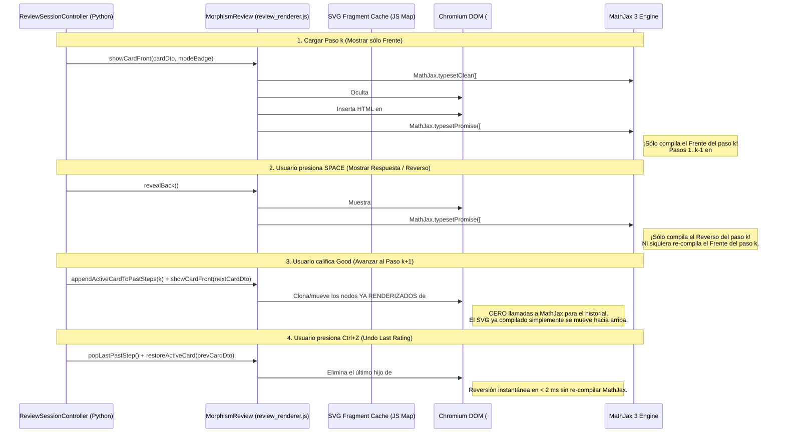

# 04 — Motor MathJax 3 Offline y Optimización Zero-Lag en Review Screen

> [!IMPORTANT]
> Este documento responde directamente a los puntos #2 y #7 de [`specZ/old/Future_version.md`](file:///c:/repos/Morphism%20SRS%20proto2/specZ/old/Future_version.md):
> 1. *"consider that the review screen becomes really laggy with too many cards. Some optimization should be added but that keeps the ability to see previous steps. (Idea: ¿Podria ser la creación de **demasiados** entornos mathjax los cuales abren nuevas instancias TODO EL RATO? revisar)."*
> 2. *"Keep the current local mathjax format (The app MUST be usable without internet)."*

---

## 1. Diagnóstico Forense: ¿Por qué se Volvía Lenta la Pantalla de Review en el Prototipo 1?

Tu hipótesis en `Future_version.md` dio exactamente en el clavo. Al inspeccionar [`review_view.py`](file:///c:/repos/New%20SRS%20Project/review_view.py#L187-L200) y [`review_view.py`](file:///c:/repos/New%20SRS%20Project/review_view.py#L399-L436) del Prototipo 1, encontramos **4 problemas críticos acumulados**:

### Causa 1: Re-compilación Cuadrática $O(N^2)$ de MathJax en Notas Seriales
En `review_view.py` (líneas 409–436), cada vez que avanzabas al paso $k$ (o simplemente mostrabas el reverso del paso $k$ con `Space`), Python construía un mega-string HTML concatenando **todos los pasos anteriores** $A_1, A_2, \dots, A_{k-1}$ más el frente y reverso del paso $A_k$, y ejecutaba en JS:
```javascript
// PROTOTIPO 1 (review_view.py líneas 194-199):
container.innerHTML = content;
MathJax.typesetPromise([container]);
```
¿Qué ocurría internamente al hacer esto en una demostración de $N = 12$ pasos?
- En el paso 1 (Frente y Reverso): MathJax compilaba $A_1$ **2 veces**.
- En el paso 2 (Frente y Reverso): `innerHTML` destruía el SVG ya compilado de $A_1$, inyectaba el LaTeX crudo de $A_1 + A_2$ y obligaba a MathJax a **re-parsear y re-dibujar desde cero $A_1$ y $A_2$ (dos veces: al ver el frente de $A_2$ y otra vez al revelar el reverso de $A_2$)**.
- Para el paso $k$, MathJax compilaba $2k$ tarjetas completas (con frente y reverso).
- En toda la nota de $N$ pasos, el número total de compilaciones completas de tarjetas era:
  $$\sum_{k=1}^{N} 2k = N(N + 1) = O(N^2)$$
  Para una nota de 15 pasos con 6 fórmulas por paso, ¡MathJax estaba ejecutando **más de 1,440 compilaciones de ecuaciones LaTeX a SVG** en una sola nota!

### Causa 2: Fuga de Memoria en la Lista Interna `MathJax.startup.document` (Falta de `typesetClear`)
En MathJax 3, cada vez que se llama a `MathJax.typesetPromise([container])`, MathJax registra cada fórmula procesada como un objeto `MathItem` dentro de su lista vinculada interna `MathJax.startup.document.math`.
- Cuando reemplazas `container.innerHTML = ...` **sin llamar antes a `MathJax.typesetClear([container])`**, los nodos DOM antiguos desaparecen de la pantalla, pero **los objetos `MathItem` antiguos quedan retenidos en la memoria interna de MathJax 3**.
- Tras repasar 50 o 100 tarjetas en una sesión, `MathJax.startup.document.math` acumula miles de referencias a nodos DOM muertos, haciendo que cada nueva llamada a `typesetPromise()` recorra toda la lista histórica de la sesión antes de renderizar la tarjeta actual.

### Causa 3: Redibujado de Layout SVG Masivo al Tener `<details open>` sin Virtualización
Todos los pasos previos $A_1 \dots A_{k-1}$ contenían decenas de elementos `<svg>` complejos con glifos vectoriales. Al mutar `container.innerHTML`, el motor Blink de Chromium debía recalcular el *Layout* y *Paint* de todos los SVGs previos simultáneamente en el hilo principal.

### Causa 4: Inconsistencia `tex-chtml.js` vs `tex-svg.js` en el Modo Offline
En `course_storage.py` (línea 12), el verificador offline comprobaba la existencia de `assets/tex-chtml.js`, mientras que `review_view.py` (línea 184) y `node_editor_dialog.py` (línea 107) cargaban `<script src="tex-svg.js"></script>`.

---

## 2. Arquitectura "Zero-Lag" de MathJax en Prototipo 2 ($O(1)$ Estricto)

Para lograr que una sesión de 500 tarjetas o una demostración de 40 pasos se sienta **instantánea (`< 4 ms` por transición)** manteniendo visible todo el historial de pasos previos (en modo `serial`) o el contexto circundante $\{A_j : j \ne i\}$ (en modo `cloze`), el Prototipo 2 rediseña completamente el DOM y el ciclo de vida de MathJax en `resources/web/html/review.html` y `resources/web/js/review_renderer.js`.

### 2.1 Estructura DOM Desacoplada en Regiones Independientes

En lugar de un único `#card-container` cuyo `innerHTML` se destruye en cada clic, `review.html` divide el documento en regiones aisladas para que los nodos ya renderizados nunca se destruyan ni re-compilen:

```html
<!DOCTYPE html>
<html lang="es">
<head>
    <meta charset="utf-8">
    <link rel="stylesheet" href="morphism://assets/css/theme_vars.css">
    <link rel="stylesheet" href="morphism://assets/css/cards.css">
    <script src="morphism://assets/js/mathjax_init.js"></script>
    <script src="morphism://assets/vendor/mathjax/tex-svg-full.js"></script>
    <script src="morphism://assets/js/review_renderer.js" defer></script>
</head>
<body>
    <main class="review-stage" id="review-stage">
        <!-- 1. Banner de Modo (Oculto en notas standard) -->
        <header id="mode-header" class="serial-header hidden">
            <span id="mode-badge" class="seq-badge"></span>
            <button id="btn-toggle-past" class="btn-ghost-sm" onclick="MorphismReview.togglePastSteps()">
                📜 Toggle Context Steps (<span id="past-count">0</span>)
            </button>
        </header>

        <!-- 2. Contenedor Superior: Pasos Previos A_1..A_{i-1} (en Serial y Cloze) -->
        <section id="past-steps-wrapper" class="past-steps-wrapper hidden">
            <div id="past-steps-list" class="past-steps-list"></div>
        </section>

        <!-- 3. Tarjeta Activa Actual A_i: Separada en Frente y Reverso independientes -->
        <article id="active-card" class="active-card">
            <div id="active-card-title" class="card-title"></div>
            <div id="active-card-front" class="card-body"></div>
            <hr id="active-card-divider" class="divider hidden">
            <div id="active-card-back" class="card-body hidden"></div>
        </article>

        <!-- 4. Contenedor Inferior (Sólo en modo Cloze): Componentes Posteriores A_{i+1}..A_n -->
        <section id="cloze-after-wrapper" class="past-steps-wrapper hidden">
            <div id="cloze-after-list" class="past-steps-list"></div>
        </section>
    </main>
</body>
</html>
```

### 2.2 Flujo Incremental $O(1)$ en `review_renderer.js`

Observa cómo funciona cada acción del usuario sin jamás re-renderizar pasos anteriores ni siquiera re-renderizar el Frente al mostrar el Reverso:



### 2.3 Especificación Exacta del Motor JS (`review_renderer.js`)

```javascript
window.MorphismReview = (() => {
    // Caché LRU en memoria de fragmentos DOM ya procesados por MathJax:
    // Clave: `${cardId}_v${contentVersion}_${side}` -> HTML string con <mjx-container> ya generado
    const typesetCache = new Map();
    const MAX_CACHE_ENTRIES = 300;

    function clearMathJaxScope(elements) {
        if (window.MathJax && window.MathJax.typesetClear) {
            window.MathJax.typesetClear(elements);
        }
    }

    async function renderElementWithCache(element, cacheKey, rawHtml) {
        if (typesetCache.has(cacheKey)) {
            element.innerHTML = typesetCache.get(cacheKey);
            return;
        }
        element.innerHTML = rawHtml;
        if (window.MathJax && window.MathJax.typesetPromise) {
            await window.MathJax.typesetPromise([element]);
            if (typesetCache.size >= MAX_CACHE_ENTRIES) {
                const firstKey = typesetCache.keys().next().value;
                typesetCache.delete(firstKey);
            }
            typesetCache.set(cacheKey, element.innerHTML);
        }
    }

    return {
        /**
         * Inicializa los pasos previos A_1 .. A_{k-1} UNA SOLA VEZ al abrir una nota serial.
         */
        async initSerialPastSteps(pastStepsArray) {
            const wrapper = document.getElementById('past-steps-wrapper');
            const list = document.getElementById('past-steps-list');
            const afterWrapper = document.getElementById('cloze-after-wrapper');
            const header = document.getElementById('mode-header');

            clearMathJaxScope([list]);
            list.innerHTML = '';
            afterWrapper.classList.add('hidden');

            if (!pastStepsArray || pastStepsArray.length === 0) {
                wrapper.classList.add('hidden');
                return;
            }

            wrapper.classList.remove('hidden');
            header.classList.remove('hidden');
            document.getElementById('past-count').textContent = pastStepsArray.length;

            for (const step of pastStepsArray) {
                const item = document.createElement('div');
                item.className = 'past-step-item';
                item.dataset.cardId = step.id;
                const cacheKey = `past_${step.id}_v${step.version}`;
                const rawHtml = `
                    <div class="past-step-title">Step ${step.position + 1}: ${step.title}</div>
                    <div class="past-step-front">${step.front}</div>
                    <div class="past-step-back">${step.back}</div>
                `;
                list.appendChild(item);
                await renderElementWithCache(item, cacheKey, rawHtml);
            }
        },

        /**
         * Inicializa el contexto holístico {A_j : j != i} para una nota en modo Cloze.
         * Aprovecha typesetCache para que al pasar de evaluar A_i a A_{i'} los hermanos
         * se rendericen en 0 ms desde caché sin volver a invocar MathJax.
         */
        async renderClozeContext(precedingCards, succeedingCards) {
            await this.initSerialPastSteps(precedingCards);
            const afterWrapper = document.getElementById('cloze-after-wrapper');
            const afterList = document.getElementById('cloze-after-list');
            clearMathJaxScope([afterList]);
            afterList.innerHTML = '';

            if (!succeedingCards || succeedingCards.length === 0) {
                afterWrapper.classList.add('hidden');
                return;
            }

            afterWrapper.classList.remove('hidden');
            for (const step of succeedingCards) {
                const item = document.createElement('div');
                item.className = 'past-step-item cloze-context-card';
                item.dataset.cardId = step.id;
                const cacheKey = `past_${step.id}_v${step.version}`;
                const rawHtml = `
                    <div class="past-step-title">Component ${step.position + 1}: ${step.title}</div>
                    <div class="past-step-front">${step.front}</div>
                    <div class="past-step-back">${step.back}</div>
                `;
                afterList.appendChild(item);
                await renderElementWithCache(item, cacheKey, rawHtml);
            }
        },

        /**
         * Promueve la tarjeta activa actual (cuyo frente y reverso YA están renderizados en SVG)
         * directamente al final de #past-steps-list en O(1) sin invocar MathJax.
         */
        appendActiveCardToPastSteps(stepNumber) {
            const list = document.getElementById('past-steps-list');
            const wrapper = document.getElementById('past-steps-wrapper');
            const titleEl = document.getElementById('active-card-title');
            const frontEl = document.getElementById('active-card-front');
            const backEl = document.getElementById('active-card-back');

            const item = document.createElement('div');
            item.className = 'past-step-item';
            item.innerHTML = `
                <div class="past-step-title">Step ${stepNumber}: ${titleEl.innerHTML}</div>
                <div class="past-step-front">${frontEl.innerHTML}</div>
                <div class="past-step-back">${backEl.innerHTML}</div>
            `;
            list.appendChild(item);
            wrapper.classList.remove('hidden');
            document.getElementById('past-count').textContent = list.children.length;
        },

        /**
         * Revierte la última promoción de paso cuando el usuario presiona Ctrl+Z (Undo).
         */
        popLastPastStep() {
            const list = document.getElementById('past-steps-list');
            const wrapper = document.getElementById('past-steps-wrapper');
            if (list.lastElementChild) {
                clearMathJaxScope([list.lastElementChild]);
                list.removeChild(list.lastElementChild);
            }
            document.getElementById('past-count').textContent = list.children.length;
            if (list.children.length === 0) {
                wrapper.classList.add('hidden');
            }
        },

        /**
         * Carga una nueva tarjeta y renderiza ÚNICAMENTE su frente.
         */
        async showCardFront(cardDto, tagClasses = []) {
            const cardArticle = document.getElementById('active-card');
            const titleEl = document.getElementById('active-card-title');
            const frontEl = document.getElementById('active-card-front');
            const backEl = document.getElementById('active-card-back');
            const dividerEl = document.getElementById('active-card-divider');

            cardArticle.className = ['active-card', ...tagClasses].join(' ');
            clearMathJaxScope([titleEl, frontEl, backEl]);
            backEl.classList.add('hidden');
            dividerEl.classList.add('hidden');
            backEl.innerHTML = '';

            // Guardar datos del reverso en memoria para cuando presione Space
            this._pendingBack = {
                id: cardDto.id,
                version: cardDto.version,
                html: cardDto.back
            };

            await renderElementWithCache(titleEl, `title_${cardDto.id}_v${cardDto.version}`, cardDto.title);
            await renderElementWithCache(frontEl, `front_${cardDto.id}_v${cardDto.version}`, cardDto.front);
        },

        /**
         * Revela el reverso y renderiza ÚNICAMENTE #active-card-back.
         */
        async revealBack() {
            if (!this._pendingBack) return;
            const backEl = document.getElementById('active-card-back');
            const dividerEl = document.getElementById('active-card-divider');
            dividerEl.classList.remove('hidden');
            backEl.classList.remove('hidden');

            const { id, version, html } = this._pendingBack;
            await renderElementWithCache(backEl, `back_${id}_v${version}`, html);
        },

        /**
         * Limpieza periódica de la caché de glifos cuando se cierra una sesión.
         */
        resetSession() {
            const stage = document.getElementById('review-stage');
            clearMathJaxScope([stage]);
            if (window.MathJax && window.MathJax.startup && window.MathJax.startup.document) {
                window.MathJax.startup.document.clear();
            }
        }
    };
})();
```

### 2.4 Virtualización CSS con `content-visibility: auto`
En `resources/web/css/cards.css`, cada elemento `.past-step-item` incluye:
```css
.past-step-item {
    content-visibility: auto;
    contain-intrinsic-size: auto 110px;
}
```
Esta propiedad nativa de Chromium instruye al motor de renderizado a **omitir por completo el cálculo de layout y pintado de los SVGs de pasos previos que estén fuera del área visible de scroll**, reduciendo el costo de renderizado a cero incluso en demostraciones de 50 pasos.

---

## 3. Configuración MathJax 3 100% Offline y Gestión de Macros

### 3.1 Estándar Único: `tex-svg-full.js` Local con `fontCache: 'local'`
- Eliminamos por completo cualquier código que intente conectarse a `cdn.jsdelivr.net` en tiempo de ejecución.
- El bundle auto-contenido `tex-svg-full.js` (que incluye todas las extensiones TeX: `ams`, `newcommand`, `configmacros`, `color`, `bbox`, `cancel`, `mathtools`, `physics`, `braket`) se incluye dentro de `src/morphism_srs/resources/web/vendor/mathjax/tex-svg-full.js` y se sirve vía `morphism://assets/vendor/mathjax/tex-svg-full.js`.
- Se configura `svg: { fontCache: 'local' }` (no `'global'`), porque con `'global'` MathJax inyecta todos los `<path>` de glifos en un único `<svg id="MJX-SVG-global-cache">` oculto en el `<body>`; si luego se clona o mueve un nodo DOM, las referencias `<use xlink:href="...">` pueden fallar o crecer indefinidamente. Con `fontCache: 'local'`, cada bloque de fórmula es 100% autónomo y cacheable en `typesetCache`.

### 3.2 Perfil Compartido `QWebEngineProfile` y Pre-Calentamiento (Warmup)
En el Prototipo 1, cada diálogo creaba un `QWebEngineView` desde cero al abrirse, causando un parpadeo blanco de ~400 ms mientras parseaba los 2.2 MB de `tex-svg.js`.
En el Prototipo 2:
1. Se instancia un único `QWebEngineProfile("MorphismOfflineProfile")` en memoria con caché de compilación V8 habilitada.
2. El `ReviewView` y un `PreviewWebEnginePool` (para `NodeEditorDialog` y `ScratchbookDialog`) se pre-inicializan en segundo plano tras mostrar la ventana principal (`QTimer.singleShot(100, ...)`), por lo que al abrir el Editor de Notas o la pantalla de Review, **MathJax ya está cargado en memoria y listo en `0 ms`**.
