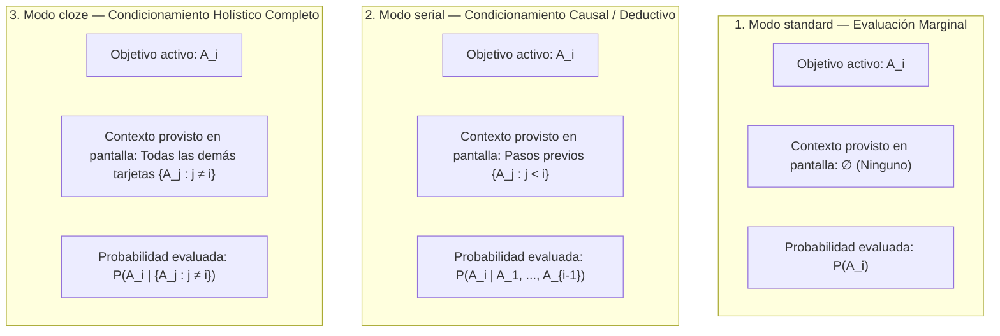

# 05 — Motor de Planificación FSRS v2, Modos Epistemológicos (`standard`, `serial`, `cloze`), Métricas y Sesiones Personalizadas

> [!IMPORTANT]
> Este documento especifica el modelo matemático y algorítmico completo de planificación de **Morphism SRS Prototype 2**, integrando:
> 1. La demostración del fallo de *Joint Retrievability* para scheduling (`Future_version.md` #7) y su reemplazo por **FSRS individual por tarjeta**, conservando $P(\bigcap A_i)$ como métrica estadística informativa junto a **Bottleneck Retrievability ($R_{\min}$)** y **Mean Retrievability ($\bar{R}$)**.
> 2. La fundamentación matemática formal de los **3 modos de nota**: **`standard`** ($P(A_i)$), **`serial`** ($P(A_i \mid A_1, \dots, A_{i-1})$) y **`cloze`** ($P(A_i \mid \{A_j : j \ne i\})$).
> 3. La máquina de estados de `ReviewSessionController` para cada modo (incluyendo el puente sobre pasos intermedios no vencidos en modo `serial` y el contexto holístico en modo `cloze`).
> 4. **Ordenamiento Topológico (Algoritmo de Kahn)**, **Auto-Estudio Global** y **Sesiones de Estudio Personalizado / Filtrado (`Custom Study`)**.
> 5. Reversión transaccional instantánea con **`Ctrl+Z` (`Undo Last Rating`)**.

---

## 1. Por qué se Elimina *Joint Retrievability* del Scheduling y se Conserva como Estadística

### 1.1 Análisis del Fallo Matemático en el Prototipo 1
En el Prototipo 1 (`models.py` líneas 220–250 y `main.py` líneas 371–398), una nota con $n$ tarjetas calculaba su retención conjunta asumiendo independencia:
$$P\left(\bigcap_{i=1}^n A_i\right) = \prod_{i=1}^n R_i(t)$$
y declaraba que la nota entera estaba vencida (`is_due = True`) en cuanto $\prod_{i=1}^n R_i(t) \le R_{\text{target}}$ (típicamente $0.85$).

**Consecuencia catastrófica para el calendario de estudio**:
- Supongamos una nota `standard` de definiciones topológicas con $n = 10$ tarjetas, o una demostración `serial` de $n = 10$ pasos.
- Para que el producto $\prod_{i=1}^{10} R_i(t)$ sea mayor que $0.85$, cada tarjeta individual debe mantenerse por encima de:
  $$R_i(t) \ge (0.85)^{1/10} \approx 0.9839 \quad (98.4\%)$$
- Como la curva de olvido de FSRS decae de $100\%$ a $85\%$ a lo largo del intervalo programado $S$ (estabilidad), caer de $100\%$ a $98.4\%$ toma apenas una fracción diminuta del intervalo ($\approx 0.09 \cdot S$).
- Resultado: ¡Una nota con 10 tarjetas cuya estabilidad era de 30 días se marcaba como vencida (`🔴 Due`) **apenas unas horas después de haber sido repasada**, y a los pocos días su $P(\bigcap A_i)$ colapsaba cerca de $0\%$!

---

## 2. El Nuevo Modelo de Vencimiento (`is_due`) y el Trío de Métricas Analíticas

### 2.1 Regla Canónica de Vencimiento (`is_due`)
En el Prototipo 2, el vencimiento de una tarjeta y de una nota se define **sin productos de probabilidades**:

1. **Vencimiento de una Tarjeta Individual ($c_i$)**:
   Una tarjeta activa (`deleted_at IS NULL AND archived_at IS NULL AND is_suspended = 0`) está **Due (Por Repasar)** en el instante $t_{\text{now}}$ si y solo si:
   $$\text{is\_due}(c_i, t_{\text{now}}) \iff \bigl(\text{state}(c_i) = 0 \text{ [New]}\bigr) \;\lor\; \bigl(\text{due\_at}(c_i) \le t_{\text{now}}\bigr)$$
   Donde $\text{due\_at}(c_i)$ es calculado directamente por FSRS para alcanzar la retención objetivo $R_{\text{target}}$ heredada según la cadena:
   $$\text{Nota (`desired\_retention`)} \longrightarrow \text{Curso (`scheduler\_preset\_id`)} \longrightarrow \text{Carpeta Padre (`course\_folders`)} \longrightarrow \text{Preset Global (`0.85`)}$$

2. **Vencimiento de una Nota ($N = \{c_1, \dots, c_n\}$)**:
   Una nota está **Due** si y solo si **al menos una** de sus tarjetas activas está Due:
   $$\text{is\_due}(N, t_{\text{now}}) \iff \exists\, c_i \in N \text{ tal que } \text{is\_due}(c_i, t_{\text{now}}) = \text{True}$$

3. **Conteo de Tarjetas Vencidas en el Nodo del Grafo (`due_count`)**:
   $$\text{due\_count}(N, t_{\text{now}}) = \sum_{c_i \in N} \mathbb{I}\bigl(\text{is\_due}(c_i, t_{\text{now}})\bigr)$$
   *(En el Prototipo 1, `due_count()` devolvía erróneamente `len(self.cards)` cuando `is_due()` era verdadero, haciendo creer que las 10 tarjetas estaban vencidas cuando solo 1 lo estaba).*

### 2.2 El Trío de Métricas Analíticas de Nivel Nota (Estadísticas y Filtros, Sin Alterar FSRS)
Aunque $P(\bigcap A_i)$ no debe gobernar el calendario de vencimiento, sigue siendo una métrica estadística valiosa para evaluar la probabilidad de recordar un sistema completo sin fallos. Por ello, el Prototipo 2 calcula y expone en `RetrievabilityPlotDialog`, en el inspector de notas y en el filtro de **Estudio Personalizado** las **3 métricas complementarias**:

| Métrica de la Nota | Fórmula Matemática | Interpretación Cognitiva y Uso en UI |
| :--- | :--- | :--- |
| **1. Bottleneck Retrievability ($R_{\min}$)** | $$R_{\min}(t) = \min_{1 \le i \le n} R_i(t)$$ | **El eslabón más débil**: En una demostración encadenada $A_1 \to \dots \to A_n$ o en un sistema `cloze`, tu capacidad de completar la estructura está acotada por el paso que peor recuerdas ($\min_i R_i$). Se muestra en la insignia principal del nodo en el grafo (`R_min = 87%`). |
| **2. Mean Retrievability ($\bar{R}$)** | $$\bar{R}(t) = \frac{1}{n}\sum_{i=1}^n R_i(t)$$ | **Dominio promedio del nodo**: Indica qué porcentaje promedio de las tarjetas de la nota se recuerda hoy. Ideal para notas `standard`. |
| **3. Joint Retrievability ($P(\bigcap A_i)$)** | $$P\left(\bigcap_{i=1}^n A_i\right) = \prod_{i=1}^n R_i(t)$$ | **Retención conjunta estricta**: Probabilidad bajo independencia de evocar simultáneamente las $n$ tarjetas sin ningún fallo. Disponible como curva en `RetrievabilityPlotDialog` y como criterio de filtrado en *Custom Study* (*"Repasar notas con $P(\bigcap A_i) \le 50\%$"*), **sin forzar vencimientos prematuros en FSRS**. |

---

## 3. Fundamentación Epistemológica y Matemática de los 3 Modos de Nota (`standard`, `serial`, `cloze`)

En Morphism SRS, una tarjeta (`cards`) es siempre una entidad atómica `(title, front, back)` que **no sabe en qué tipo de nota vive**. Es la **Nota (`notes.review_mode`)** quien define la **estructura de condicionamiento probabilístico** bajo la cual se evalúa cada tarjeta $A_i \in \{A_1, \dots, A_n\}$:



### 3.1 Comparativa Formal de los 3 Modos

| Modo (`review_mode`) | Silueta en Grafo | Probabilidad Modelada | Contexto Visible en `ReviewView` | Casos de Uso Matemáticos Típicos |
| :--- | :---: | :--- | :--- | :--- |
| **`standard`** | **Rectángulo** | $$P(A_i)$$ | **Ninguno** ($\varnothing$). Solo se muestra el frente de $A_i$. | Colección de definiciones, fórmulas o lemas independientes de una sección. |
| **`serial`** | **Rombo** | $$P(A_i \mid A_1, \dots, A_{i-1})$$ | **Prefijo causal $\{A_j : j < i\}$**: Se despliegan arriba en `#past-steps-list` todos los pasos anteriores a $A_i$. | Demostraciones constructivas o derivaciones largas paso a paso ($A_1 \to A_2 \to \dots \to A_n$). |
| **`cloze`** | **Círculo / Elipse** | $$P(A_i \mid \{A_j : j \ne i\})$$ | **Complemento completo $\{A_j : j \ne i\}$**: Se muestran resueltas tanto las tarjetas anteriores ($j < i$) como las posteriores ($j > i$). | Teoremas de equivalencia múltiple ($A_1 \iff A_2 \iff A_3 \iff A_4$), axiomas de una estructura algebraica o propiedades simétricas donde cada pieza se deduce del resto. |

---

## 4. Máquina de Estados de `ReviewSessionController` por Modo de Nota

```mermaid
stateDiagram-v2
    [*] --> EvaluateNoteMode: Usuario inicia repaso de Nota N = {A_1, ..., A_n}

    state EvaluateNoteMode <<choice>>
    EvaluateNoteMode --> StandardMode: review_mode == 'standard'
    EvaluateNoteMode --> SerialMode: review_mode == 'serial'
    EvaluateNoteMode --> ClozeMode: review_mode == 'cloze'

    state StandardMode {
        s1: Filtrar tarjetas c_i donde is_due(c_i) == True
        s2: Ordenar por position ASC
        s3: Mostrar sólo Frente de c_i (#past-steps-list oculto)
        s1 --> s2 --> s3
    }

    state SerialMode {
        ss1: Identificar conjunto de índices vencidos D = {i : is_due(A_i) == True}
        ss2: Sea k = min(D) el primer paso vencido
        ss3: Cargar A_1 .. A_{k-1} en #past-steps-list (Contexto Previo Dominado)
        ss4: Evaluar paso activo A_k; al aprobar, promover A_k a #past-steps-list en O(1)
        ss5: Si el siguiente vencido es m > k+1, incorporar pasos puente A_{k+1}..A_{m-1} a #past-steps-list
        ss1 --> ss2 --> ss3 --> ss4 --> ss5
    }

    state ClozeMode {
        c1: Identificar conjunto de índices vencidos D = {i : is_due(A_i) == True}
        c2: Para cada i en D (en orden position ASC):
        c3: Renderizar {A_j : j < i} en #past-steps-list y {A_j : j > i} en #cloze-after-list
        c4: Evaluar tarjeta activa A_i en #active-card condicionada en {A_j : j != i}
        c1 --> c2 --> c3 --> c4
    }
```

### 4.1 Detalle Operativo del Modo `standard` ($P(A_i)$)
- **Qué entra en la cola**: Únicamente las tarjetas $A_i \in N$ que cumplen $\text{is\_due}(A_i, t_{\text{now}}) = \text{True}$.
- **Comportamiento al calificar `Again (1)`**: La tarjeta actualiza su estado FSRS (`Learning` / `Relearning`) y se re-encola al final de la sesión activa hasta que el usuario logre calificarla con `Good` o `Easy`.

### 4.2 Detalle Operativo del Modo `serial` ($P(A_i \mid A_1, \dots, A_{i-1})$)
Supongamos una demostración de 6 pasos ($A_1 \dots A_6$) donde $A_1, A_2, A_3$ y $A_5$ están al día (no vencidos), pero **$A_4$ y $A_6$ están vencidos hoy**:
1. **Contexto Inicial ($j < 4$)**: Al abrir la nota, el primer paso vencido es $A_4$. Los pasos anteriores $A_1, A_2, A_3$ se cargan inmediatamente desplegados en el panel superior `#past-steps-list` (`📜 Previous Steps A_1 .. A_3`), para que el estudiante tenga presentes las hipótesis y lemas previos sin perder tiempo calificándolos.
2. **Evaluación de $A_4$**: Se muestra el frente de $A_4$ en `#active-card`. El estudiante deduce el paso 4 a partir de $A_1, A_2, A_3$, presiona `Space` para revelar el reverso y califica:
   - Si califica **`Again (1)`**: El paso $A_4$ oculta su reverso y se re-intenta antes de avanzar en la cadena.
   - Si califica **`Hard (2)`, `Good (3)` o `Easy (4)`**: `MorphismReview.appendActiveCardToPastSteps(4)` mueve el nodo DOM ya renderizado de $A_4$ a `#past-steps-list` en $O(1)$.
3. **Puente sobre pasos intermedios no vencidos ($A_5$)**:
   - Como el siguiente paso vencido es $A_6$ y depende deductivamente de $A_5$, el controlador inserta automáticamente el paso no vencido $A_5$ en `#past-steps-list` como contexto visible y salta directamente a evaluar **$A_6$**.
   - Así se garantiza rigurosamente que al evaluar cualquier $A_i$, **toda la cadena causal $\{A_1, \dots, A_{i-1}\}$ esté visible arriba**, pero FSRS solo evalúe y actualice los pasos vencidos.
   - *(Nota: Si el usuario desea recitar voluntariamente los 6 pasos desde $A_1$ hasta $A_6$ aunque no estén todos vencidos, puede elegir la acción secundaria **"🔄 Review Full Proof Chain"** en el menú contextual de la nota o en Custom Study).*

### 4.3 Detalle Operativo del Modo `cloze` ($P(A_i \mid \{A_j : j \ne i\})$)
A diferencia de Anki (donde un "cloze" es un simple reemplazo de subcadenas `{{c1::...}}` dentro de un único texto plano), en Morphism SRS una nota **`cloze`** modela un sistema de $n$ proposiciones o componentes $\{A_1, \dots, A_n\}$ mutuamente acoplados:

```text
+--------------------------------------------------------------------------------------------------+
| 🟣 CLOZE NOTE: "Teorema de Caracterizaciones Equivalentes de Compacidad en Espacios Métricos"    |
| Evaluando P(A_2 | {A_1, A_3, A_4}) — Componente 2 de 4                                           |
+--------------------------------------------------------------------------------------------------+
| 🌐 CONTEXTO PREVIO (#past-steps-list) — Componente A_1 (Visible Completo):                       |
|   [1. Compacidad por Recubrimientos (Borel-Lebesgue)]:                                           |
|   Todo recubrimiento abierto de (X, d) admite un subrecubrimiento finito.                        |
+--------------------------------------------------------------------------------------------------+
| ❓ COMPONENTE ACTIVO EN EVALUACIÓN (#active-card) — A_2:                                         |
|   [Frente]: Enuncie la caracterización por Compacidad Secuencial (Bolzano-Weierstrass)           |
|             equivalente a las condiciones A_1, A_3 y A_4.                                        |
|   --------------------------------------------------------------------------------------------   |
|   [Reverso (tras presionar Space)]:                                                              |
|   Toda sucesión (x_n) en X posee al menos una subsucesión que converge a un punto x ∈ X.         |
+--------------------------------------------------------------------------------------------------+
| 🌐 CONTEXTO POSTERIOR (#cloze-after-list) — Componentes A_3 y A_4 (Visibles Completos):          |
|   [3. Completitud y Total Acotación]:                                                            |
|   (X, d) es un espacio métrico completo y totalmente acotado.                                    |
|   [4. Propiedad de Intersección Finita (FIP)]:                                                   |
|   Toda familia de cerrados con la propiedad de intersección finita tiene intersección no vacía.  |
+--------------------------------------------------------------------------------------------------+
```

- Cuando vence $A_i$, el estudiante visualiza arriba $\{A_1, \dots, A_{i-1}\}$ en `#past-steps-list` y abajo $\{A_{i+1}, \dots, A_n\}$ en `#cloze-after-list`.
- Gracias a `typesetCache` en `review_renderer.js`, si en la misma sesión están vencidas $A_2$ y $A_4$, al pasar de evaluar $A_2$ a evaluar $A_4$, las tarjetas hermanas se intercambian entre los paneles de contexto en **`0 ms` sin volver a invocar MathJax**.

---

## 5. Ordenamiento Topológico, Auto-Estudio y Estudio Personalizado (`Custom Study`)

### 5.1 Ordenamiento Topológico (Algoritmo de Kahn) en Sesiones de Estudio
En el Prototipo 1, iniciar un repaso global iteraba las notas en el orden arbitrario en que fueron creadas, preguntando un teorema avanzado antes de haber repasado la definición de la cual dependía.
En el Prototipo 2, `SchedulerEngine.sort_notes_topologically(notes, links)` aplica el **Algoritmo de Kahn** sobre las aristas con `relation_type = 'prerequisite'`:
1. Calcula el nivel de profundidad topológica $\text{depth}(N)$ de cada nota ($\text{depth} = 0$ para definiciones/axiomas raíz sin prerrequisitos).
2. Ordena las notas con tarjetas vencidas por la tupla:
   $$\bigl(\text{depth}(N)\;\text{ASC},\; \text{display\_order}(N)\;\text{ASC},\; R_{\min}(N)\;\text{ASC}\bigr)$$
3. De este modo, **los fundamentos y definiciones se repasan siempre antes que los lemas y teoremas que los utilizan**.

### 5.2 Modalidad 1: "Auto-Estudio" (`▶️ Study Due`)
- Accesible con un clic desde la barra superior (para el curso activo, para una carpeta entera de cursos o para toda la colección).
- Recolecta automáticamente todas las tarjetas con $\text{is\_due}(c_i, t_{\text{now}}) = \text{True}$, ordena sus notas topológicamente y ejecuta la sesión respetando el modo (`standard`, `serial` o `cloze`) de cada nota.

### 5.3 Modalidad 2: "Estudio Personalizado / Filtrado" (`🎯 Custom Study Session`)
Permite crear sesiones a medida (como en Anki, pero integrando las métricas matemáticas y el grafo de Morphism SRS):

```text
+----------------------------------------------------------------------------------+
| 🎯 Create Custom Study / Cram Session                                            |
+----------------------------------------------------------------------------------+
| 1. Scope:                                                                        |
|    (•) Active Course ("Análisis Real I")     ( ) Entire Folder ("Mathematics")   |
|    ( ) Selected Notes in Browser / Graph (14 notes)                              |
|                                                                                  |
| 2. Card & Note Filter Criteria:                                                  |
|    [x] Notes with Bottleneck Retrievability R_min <= [ 75 ]%                     |
|    [ ] Notes with Joint Retrievability P(∩ A_i)  <= [ 40 ]%                      |
|    [ ] Cards due within the next [ 5 ] days (Review Ahead before Exam)           |
|    [ ] Leeches / Difficult cards only (Lapses >= [ 3 ] or Difficulty >= [ 7.5 ]) |
|    [ ] Filter by Note Mode: [x] Standard   [x] Serial   [x] Cloze                |
|    [ ] Filter by Tags (from tags_default.csv): [ theorem, measure_theory       ] |
|                                                                                  |
| 3. Serial & Cloze Behavior Override:                                             |
|    (•) Normal (Test only matching/due steps, show others as context)             |
|    ( ) Full Chain Recital (Test ALL steps A_1 .. A_n from start to finish)       |
|                                                                                  |
| 4. FSRS Rescheduling Policy:                                                     |
|    (•) Practice / Cram Only (Record in review_sessions, do NOT alter FSRS due)   |
|    ( ) Reschedule FSRS normally                                                  |
|                                                                                  |
| [ Cancel ]                                          [ 🚀 Start Session (42 Cards)]|
+----------------------------------------------------------------------------------+
```

---

## 6. Deshacer Calificación (`Undo Last Rating` — `Ctrl+Z` en Review)

Gracias a que `review_logs` en SQLite v2 almacena `state_before_json` y `card_schedules` guarda el estado exacto:
- Al presionar **`Ctrl+Z`** (o el botón `↩️ Undo` en la barra superior de Review):
  1. `ReviewSessionController` desapila el último `RateCardCommand` del `QUndoStack`.
  2. En una transacción atómica SQLite (`< 2 ms`):
     - Restaura `card_schedules` usando los valores exactos de `state_before_json`.
     - Elimina la fila recién creada en `review_logs`.
  3. En la vista `QWebEngineView`:
     - Si la nota era `serial` y el paso había sido promovido a `#past-steps-list`, invoca `MorphismReview.popLastPastStep()`.
     - Vuelve a mostrar la tarjeta anterior en `#active-card` (recuperada instantáneamente de `typesetCache`).
