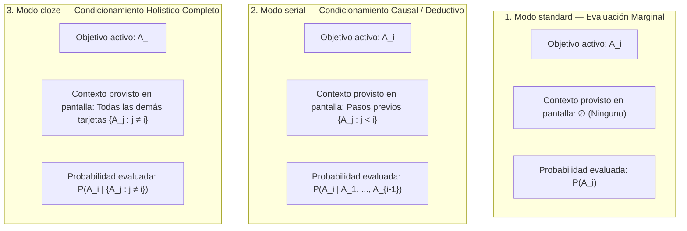

# 05 — Motor de Planificación FSRS, Modos Epistemológicos (`standard`, `serial`, `cloze`), Métricas y Sesiones Personalizadas

> [!IMPORTANT]
> Este documento especifica el modelo matemático y algorítmico de planificación de **Morphism SRS**, integrando:
> 1. El modelo de **FSRS individual por tarjeta** gestionado por [`SchedulerEngine`](../src/morphism_srs/domain/scheduler_engine.py), conservando $P_{\text{joint}} = \prod R_i$ como métrica estadística analítica junto a **Bottleneck Retrievability ($R_{\min}$)** y **Mean Retrievability ($R_{\text{avg}}$)**.
> 2. La fundamentación matemática formal de los **3 modos de nota**: **`standard`** ($P(A_i)$), **`serial`** ($P(A_i \mid A_1, \dots, A_{i-1})$) y **`cloze`** ($P(A_i \mid \{A_j : j \ne i\})$).
> 3. La máquina de estados de [`ReviewController`](../src/morphism_srs/controllers/review_controller.py) para cada modo (secuencialidad estricta en notas seriales y aislamiento contextual en notas cloze).
> 4. **Ordenamiento Topológico (Algoritmo de Kahn)**, **Auto-Estudio** y **Sesiones de Estudio Personalizado (`Custom Study`)**.
> 5. Reversión transaccional con **`Ctrl+Z` (`Undo Last Rating`)** mediante `CommandStack` y `ReviewRepository.undo_review`.

---

## 1. Fundamento Matemático: FSRS Individual por Tarjeta y Métrica Informativa de Retención Conjunta

### 1.1 Inviabilidad de la Retención Conjunta como Criterio de Vencimiento
En un sistema epistémico compuesto por $n$ tarjetas que forman una nota (por ejemplo, los $n$ pasos deductivos de un teorema o una colección de definiciones acopladas), calcular la retención conjunta asumiendo independencia estocástica resulta en:
$$P\left(\bigcap_{i=1}^n A_i\right) = \prod_{i=1}^n R_i(t)$$
Si se utilizara esta probabilidad conjunta para gobernar el calendario de vencimiento de la nota (declarando la nota vencida en cuanto $\prod_{i=1}^n R_i(t) \le R_{\text{target}}$, por ejemplo $0.85$):
- Para una nota con $n = 10$ tarjetas, mantener el producto por encima de $0.85$ exigiría que cada tarjeta individual se mantuviese en:
  $$R_i(t) \ge (0.85)^{1/10} \approx 0.9839 \quad (98.4\%)$$
- Dado que la curva de olvido de FSRS decae de $100\%$ a $85\%$ a lo largo del intervalo programado $S$ (estabilidad), descender a $98.4\%$ consume apenas una fracción diminuta del intervalo programado ($\approx 9\%$).
- Como consecuencia, una nota de 10 tarjetas con estabilidad de 30 días se marcaría como vencida a las pocas horas de haber sido repasada, provocando sobre-repasos continuos.

Por este motivo, Morphism SRS establece que **el algoritmo FSRS calcula y actualiza los intervalos de repaso de forma estrictamente individual por cada tarjeta**, mientras que la retención conjunta se mantiene como una métrica agregada de observación analítica y filtro de estudio avanzado.

---

## 2. Reglas Canónicas de Vencimiento (`is_due`) y Métricas de Nota

### 2.1 Criterios Canónicos de Vencimiento en [`SchedulerEngine`](../src/morphism_srs/domain/scheduler_engine.py)
El vencimiento se determina sin multiplicación de probabilidades:

1. **Vencimiento de una Tarjeta Individual ($c_i$)**:
   Una tarjeta activa (`deleted_at IS NULL AND archived_at IS NULL AND is_suspended = 0`) está vencida (**Due**) en el instante $t_{\text{now}}$ si y solo si:
   $$\text{is\_due}(c_i, t_{\text{now}}) \iff \bigl(\text{state}(c_i) = \text{NEW}\bigr) \;\lor\; \bigl(\text{due\_at}(c_i) \le t_{\text{now}}\bigr) \;\lor\; \bigl(\text{state}(c_i) \in \{\text{LEARNING}, \text{RELEARNING}\}\bigr)$$
   Donde $\text{due\_at}(c_i)$ es determinado por FSRS v5 para alcanzar la retención objetivo heredada (`desired_retention`).

2. **Vencimiento de una Nota ($N = \{c_1, \dots, c_n\}$)**:
   Una nota está vencida si y solo si al menos una de sus tarjetas activas está vencida:
   $$\text{is\_due}(N, t_{\text{now}}) \iff \exists\, c_i \in N \text{ tal que } \text{is\_due}(c_i, t_{\text{now}}) = \text{True}$$

3. **Conteo de Tarjetas Vencidas en el Nodo (`due_count`)**:
   $$\text{due\_count}(N, t_{\text{now}}) = \sum_{c_i \in N} \mathbb{I}\bigl(\text{is\_due}(c_i, t_{\text{now}})\bigr)$$

### 2.2 Trío de Métricas Analíticas de Nivel Nota ([`compute_note_metrics`](../src/morphism_srs/domain/scheduler_engine.py#L144-L191))
Para cada tarjeta activa con estabilidad $S_i > 0$ y tiempo transcurrido $t_i$ en días desde el último repaso, FSRS v5 calcula la retención individual:
$$R(t_i, S_i) = \left(1 + \frac{19}{81} \cdot \frac{t_i}{S_i}\right)^{-0.5}$$

A nivel de nota, [`SchedulerEngine.compute_note_metrics`](../src/morphism_srs/domain/scheduler_engine.py#L144) calcula el trío de métricas expuesto en el gráfico de retención ([`RetrievabilityDialog`](../src/morphism_srs/ui/dialogs/retrievability_dialog.py)) y en el navegador del grafo:

| Métrica de la Nota | Fórmula Matemática | Interpretación y Visualización en UI |
| :--- | :--- | :--- |
| **1. Bottleneck Retrievability ($R_{\min}$)** | $$R_{\min}(t) = \min_{1 \le i \le n} R_i(t)$$ | **El eslabón más débil**: Acota la capacidad del estudiante para evocar una deducción encadenada completa o un sistema cerrado. Se proyecta en la insignia principal del nodo en el grafo (`R_min = 87%`). |
| **2. Mean Retrievability ($R_{\text{avg}}$)** | $$R_{\text{avg}}(t) = \frac{1}{n}\sum_{i=1}^n R_i(t)$$ | **Dominio promedio del nodo**: Mide el porcentaje promedio retenido de los conceptos de la nota. Métrica primaria para notas `standard`. |
| **3. Joint Retrievability ($P_{\text{joint}}$)** | $$P_{\text{joint}}(t) = \prod_{i=1}^n R_i(t)$$ | **Retención conjunta estricta**: Probabilidad bajo independencia de evocar simultáneamente todas las tarjetas de la nota sin fallar ninguna. Utilizada como criterio analítico y filtro en sesiones de estudio personalizado. |

---

## 3. Fundamentación Epistemológica y Matemática de los 3 Modos de Nota (`standard`, `serial`, `cloze`)

En Morphism SRS, una tarjeta (`cards`) es una entidad atómica `(title, front, back)` que no contiene acoplamiento rígido con la interfaz. Es la **Nota ([`notes.review_mode`](../src/morphism_srs/domain/enums.py#L13-L16))** la que define la **estructura de condicionamiento probabilístico** bajo la cual se evalúa cada tarjeta $A_i \in \{A_1, \dots, A_n\}$:



### 3.1 Comparativa Formal de los 3 Modos

| Modo (`review_mode`) | Silueta en Grafo | Probabilidad Modelada | Contexto Visible en [`ReviewView`](../src/morphism_srs/ui/views/review_view.py) | Casos de Uso Matemáticos Típicos |
| :--- | :---: | :--- | :--- | :--- |
| **`standard`** | **Rectángulo** | $$P(A_i)$$ | **Ninguno** ($\varnothing$). Solo se muestra el frente de $A_i$ en `#card-front`. | Colecciones de definiciones, fórmulas o lemas independientes de una sección. |
| **`serial`** | **Rombo** | $$P(A_i \mid A_1, \dots, A_{i-1})$$ | **Prefijo causal $\{A_j : j < i\}$**: Se despliegan en `#siblings-before` todos los pasos resueltos anteriores a $A_i$. | Demostraciones constructivas o derivaciones secuenciales paso a paso ($A_1 \to A_2 \to \dots \to A_n$). |
| **`cloze`** | **Círculo / Elipse** | $$P(A_i \mid \{A_j : j \ne i\})$$ | **Complemento contextual $\{A_j : j \ne i\}$**: Se muestran resueltas las tarjetas anteriores en `#siblings-before` y las posteriores en `#siblings-after`. | Desambiguación de proposiciones con alta interferencia mutua (e.g. caracterizaciones equivalentes de un espacio métrico). |

---

## 4. Máquina de Estados de `ReviewController` por Modo de Nota

```mermaid
stateDiagram-v2
    [*] --> EvaluateNoteMode: Usuario inicia sesión de repaso

    state EvaluateNoteMode <<choice>>
    EvaluateNoteMode --> StandardMode: review_mode == 'standard'
    EvaluateNoteMode --> SerialMode: review_mode == 'serial'
    EvaluateNoteMode --> ClozeMode: review_mode == 'cloze'

    state StandardMode {
        s1: Filtrar tarjetas c_i vencidas o en aprendizaje
        s2: Ordenar según criterio de sesión
        s3: Evaluar tarjeta sin contexto previo
        s4: Calificación Again -> Re-encolar al final de la cola activa
        s1 --> s2 --> s3 --> s4
    }

    state SerialMode {
        ss1: Cargar pasos de la nota secuencialmente (step_order ASC)
        ss2: Para paso activo A_k, mostrar pasos 1..k-1 en #siblings-before
        ss3: Calificación Again -> Permanecer en paso A_k hasta dominarlo
        ss4: Calificación Hard -> Avanzar a A_{k+1}, marcar k no dominado
        ss5: Fin de lote -> Re-iniciar ciclo desde el paso no dominado más temprano
        ss1 --> ss2 --> ss3
        ss2 --> ss4
        ss4 --> ss5
    }

    state ClozeMode {
        c1: Identificar tarjeta objetivo A_i
        c2: Renderizar {A_j : j < i} en #siblings-before
        c3: Renderizar {A_j : j > i} en #siblings-after
        c4: Evaluar A_i condicionado al contexto circundante
        c1 --> c2 --> c3 --> c4
    }
```

### 4.1 Detalle Operativo del Modo `standard` ($P(A_i)$)
- **Composición de la cola**: Ingresan las tarjetas que cumplen $\text{is\_due}(c_i, t_{\text{now}}) = \text{True}$ o tarjetas seleccionadas en estudio personalizado.
- **Calificación `Again (1)`**: La tarjeta pasa a estado de reaprendizaje (`Learning` / `Relearning`) y [`ReviewController.submit_rating`](../src/morphism_srs/controllers/review_controller.py#L384-L387) la re-encola al final de la cola activa para repetirla en la misma sesión hasta que se domine con `Good` o `Easy`.

### 4.2 Detalle Operativo del Modo `serial` ($P(A_i \mid A_1, \dots, A_{i-1})$)
En notas de demostración o derivación encadenada, el orden cognitivo es estrictamente causal:
1. **Contexto Previo**: Al evaluar el paso $k$, [`SchedulerEngine.build_prompt_context`](../src/morphism_srs/domain/scheduler_engine.py#L318-L332) recopila todos los pasos $j < k$ como `SiblingCardContext` con `position = "before"`, desplegándolos en `#siblings-before` para que las hipótesis y deducciones intermedias previas estén disponibles.
2. **Evaluación de $A_k$ y Manejo de Calificaciones**:
   - Si el usuario califica **`Again (1)`**: El controlador **no avanza el índice de la cola** (`_current_index` se preserva); la tarjeta oculta su respuesta y permanece activa para que el estudiante consolide el paso actual antes de intentar deducir el siguiente.
   - Si el usuario califica **`Hard (2)`**: El controlador avanza a $A_{k+1}$, pero registra el paso como no dominado en la sesión (`_session_card_mastered[card.id] = False`). Al completarse la cadena, el sistema re-abre la deducción ciclando hacia el paso no dominado más temprano en orden ascendente de `step_order`.
   - Si el usuario califica **`Good (3)`** o **`Easy (4)`**: El paso se registra como dominado (`_session_card_mastered[card.id] = True`) y se avanza al siguiente paso deductivo.

### 4.3 Detalle Operativo del Modo `cloze` ($P(A_i \mid \{A_j : j \ne i\})$)
A diferencia de los reemplazos estáticos de texto plano tipo Anki, en Morphism SRS una nota **`cloze`** representa un sistema acoplado de componentes $\{A_1, \dots, A_n\}$:

```text
+--------------------------------------------------------------------------------------------------+
| 🟣 CLOZE NOTE: "Teorema de Caracterizaciones Equivalentes de Compacidad en Espacios Métricos"    |
| Evaluando P(A_2 | {A_1, A_3, A_4}) — Componente 2 de 4                                           |
+--------------------------------------------------------------------------------------------------+
| 🌐 CONTEXTO PREVIO (#siblings-before) — Componente A_1 (Visible Completo):                       |
|   [1. Compacidad por Recubrimientos (Borel-Lebesgue)]:                                           |
|   Todo recubrimiento abierto de (X, d) admite un subrecubrimiento finito.                        |
+--------------------------------------------------------------------------------------------------+
| ❓ COMPONENTE ACTIVO EN EVALUACIÓN (#active-card-box) — A_2:                                     |
|   [Frente]: Enuncie la caracterización por Compacidad Secuencial (Bolzano-Weierstrass)           |
|             equivalente a las condiciones A_1, A_3 y A_4.                                        |
|   --------------------------------------------------------------------------------------------   |
|   [Reverso (tras presionar Space)]:                                                              |
|   Toda sucesión (x_n) en X posee al menos una subsucesión que converge a un punto x ∈ X.         |
+--------------------------------------------------------------------------------------------------+
| 🌐 CONTEXTO POSTERIOR (#siblings-after) — Componentes A_3 y A_4 (Visibles Completos):           |
|   [3. Completitud y Total Acotación]:                                                            |
|   (X, d) es un espacio métrico completo y totalmente acotado.                                    |
|   [4. Propiedad de Intersección Finita (FIP)]:                                                   |
|   Toda familia de cerrados con la propiedad de intersección finita tiene intersección no vacía.  |
+--------------------------------------------------------------------------------------------------+
```

Al evaluar la componente $A_i$, [`SchedulerEngine.build_prompt_context`](../src/morphism_srs/domain/scheduler_engine.py#L333-L348) suministra los elementos $j < i$ como `position = "before"` y los elementos $j > i$ como `position = "after"`, permitiendo evaluar el elemento omitido con aislamiento contextual perfecto.

---

## 5. Ordenamiento Topológico, Auto-Estudio y Estudio Personalizado (`Custom Study`)

### 5.1 Ordenamiento Topológico (Algoritmo de Kahn) en Sesiones de Repaso
Para evitar evaluar conceptos avanzados antes de que sus prerrequisitos hayan sido repasados, [`SchedulerEngine.topological_sort_notes`](../src/morphism_srs/domain/scheduler_engine.py#L362-L392) aplica el **Algoritmo de Kahn** sobre las aristas de prerrequisitos del grafo de conocimiento:
1. Construye el mapa de adyacencia y calcula los grados de entrada (`in_degree`) para el conjunto de notas involucradas.
2. Procesa la cola mediante `collections.deque`, ordenando las notas libres de dependencias pendientes en primer lugar.
3. El orden final del lote de tarjetas combina:
   $$\bigl(\text{topo\_rank}(N)\;\text{ASC},\; \text{step\_order}(c)\;\text{ASC},\; \text{due\_at}(c)\;\text{ASC}\bigr)$$
   Asegurando que los fundamentos y definiciones se repasen sistemáticamente antes que los teoremas y corolarios derivados.

### 5.2 Modalidad 1: Auto-Estudio (`ReviewController.start_auto_study`)
- Se ejecuta directamente desde el botón principal de la barra de navegación o mediante atajo de teclado.
- Invoca [`ReviewController.start_auto_study`](../src/morphism_srs/controllers/review_controller.py#L69-L89), configurando un [`CustomStudyConfig`](../src/morphism_srs/controllers/review_controller.py#L23-L35) con `only_due_or_new = True` y `sort_criterion = "topological_due"`.

### 5.3 Modalidad 2: Estudio Personalizado y Filtrado ([`CustomStudyDialog`](../src/morphism_srs/ui/dialogs/custom_study_dialog.py))
Permite configurar sesiones de repaso focalizadas y simulacros previos a exámenes:
- **Ámbito (Scope)**: Curso activo, carpeta con cursos descendientes o notas seleccionadas en el grafo.
- **Inclusión de Ancestros**: Opción para incluir automáticamente notas prerrequisito ancestros mediante [`NoteRepository.get_ancestors_recursive`](../src/morphism_srs/storage/repositories/note_repo.py).
- **Criterios de Ordenación (`sort_criterion`)**:
  - `topological_due`: Orden topológico estándar según el DAG.
  - `bottleneck_r_min`: Prioriza notas con menor retención mínima ($R_{\min}$).
  - `joint_retrieval`: Prioriza notas con menor retención conjunta ($P_{\text{joint}}$).
  - `lowest_stability`: Prioriza tarjetas con menor estabilidad en FSRS.
  - `most_lapses`: Prioriza tarjetas con mayor historial de fallos ("leeches").
- **Modo Sandbox (`cram_sandbox: bool`)**:
  - Al activarse, permite realizar repasos intensivos sin alterar el calendario FSRS real ni registrar transacciones permanentes en `review_logs`.

---

## 6. Deshacer Calificación (`Undo Last Rating` — `Ctrl+Z` en Review)

El sistema de deshacer en la vista de repaso opera de manera transaccional:
1. Al calificar una tarjeta, [`ReviewController.submit_rating`](../src/morphism_srs/controllers/review_controller.py#L272) apila un [`UndoableCommand`](../src/morphism_srs/controllers/commands.py#L9) en su `CommandStack`.
2. Al pulsar **`Ctrl+Z`** o el botón `↩ Undo`:
   - [`ReviewController.undo_last_review()`](../src/morphism_srs/controllers/review_controller.py#L414) ejecuta la función `undo_fn`.
   - Dentro de un [`UnitOfWork`](../src/morphism_srs/storage/unit_of_work.py#L12), [`ReviewRepository.undo_review(log_id)`](../src/morphism_srs/storage/repositories/review_repo.py#L129-L163) restaura la fila de `card_schedules` a su estado previo exacto mediante `state_before_json` y elimina el registro en `review_logs`.
   - Se restaura el índice de la sesión (`_restore_queue_index`) y los indicadores de dominio de la tarjeta.
   - Se emite `EventBus.review_state_changed`, provocando que [`ReviewView._render_current_card()`](../src/morphism_srs/ui/views/review_view.py#L227) envíe inmediatamente el nuevo estado restaurado al DOM web mediante `window.MorphismReview.renderCardState(...)`.
