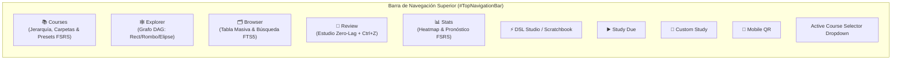
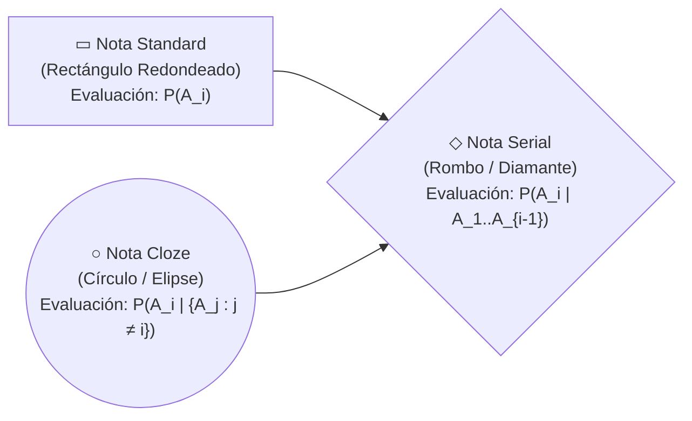

# 07 — Especificación de Vistas UI, Graph Explorer v2, Formas de Nodos, Navegador Masivo y Adaptabilidad 720p

> [!IMPORTANT]
> Este documento detalla todos los componentes de interfaz gráfica en PySide6 del Prototipo 2, integrando:
> 1. **Selección y borrado masivo de notas en el Browser** (`Future_version.md` #31) respaldado por `FTS5` y transacciones atómicas reversibles con **`Ctrl+Z` (`QUndoStack`)**.
> 2. **Diferenciación geométrica en el `GraphExplorerView`**: **Rectángulos** para notas `standard`, **Rombos** para notas `serial` y **Círculos / Elipses** para notas `cloze`, junto con selección múltiple *Rubber-Band Marquee* y renderizado LOD a 60 FPS.
> 3. **Reglas de dimensionamiento relativo al monitor** para garantizar usabilidad perfecta en laptops de **720p ($1280 \times 720$ / $1366 \times 768$)** hasta monitores 4K.
> 4. Especificación completa de `CoursesView v2`, `NodeEditorDialog v2` (con pegado directo de imágenes/SVG vía `Ctrl+V`), `Scratchbook & DSL Studio v2`, `StatsView v2` y `RetrievabilityPlotDialog v2`.

---

## 1. Estructura de Navegación Principal (`MainWindow` Shell)

En el Prototipo 1 existían 4 pestañas (`📚 Courses`, `🕸️ Explorer`, `🧠 Review`, `📊 Stats`). En el Prototipo 2 se añade una **5ª pestaña central dedicada (`🗂️ Browser`)**, acceso rápido al **Scratchbook & DSL Studio**, **Custom Study** y el botón de **Sesión Móvil QR Bajo Demanda**:



---

## 2. Nueva Vista: `🗂️ Browser` (`NoteBrowserView` — Gestión y Borrado Masivo)

El Prototipo 1 carecía de una vista tabular tipo Anki Browser: para borrar 20 notas importadas por error había que hacer clic derecho $\to$ *Delete Note* $\to$ confirmar en un popup **20 veces seguidas** sobre el lienzo del grafo.

`NoteBrowserView` resuelve esto de raíz proporcionando un explorador de alta velocidad respaldado por SQLite y `FTS5`:

### 2.1 Diseño de Pantalla en 3 Paneles (`QSplitter` con Memoria)

```text
+--------------------------------------------------------------------------------------------------+
| 🔍 [ Search notes & cards (e.g. "Lebesgue" tag:measure_theory mode:serial is:due) ] [Clear]      |
+-----------------------+----------------------------------------------+---------------------------+
| 📁 FACET FILTERS      | 📋 NOTES & CARDS TABLE (Multi-Select)        | 👁️ INSPECTOR / PREVIEW   |
|                       | [x] Select All (24 selected)                 |                           |
| ▾ All Courses         | +---+--------------+--------+-------+------+ | Note: Medida Exterior     |
|   ▸ Mathematics       | | ✓ | Note Title   | Mode   | Cards | Due  | | Mode: [serial         v] |
|     • Análisis Real   | +---+--------------+--------+-------+------+ | Tags: [measure_theory][+] |
|     • Álgebra Lineal  | | ☑ | Medida Ext.. | Serial |   5   | 2 Due| | R_min: 86% | P(∩): 51%   |
| ▾ Status              | | ☑ | Lema Fatou   | Serial |   4   | 0 Due| | ------------------------- |
|   • 🔴 Due Now (18)   | | ☑ | Compacidad   | Cloze  |   4   | 1 Due| | Card #1 Preview (MathJax) |
|   • 🆕 New (42)       | | ☑ | Conj. Cantor | Std    |   3   | New  | |                           |
|   • ⚠️ Leeches (3)    | | ☐ | Teor. Fubini | Serial |   6   | OK   | | [✏️ Open Full Note Editor]|
|   • 🗑️ Trash (5)      | +---+--------------+--------+-------+------+ |                           |
| ▾ Note Modes          | +------------------------------------------+ |                           |
|   • ▭ Standard        | | ⚡ BULK ACTIONS BAR (24 Notes Selected): | |                           |
|   • ◇ Serial          | | [🗑️ Delete Selected] [🏷️ Tag] [📁 Move] | |                           |
|   • ○ Cloze           | | [🔀 Change Mode] [⏸️ Suspend] [🎯 Study]| |                           |
| ▾ Standard Tags       | +------------------------------------------+ |                           |
|   • #theorem (84)     |                                              |                           |
|   • #definition (62)  |                                              |                           |
+-----------------------+----------------------------------------------+---------------------------+
```

### 2.2 Características Técnicas del `NoteBrowserView`
1. **Modos de Visualización Conmutables (`Notes Mode` vs `Cards Mode`)**:
   - **Vista por Notas (Por defecto)**: Cada fila es una Nota (`notes`). Muestra `UUID corto`, `Title`, `Course(s)`, `Review Mode` (`standard | serial | cloze`), `Total Cards`, `Due Count`, `R_min`, `R_mean`, `P(∩)`, `Tags` y `Created At`.
   - **Vista por Tarjetas**: Cada fila es una Tarjeta atómica (`cards`). Permite buscar y seleccionar pasos específicos dentro de notas `serial` o componentes de notas `cloze`.
2. **Selección Masiva Nativa y Rápida**:
   - Configurado con `QAbstractItemView.ExtendedSelection` + columna de casillas de verificación (`Qt.ItemIsUserCheckable`).
   - Soporta **`Ctrl + A`** (seleccionar todas las filas filtradas), **`Shift + Clic`** (seleccionar un rango continuo de 100 notas en dos clics), **`Ctrl + Clic`** (selección discontinua) y **`Espacio`** para marcar/desmarcar todas las filas resaltadas.
3. **Barra Contextual de Acciones en Masa (`#BulkActionsBar`)**:
   Aparece automáticamente en la parte inferior de la tabla cuando hay $\ge 1$ elementos seleccionados:
   - **`🗑️ Delete Selected (Del)`**:
     - Muestra un único diálogo de confirmación claro con tres opciones:
       1. *Move $N$ Notes to Trash (Soft Delete — Reversible inmediatamente con `Ctrl+Z`)*
       2. *Remove $N$ Notes from Current Course Only (si pertenecen a múltiples cursos)*
       3. *Permanently Delete $N$ Notes and their Cards from Database (Hard Delete)*
     - Ejecuta el borrado de las $N$ notas en **una sola transacción SQLite (`< 5 ms`)** y registra el comando en `QUndoStack`.
   - **`🏷️ Add / Remove Tags...`**: Abre un selector con autocompletado instantáneo sobre los **2,000 tags estándar** de [`specZ/tags_default.csv`](file:///c:/repos/Morphism%20SRS%20proto2/specZ/tags_default.csv) para etiquetar las $N$ notas de golpe (reversible con `Ctrl+Z`).
   - **`🔀 Change Note Mode...`**: Cambia el `review_mode` (`standard`, `serial`, `cloze`) en lote.
   - **`📁 Move / Share to Course...`**: Mueve las notas a otro curso o las comparte (añade entradas en `course_notes`) sin duplicar las tarjetas.
   - **`🔄 Reschedule FSRS`**: Recalcula el estado FSRS de todas las notas seleccionadas reproduciendo sus `review_logs` con el preset activo.
   - **`🎯 Custom Study Selected`**: Inicia inmediatamente una sesión de estudio personalizada únicamente con las notas seleccionadas.

---

## 3. `🕸️ GraphExplorerView v2` — Siluetas Geométricas por Modo, Selección Marquee y 60 FPS

Además del nuevo `NoteBrowserView`, el propio lienzo del grafo (`GraphExplorerView`) se rediseña para diferenciar visualmente los 3 modos de nota y soportar **selección masiva e interacción fluida a 60 FPS**:

### 3.1 Diferenciación Visual de Nodos por Silueta Geométrica (`standard`, `serial`, `cloze`)
En `GraphExplorerView`, cada nota se distingue instantáneamente en el lienzo por su **forma geométrica**, permitiendo distinguir de un vistazo qué nodos son conjuntos de definiciones, cuáles son demostraciones encadenadas y cuáles son sistemas de equivalencia `cloze`:



#### Especificación Exacta de Trazado (`QPainterPath`) en `NoteNodeItem`:
| Modo (`review_mode`) | Silueta Geométrica | Implementación en `NoteNodeItem.shape()` y `paint()` | Paleta de Tokens (cuando está al día) |
| :--- | :--- | :--- | :--- |
| **`standard`** | **Rectángulo Redondeado** (`▭`) | `path.addRoundedRect(0, 0, W, H, 12, 12)`<br>Dimensiones base: $W = 210\text{ px},\; H = 86\text{ px}$. | `node_ok_start` $\to$ `node_ok_end`, borde `node_ok_border` (`#10b981`). |
| **`serial`** | **Rombo / Diamante** (`◇`) | `QPolygonF([QPointF(W/2, 0), QPointF(W, H/2), QPointF(W/2, H), QPointF(0, H/2)])`<br>Dimensiones base: $W = 240\text{ px},\; H = 110\text{ px}$ para alojar cómodamente el texto dentro del diamante. | `node_serial_start` $\to$ `node_serial_end`, borde `node_serial_border` (`#818cf8`). |
| **`cloze`** | **Elipse / Círculo** (`○`) | `path.addEllipse(0, 0, W, H)`<br>Dimensiones base: $W = 220\text{ px},\; H = 96\text{ px}$. | `node_cloze_start` $\to$ `node_cloze_end`, borde `node_cloze_border` (`#c084fc`). |

*(Nota: Cuando cualquier nodo tiene tarjetas vencidas `due_cards_count > 0`, su relleno y borde conmutan a los tokens de alerta `node_due_start` / `node_due_border` conservando intacta su silueta de rectángulo, rombo o elipse).*

### 3.2 Selección Múltiple por Rectángulo (*Rubber-Band Marquee*) y `Ctrl+Clic`
En el Prototipo 1, `QGraphicsView` estaba fijo en `ScrollHandDrag`, por lo que arrastrar el ratón siempre movía la cámara y **era imposible arrastrar un rectángulo de selección sobre varios nodos**.

En el Prototipo 2 implementamos interacción dual estándar de editores de nodos profesionales (como Blender / Obsidian Canvas / Miro):
- **Arrastrar con Botón Izquierdo sobre el fondo vacío (o `Shift + Arrastrar`)**: Dibuja un rectángulo de selección (*Rubber-Band Marquee*) estilizado con borde `--accent-primary` y fondo semitransparente `rgba(99, 102, 241, 0.15)`, seleccionando todos los `NoteNodeItem` dentro del área.
- **Arrastrar con Botón Central del Ratón o `Espacio + Arrastrar` (o Botón Derecho arrastrando)**: Desplaza la cámara (*Pan*) suavemente por el lienzo infinito. *(También se incluye un botón conmutador en la barra de herramientas: `✋ Pan Mode` vs `🔲 Select Mode` para usuarios de trackpad).*
- **Mover en Bloque con `Ctrl+Z`**: Cuando hay $N$ nodos seleccionados, arrastrar cualquiera de ellos mueve los $N$ nodos simultáneamente manteniendo sus distancias relativas, y al soltar el ratón registra un único `MoveNodesCommand` en `QUndoStack`.

### 3.3 Menú Contextual y Barra Flotante de Selección Múltiple en el Grafo
Cuando el usuario selecciona $N > 1$ nodos en el grafo:
- Aparece una **Píldora Flotante Superior (`#FloatingGraphSelectionBar`)**:
  `[ 8 Notes Selected ]  [ 🎯 Study Selected ]  [ ⚡ Auto-Layout Subgraph ]  [ 🏷️ Tag ]  [ ✂️ Clear Links ]  [ 🗑️ Delete (8) ]`
- Presionar la tecla **`Delete` / `Backspace`** con varios nodos seleccionados invoca directamente el borrado en masa de esos nodos (reversible con `Ctrl+Z`).

### 3.4 Interfaz Limpia y Selección Estable en `GraphExplorerView`
- **Barra Superior Focalizada**: Se eliminan el selector de cursos y botones de exportación (trasladados al panel lateral de `CoursesView`), mostrando directamente una etiqueta destacada con el curso activo (`📘 {course.name}`).
- **Filtro Prominente**: El campo de búsqueda/filtro de notas incorpora estilo secundario de alto contraste (`role="filter"`, `variant="secondary"`, con borde `accent_secondary` y foco `accent_primary`), con atajo `Ctrl+F`.
- **Selección en Masa Estable (Bulk Select)**: La selección Marquee (`RubberBandDrag`) restringe el flag `ItemIsMovable` exclusivamente a los nodos ya seleccionados y fuera del modo de paneo manual, con un padding de tolerancia reducido a 2.0px. Esto elimina por completo desplazamientos indeseados de nodos o de la cámara al tocar sus contornos. La barra de acciones en masa (`floating_bar`) opera como overlay flotante interno sin forzar reflow del canvas.

### 3.5 Tipos de Aristas Semánticas y Level-of-Detail (LOD)
- **Estilos de Aristas por `relation_type`**:
  - `prerequisite`: Línea curva Bézier sólida con punta de flecha rellena (`--edge-prereq`) calculando la intersección exacta con el contorno del rectángulo, rombo o elipse destino.
  - `uses` / `related` / `generalizes`: Línea punteada/discontinua (`Qt.DashLine`) con color `--edge-related`.
- **Optimización Level-of-Detail (LOD) en `NoteNodeItem.paint()`**:
  - Usando `option.levelOfDetailFromTransform(painter.worldTransform())`:
    - Si el nivel de zoom es $< 0.35$ (vista panorámica de un curso grande con 300+ nodos), se omite el renderizado de textos secundarios, gradientes complejos y sombras, dibujando las siluetas geométricas simplificadas de color de estado para mantener **60 FPS constantes**.

---

## 4. Especificación de las Vistas y Diálogos Restantes + Adaptabilidad 720p

### 4.1 Reglas de Geometría Relativa para Pantallas Compactas (720p / $1366 \times 768$)
Como se especificó en [`01_ARCHITECTURE_AND_PROJECT_STRUCTURE.md`](file:///c:/repos/Morphism%20SRS%20proto2/specZ/01_ARCHITECTURE_AND_PROJECT_STRUCTURE.md#L287-L321), todos los diálogos (`NodeEditorDialog`, `ScratchbookDialog`, `RetrievabilityPlotDialog`, `CustomStudyDialog`, `SettingsDialog`) se inicializan mediante `apply_relative_geometry(dialog, width_ratio=0.86, height_ratio=0.86)`:
- En una laptop de $1366 \times 768$ (con barra de tareas de 40px, altura disponible $728\text{ px}$), los diálogos abren automáticamente a $\approx 1170 \times 626\text{ px}$, perfectamente centrados y sin que ningún botón inferior quede oculto fuera de la pantalla.
- Todos los contenedores de botones usan `FlowLayout` envolvente y todos los paneles de inspección usan `QScrollArea(widgetResizable=True)`.

### 4.2 `CoursesView v2` (`📚 Courses`)
- **Arquitectura de Barra y Panel Lateral (Sidebar)**:
  - **Barra Superior Limpia**: Conserva únicamente el título de la vista y los accesos rápidos de estudio: **`Custom Study...`** y **`Auto-Study Due`**, eliminando sobrecargas visuales y el botón redundante de "Open in Graph Explorer".
  - **Panel Lateral Izquierdo (Sidebar)**: Agrupa verticalmente las acciones estructurales: **`+ New Folder`**, **`+ New Course`**, **`📥 Import Deck...`** y **`📤 Export Course...`**.
- Árbol jerárquico ilimitado de carpetas anidadas (`course_folders` con `parent_id`) y cursos (`courses`), soportando reordenamiento por Drag-and-Drop (`display_order`).
- Columnas en vivo en el árbol: **`Total Notes`**, **`Total Cards`**, **`🔴 Due Today`**, **`🆕 New`** y **`Preset FSRS`**.
- Configuración y optimización de **Presets FSRS a nivel Global o de Carpeta**: clic derecho sobre cualquier carpeta permite asignar o entrenar un `scheduler_preset` que heredan todos los subcursos de esa carpeta.
- Botón directo **`▶️ Study Entire Folder`** e importación/exportación nativa en formato `.mpkg` (100% SQL puro) y `.mdsl` (con deprecación total de JSON).

### 4.3 `NodeEditorDialog v2`
- Ventana no-modal maximizable con divisor ajustable (`QSplitter`) entre la lista de tarjetas (izquierda), los editores de código HTML/LaTeX con barra de botones `FlowLayout` y selector de tags autocompletable desde `tags_default.csv` (centro), y la vista previa en vivo de MathJax (derecha).
- **Soporte de Pegado Directo de Imágenes y SVGs (`Ctrl+V` / Drag & Drop)**:
  - Si el portapapeles contiene una imagen (`mimeData().hasImage()`) o un archivo `.svg`/`.png` copiado, presionar `Ctrl+V` en `txt_card_front` o `txt_card_back` almacena automáticamente el recurso en `MediaVault` (`AppData/media/<sha[:2]>/<sha>.<ext>`) e inserta `.<ext>" class="commutative-diagram" />`.
- **Reordenamiento por Drag-and-Drop**: La lista de tarjetas soporta arrastrar y soltar para reordenar los pasos $A_1 \dots A_n$ instantáneamente.

### 4.4 `Scratchbook & DSL Studio v2` (`ScratchbookDialog`)
- Combina el Scratchbook libre del Prototipo 1 con un **Modo Estudio Compilador DSL**:
  - Cada página en `scratch_pages` puede conmutarse entre **`📝 Math Scratchpad (HTML/LaTeX)`** y **`⚡ DSL Compiler Script (.mdsl)`**.
  - En modo **DSL Script**, el panel derecho muestra en tiempo real la vista previa de las tarjetas compiladas con MathJax y los diagnósticos de línea/columna, con un botón **`🚀 Compile & Import into Active Course`**.

### 4.5 `StatsView v2` y `RetrievabilityPlotDialog v2`
- **`StatsView v2`**:
  - Selector de alcance: **`Current Course`**, **`Selected Folder (Recursive)`** o **`🌐 Global (All Courses)`**.
  - Heatmap anual de contribuciones + Histograma de vencimientos futuros (-7 días a +30 días) + distribución de tarjetas por estado (`New`, `Learning`, `Review`, `Relearning`).
- **`RetrievabilityPlotDialog v2`**:
  - Muestra simultáneamente las **3 curvas analíticas de la nota** y las curvas de sus tarjetas individuales:
    1. **Curva de Cuello de Botella $R_{\min}(t) = \min_i R_i(t)$** (línea sólida destacada).
    2. **Curva de Retención Media $\bar{R}(t) = \frac{1}{n}\sum_i R_i(t)$** (línea discontinua).
    3. **Curva de Retención Conjunta $P(\bigcap A_i)(t) = \prod_i R_i(t)$** (línea punteada estadística, activable/desactivable con una casilla).
    4. **Curvas individuales $R_i(t)$** para cada paso/componente $A_i$.
  - Mantiene las escalas de zoom (`24h`, `48h`, `7d`, `30d`, `90d`, `1y`) con cálculo continuo de días fraccionarios (`elapsed_seconds / 86400.0`).


### 4.6 `ReviewView` — Interfaz Limpia y Atajo "Hide Answer"
- **Encabezado Optimizado**: Se eliminan del encabezado superior de la sesión de repaso los botones de `Custom Study` y `Auto-Study` (que pertenecen a `CoursesView`), manteniendo únicamente la navegación hacia el grafo, insignia del curso, contador de progreso, métricas de retención, edición rápida (`E`) y deshacer (`Ctrl+Z`).
- **Atajo "Hide Answer" (`` ` `` / `|` / Virtual Key `0xC0`)**:
  - Permite ocultar y volver a mostrar la respuesta en cualquier momento con un solo toque de teclado.
  - Diseñado para repaso activo sin recalcular intervalos ni alterar calificaciones FSRS.