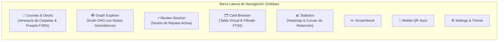
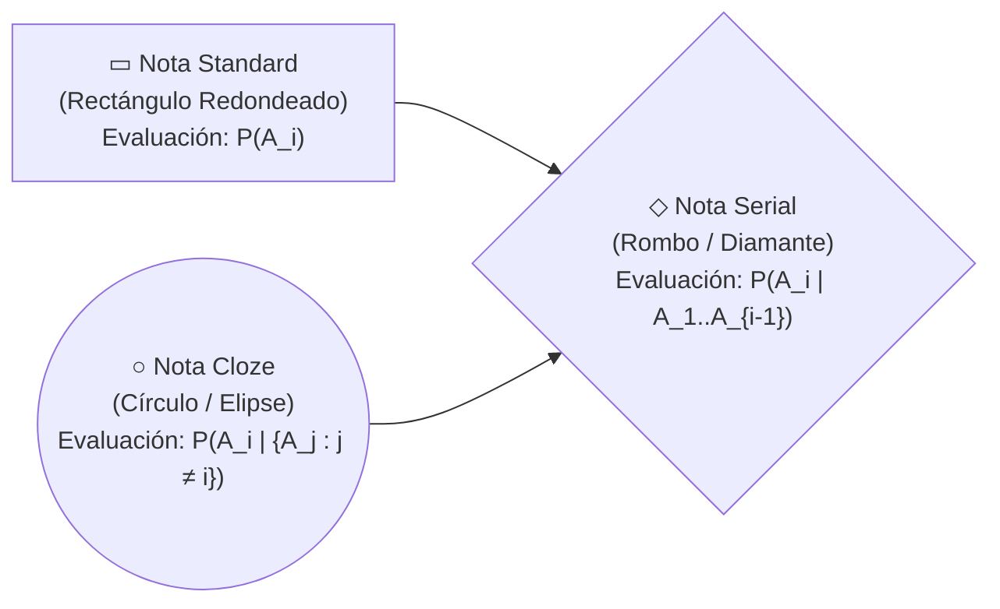

# 07 — Especificación de Vistas UI, Graph Explorer, Formas de Nodos, Navegador Masivo y Adaptabilidad 720p

> [!IMPORTANT]
> Este documento detalla la arquitectura de interfaz gráfica en PySide6 de **Morphism SRS**, integrando:
> 1. **Estructura de navegación de escritorio** con barra lateral izquierda persistente y vistas apiladas en [`MainWindow`](../src/morphism_srs/ui/main_window.py).
> 2. **Navegador masivo de tarjetas y notas** ([`BrowserView`](../src/morphism_srs/ui/views/browser_view.py)) con filtrado multifacético, búsquedas FTS5 y operaciones en lote.
> 3. **Diferenciación geométrica de nodos en [`ExplorerView`](../src/morphism_srs/ui/views/explorer_view.py)** (`GraphNodeItem`): rectángulos redondeados (`standard`), rombos (`serial`) y elipses (`cloze`), con selección por recuadro (Rubber-Band Marquee) y optimización Level-of-Detail (LOD).
> 4. **Reglas de dimensionamiento relativo** para asegurar visualización ergonómica en pantallas desde **720p ($1280 \times 720$ / $1366 \times 768$)** hasta 4K.
> 5. Especificación completa de [`CoursesView`](../src/morphism_srs/ui/views/courses_view.py), [`NodeEditorDialog`](../src/morphism_srs/ui/dialogs/node_editor_dialog.py), [`ScratchbookDialog`](../src/morphism_srs/ui/dialogs/scratchbook_dialog.py), [`StatsView`](../src/morphism_srs/ui/views/stats_view.py) y [`ReviewView`](../src/morphism_srs/ui/views/review_view.py).

---

## 1. Estructura de Navegación Principal ([`MainWindow`](../src/morphism_srs/ui/main_window.py))

La ventana principal de la aplicación organiza la navegación mediante un panel lateral izquierdo (`role="sidebar"`, 210 px de ancho) que controla un [`QStackedWidget`](../src/morphism_srs/ui/main_window.py#L146) central:



---

## 2. Vista de Navegador y Operaciones Masivas ([`BrowserView`](../src/morphism_srs/ui/views/browser_view.py))

[`BrowserView`](../src/morphism_srs/ui/views/browser_view.py) proporciona una interfaz tabular de alto rendimiento respaldada por SQLite y búsqueda indexada en texto completo (`FTS5`), diseñada para explorar, auditar y transformar colecciones extensas de notas y tarjetas:

### 2.1 Diseño de Pantalla en 3 Paneles (`QSplitter` con Memoria)

```text
+--------------------------------------------------------------------------------------------------+
| 🔍 [ Search notes & cards (e.g. "Lebesgue" tag:measure_theory mode:serial is:due) ] [Clear]      |
+-----------------------+----------------------------------------------+---------------------------+
| 📁 FACET FILTERS      | 📋 NOTES & CARDS TABLE (Multi-Select)        | 👁️ INSPECTOR / PREVIEW   |
|                       | [x] Select All (24 selected)                 |                           |
| ▾ All Courses         | +---+--------------+--------+-------+------+ | Note: Medida Exterior     |
|   ▸ Mathematics       | | ✓ | Note Title   | Mode   | Cards | Due  | | Mode: [serial         v] |
|     • Análisis Real   | +---+--------------+--------+-------+------+ | Tags: [measure_theory][+] |
|     • Álgebra Lineal  | | ☑ | Medida Ext.. | Serial |   5   | 2 Due| | R_min: 86% | P(∩): 51%   |
| ▾ Status              | | ☑ | Lema Fatou   | Serial |   4   | 0 Due| | ------------------------- |
|   • 🔴 Due Now (18)   | | ☑ | Compacidad   | Cloze  |   4   | 1 Due| | Card #1 Preview (MathJax) |
|   • 🆕 New (42)       | | ☑ | Conj. Cantor | Std    |   3   | New  | |                           |
|   • ⚠️ Leeches (3)    | | ☐ | Teor. Fubini | Serial |   6   | OK   | | [✏️ Open Full Note Editor]|
|   • 🗑️ Trash (5)      | +---+--------------+--------+-------+------+ |                           |
| ▾ Note Modes          | +------------------------------------------+ |                           |
|   • ▭ Standard        | | ⚡ BULK ACTIONS BAR (24 Notes Selected): | |                           |
|   • ◇ Serial          | | [🗑️ Delete Selected] [🏷️ Tag] [📁 Move] | |                           |
|   • ○ Cloze           | | [🔀 Change Mode] [⏸️ Suspend] [🎯 Study]| |                           |
| ▾ Standard Tags       | +------------------------------------------+ |                           |
|   • #theorem (84)     |                                              |                           |
|   • #definition (62)  |                                              |                           |
+-----------------------+----------------------------------------------+---------------------------+
```

### 2.2 Características Técnicas de `BrowserView`
1. **Modos de Visualización Conmutables (`Cards Browser` vs `Notes Browser`)**:
   - **Vista por Tarjetas ([`BrowserTableModel`](../src/morphism_srs/ui/views/browser_view.py#L43))**: Cada fila representa una tarjeta atómica (`BrowserRowItem`). Columnas: `Note Title`, `Step / Card`, `Mode`, `State`, `R(t)`, `Stability`, `Due Date`, `Lapses` y `Tags`.
   - **Vista por Notas ([`BrowserNoteTableModel`](../src/morphism_srs/ui/views/browser_view.py#L107))**: Cada fila representa una nota (`BrowserNoteRowItem`). Columnas: `UUID`, `Title`, `Course`, `Mode`, `Cards`, `Due Count`, `R_min`, `P_joint`, `Tags` y `Created At`.
2. **Selección Masiva Nativa y Rápida**:
   - Configurado con `QAbstractItemView.SelectionMode.ExtendedSelection` y navegación por teclado.
   - Soporta **`Ctrl + A`** (seleccionar todas las filas coincidentes), **`Shift + Clic`** (selección de rango contiguo) y **`Ctrl + Clic`** (selección discontinua).
3. **Acciones Contextuales en Masa**:
   - **En modo Tarjetas (`cards_actions_widget`)**:
     - **`Custom Study Selected`**: Inicia inmediatamente una sesión de estudio personalizada con las tarjetas seleccionadas.
     - **`+ Tag`**: Abre un selector de tags para añadir etiquetas en masa.
     - **`Toggle Suspend`**: Conmuta el estado de suspensión de las tarjetas seleccionadas.
     - **`Reset Schedule`**: Reinicia el estado de planificación FSRS al estado nuevo (`NEW`).
   - **En modo Notas (`notes_actions_widget`)**:
     - **`📥 Inject into Course...`**: Asocia las notas seleccionadas a un curso sin duplicar datos en la base.
     - **`+ New Note`** y **`✏️ Edit Note`**: Abre el editor de notas ([`NodeEditorDialog`](../src/morphism_srs/ui/dialogs/node_editor_dialog.py)).
     - **`🗑️ Delete Permanently`**: Ejecuta la eliminación de las notas seleccionadas y sus tarjetas asociadas en una transacción SQLite mediante `UnitOfWork`.

---

## 3. `🕸️ ExplorerView` — Siluetas Geométricas por Modo, Selección Marquee y 60 FPS

En el lienzo del grafo ([`ExplorerView`](../src/morphism_srs/ui/views/explorer_view.py)), cada nodo se modela como una instancia de [`GraphNodeItem`](../src/morphism_srs/ui/views/explorer_view.py#L197) en PySide6:

### 3.1 Diferenciación Visual de Nodos por Silueta Geométrica (`standard`, `serial`, `cloze`)
En [`ExplorerView`](../src/morphism_srs/ui/views/explorer_view.py), cada nota se distingue instantáneamente en el lienzo por su **forma geométrica**, permitiendo reconocer de un vistazo la naturaleza epistémica de cada nodo:



#### Especificación de Trazado (`QPainterPath`) en [`GraphNodeItem`](../src/morphism_srs/ui/views/explorer_view.py#L197):
| Modo (`review_mode`) | Silueta Geométrica | Implementación en `GraphNodeItem.shape()` y `paint()` | Paleta de Colores por Estado (Accesible) |
| :--- | :--- | :--- | :--- |
| **`standard`** | **Rectángulo Redondeado** (`▭`) | `path.addRoundedRect(-W/2, -H/2, W, H, 12, 12)`<br>Dimensiones base: $W = 216\text{ px},\; H = 86\text{ px}$. | Gradiente azul rey (`#2563eb` $\to$ `#1e3a8a`) con borde `#93c5fd` al estar al día. |
| **`serial`** | **Rombo / Diamante** (`◇`) | `QPolygonF([QPointF(0, -hh), QPointF(hw, 0), QPointF(0, hh), QPointF(-hw, 0)])`<br>Dimensiones con padding: $W = 244\text{ px},\; H = 102\text{ px}$. | Gradiente idéntico al estado, con silueta romboidal que denota deducción encadenada. |
| **`cloze`** | **Elipse / Círculo** (`○`) | `path.addEllipse(QRectF(-hw, -hh, W, H))`<br>Dimensiones base: $W = 216\text{ px},\; H = 86\text{ px}$. | Silueta elíptica que denota sistema holístico de equivalencias. |

- **Estados de Estudio**:
  - **Tarjetas Vencidas (`due_count > 0`)**: Gradiente rojo intenso (`#dc2626` $\to$ `#7f1d1d`) con borde coral (`#fca5a5`) y grosor `3.2 px`.
  - **Estudio Incompleto (`is_incomplete` — New/Learning)**: Gradiente pizarra (`#475569` $\to$ `#334155`) con borde plateado (`#94a3b8`).
  - **Repaso al Día**: Gradiente azul (`#2563eb` $\to$ `#1e3a8a`) con borde azul cielo (`#93c5fd`).
  - **Selección Activa**: Resaltado perimetral con borde amarillo brillante (`#facc15`) y grosor `4.0 px`.

### 3.2 Interacción en el Lienzo y Selección Marquee
`ExplorerView` implementa interacción dual de manipulación en el lienzo:
- **Arrastre de Selección (Rubber-Band Marquee)**: Al arrastrar con el botón izquierdo sobre el fondo del lienzo o con `Shift + Arrastrar`, se proyecta un rectángulo semitransparente que selecciona en masa todos los nodos contenidos.
- **Desplazamiento del Lienzo (Pan)**: Arrastre con botón central o con la herramienta de paneo manual para explorar el grafo de forma continua.
- **Mover en Bloque con `Ctrl+Z`**: Arrastrar cualquier nodo seleccionado desplaza uniformemente todos los nodos seleccionados.
- **Conexiones Semánticas ([`GraphEdgeItem`](../src/morphism_srs/ui/views/explorer_view.py#L67))**: Curvas de Bézier cúbicas con flechas orientadas calculadas según los puertos cardinales (Norte, Sur, Este, Oeste) más cercanos entre los nodos origen y destino.
- **Optimización Level-of-Detail (LOD)**:
  - En zoom panorámico (`scale < 0.30`), el pintor omite textos y sub-etiquetas, dibujando únicamente las siluetas vectoriales y bordes para mantener **60 FPS** en grafos de cientos de nodos.
  - A escala media (`scale >= 0.30`), dibuja el título de la nota con elisión a la derecha.
  - A escala completa (`scale >= 0.55`), dibuja la etiqueta de estado (`DUE`, `NEW`, `LEARNING`, `R_min`).

### 3.3 Barra de Selección y Filtro Prominente
- **Filtro Prominente**: Campo de búsqueda de notas con estilo secundario (`role="filter"`, `variant="secondary"`), con atajo `Ctrl+F`.
- **Barra Flotante de Acciones en Masa**: Overlay flotante que aparece al seleccionar múltiples nodos, permitiendo ejecutar acciones como estudio personalizado, auto-layout del subgrafo, etiquetado o eliminación.

---

## 4. Vistas Complementarias y Adaptabilidad en Pantallas Compactas (720p)

### 4.1 Geometría Relativa y Adaptabilidad ([`window_sizing.py`](../src/morphism_srs/ui/window_sizing.py))
Para garantizar usabilidad sin recortes en portátiles con pantallas de **720p ($1280 \times 720$ / $1366 \times 768$)** hasta monitores de alta resolución:
- Los diálogos y ventanas auxiliares calculan su tamaño inicial mediante [`apply_relative_geometry(widget, width_ratio=0.85, height_ratio=0.85)`](../src/morphism_srs/ui/window_sizing.py#L11).
- Los contenedores extensos se protegen mediante [`wrap_in_scroll_area`](../src/morphism_srs/ui/window_sizing.py#L32), evitando que botones o controles queden fuera del área visible.

### 4.2 `CoursesView` (`📘 Courses & Decks`)
- **Panel Lateral Estructural**: Agrupa las acciones principales: **`+ New Folder`**, **`+ New Course`**, **`📥 Import Deck...`** y **`📤 Export Course...`**.
- **Barra Superior**: Controles directos para **`Custom Study...`** y **`▶️ Auto-Study Due`**.
- **Árbol Jerárquico**: Estructura de carpetas (`course_folders`) y cursos (`courses`) con soporte de reordenamiento por arrastrar y soltar (Drag-and-Drop) y métricas en vivo (`Total Notes`, `Total Cards`, `Due Today`, `New`).

### 4.3 `NodeEditorDialog`
- Editor de notas con divisor ajustable (`QSplitter`): lista de pasos/tarjetas a la izquierda, editores de código HTML/LaTeX en el centro y vista previa en vivo renderizada con MathJax a la derecha.
- **Pegado Directo de Imágenes y SVGs (`Ctrl+V`)**: Si el portapapeles contiene una imagen o archivo gráfico, se almacena automáticamente en [`MediaVault`](../src/morphism_srs/storage/media_vault.py) y se inserta la referencia segura `morphism://media/<sha256>.<ext>`.

### 4.4 `ScratchbookDialog`
- Cuaderno libre de notas matemáticas con soporte de HTML, LaTeX, renderizado en vivo y almacenamiento persistente en `scratch_pages`.

### 4.5 `StatsView` y `RetrievabilityDialog`
- [`StatsView`](../src/morphism_srs/ui/views/stats_view.py): Heatmap de estudio, distribución de estados y pronóstico de repasos futuros vía WebEngine y Chart.js.
- [`RetrievabilityDialog`](../src/morphism_srs/ui/dialogs/retrievability_dialog.py): Curvas de retención analítica ($R_{\min}$, $R_{\text{avg}}$, $P_{\text{joint}}$ y curvas individuales por tarjeta) sobre escalas de tiempo configurables.

### 4.6 `ReviewView` — Interfaz Focalizada y Atajo "Hide Answer"
- Interfaz dedicada al repaso activo con botones de calificación FSRS, contador de tarjetas restantes e inspección de contexto deductivo.
- **Atajo "Hide Answer" (`` ` `` / `|` / Virtual Key `0xC0`)**: Permite alternar la visibilidad de la respuesta en cualquier instante sin alterar el estado del repaso.