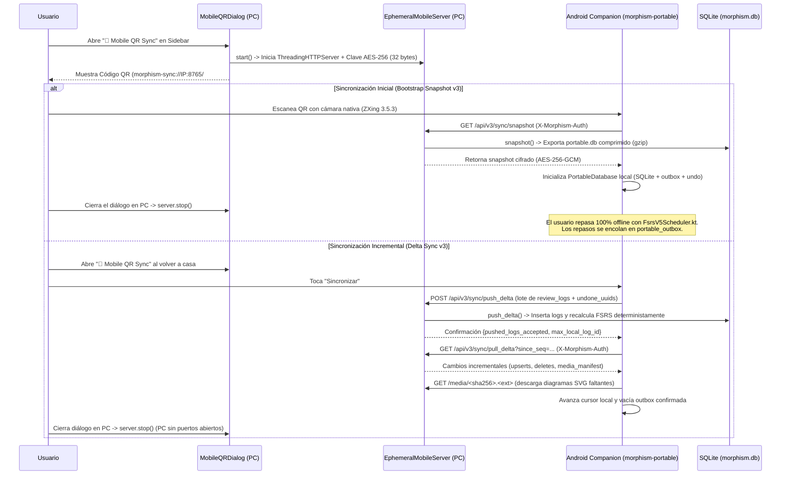
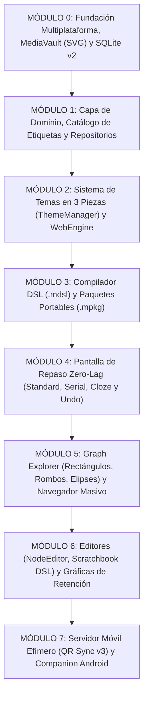

# 08 — Arquitectura Móvil Bajo Demanda (Sesión Efímera por QR) y Especificación del Sistema

> [!IMPORTANT]
> Este documento especifica la infraestructura de estudio y sincronización móvil bajo demanda de **Morphism SRS**, incorporando las directrices arquitectónicas del sistema:
> 1. **Cero servidores 24/7 en segundo plano**: El servidor de sincronización/estudio móvil se levanta **exclusivamente** mientras se muestra en pantalla el diálogo del código QR ([`MobileQRDialog`](../src/morphism_srs/ui/dialogs/mobile_qr_dialog.py#L28-L142)) y se destruye automáticamente al cerrar dicho diálogo (`closeEvent` / `done`), evitando procesos residentes o puertos permanentemente abiertos.
> 2. **Protocolo v3 Cifrado Punto a Punto (AES-256-GCM)**: Autenticación por prueba AAD y cifrado de carga útil gobernado por [`sync_crypto.py`](../src/morphism_srs/services/sync_crypto.py) y [`delta_sync.py`](../src/morphism_srs/services/delta_sync.py).
> 3. **Companion Nativo Android**: Módulo [`src/morphism-portable/`](../src/morphism-portable/) en Kotlin con base de datos SQLite propia, cola outbox/undo local y paridad matemática FSRS v5.
> 4. **Referencia al Backlog de Mazos Semilla**: Documentado en [`specZ/TODO/SEED_DECKS_AND_ONBOARDING.md`](TODO/SEED_DECKS_AND_ONBOARDING.md).

---

## 1. Arquitectura de Estudio y Sincronización Móvil Bajo Demanda

### 1.1 Por qué un Servidor Efímero Vinculado al Diálogo QR Resuelve el Problema sin Deuda Técnica
Mantener un demonio web corriendo 24/7 en la PC consume recursos, abre puertos permanentemente en el firewall y genera deuda técnica de mantenimiento. Por otro lado, construir un servidor en la nube de terceros rompe la filosofía 100% local y privada de Morphism SRS.

La solución en Morphism SRS es un **Servidor HTTP Local Efímero ([`EphemeralMobileServer`](../src/morphism_srs/services/mobile_server.py#L46-L420)) gobernado estrictamente por el ciclo de vida visual de [`MobileQRDialog`](../src/morphism_srs/ui/dialogs/mobile_qr_dialog.py#L28-L142)**:

1. **En reposo (99% del tiempo)**: No existe ningún hilo de red ni socket abierto en la aplicación.
2. **Al hacer clic en el botón `📱  Mobile QR Sync` en la barra lateral de navegación ([`MainWindow`](../src/morphism_srs/ui/main_window.py#L133-L136))**:
   - Se abre [`MobileQRDialog`](../src/morphism_srs/ui/dialogs/mobile_qr_dialog.py).
   - En su inicialización, el diálogo instancia e inicia un servidor [`EphemeralMobileServer`](../src/morphism_srs/services/mobile_server.py#L80-L396) (`ThreadingHTTPServer` en un `threading.Thread` demonio) escuchando en el puerto local `8765` (o puerto libre asignado por SO si está ocupado).
   - Genera una clave criptográfica de sesión efímera AES-256 de 32 bytes (`secrets.token_bytes(32)`) y recupera el UUID único de la base de datos (`sync_db_uuid` en `app_meta`).
   - Se renderiza en pantalla el **Código QR** con el URI de sincronización `morphism-sync://{ip}:{port}/#{fragment}` (mediante [`render_qr_pixmap`](../src/morphism_srs/services/qr_generator.py)) conteniendo la clave en Base64 URL-safe y el UUID.
3. **Al cerrar `MobileQRDialog` (`closeEvent` / `done` / botón *Stop Server & Close*)**:
   - El socket se cierra inmediatamente (`self.server.stop()` ejecuta `shutdown()` y `server_close()`), el hilo termina en `< 50 ms` y el puerto queda completamente liberado.

### 1.2 Modos de Operación y Protocolo de Sincronización
Morphism SRS soporta dos modalidades de interacción móvil gobernadas por [`EphemeralMobileServer`](../src/morphism_srs/services/mobile_server.py#L46-L420):

1. **Protocolo v3 Cifrado (Companion Nativo `morphism-portable`)**:
   - **Emparejamiento Inmediato**: El código QR codifica un URI `morphism-sync://{ip}:{port}/#key={session_key_base64}&uuid={db_uuid}`. La clave de sesión nunca viaja en el cuerpo ni en parámetros de query en texto claro, sino en el fragmento hash `#` del URI, impidiendo fugas por logs intermedios.
   - **Handshake Autenticado**: Cada petición HTTP (`GET` / `POST`) incluye la cabecera `X-Morphism-Auth` con una prueba sellada vía AES-256-GCM (`open_sealed(key, proof, aad)`) donde el AAD vincula el comando y la ruta. Protegido contra ataques de repetición mediante ventana de 30 minutos y conjunto `_seen_requests`.
   - **Snapshot Inicial Comprimido**: Si el cursor móvil está en cero o la divergencia supera los 2,000 registros, [`snapshot()`](../src/morphism_srs/services/sync_snapshot.py#L11-L45) genera un archivo SQLite autocontenido en memoria comprimido con `gzip`, excluyendo tablas de búsqueda de escritorio (`notes_fts`) y metadatos no transferibles.
   - **Delta Sync Idempotente**: Las sincronizaciones ordinarias transmiten únicamente las filas registradas en `sync_oplog` desde la última secuencia confirmada ([`pull_delta`](../src/morphism_srs/services/delta_sync.py#L52-L98)) y reciben lotes de hasta 250 repasos locales ([`push_delta`](../src/morphism_srs/services/delta_sync.py#L100-L191)) con UUID único y control de tombstones (`sync_undo:`).
   - **Reconciliación Cronológica FSRS**: El servidor PC no confía ciegamente en los intervalos calculados por el cliente móvil; toma la secuencia cronológica de logs de repaso y ejecuta [`SchedulerEngine.reschedule_from_logs`](../src/morphism_srs/domain/scheduler_engine.py#L137-L192) garantizando convergencia matemática determinista.
2. **Modo Legacy de Compatibilidad (`allow_legacy=True`)**:
   - Para navegadores web ligeros mediante endpoints `/api/checkout` y `/api/checkin` con token en query (`?token=...`) o cabecera `X-Morphism-Token`.
   - Esta modalidad se encuentra deshabilitada por defecto en [`EphemeralMobileServer`](../src/morphism_srs/services/mobile_server.py#L59) para garantizar la máxima seguridad en redes locales públicas o compartidas.

### 1.3 Especificación del Companion Móvil Nativo (`morphism-portable`)
El cliente móvil táctil ([`src/morphism-portable/`](../src/morphism-portable/)) es una aplicación nativa para Android (API 26 / Android 8.0+) bajo licencia GPL-3.0-or-later, diseñada para ejecutar repasos y explorar el grafo DAG 100% offline con la misma exactitud que la versión de escritorio:

1. **Arquitectura Nativa en Kotlin y Almacenamiento SQLite**:
   - **Base de Datos Local ([`PortableDatabase.kt`](../src/morphism-portable/kotlin/org/morphism/srs/portable/db/PortableDatabase.kt))**: Emplea SQLite nativo con transacciones atómicas, soporte de claves foráneas y modo WAL. Implementa las tablas relacionales de cursos, notas, tarjetas y horarios derivadas de [`schema_v2.sql`](../src/morphism_srs/storage/schema_v2.sql).
   - **Bandeja de Salida y Deshacer Autónomos**: Incorpora las tablas `portable_outbox` (para encolar repasos locales con secuencias independientes sin requerir IDs de la PC), `portable_undo` (instantáneas locales de programación FSRS para reversión inmediata) y `portable_undone` (tombstones que garantizan que una acción de deshacer prevalezca incluso ante reintentos de red tardíos).
   - **Cámara y Escáner QR Integrado ([`QrScannerActivity.kt`](../src/morphism-portable/kotlin/org/morphism/srs/portable/QrScannerActivity.kt))**: Utiliza la API de Camera y la librería ZXing 3.5.3 empaquetada en el APK, funcionando de manera totalmente autónoma sin dependencias de Google Play Services.

2. **Paridad Algorítmica FSRS v5 ([`FsrsV5Scheduler.kt`](../src/morphism-portable/kotlin/org/morphism/srs/portable/domain/FsrsV5Scheduler.kt))**:
   - Implementa de forma canónica las fórmulas de FSRS v5 para estabilidad $S$, dificultad $D$, intervalos de repaso y cálculo de retención $R(t) = (1 + \frac{19}{81}\frac{t}{S})^{-0.5}$.
   - Su comportamiento está rigurosamente verificado mediante la suite de paridad [`tests/test_portable_scheduler_parity.py`](../tests/test_portable_scheduler_parity.py), validando 1,024 combinaciones de estado contra el motor Python.

3. **Sesión de Repaso Táctil ([`portable_ui.js`](../src/morphism-portable/assets/web/portable_ui.js) & [`CourseGraphDao.kt`](../src/morphism-portable/kotlin/org/morphism/srs/portable/db/CourseGraphDao.kt))**:
   - **Garantía de Dominio Completo**: La sesión no concluye mientras permanezcan tarjetas `due` o no dominadas en la cola de repaso.
   - **Comportamiento Serial Estricto**: Para notas en modo `serial`, calificar con `Again (1)` retiene al usuario en el paso actual hasta dominarlo, sin avanzar prematuramente en la cadena causal.
   - **Reciclado al Paso Más Temprano**: Al finalizar el recorrido de una demostración, si algún paso fue fallado o necesita refuerzo, el sistema cicla automáticamente de regreso al paso no dominado más temprano.
   - **Atajos de Teclado Físico**: Soporte para ocultar/alternar la respuesta visible al repasar con teclado físico conectado al móvil (atajo rápido `` ` `` / `|` / keyCodes `192`/`220`).
   - **Corrección de Conteo Due**: [`CourseGraphDao.kt`](../src/morphism-portable/kotlin/org/morphism/srs/portable/db/CourseGraphDao.kt) excluye notas nuevas (`state == 0`) del conteo de `isDue`, evitando que conceptos no repasados aparezcan en rojo como vencidos.

4. **Lienzo del Grafo DAG ([`graph_canvas.js`](../src/morphism-portable/assets/web/graph_canvas.js))**:
   - **Splines Cardinales con Flechas Alineadas**: Curvas Bézier calculadas entre los puertos cardinales (North, South, East, West) de los nodos origen y destino, con puntas de flecha alineadas al ángulo tangente de entrada del puerto.
   - **Paleta Cromática Oficial de Estados**:
     - *Notas No Repasadas / Raíces*: Gris pizarra (`#334155` / `#1e293b`, borde `#94a3b8`).
     - *Notas Aprendidas al Día*: Azul rey (`#2563eb` / `#1e3a8a`, borde `#93c5fd`).
     - *Notas en Aprendizaje*: Cian (`#0284c7` / `#0f172a`, borde `#38bdf8`).
     - *Notas Vencidas (Due)*: Rojo (`#dc2626` / `#7f1d1d`, borde `#fca5a5`).

5. **Herramienta de Compilación Autónoma ([`build_portable.py`](../src/morphism-portable/build_portable.py))**:
   - Permite compilar el APK alineado y firmado (`morphism-srs.apk`) desde la línea de comandos de Windows y Linux x64 sin requerir Android Studio ni APKs base de terceros.
   - Descarga JDK 17, Kotlin CLI 2.0.21, Android Build Tools 35 y plataforma API 34 a `.build_cache/portable/`, permitiendo compilaciones posteriores 100% offline.

### 1.4 Contrato de Endpoints del Servidor Efímero (`services/mobile_server.py`)
Todas las comunicaciones del Protocolo v3 en [`EphemeralMobileServer`](../src/morphism_srs/services/mobile_server.py#L46-L420) exigen la cabecera `X-Morphism-Auth` con cifrado AES-256-GCM ([`sync_crypto.py`](../src/morphism_srs/services/sync_crypto.py)):

- `GET /api/v3/sync/ping`: Comprobación de estado y perfil de sincronización. Devuelve `{ok: true, protocol: 3, app: "Morphism SRS", version: "0.4.0", db_uuid, profile_id, profile_name}`.
- `GET /api/v3/sync/snapshot`: Genera una copia SQLite comprimida con `gzip` de la base de datos vía [`snapshot()`](../src/morphism_srs/services/sync_snapshot.py#L11-L45), cifrada como `application/vnd.morphism.encrypted`.
- `GET /api/v3/sync/pull_delta?since_seq={seq}`: Extrae las mutaciones registradas en `sync_oplog` desde `since_seq` vía [`pull_delta`](../src/morphism_srs/services/delta_sync.py#L52-L98). Devuelve `{db_uuid, current_seq, protocol: 3, mode: "delta", upserts: {...}, deletes: {...}, media_manifest: [...]}`. Si la divergencia supera los 2,000 registros o el payload es mayor a 512 KiB, instruye `{snapshot_required: true}`.
- `POST /api/v3/sync/push_delta`: Ingesta un lote de repasos y reversiones vía [`push_delta`](../src/morphism_srs/services/delta_sync.py#L100-L191) `{db_uuid, new_review_logs: [...], undone_log_uuids: [...]}`. Persiste los logs, registra tombstones de deshacer, recalcula cronológicamente los estados FSRS con [`SchedulerEngine.reschedule_from_logs`](../src/morphism_srs/domain/scheduler_engine.py#L137-L192) y notifica a la interfaz mediante señales de [`EventBus`](../src/morphism_srs/controllers/event_bus.py#L12-L24).
- `GET /media/<sha256>.<ext>`: Entrega diagramas SVG e imágenes raster desde [`MediaVault`](../src/morphism_srs/storage/media_vault.py), cifradas con la clave simétrica de la sesión.
- **Rutas Legadas (Opt-in mediante `allow_legacy=True`, token en query o cabecera `X-Morphism-Token`)**:
  - `GET /api/checkout`: Exporta lote JSON de tarjetas pendientes para estudio web.
  - `POST /api/checkin`: Ingesta lote de repasos aplicando calificaciones mediante simulación en `ReviewController`.
  - `GET /api/v2/sync/pull` y `POST /api/v2/sync/push`: Sincronización v2 en texto plano.

---

## 2. Mazos Semilla Introductorios y Onboarding de Testers (`specZ/TODO/`)

La planificación de cursos semilla (*Interactive Tutorial*, *Análisis Real*, *Álgebra Lineal*) y el protocolo de distribución para evaluadores se encuentra organizada en el directorio de backlog:

👉 **[`specZ/TODO/SEED_DECKS_AND_ONBOARDING.md`](TODO/SEED_DECKS_AND_ONBOARDING.md)**

---

## 3. Estructura Modular y Verificación del Sistema (Módulos 0 a 7)

Morphism SRS organiza su arquitectura e implementación en **8 Módulos Funcionales (Módulos 0 a 7)**, cada uno respaldado por suites de pruebas automatizadas unitarias y de integración:

### Módulo 0: Fundación, `AppData` Multiplataforma, `MediaVault` (SVG) y Base de Datos SQLite
- **Componentes e Implementación**:
  - Configuración y rutas estándar: [`pyproject.toml`](../pyproject.toml) y [`config.py`](../src/morphism_srs/config.py) (`platformdirs` con soporte de modo portable vía `portable.flag`).
  - Almacenamiento y persistencia: [`schema_v2.sql`](../src/morphism_srs/storage/schema_v2.sql), [`database.py`](../src/morphism_srs/storage/database.py), [`unit_of_work.py`](../src/morphism_srs/storage/unit_of_work.py) y [`media_vault.py`](../src/morphism_srs/storage/media_vault.py).
- **Verificación y Cobertura de Pruebas**:
  - Validado en [`tests/test_database.py`](../tests/test_database.py): inicialización de `morphism.db` en modo `WAL` y tablas `STRICT`, siembra de etiquetas canónicas desde [`specZ/tags_default.csv`](tags_default.csv), verificación de triggers de inicialización (`trg_cards_init_schedule`), sincronización (`trg_oplog_*`) e integridad acíclica de carpetas (`trg_course_folders_prevent_cycles`), junto con el almacenamiento inmutable y deduplicación SHA-256 de archivos SVG y PNG en `MediaVault`.

### Módulo 1: Capa de Dominio, `SchedulerEngine` (Standard, Serial, Cloze) y Repositorios SQLite
- **Componentes e Implementación**:
  - Modelos de dominio y tipos: [`domain/enums.py`](../src/morphism_srs/domain/enums.py) (`NoteMode`: `STANDARD`, `SERIAL`, `CLOZE`), [`domain/models.py`](../src/morphism_srs/domain/models.py), [`domain/ids.py`](../src/morphism_srs/domain/ids.py) y [`domain/scheduler_engine.py`](../src/morphism_srs/domain/scheduler_engine.py).
  - Repositorios en [`storage/repositories/`](../src/morphism_srs/storage/repositories/): [`folder_repo.py`](../src/morphism_srs/storage/repositories/folder_repo.py), [`course_repo.py`](../src/morphism_srs/storage/repositories/course_repo.py), [`note_repo.py`](../src/morphism_srs/storage/repositories/note_repo.py), [`card_repo.py`](../src/morphism_srs/storage/repositories/card_repo.py), [`review_repo.py`](../src/morphism_srs/storage/repositories/review_repo.py), [`browser_repo.py`](../src/morphism_srs/storage/repositories/browser_repo.py) y [`scratch_repo.py`](../src/morphism_srs/storage/repositories/scratch_repo.py).
- **Verificación y Cobertura de Pruebas**:
  - Validado en [`tests/test_scheduler.py`](../tests/test_scheduler.py): herencia jerárquica de presets FSRS (`Nota -> Curso -> Carpeta Padre -> Global`), cálculo de retención $R_{\min}(t)$, $\bar{R}(t)$ y $P(\bigcap A_i)(t)$, ordenamiento topológico acíclico de Kahn y eliminación en cascada de notas con dependencias y logs sin lanzar `IntegrityError`.

### Módulo 2: Sistema de Diseño en 3 Piezas (`ThemeManager`), Sanitizador `\lt`/`\gt` y Esquema `morphism://`
- **Componentes e Implementación**:
  - Sanitización matemática: [`services/safe_html.py`](../src/morphism_srs/services/safe_html.py) (`sanitize_math_html`).
  - Motor de estilos y temas: 10 temas en [`resources/themes/`](../src/morphism_srs/resources/themes/), plantilla [`resources/styles/app.qss.tmpl`](../src/morphism_srs/resources/styles/app.qss.tmpl), estilos web [`resources/web/css/cards.css`](../src/morphism_srs/resources/web/css/cards.css).
  - Gestores y adaptadores: [`theming/theme_manager.py`](../src/morphism_srs/theming/theme_manager.py), [`theming/delegates.py`](../src/morphism_srs/theming/delegates.py), [`web_engine/scheme_handler.py`](../src/morphism_srs/web_engine/scheme_handler.py), [`web_engine/web_profile.py`](../src/morphism_srs/web_engine/web_profile.py) y geometría elástica 720p en [`ui/window_sizing.py`](../src/morphism_srs/ui/window_sizing.py).
- **Verificación y Cobertura de Pruebas**:
  - Validado en [`tests/test_ui_and_theming.py`](../tests/test_ui_and_theming.py) y [`tests/test_svg_mask_rendering.py`](../tests/test_svg_mask_rendering.py): compilación de tokens QSS, inyección dinámica de variables CSS en WebEngine, entintado dinámico de diagramas SVG mediante máscaras CSS y adaptación elástica de ventanas a $1280 \times 720$.

### Módulo 3: Compilador DSL (`.mdsl`), Paquetes Portables (`.mpkg`) y Exportación
- **Componentes e Implementación**:
  - Pipeline de compilación: [`services/dsl_compiler/`](../src/morphism_srs/services/dsl_compiler/) ([`lexer.py`](../src/morphism_srs/services/dsl_compiler/lexer.py), [`parser.py`](../src/morphism_srs/services/dsl_compiler/parser.py), [`validator.py`](../src/morphism_srs/services/dsl_compiler/validator.py), [`compiler.py`](../src/morphism_srs/services/dsl_compiler/compiler.py)).
  - Servicios de intercambio: [`services/import_export/mpkg_service.py`](../src/morphism_srs/services/import_export/mpkg_service.py) y cálculo de coordenadas DAG en [`services/layout_service.py`](../src/morphism_srs/services/layout_service.py).
- **Verificación y Cobertura de Pruebas**:
  - Validado en [`tests/test_dsl_and_safe_html.py`](../tests/test_dsl_and_safe_html.py) y [`tests/test_mpkg_and_mobile.py`](../tests/test_mpkg_and_mobile.py): compilación en dos pasadas de notas `standard`, `serial` y `cloze`, resolución de enlaces `LINK` a aristas de prerrequisito y empaquetado/desempaquetado íntegro de cursos en archivos `.mpkg` con base de datos SQLite y directorio `media/`.

### Módulo 4: Pantalla de Repaso "Zero-Lag" ($O(1)$), Modos `serial`/`cloze` y Deshacer Transaccional
- **Componentes e Implementación**:
  - DOM y renderizado: [`resources/web/html/review.html`](../src/morphism_srs/resources/web/html/review.html), [`review_renderer.js`](../src/morphism_srs/resources/web/js/review_renderer.js) y bundle local [`tex-svg-full.js`](../src/morphism_srs/resources/web/vendor/mathjax/tex-svg-full.js).
  - Lógica de sesión y vista: [`controllers/review_controller.py`](../src/morphism_srs/controllers/review_controller.py), stack de deshacer [`controllers/commands.py`](../src/morphism_srs/controllers/commands.py) y widget de estudio [`ui/views/review_view.py`](../src/morphism_srs/ui/views/review_view.py).
- **Verificación y Cobertura de Pruebas**:
  - Validado en [`tests/test_review_learning_and_serial.py`](../tests/test_review_learning_and_serial.py): transiciones de DOM constantes sin recarga de página WebEngine, retención estricta en el paso actual ante calificación `Again` en cadenas seriales, reciclado al paso más temprano y reversión completa de calificación con `Ctrl+Z`.

### Módulo 5: `BrowserView` (Selección/Borrado Masivo FTS5) y `ExplorerView`
- **Componentes e Implementación**:
  - Navegador masivo: [`controllers/browser_controller.py`](../src/morphism_srs/controllers/browser_controller.py) y [`ui/views/browser_view.py`](../src/morphism_srs/ui/views/browser_view.py) con modelos virtualizados `BrowserTableModel` y `BrowserNoteTableModel`.
  - Explorador DAG: [`controllers/explorer_controller.py`](../src/morphism_srs/controllers/explorer_controller.py) y [`ui/views/explorer_view.py`](../src/morphism_srs/ui/views/explorer_view.py) (con nodos [`GraphNodeItem`](../src/morphism_srs/ui/views/explorer_view.py#L42-L135) en rectángulo redondeado, rombo o elipse, aristas cardinales Bézier [`GraphEdgeItem`](../src/morphism_srs/ui/views/explorer_view.py#L137-L225), selección múltiple *rubber-band* y LOD de 3 niveles).
- **Verificación y Cobertura de Pruebas**:
  - Validado en [`tests/test_remerge_v2_features.py`](../tests/test_remerge_v2_features.py): búsqueda reactiva con debouncing de 180 ms en SQLite FTS5, etiquetado y eliminación en lote, navegación por vista de cursos y edición visual interactiva del DAG.

### Módulo 6: Editores (`NodeEditorDialog`, `ScratchbookDialog`) y Métricas de Retención
- **Componentes e Implementación**:
  - Diálogos de autoría: [`ui/dialogs/node_editor_dialog.py`](../src/morphism_srs/ui/dialogs/node_editor_dialog.py) (con soporte de pegado SVG directo `Ctrl+V`), [`ui/dialogs/scratchbook_dialog.py`](../src/morphism_srs/ui/dialogs/scratchbook_dialog.py), [`ui/dialogs/retrievability_dialog.py`](../src/morphism_srs/ui/dialogs/retrievability_dialog.py) y panel de analíticas [`ui/views/stats_view.py`](../src/morphism_srs/ui/views/stats_view.py).
- **Verificación y Cobertura de Pruebas**:
  - Validado en suites de interfaz y analítica: previsualización WebEngine en vivo durante la edición, compilación DSL interactiva y trazado matemático de las 3 curvas de retención ($R_{\min}(t)$, $\bar{R}(t)$, $P(\bigcap A_i)(t)$) en `RetrievabilityPlotDialog`.

### Módulo 7: Servidor Móvil Efímero (QR Sync v3) y Companion Nativo Android (`morphism-portable`)
- **Componentes e Implementación**:
  - Servidor efímero y criptografía: [`services/mobile_server.py`](../src/morphism_srs/services/mobile_server.py), [`services/delta_sync.py`](../src/morphism_srs/services/delta_sync.py), [`services/sync_crypto.py`](../src/morphism_srs/services/sync_crypto.py), [`services/sync_snapshot.py`](../src/morphism_srs/services/sync_snapshot.py), [`services/qr_generator.py`](../src/morphism_srs/services/qr_generator.py) y diálogo visual [`ui/dialogs/mobile_qr_dialog.py`](../src/morphism_srs/ui/dialogs/mobile_qr_dialog.py).
  - Aplicación Android: proyecto nativo en [`src/morphism-portable/`](../src/morphism-portable/) y compilador [`build_portable.py`](../src/morphism-portable/build_portable.py).
- **Verificación y Cobertura de Pruebas**:
  - Validado en [`tests/test_mobile_sync_v3.py`](../tests/test_mobile_sync_v3.py), [`tests/test_delta_sync_and_portable.py`](../tests/test_delta_sync_and_portable.py), [`tests/test_portable_sync_crypto.py`](../tests/test_portable_sync_crypto.py), [`tests/test_portable_scheduler_parity.py`](../tests/test_portable_scheduler_parity.py) y [`tests/test_portable_web.py`](../tests/test_portable_web.py):
    - Handshake autenticado v3 vía AES-256-GCM y AAD contra ataques de repetición.
    - Exportación y compresión de snapshot SQLite `portable.db` sanitizado para Android.
    - Sincronización incremental bidireccional mediante oplog deltas y lotes de repasos atómicos.
    - Paridad matemática exacta de [`FsrsV5Scheduler.kt`](../src/morphism-portable/kotlin/org/morphism/srs/portable/domain/FsrsV5Scheduler.kt) validada contra py-fsrs 5.1.3 con 1,024 combinaciones de estado.
    - Ciclo de vida efímero estricto en [`MobileQRDialog`](../src/morphism_srs/ui/dialogs/mobile_qr_dialog.py): terminación del hilo y liberación completa del socket en `< 50 ms` al cerrar el diálogo.
