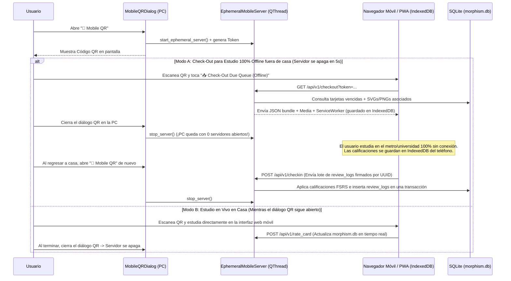
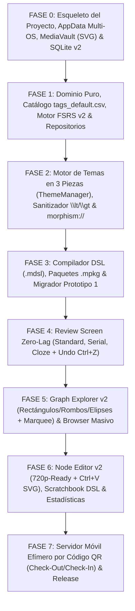

# 08 — Arquitectura Móvil Bajo Demanda (Sesión Efímera por QR) y Plan Maestro de Implementación

> [!IMPORTANT]
> Este documento aborda el requerimiento #19 de [`specZ/old/Future_version.md`](file:///c:/repos/Morphism%20SRS%20proto2/specZ/old/Future_version.md) (*"Mobile app is urgent for study"*), incorporando la directriz arquitectónica del autor:
> 1. **Cero servidores 24/7 en segundo plano**: El servidor de sincronización/estudio móvil se levanta **exclusivamente** mientras se muestra en pantalla el diálogo del código QR (`MobileQRDialog`) y se destruye automáticamente al cerrar dicho diálogo, evitando procesos residentes o deuda técnica.
> 2. **Referencia al Backlog de Mazos Semilla**: Movido a [`specZ/TODO/SEED_DECKS_AND_ONBOARDING.md`](file:///c:/repos/Morphism%20SRS%20proto2/specZ/TODO/SEED_DECKS_AND_ONBOARDING.md).
> 3. **Plan Maestro de Implementación Paso a Paso (Fases 0 a 7)** con entregables exactos y criterios de aceptación verificables, dejando la vinculación móvil para el final del ciclo (Fase 7).

---

## 1. Arquitectura de Estudio y Sincronización Móvil Bajo Demanda (Fase 7)

### 1.1 Por qué un Servidor Efímero Vinculado al Diálogo QR Resuelve el Problema sin Deuda Técnica
Mantener un demonio web corriendo 24/7 en la PC consume recursos, abre puertos permanentemente en el firewall y genera deuda técnica de mantenimiento. Por otro lado, construir un servidor en la nube de terceros rompe la filosofía 100% local y privada de Morphism SRS.

La solución en el Prototipo 2 es un **Servidor HTTP Local Efímero (`EphemeralMobileServer` en `services/mobile_server.py`) gobernado estrictamente por el ciclo de vida visual de `MobileQRDialog`**:

1. **En reposo (99% del tiempo)**: No existe ningún hilo de red ni socket abierto en la aplicación.
2. **Al hacer clic en `📱 Mobile QR` en la barra superior**:
   - Se abre `MobileQRDialog`.
   - En `showEvent`, el diálogo inicia un servidor HTTP ligero (`http.server` / `aiohttp` en un `QThread`) escuchando en un puerto local (ej. `8765`) con un **token criptográfico efímero de un solo uso** (`?token=<128-bit-hex>`).
   - Se genera y muestra en pantalla el **Código QR** con la URL local (`http://192.168.x.x:8765/?token=...` o IP de Tailscale si está presente).
3. **Al cerrar `MobileQRDialog` (`closeEvent` / `reject`)**:
   - El socket se cierra inmediatamente (`server.shutdown()`), el hilo termina en `< 50 ms` y el puerto queda completamente liberado.

### 1.2 Los Dos Modos de Uso desde el Teléfono
Al escanear el código QR con el navegador del teléfono (Safari en iOS o Chrome/Firefox en Android), se carga la interfaz táctil de Morphism SRS (que reutiliza exactamente el mismo `tex-svg-full.js`, `cards.css` y `review_renderer.js` con soporte para notas `standard`, `serial` y `cloze`):

1. **Modo Check-Out / Check-In Offline (Sin dejar el servidor ni la PC encendidos)**:
   - Tocas **"📥 Download Due Queue for Offline Study"** en el teléfono.
   - En menos de 2 segundos, el teléfono descarga todas las tarjetas vencidas del día (junto con sus pasos de contexto `serial` / `cloze`, sus diagramas `.svg` y el bundle `tex-svg-full.js` cacheado vía `ServiceWorker`) y los almacena en `IndexedDB` del navegador móvil.
   - **Cierras inmediatamente la ventana del QR en tu PC** (el servidor se apaga por completo).
   - Repasas tus demostraciones en el autobús, tren o universidad sin internet.
   - Al volver a casa, abres la ventana del QR por 5 segundos y tocas **"🔄 Sync Reviews Back to PC"**: el teléfono envía el arreglo de `review_logs` (identificados por `card_uuid` y timestamp UTC) y `SchedulerEngine` actualiza `card_schedules` y `review_logs` en `morphism.db`.
2. **Modo Estudio en Vivo (LAN / Tailscale)**:
   - Si estás estudiando en el sofá o en la cama dentro de tu red local, simplemente dejas la ventana del QR abierta mientras repasas y cada calificación se escribe al instante en `morphism.db`.

### 1.3 Especificación del Companion Móvil Nativo (`morphism-portable`)
El cliente móvil táctil (`src/morphism-portable/`) implementa un motor de visualización y estudio offline idéntico al de escritorio:

1. **Sesión de Repaso Táctil (`portable_ui.js` & `CourseGraphDao.kt`)**:
   - **Garantía de Dominio Completo**: La sesión no se da por concluida mientras permanezcan tarjetas `due` o no dominadas en la cola.
   - **Comportamiento Serial Estricto**: Para notas en modo `serial`, calificar con `Again (1)` retiene al usuario en el paso actual hasta dominarlo, sin avanzar prematuramente en la cadena causal.
   - **Reciclado al Paso Más Temprano**: Al finalizar el recorrido de una demostración, si algún paso fue fallado o necesita refuerzo, el sistema cicla automáticamente de regreso al paso no dominado más temprano.
   - **Atajo "Hide Answer"**: Detección de atajos rápidos (`` ` `` en teclado US / `|` en teclado ES / keyCode `192`/`220`) para ocultar/alternar la respuesta visible al repasar con teclado físico conectado al móvil.
   - **Corrección de Conteo Due**: `CourseGraphDao.kt` excluye notas nuevas (`state == 0`) del conteo de `isDue`, evitando que conceptos no repasados aparezcan en rojo como vencidos.

2. **Lienzo del Grafo DAG (`graph_canvas.js`)**:
   - **Splines Cardinales con Flechas Alineadas**: Reemplaza curvas naive por curvas Bézier calculadas entre los puertos cardinales (North, South, East, West) de los nodos origen y destino, con puntas de flecha alineadas al ángulo tangente de entrada del puerto.
   - **Paleta Cromática Oficial de Estados**:
     - *Notas No Repasadas / Raíces*: Gris pizarra (`#334155` / `#1e293b`, borde `#94a3b8`).
     - *Notas Aprendidas al Día*: Azul rey (`#2563eb` / `#1e3a8a`, borde `#93c5fd`).
     - *Notas en Aprendizaje*: Cian (`#0284c7` / `#0f172a`, borde `#38bdf8`).
     - *Notas Vencidas (Due)*: Rojo (`#dc2626` / `#7f1d1d`, borde `#fca5a5`).

### 1.4 Contrato de Endpoints REST del Servidor Efímero (`services/mobile_server.py`)
Todos los endpoints exigen el encabezado `X-Morphism-Token: <ephemeral_session_token>`:
- `GET /`: Sirve `mobile_study.html` (interfaz táctil responsive con botones grandes `Again`, `Hard`, `Good`, `Easy` y `Undo`).
- `GET /assets/<path>`: Sirve `tex-svg-full.js`, `cards.css`, `theme_vars.css` y `review_renderer.js`.
- `GET /media/<sha256>.<ext>`: Sirve imágenes y diagramas conmutativos `.svg` desde `MediaVault`.
- `GET /api/v1/checkout`: Devuelve el paquete JSON con las notas y tarjetas vencidas ordenadas topológicamente, incluyendo todos los pasos de contexto necesarios para los modos `serial` y `cloze`.
- `POST /api/v1/checkin`: Recibe una lista de eventos `{card_uuid, reviewed_at, rating, response_time_ms}`, verifica idempotencia y aplica las actualizaciones FSRS en una transacción atómica sobre `morphism.db`.

---

## 2. Mazos Semilla Introductorios y Onboarding de Testers (`specZ/TODO/`)

Siguiendo tu indicación de no implementar ni diseñar en firme los mazos pre-hechos hasta tener su contenido listo, toda la planificación de cursos semilla (*Interactive Tutorial*, *Análisis Real*, *Álgebra Lineal*) y el protocolo de distribución para testers se encuentra separada en el directorio de backlog:

👉 **[`specZ/TODO/SEED_DECKS_AND_ONBOARDING.md`](file:///c:/repos/Morphism%20SRS%20proto2/specZ/TODO/SEED_DECKS_AND_ONBOARDING.md)**

---

## 3. Plan Maestro de Implementación Paso a Paso (Roadmap en 7 Fases)

Cuando decidas iniciar la implementación del código en **Morphism SRS Prototype 2**, este es el orden exacto de construcción en **7 Fases Secuenciales**, diseñado para que cada fase sea 100% verificable mediante tests automatizados (`pytest` + `pytest-qt`) antes de pasar a la siguiente:

### Fase 0: Fundación, `AppData` Multiplataforma, `MediaVault` (SVG) y Base de Datos SQLite v2
- **Archivos a crear**:
  - `pyproject.toml`, `src/morphism_srs/config.py` (`platformdirs` para Windows/Linux/macOS + `portable.flag`).
  - `src/morphism_srs/storage/schema_v2.sql`, `database.py`, `unit_of_work.py`, `media_vault.py`.
- **Criterios de Verificación**:
  - Test automatizado que inicializa `morphism.db` en modo `WAL` y `STRICT`, siembra las **2,000 etiquetas estándar** desde [`specZ/tags_default.csv`](file:///c:/repos/Morphism%20SRS%20proto2/specZ/tags_default.csv) y verifica que todos los triggers (`trg_cards_init_schedule`, `trg_cards_fts_*`, `trg_course_folders_prevent_cycles`) funcionen.
  - Test de `MediaVault` verificando almacenamiento y deduplicación `SHA-256` de archivos `.svg` y `.png`.

### Fase 1: Capa de Dominio, `SchedulerEngine` (Standard, Serial, Cloze) y Repositorios SQLite
- **Archivos a crear**:
  - `domain/enums.py` (`NoteMode`: `STANDARD`, `SERIAL`, `CLOZE`), `domain/models.py` (tarjetas atómicas sin `card_type`), `domain/ids.py` (UUIDv4), `domain/scheduler_engine.py`.
  - Repositorios en `storage/repositories/`: `folder_repo.py`, `course_repo.py`, `note_repo.py`, `card_repo.py`, `review_repo.py`, `browser_repo.py`, `scratch_repo.py`.
- **Criterios de Verificación**:
  - Verificar la herencia jerárquica de `scheduler_presets` (`Nota -> Curso -> Carpeta Padre -> Global`).
  - Verificar que una nota con 15 tarjetas recién repasadas tenga `is_due == False` y calcule exactamente $R_{\min}(t)$, $\bar{R}(t)$ y $P(\bigcap A_i)(t)$.
  - Verificar el ordenamiento topológico de Kahn sobre un DAG de prerrequisitos y que el borrado masivo (Soft Delete y Hard Delete) de notas con `review_logs` jamás lance `IntegrityError`.

### Fase 2: Sistema de Diseño en 3 Piezas (`ThemeManager`), Sanitizador `\lt`/`\gt` y Esquema `morphism://`
- **Archivos a crear**:
  - `services/safe_html.py` (`sanitize_math_html` convirtiendo `<` y `>` matemáticos a `\lt` y `\gt`).
  - `resources/themes/{dark_slate,light_paper,oled_midnight}.json`, `resources/styles/app.qss.tmpl`, `resources/web/css/cards.css`.
  - `theming/theme_manager.py`, `theming/delegates.py` (filtro global de `QComboBox`), `web_engine/scheme_handler.py`, `web_engine/web_profile.py`, `ui/window_sizing.py` (`apply_relative_geometry` para 720p).
- **Criterios de Verificación**:
  - Suite de pruebas unitarias para `sanitize_math_html` con fórmulas complejas y etiquetas HTML mixtas.
  - Ventana de prueba en resolución $1280 \times 720$ verificando todos los widgets (`QPushButton` variantes, `QComboBox` desplegable, `QTableView`, `QTreeView` y `QWebEngineView` con diagramas `.svg`) cambiando de tema en vivo entre *Dark Slate* y *Light Paper*.

### Fase 3: Compilador DSL (`.mdsl`), Paquetes Portables (`.mpkg`) y Migración de Prototipo 1
- **Archivos a crear**:
  - `services/dsl_compiler/{lexer,parser,validator,compiler}.py`.
  - `services/import_export/{mpkg_service,json_service,proto1_migrator}.py`, `services/layout_service.py`.
- **Criterios de Verificación**:
  - Compilar scripts `.mdsl` con notas `standard`, `serial` y `cloze`, etiquetas de `tags_default.csv` y enlaces simbólicos `LINK`.
  - Ejecutar `proto1_migrator.py` apuntando a `c:\repos\New SRS Project` y verificar que el 100% de los cursos, tarjetas, horarios FSRS, logs de repaso y lotes de `to_import/` se importen sin pérdida en `morphism.db`.

### Fase 4: Pantalla de Review "Zero-Lag" ($O(1)$), Modos `serial`/`cloze` y `Undo Rating` (`Ctrl+Z`)
- **Archivos a crear**:
  - `resources/web/html/review.html`, `resources/web/js/review_renderer.js`, `resources/web/vendor/mathjax/tex-svg-full.js`.
  - `controllers/review_controller.py`, `controllers/commands.py` (`RateCardCommand`), `ui/views/review_view.py`, `ui/dialogs/custom_study_dialog.py`.
- **Criterios de Verificación**:
  - Cargar una demostración `serial` de 25 pasos y una nota `cloze` de 6 equivalencias ($P(A_i \mid \{A_j : j \ne i\})$), midiendo tiempos de transición `< 10 ms` constantes y verificando que `Ctrl+Z` revierta tanto la base de datos como el DOM incremental.

### Fase 5: `NoteBrowserView` (Selección/Borrado Masivo FTS5) y `GraphExplorerView v2`
- **Archivos a crear**:
  - `controllers/browser_controller.py`, `ui/views/browser_view.py`.
  - `controllers/explorer_controller.py`, `ui/views/explorer_view.py` (con siluetas de **Rectángulo**, **Rombo** y **Elipse**, selección *Rubber-Band Marquee*, barra flotante y LOD), `ui/views/courses_view.py`.
- **Criterios de Verificación**:
  - Buscar en `NoteBrowserView` mediante `FTS5`, seleccionar 50 notas con `Shift+Clic`, etiquetarlas o borrarlas en masa en `< 5 ms` y deshacer con `Ctrl+Z`.
  - Seleccionar múltiples nodos en el grafo con el rectángulo Marquee, moverlos en bloque y verificar `Ctrl+Z`.

### Fase 6: Editores (`NodeEditor v2`, `Scratchbook + DSL Studio v2`) y Estadísticas (`Stats v2`, `Retrievability v2`)
- **Archivos a crear**:
  - `ui/dialogs/node_editor_dialog.py`, `ui/dialogs/scratchbook_dialog.py`, `ui/dialogs/retrievability_dialog.py`, `ui/dialogs/settings_dialog.py`, `ui/views/stats_view.py`.
- **Criterios de Verificación**:
  - Pegar imágenes y diagramas `.svg` con `Ctrl+V` en el editor, compilar notas en vivo desde el Scratchbook y verificar las 3 curvas ($R_{\min}(t)$, $\bar{R}(t)$, $P(\bigcap A_i)(t)$) en `RetrievabilityPlotDialog`.

### Fase 7: Servidor Móvil Efímero Bajo Demanda (`MobileQRDialog`) y Empaquetado Final
- **Archivos a crear**:
  - `services/mobile_server.py`, `ui/dialogs/mobile_qr_dialog.py`, `resources/web/html/mobile_study.html`, `scripts/build_release.py`.
- **Criterios de Verificación**:
  - Abrir `MobileQRDialog`, verificar que el servidor arranca, realizar un *Check-Out* de la cola vencida en el teléfono, cerrar `MobileQRDialog` verificando que el puerto se cierra inmediatamente, repasar en modo avión en el teléfono y hacer *Check-In* de vuelta a `morphism.db`.
