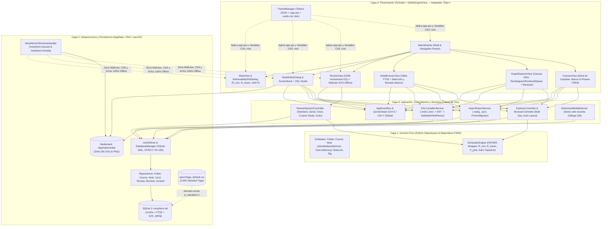

# Morphism SRS — Prototype 2: Master Architecture & Engineering Specification (Whitepaper)

> [!IMPORTANT]
> **Alcance del Documento**: Este repositorio contiene la **Especificación Técnica Completa (Whitepaper & Plan de Implementación)** para **Morphism SRS Prototype 2**. Fue diseñado desde cero analizando la arquitectura, limitaciones y deuda técnica del Prototipo 1 (`New SRS Project`), incorporando todos los requerimientos de [`specZ/old/Future_version.md`](file:///c:/repos/Morphism%20SRS%20proto2/specZ/old/Future_version.md), las decisiones de diseño del autor y auditando a fondo la propuesta [`specZ/old/morphism_srs_schema.sql`](file:///c:/repos/Morphism%20SRS%20proto2/specZ/old/morphism_srs_schema.sql).

---

## 1. Visión Ejecutiva y Diagnóstico Arquitectónico

**Morphism SRS** es un sistema de repetición espaciada (SRS) de próxima generación especializado en **Matemáticas, Física, Lógica Formal y Demostraciones Secuenciales**, construido sobre **Python 3.11+**, **PySide6 (Qt6)**, **SQLite 3 (WAL + STRICT + FTS5)**, **FSRS (Free Spaced Repetition Scheduler)** y **MathJax 3 100% Offline con soporte vectorial SVG nativo**.

El **Prototipo 1** validó exitosamente el concepto central (grafos dirigidos de prerrequisitos, secuencias de pasos encadenados $A_1 \to \dots \to A_n$, renderizado LaTeX offline y curvas de decaimiento FSRS), pero sufrió problemas estructurales típicos de un primer prototipo rápido que el **Prototipo 2** resuelve de raíz:

| Problema en Prototipo 1 | Causa Raíz Identificada en el Código | Solución Arquitectónica en Prototipo 2 |
| :--- | :--- | :--- |
| **1. Lag severo en la pantalla de Review con muchas tarjetas/pasos** | En `review_view.py`, cada paso de una nota serial reconstruía el HTML de **todos** los pasos previos ($A_1 \dots A_{k-1}$) más el actual, sobrescribía `container.innerHTML` y ejecutaba `MathJax.typesetPromise` sobre todo el contenedor ($O(N^2)$ pasadas de MathJax por sesión). Además, nunca se invocaba `MathJax.typesetClear()`, acumulando nodos huérfanos en la memoria interna de MathJax. | **DOM Incremental Append-Only + Caché SVG + Virtualización CSS**: Los pasos previos ya renderizados se mueven al contenedor de historial mediante `appendChild` **sin re-ejecutar MathJax** ($O(1)$ por paso). Uso estricto de `MathJax.typesetClear([node])` y `content-visibility: auto`. |
| **2. Joint Retrievability ($P(\bigcap A_i) = \prod R_i$) distorsionaba el scheduling** | Multiplicar $R_i(t)$ hace que una nota con 10 tarjetas al $90\%$ tenga retención conjunta $0.90^{10} = 34.8\% \ll 85\%$, marcando la nota como vencida casi instantáneamente tras estudiarla. | **FSRS Individual por Tarjeta + Trío de Métricas Analíticas**: El vencimiento (`is_due`) se rige estrictamente por el estado individual FSRS de cada tarjeta. Para analítica visual e inspección se calculan **Bottleneck Retrievability** ($R_{\min} = \min_i R_i$), **Mean Retrievability** ($\bar{R}$) y **Joint Retrievability** ($P(\bigcap A_i)$) como estadística pura sin forzar vencimientos artificiales. |
| **3. Spaghetti code en modelos: `ProofSequenceCard`, `card_type` redundante y `content_kind` arbitrario** | Existían dos mecanismos duplicados para pasos (`ProofSequenceCard` con `card_steps` vs notas `serial_sequence_single`), además de obligar a clasificar cada nota en un único `content_kind`. | **Unificación en Tarjetas Atómicas + 3 Modos Epistemológicos (`standard`, `serial`, `cloze`) + Tags Estandarizados**: Se eliminan `ProofSequenceCard`, `card_type`, `card_steps` y `content_kind`. Toda tarjeta es una entidad atómica `(title, front, back)`. La nota define el condicionamiento: `standard` ($P(A_i)$), `serial` ($P(A_i \mid A_1 \dots A_{i-1})$) o `cloze` ($P(A_i \mid \{A_j : j \ne i\})$). La clasificación semántica usa el catálogo [`specZ/tags_default.csv`](file:///c:/repos/Morphism%20SRS%20proto2/specZ/tags_default.csv) (2,000 tags científicos en inglés). |
| **4. Estilos CSS / QSS inconsistentes, ilegibles y ventanas que colapsan en pantallas 720p** | Más de 35 llamadas `setStyleSheet(...)` hardcodeadas en 10 archivos `.py`, colores duplicados en strings HTML, fallos de popups `QComboBox` en Windows y tamaños fijos (`1120x820`) que desbordan pantallas de laptops de $1366 \times 768$ o $1280 \times 720$. | **Motor de Temas Basado en Parámetros Generales (`ThemeManager` en 3 piezas) + Geometría Relativa al Monitor**: Un archivo JSON de tokens genera la hoja maestra `app.qss` de Qt y las variables CSS `:root` de `cards.css`. Ventanas dimensionadas dinámicamente según `QScreen.availableGeometry()`. |
| **5. Problemas con MathJax Offline, diagramas conmutativos y rutas de imágenes rotas** | `course_storage.py` verificaba `tex-chtml.js`, pero `review_view.py` cargaba `tex-svg.js`. Las imágenes usaban rutas absolutas locales (`file:///C:/Users/...`) y los diagramas conmutativos complejos se portaban mal en MathJax. | **Protocolo `morphism://` + Bóveda `MediaVault` Multiplataforma (`AppData` / XDG / macOS) con Soporte Nativo SVG**: Almacenamiento direccionado por contenido (`SHA-256`) con soporte de primer nivel para diagramas vectoriales `.svg` (Quiver/TikZ/Inkscape) con inversión adaptativa en modo oscuro. |
| **6. Bugs con `<` y `>` en texto matemático interpretados como etiquetas HTML** | Escribir desigualdades como `$x < y$` o `$a > 0$` provocaba que el parser HTML de Chromium interpretara `< y$` como la apertura de un tag HTML corrupto, devorando el texto siguiente. | **Sanitizador Inteligente a Macros LaTeX Nativas (`\lt` y `\gt`)**: `SafeMathHtmlParser` preserva únicamente una lista blanca de tags HTML de formato (`<b>`, ` `, `<ul>`, etc.) y convierte operadores `<` y `>` matemáticos a comandos nativos **`\lt`** y **`\gt`**, inmunes al parser HTML. |
| **7. Almacenamiento fragmentado en JSONs y creación tediosa vía scripts Python** | Cada curso requería 3 archivos JSON y escribir LaTeX (`\frac`, `\beta`, `\nabla`) en JSON crudo causaba errores de escape (`\f`, `\b`, `\n`), obligando a crear scripts `.py` en `scratch/`. | **Base de Datos Unificada SQLite 3 (`morphism.db`) + Compilador DSL Nativo (`.mdsl`)**: Tablas `STRICT`, modo `WAL`, búsqueda `FTS5`, UUIDs canónicos para compartir mazos (`.mpkg`) y lenguaje declarativo (`NEW NOTE`, `CARD`, `FRONT`, `BACK`, `LINK`) sin escapes. |
| **8. Falta de `Ctrl+Z` (Deshacer) y borrado masivo tedioso** | Calificar una tarjeta por accidente o borrar 20 notas en el grafo no se podía deshacer, y borrar requería 20 confirmaciones individuales. | **Pila `QUndoStack` Transversal (`Ctrl+Z` / `Ctrl+Y`) + `NoteBrowserView` + Selección Marquee**: Deshacer calificaciones FSRS en vivo (restaurando `state_before_json`), selección por rectángulo en el grafo y tabla `FTS5` con casillas para operaciones en masa en una sola transacción SQL. |

---

## 2. Mapa Maestro de la Especificación (`specZ/`)

La especificación técnica completa se estructura en **8 documentos principales**, un **catálogo estándar de 2,000 etiquetas** y un **directorio de backlog (`TODO/`)** dentro de [`specZ/`](file:///c:/repos/Morphism%20SRS%20proto2/specZ):

1. **[`specZ/01_ARCHITECTURE_AND_PROJECT_STRUCTURE.md`](file:///c:/repos/Morphism%20SRS%20proto2/specZ/01_ARCHITECTURE_AND_PROJECT_STRUCTURE.md)**
   - Principios arquitectónicos Anti-Spaghetti (4 Capas Unidireccionales: Domain, Infrastructure/SQLite, Application Controllers/Services, Presentation PySide6).
   - Árbol completo de directorios y responsabilidades de cada módulo en `src/morphism_srs/`.
   - Compatibilidad multiplataforma de `AppData` (`Windows %APPDATA%`, `Linux XDG`, `macOS Application Support` + `Portable Mode`).
   - Bóveda de medios `MediaVault` (`SHA-256`) con soporte vectorial nativo **SVG** para diagramas conmutativos y esquema `morphism://`.
   - Bus de eventos tipado (`AppEventBus`), pila universal `QUndoStack` (`Ctrl+Z`) y reglas de geometría relativa para pantallas de **720p**.

2. **[`specZ/02_DATABASE_AND_SQL_SPECIFICATION.md`](file:///c:/repos/Morphism%20SRS%20proto2/specZ/02_DATABASE_AND_SQL_SPECIFICATION.md)**
   - **Auditoría técnica exhaustiva** de [`specZ/old/morphism_srs_schema.sql`](file:///c:/repos/Morphism%20SRS%20proto2/specZ/old/morphism_srs_schema.sql) (10 problemas críticos detectados y sus soluciones en v2).
   - Deprecación de `ProofSequenceCard`, `card_type`, `card_steps` y `content_kind`; unificación en tarjetas atómicas, modos `standard | serial | cloze`, identificadores `uuid` universales, `display_order` y jerarquía FSRS a nivel Global / Carpeta (`course_folders`) / Curso.
   - **Esquema SQLite v2 Completo y Verificado (`schema_v2.sql`)**, diagrama Entidad-Relación (`erDiagram`), consultas SQL críticas (`< 2 ms`) y migrador automático desde el Prototipo 1 (`proto1_migrator.py`).

3. **[`specZ/03_THEMING_QSS_AND_CSS_ARCHITECTURE.md`](file:///c:/repos/Morphism%20SRS%20proto2/specZ/03_THEMING_QSS_AND_CSS_ARCHITECTURE.md)**
   - Diagnóstico de los fallos de estilo del Prototipo 1 y arquitectura simplificada en **3 piezas maestras**: Parámetros Generales (`themes/*.json`), hoja única de widgets Qt (`app.qss.tmpl`) y hoja web (`cards.css`).
   - Catálogo completo de Design Tokens (`dark_slate.json`, `light_paper.json`, `oled_midnight.json`), variantes semánticas (`[variant="primary"]`, `[role="view-title"]`) y solución definitiva al popup de `QComboBox` en todos los sistemas operativos.
   - Algoritmo completo de sanitización `SafeMathHtmlParser` que convierte operadores `<` y `>` en texto matemático a macros LaTeX nativas **`\lt`** y **`\gt`**.
   - Clases semánticas vinculadas a Tags Estandarizados y adaptación automática de diagramas SVG en modo oscuro.

4. **[`specZ/04_MATHJAX_AND_WEBENGINE_PERFORMANCE.md`](file:///c:/repos/Morphism%20SRS%20proto2/specZ/04_MATHJAX_AND_WEBENGINE_PERFORMANCE.md)**
   - Diagnóstico forense de la re-compilación cuadrática $O(N^2)$ y fuga de memoria en `MathJax.startup.document` del Prototipo 1.
   - Arquitectura del motor **Zero-Lag Review Renderer ($O(1)$)**: regiones DOM independientes, promoción de pasos en $O(1)$ sin re-invocar MathJax, soporte de contexto para modo `cloze`, `MathJax.typesetClear()` selectivo, caché LRU de fragmentos SVG y virtualización CSS (`content-visibility: auto`).
   - Empaquetado 100% Offline de `tex-svg-full.js` con `fontCache: 'local'` y pre-calentamiento de `QWebEngineProfile`.

5. **[`specZ/05_SCHEDULING_AND_REVIEW_ENGINE.md`](file:///c:/repos/Morphism%20SRS%20proto2/specZ/05_SCHEDULING_AND_REVIEW_ENGINE.md)**
   - Fundamentación matemática de los 3 modos de nota según su estructura de condicionamiento probabilístico:
     - **`standard`**: $P(A_i)$ (evaluación marginal independiente).
     - **`serial`**: $P(A_i \mid A_1, \dots, A_{i-1})$ (condicionamiento causal deductivo sobre pasos previos).
     - **`cloze`**: $P(A_i \mid \{A_j : j \ne i\})$ (condicionamiento holístico sobre todas las demás tarjetas de la nota, distinto de la simple oclusión de texto de Anki).
   - Reglas formales de vencimiento (`is_due`), trío de métricas analíticas ($R_{\min}$, $\bar{R}$, $P(\bigcap A_i)$), ordenamiento topológico (Algoritmo de Kahn), **Auto-Estudio vs Estudio Personalizado (Custom Study)** y reversión transaccional con **`Ctrl+Z`**.

6. **[`specZ/06_DSL_COMPILER_AND_IMPORT_EXPORT.md`](file:///c:/repos/Morphism%20SRS%20proto2/specZ/06_DSL_COMPILER_AND_IMPORT_EXPORT.md)**
   - Especificación formal y gramática EBNF del lenguaje declarativo **Morphism DSL (`.mdsl`)** (`NEW NOTE`, `MODE standard|serial|cloze`, `TAGS`, `CARD`, `FRONT`, `BACK`, `LINK`).
   - Arquitectura del compilador en 2 pasadas (`DSLLexer`, `DSLParser`, `SemanticValidator`, `SQLiteBatchImporter`) con validación contra [`specZ/tags_default.csv`](file:///c:/repos/Morphism%20SRS%20proto2/specZ/tags_default.csv) y auto-layout topológico.
   - Formato de paquetes portables **`.mpkg` (ZIP con UUIDs + medios SVG/PNG)** y retrocompatibilidad total con los lotes JSON del Prototipo 1.

7. **[`specZ/07_UI_VIEWS_AND_MASS_BROWSER_SPEC.md`](file:///c:/repos/Morphism%20SRS%20proto2/specZ/07_UI_VIEWS_AND_MASS_BROWSER_SPEC.md)**
   - Especificación completa de las 5 vistas principales y diálogos de PySide6 adaptados a pantallas desde **720p**.
   - **Navegador Masivo (`🗂️ Browser` / `NoteBrowserView`)**: tabla virtualizada con búsqueda `FTS5`, filtros facetados, casillas multi-selección y barra de acciones en lote (`Delete`, `Tag`, `Change Mode`, `Move`, `Reschedule`, `Custom Study`).
   - **`GraphExplorerView v2`**: diferenciación geométrica por modo de nota (**Rectángulos** para `standard`, **Rombos** para `serial`, **Círculos/Elipses** para `cloze`), selección múltiple *Rubber-Band Marquee*, barra flotante de acciones y Level-of-Detail (LOD) a 60 FPS.

8. **[`specZ/08_MOBILE_COMPANION_AND_ROADMAP.md`](file:///c:/repos/Morphism%20SRS%20proto2/specZ/08_MOBILE_COMPANION_AND_ROADMAP.md)**
   - **Arquitectura Móvil Efímera Bajo Demanda (On-Demand QR Session)**: cero servidores 24/7 en segundo plano; el servidor local solo existe mientras la ventana del código QR está abierta, soportando tanto **Estudio en Vivo (LAN/Tailscale)** como **Check-Out / Check-In Offline (`IndexedDB` + `sync_oplog`)**.
   - **Plan Maestro de Implementación Paso a Paso (Fases 0 a 7)** con entregables y pruebas de verificación por fase.

9. **Recursos Complementarios en `specZ/`**:
   - **[`specZ/tags_default.csv`](file:///c:/repos/Morphism%20SRS%20proto2/specZ/tags_default.csv)**: Catálogo curado y podado computacionalmente con **2,000 etiquetas estándar** en inglés (`name_of_tag_with_underscores`) que cubren tipos epistémicos y ramas de las matemáticas, física y computación.
   - **[`specZ/TODO/SEED_DECKS_AND_ONBOARDING.md`](file:///c:/repos/Morphism%20SRS%20proto2/specZ/TODO/SEED_DECKS_AND_ONBOARDING.md)**: Diseño en backlog de los mazos introductorios y protocolo de onboarding para testers.

---

## 3. Diagrama Maestro de Arquitectura (Prototipo 2)

---

## 4. Matriz de Cumplimiento de Requerimientos

| # | Requerimiento (`Future_version.md` + Revisiones de Diseño) | Estado en Especificación | Documento de Referencia |
| :-: | :--- | :--- | :--- |
| 1 | **Usar SQLite con soporte de UUIDs y jerarquía de carpetas** | Esquema v2 completo (`STRICT`, `WAL`, `FTS5`, `uuid`, `course_folders` acíclico) + migrador desde Proto 1 | [`02_DATABASE_AND_SQL_SPECIFICATION.md`](file:///c:/repos/Morphism%20SRS%20proto2/specZ/02_DATABASE_AND_SQL_SPECIFICATION.md) |
| 2 | **Optimizar pantalla de Review manteniendo pasos previos (evitar lag de MathJax)** | DOM incremental ($O(1)$), `MathJax.typesetClear`, caché LRU de SVGs y `content-visibility: auto` | [`04_MATHJAX_AND_WEBENGINE_PERFORMANCE.md`](file:///c:/repos/Morphism%20SRS%20proto2/specZ/04_MATHJAX_AND_WEBENGINE_PERFORMANCE.md) |
| 3 | **Eliminar Joint Retrievability del scheduling pero conservarla como estadística** | Scheduling FSRS por tarjeta individual; $R_{\min}$, $\bar{R}$ y $P(\bigcap A_i)$ en gráficos y filtros de estudio personalizado | [`05_SCHEDULING_AND_REVIEW_ENGINE.md`](file:///c:/repos/Morphism%20SRS%20proto2/specZ/05_SCHEDULING_AND_REVIEW_ENGINE.md) |
| 4 | **Deprecar `ProofSequenceCard` / `card_type` y añadir modo `cloze` condicional** | Tarjetas atómicas únicas; notas con `review_mode IN ('standard', 'serial', 'cloze')` donde `cloze` evalúa $P(A_i \mid \{A_j : j \ne i\})$ | [`02_DATABASE_AND_SQL_SPECIFICATION.md`](file:///c:/repos/Morphism%20SRS%20proto2/specZ/02_DATABASE_AND_SQL_SPECIFICATION.md) y [`05_SCHEDULING_AND_REVIEW_ENGINE.md`](file:///c:/repos/Morphism%20SRS%20proto2/specZ/05_SCHEDULING_AND_REVIEW_ENGINE.md) |
| 5 | **Eliminar `content_kind` y unificar con 2,000 Tags estándar en CSV** | Columna `content_kind` eliminada; catálogo [`specZ/tags_default.csv`](file:///c:/repos/Morphism%20SRS%20proto2/specZ/tags_default.csv) en formato `snake_case` inglés | [`02_DATABASE_AND_SQL_SPECIFICATION.md`](file:///c:/repos/Morphism%20SRS%20proto2/specZ/02_DATABASE_AND_SQL_SPECIFICATION.md) y [`tags_default.csv`](file:///c:/repos/Morphism%20SRS%20proto2/specZ/tags_default.csv) |
| 6 | **Compilador de Tarjetas/Notas/Cursos (`NEW NOTE`, `CARD`, `FRONT`, `BACK`, `LINK`)** | Gramática EBNF completa, parser en 2 pasadas, sin escapes de LaTeX e integrado en el Scratchbook | [`06_DSL_COMPILER_AND_IMPORT_EXPORT.md`](file:///c:/repos/Morphism%20SRS%20proto2/specZ/06_DSL_COMPILER_AND_IMPORT_EXPORT.md) |
| 7 | **Hacer el CSS/QSS modular y modificable + Sanitizar `<` y `>` a `\lt` y `\gt`** | Arquitectura de 3 piezas (`tokens.json` + `app.qss` + `cards.css`) + `SafeMathHtmlParser` (`\lt` y `\gt`) | [`03_THEMING_QSS_AND_CSS_ARCHITECTURE.md`](file:///c:/repos/Morphism%20SRS%20proto2/specZ/03_THEMING_QSS_AND_CSS_ARCHITECTURE.md) |
| 8 | **Mantener MathJax 100% local + Soporte de diagramas vectoriales SVG en `AppData`** | Bundle `tex-svg-full.js` local + `MediaVault` multiplataforma (Windows/Linux/macOS) con soporte nativo `.svg` | [`01_ARCHITECTURE_AND_PROJECT_STRUCTURE.md`](file:///c:/repos/Morphism%20SRS%20proto2/specZ/01_ARCHITECTURE_AND_PROJECT_STRUCTURE.md) y [`04_MATHJAX_AND_WEBENGINE_PERFORMANCE.md`](file:///c:/repos/Morphism%20SRS%20proto2/specZ/04_MATHJAX_AND_WEBENGINE_PERFORMANCE.md) |
| 9 | **Selección masiva en Browser + Formas diferenciadas en Grafo + `Ctrl+Z` + Ventanas 720p** | `NoteBrowserView` FTS5, rectángulos/rombos/elipses en grafo, `QUndoStack` universal y geometría relativa al monitor | [`07_UI_VIEWS_AND_MASS_BROWSER_SPEC.md`](file:///c:/repos/Morphism%20SRS%20proto2/specZ/07_UI_VIEWS_AND_MASS_BROWSER_SPEC.md) |
| 10 | **Sincronización/Estudio móvil mediante servidor efímero (sólo con QR abierto)** | Servidor local bajo demanda activado únicamente durante el diálogo QR (modos Live y Check-Out/Check-In Offline) | [`08_MOBILE_COMPANION_AND_ROADMAP.md`](file:///c:/repos/Morphism%20SRS%20proto2/specZ/08_MOBILE_COMPANION_AND_ROADMAP.md) |
| 11 | **Mazos semilla introductorios en carpeta `TODO`** | Especificación movida a [`specZ/TODO/SEED_DECKS_AND_ONBOARDING.md`](file:///c:/repos/Morphism%20SRS%20proto2/specZ/TODO/SEED_DECKS_AND_ONBOARDING.md) | [`TODO/SEED_DECKS_AND_ONBOARDING.md`](file:///c:/repos/Morphism%20SRS%20proto2/specZ/TODO/SEED_DECKS_AND_ONBOARDING.md) |
