# Plan de Arquitectura e Implementación: Compañero Móvil en `src/morphism-portable` (Morphism SRS Prototype 2)

> [!IMPORTANT]
> **Principios Rectores de Diseño (Clean Room Prototype 2):**
> 1. **Rol Estricto de Compañero de Estudio (Sin Importar/Exportar ni Autoría)**:
>    - La aplicación móvil **NO** tendrá funciones para importar/exportar cursos (`.json`, `.mpkg`) ni compilar `.mdsl`, ni crear/editar/borrar cursos o notas. Toda la autoría, compilación DSL y gestión de archivos vive exclusivamente en la aplicación de escritorio (`src/morphism_srs`).
>    - El móvil se dedica 100% a **visualizar el Grafo DAG**, **realizar sesiones de repaso FSRS v5** (con condicionamiento real `standard`, `serial` y `cloze`) y **sincronizar el progreso de vuelta al PC**.
> 2. **Cero JSON Legacy — Motor SQLite v2 Nativo + Sincronización por Diffs (`sync_oplog`)**:
>    - Se elimina por completo el almacenamiento de cursos en `localStorage` mediante blobs JSON heredados de `Morphism-SRS-plus`.
>    - La app móvil usará el motor **SQLite nativo de Android (`android.database.sqlite.SQLiteDatabase`)** ejecutando exactamente el mismo esquema relacional [`schema_v2.sql`](file:///C:/repos/Morphism%20SRS/Morphism%20SRS%20proto2/src/morphism_srs/storage/schema_v2.sql) de Prototype 2.
>    - La sincronización PC $\leftrightarrow$ Móvil operará mediante **deltas incrementales basados en cursores (`sync_oplog` + `review_logs`)**, inspirada directamente en el sistema `USN` (*Update Sequence Number*) de **Anki / AnkiDroid (GPL-3.0)**.
> 3. **Arquitectura Híbrida en Kotlin estilo AnkiDroid en `src/morphism-portable/`**:
>    - Al estar bajo licencia **GPL-3.0**, tomamos el patrón arquitectónico probado de **AnkiDroid**: backend nativo en **Kotlin** (gestión SQLite transaccional, motor FSRS v5, servidor de activos `morphism://` vía `shouldInterceptRequest`, cliente HTTP de deltas) acoplado a una capa visual ligera en `WebView` que reutiliza directamente los activos web (`tex-svg-full.js`, `cards.css`, `themes/*.json`, `mathjax_macros.json`) de `src/morphism_srs/resources/`.

---

## 1. Evaluación Arquitectónica: ¿Reusar Qt en Android vs. Kotlin + SQLite + WebView (Estilo AnkiDroid)?

| Criterio | Opción A: Qt / PySide6 en Android | Opción B: Kotlin + SQLite Nativo + WebView Bridge (Estilo AnkiDroid) ✅ |
| :--- | :--- | :--- |
| **Soporte de `QWebEngineView`** | **No soportado en Android** por Qt/PySide6 (Chromium embebido de Qt no compila para Android; obliga a usar un wrapper nativo distinto). | **Nativo del sistema (`android.webkit.WebView`)**, acelerado por hardware y con soporte completo de MathJax 3 SVG. |
| **Tamaño del APK y Rendimiento** | $> 120\text{ MB}$ (empaqueta intérprete Python + binarios `libQt6*.so` + cruces NDK). Arranque lento en frío. | **$< 1.5\text{ MB}$**. Arranque instantáneo ($< 200\text{ ms}$) y consumo mínimo de batería. |
| **Motor SQLite** | `sqlite3` de Python sobre NDK. | **`android.database.sqlite.SQLiteDatabase`** nativo del sistema operativo Android en C++, con soporte `WAL` y `STRICT`. |
| **Reutilización de Código con Desktop (`src/morphism_srs`)** | Los widgets de escritorio (`QTreeView`, `QTableView`, menús contextuales de ratón) resultan incómodos en pantallas táctiles de 6". | **Reutiliza el 100% de lo que sí debe compartirse**: [`schema_v2.sql`](file:///C:/repos/Morphism%20SRS/Morphism%20SRS%20proto2/src/morphism_srs/storage/schema_v2.sql), [`cards.css`](file:///C:/repos/Morphism%20SRS/Morphism%20SRS%20proto2/src/morphism_srs/resources/web/css/cards.css), [`mathjax_macros.json`](file:///C:/repos/Morphism%20SRS/Morphism%20SRS%20proto2/src/morphism_srs/resources/defaults/mathjax_macros.json), [`tex-svg-full.js`](file:///C:/repos/Morphism%20SRS/Morphism%20SRS%20proto2/src/morphism_srs/resources/web/vendor/mathjax/tex-svg-full.js) y los temas [`resources/themes/*.json`](file:///C:/repos/Morphism%20SRS/Morphism%20SRS%20proto2/src/morphism_srs/resources/themes/). |

> [!TIP]
> **Lección clave tomada de AnkiDroid (GPL-3.0):**
> En AnkiDroid (`com.ichi2.anki`), toda la lógica de datos, consultas SQL, planificación FSRS y sincronización reside en **Kotlin** sobre SQLite nativo, mientras que el renderizado de tarjetas matemáticas e interacción táctil ocurre en un `WebView` conectado mediante `@JavascriptInterface` y un `WebViewClient.shouldInterceptRequest` que sirve imágenes locales sin pasar strings gigantes por memoria.
> En Morphism SRS Prototype 2, interceptar el esquema `morphism://media/<sha256>.<ext>` y `morphism://app/<path>` en Kotlin permite que **las tarjetas con imágenes/diagramas conmutativos `` funcionen de forma idéntica en PC y en Android sin reescribir el HTML**.

---

## 2. Estructura de Directorios Propuesta en `src/morphism-portable/`

Se eliminará la carpeta `android/` de la raíz y toda la implementación móvil vivirá organizada en `src/morphism-portable/` junto a `src/morphism_srs/`:

```text
src/
├── morphism_srs/                        # Aplicación Principal de Escritorio (Python + PySide6)
│   ├── domain/
│   ├── storage/schema_v2.sql            # ◄── Esquema SQL canónico compartido con morphism-portable
│   ├── resources/
│   │   ├── defaults/mathjax_macros.json # ◄── Configuración y macros MathJax compartidos
│   │   ├── icons/                       # ◄── Iconos oficiales compartidos
│   │   ├── themes/*.json                # ◄── Los 10 temas de diseño v2 compartidos
│   │   └── web/
│   │       ├── css/cards.css            # ◄── Estilos de tarjetas y pasos hermanos compartidos
│   │       └── vendor/mathjax/tex-svg-full.js
│   └── services/mobile_server.py        # Servidor efímero en PC con endpoints de Delta Sync
│
└── morphism-portable/                   # Compañero Móvil Android (Kotlin + SQLite v2 + WebView)
    ├── AndroidManifest.xml              # package="org.morphism.srs", usesCleartextTraffic="true"
    ├── build_portable.py                # Builder autónomo (kotlinc + d8 + aapt2 + zipalign + v1/v2 signer)
    ├── kotlin/
    │   └── org/morphism/srs/portable/
    │       ├── MainActivity.kt          # WebView host, barras del sistema, botón Back y ciclo de vida
    │       ├── bridge/
    │       │   ├── MorphismSchemeInterceptor.kt # Sirve morphism://app/*, morphism://media/* y schema_v2.sql
    │       │   └── MorphismJsBridge.kt  # @JavascriptInterface: expone DAO SQLite, FSRS y Sync a la UI
    │       ├── db/
    │       │   ├── PortableDatabase.kt  # SQLiteOpenHelper nativo (WAL, foreign_keys=ON, schema_v2.sql)
    │       │   ├── CourseGraphDao.kt    # Queries SQL < 2ms para cursos, nodos del grafo, aristas y R_min
    │       │   └── ReviewQueueDao.kt    # Orden topológico de Kahn, contexto serial/cloze, rate y undo
    │       ├── domain/
    │       │   └── FsrsV5Scheduler.kt   # Motor FSRS v5 en Kotlin (R=0.80, sin learning steps, 19 pesos)
    │       └── sync/
    │           ├── DeltaSyncEngine.kt   # Push de review_logs/schedules y Pull de diffs sync_oplog
    │           └── MediaSyncStore.kt    # Almacenamiento y verificación SHA-256 en filesDir/media/
    ├── res/
    │   ├── values/
    │   │   ├── strings.xml              # app_name = "Morphism SRS"
    │   │   ├── colors.xml
    │   │   └── styles.xml
    │   └── mipmap-{mdpi,hdpi,xhdpi,xxhdpi,xxxhdpi}/ic_launcher.png
    └── assets/
        └── web/
            ├── index.html               # Shell visual táctil (SIN botones de importar/exportar/editar)
            ├── portable_ui.js           # Controlador de vistas ligero (consume @JavascriptInterface)
            └── graph_canvas.js          # Renderizador Canvas 2D High-DPI (Rectángulo/Rombo/Elipse)
```

---

## 3. Esquema SQLite v2 y Protocolo de Sincronización Diferencial (Diffs Bidireccionales)

### 3.1 Base de Datos SQLite Nativa en el Móvil (`PortableDatabase.kt`)
Al iniciar la app en Android, `PortableDatabase` (subclase de `SQLiteOpenHelper`) lee `schema_v2.sql` empaquetado desde `src/morphism_srs/storage/schema_v2.sql` y configura:
- `PRAGMA foreign_keys = ON;`
- `PRAGMA journal_mode = WAL;`
- `PRAGMA synchronous = NORMAL;`

Además, en la tabla `app_meta (key TEXT PRIMARY KEY, value_json TEXT NOT NULL)` del móvil se almacenan los punteros de sincronización:
- `sync_pc_db_uuid`: UUID de la base de datos del PC vinculado.
- `sync_last_pc_seq`: Entero con el último `sync_oplog.id` aplicado desde el PC (`0` antes del primer sync).
- `sync_last_pushed_log_id`: Entero con el último `review_logs.id` local confirmado por el PC (`0` al inicio).
- `active_course_id`: ID del curso actualmente seleccionado en el móvil.
- `active_theme_id`: Tema visual activo.

### 3.2 Registro Automático de Diffs en el PC mediante Triggers SQLite (`sync_oplog`)
Para que el PC lleve un registro exacto y sin olvidos de cada cambio estructural (creación/edición/borrado de carpetas, cursos, notas, vínculos `course_notes`, tarjetas, horarios FSRS, aristas `edges`, etiquetas `tags`/`note_tags` y páginas de `scratchbook_pages`), añadiremos **Triggers SQLite automáticos** en [`database.py`](file:///C:/repos/Morphism%20SRS/Morphism%20SRS%20proto2/src/morphism_srs/storage/database.py) / [`schema_v2.sql`](file:///C:/repos/Morphism%20SRS/Morphism%20SRS%20proto2/src/morphism_srs/storage/schema_v2.sql):

- **Tablas con `uuid` propio** (`course_folders`, `courses`, `notes`, `cards`, `edges`, `review_logs`, `scratchbook_pages`):
  - `AFTER INSERT` y `AFTER UPDATE`: insertan en `sync_oplog (entity_table, entity_uuid, operation, created_at)` una entrada `'UPSERT'`.
  - `AFTER DELETE`: insertan en `sync_oplog` una entrada `'DELETE'` con el `OLD.uuid` (tombstone).
- **Tablas de unión y estado sin columna `uuid` propia** (`course_notes`, `card_schedules`, `tags`, `note_tags`, `media_assets`):
  - `course_notes`: `entity_uuid = NEW.course_id || ':' || NEW.note_id` (o resolución por UUIDs de curso y nota en el serializador de deltas).
  - `card_schedules`: `entity_uuid = (SELECT uuid FROM cards WHERE id = NEW.card_id)`.
  - `tags`: `entity_uuid = NEW.name`.
  - `note_tags`: `entity_uuid = NEW.note_id || ':' || NEW.tag_id`.
  - `media_assets`: `entity_uuid = NEW.sha256_hash`.

### 3.3 Flujo Completo del Protocolo de Sincronización en 3 Fases (`DeltaSyncEngine.kt` $\leftrightarrow$ `mobile_server.py`)

```mermaid
sequenceDiagram
    participant Mobile as App Móvil (Kotlin + SQLite v2)
    participant Server as EphemeralMobileServer (PC Python)
    participant PCDB as morphism.db (PC SQLite v2)

    Note over Mobile,Server: Usuario abre "📱 Mobile QR Sync" en PC (Puerto 8765) y pulsa Sincronizar en Móvil

    rect rgb(30, 41, 59)
    Note right of Mobile: FASE 1: PUSH DELTA (Móvil -> PC)
    Mobile->>Mobile: SELECT * FROM review_logs WHERE id > last_pushed_log_id
    Mobile->>Server: POST /api/v2/sync/push_delta?token=...<br/>{device_id, new_review_logs, updated_schedules, undone_log_uuids}
    Server->>PCDB: BEGIN IMMEDIATE (UnitOfWork)
    Server->>PCDB: 1. Elimina review_logs deshechos (undone_log_uuids)
    Server->>PCDB: 2. INSERT OR IGNORE nuevos review_logs por UUID
    Server->>PCDB: 3. Reconcilia card_schedules (LWW o reschedule_from_logs si hubo repaso concurrente)
    Server->>PCDB: COMMIT + emite señales UI en PC
    Server-->>Mobile: 200 OK {pushed_logs_accepted, max_local_log_id}
    Mobile->>Mobile: Actualiza sync_last_pushed_log_id
    end

    rect rgb(15, 23, 42)
    Note right of Mobile: FASE 2: PULL DELTA (PC -> Móvil)
    Mobile->>Server: GET /api/v2/sync/pull_delta?since_seq={last_pc_seq}&token=...
    alt since_seq == 0 (Sincronización Inicial / Bootstrap)
        Server->>PCDB: Lee tablas maestras + current_seq = MAX(sync_oplog.id)
        Server-->>Mobile: {mode: "bootstrap", current_seq, tables: {...}, media_manifest: [...]}
        Mobile->>Mobile: Transacción SQLite: puebla tablas y guarda sync_last_pc_seq = current_seq
    else since_seq > 0 (Sincronización Incremental por Diffs)
        Server->>PCDB: SELECT * FROM sync_oplog WHERE id > since_seq ORDER BY id ASC
        Server->>Server: Compacta operaciones por (entity_table, entity_uuid)
        Server-->>Mobile: {mode: "delta", current_seq, upserts: {...}, deletes: {...}, new_media: [...]}
        Mobile->>Mobile: Transacción SQLite: aplica INSERT OR REPLACE y DELETE en < 10 ms
        Mobile->>Mobile: Actualiza sync_last_pc_seq = current_seq
    end
    end

    rect rgb(23, 37, 84)
    Note right of Mobile: FASE 3: MEDIA SYNC DIFERENCIAL (SVGs / Imágenes)
    Mobile->>Mobile: Filtra media_assets cuyos archivos no existen en filesDir/media/
    loop Solo para cada sha256 faltante
        Mobile->>Server: GET /media/{sha256}.{ext}?token=...
        Server-->>Mobile: Bytes del archivo (.svg / .png)
        Mobile->>Mobile: Verifica SHA-256 y guarda en filesDir/media/{sha256}.{ext}
    end
    end
```



### 3.4 Resolución Matemática de Conflictos en `card_schedules`
Cuando el móvil envía repasos al PC en la **Fase 1 (`push_delta`)**:
1. Cada `review_log` tiene un `uuid` único e inmutable y referencia a su tarjeta mediante `card_uuid` (para ser inmune a diferencias de `AUTOINCREMENT` si algún día existieran, aunque el móvil replica los `id` canónicos del PC).
2. Para cada tarjeta que recibió nuevos `review_logs` desde el móvil:
   - **Caso Estándar (sin conflicto)**: La tarjeta no fue repasada en el PC desde la última sincronización (`pc_schedule.last_review_at == mobile_first_log.prev_last_review_at`). El PC actualiza directamente `card_schedules` con el estado final calculado por el móvil.
   - **Caso Concurrente (repasada tanto en PC como en Móvil antes de sincronizar)**: El PC inserta los nuevos `review_logs` del móvil y ejecuta [`SchedulerEngine.reschedule_from_logs(card_id, all_logs)`](file:///C:/repos/Morphism%20SRS/Morphism%20SRS%20proto2/src/morphism_srs/domain/scheduler_engine.py#L273-L290) ordenando todos los `review_logs` de esa tarjeta por `reviewed_at ASC`. Así se conserva el 100% del historial de ambos dispositivos y la estabilidad/dificultad FSRS v5 converge exactamente al valor matemático correcto.
   - **Soporte de `Undo` entre sesiones**: Si el usuario calificó una tarjeta en el móvil y luego presionó `Undo`, el móvil borra ese `review_log` localmente y, si ya había sido sincronizado previamente, incluye su `uuid` en `undone_log_uuids` para que el PC también lo elimine y recalcule el horario de esa tarjeta.

---

## 4. Auditoría de MathJax y UI en `Morphism-SRS-plus`: Qué Incorporar a Prototype 2

Tras revisar los últimos commits de `Morphism-SRS-plus` (`36ce1e4`, `07795a5`, `b8a90d2`), identificamos **tres mejoras técnicas reales** (separadas de su deuda técnica de cursos semilla y Cloze legacy) que debemos aplicar tanto en **Desktop (`src/morphism_srs`)** como en **Mobile (`src/morphism-portable`)**:

### 4.1 Corrección del Bug de Race Condition en el Typeset Inicial de MathJax (`36ce1e4`)
- **Diagnóstico del bug en Prototype 2**:
  - En [`review.html`](file:///C:/repos/Morphism%20SRS/Morphism%20SRS%20proto2/src/morphism_srs/resources/web/html/review.html) (y en la vista móvil), `mathjax_init.js` define `window.MathJax = { tex: ..., svg: ..., startup: { typeset: false } }` antes de cargar `tex-svg-full.js`.
  - Durante los primeros milisegundos mientras `tex-svg-full.js` se parsea e inicializa sus paquetes internos, `window.MathJax` **ya es un objeto truthy**, pero `window.MathJax.typesetPromise` y `window.MathJax.typesetClear` **aún son `undefined`**.
  - En [`review_renderer.js`](file:///C:/repos/Morphism%20SRS/Morphism%20SRS%20proto2/src/morphism_srs/resources/web/js/review_renderer.js#L6-L20) y [`preview_renderer.js`](file:///C:/repos/Morphism%20SRS/Morphism%20SRS%20proto2/src/morphism_srs/resources/web/js/preview_renderer.js), `typesetElements(elements)` hace:
    ```javascript
    if (!window.MathJax) return;
    _typesetQueue = _typesetQueue.then(function () {
        if (window.MathJax.typesetPromise) {
            return window.MathJax.typesetPromise(elements);
        }
    });
    ```
    Si la primera tarjeta se renderiza antes de que `MathJax.startup.promise` termine, `window.MathJax.typesetPromise` es `undefined`, la promesa resuelve en vacío y **la primera tarjeta se queda sin renderizar sus fórmulas LaTeX**.
- **Solución limpia para `src/morphism_srs` y `src/morphism-portable`**:
  1. En `_typesetQueue`, encadenar siempre la espera a `window.MathJax.startup.promise` antes de invocar `typesetClear` y `typesetPromise`:
     ```javascript
     function waitMathJaxReady() {
         if (window.MathJax && window.MathJax.startup && window.MathJax.startup.promise) {
             return window.MathJax.startup.promise;
         }
         return Promise.resolve();
     }
     ```
  2. Configurar un callback `startup.ready` en `window.MathJax` (`scheme_handler.py` e `index.html` móvil) que llame a `MathJax.startup.defaultReady()` y, al resolver `MathJax.startup.promise`, verifique si ya hay elementos pendientes de renderizar en el DOM.

### 4.2 Bloqueo de `autoload` de Red y Paquetes Completos en `mathjax_macros.json` (`b8a90d2`)
- **Diagnóstico**:
  - Aunque `tex-svg-full.js` incluye todos los paquetes compilados adentro, si una nota usa `\boldsymbol{\nabla}`, `\bm{x}`, `\cancel{t}` o `\ce{H2O}` y esos paquetes no están declarados en `packages: {'[+]': [...]}` con `autoload` desactivado, MathJax intenta descargar extensiones externas por red/archivo relativo y falla en modo offline.
- **Solución en [`src/morphism_srs/resources/defaults/mathjax_macros.json`](file:///C:/repos/Morphism%20SRS/Morphism%20SRS%20proto2/src/morphism_srs/resources/defaults/mathjax_macros.json) y [`scheme_handler.py`](file:///C:/repos/Morphism%20SRS/Morphism%20SRS%20proto2/src/morphism_srs/web_engine/scheme_handler.py)**:
  - Declarar en `packages`: `{"[+]": ["color", "ams", "boldsymbol", "mhchem", "mathtools", "cancel", "cases", "centernot", "unicode", "noerrors", "noundefined"]}`.
  - Desactivar `autoload` para esos paquetes (`"autoload": {"boldsymbol": [], "mhchem": [], "mathtools": [], "cancel": [], "cases": [], "centernot": [], "unicode": []}`) de modo que MathJax use las definiciones internas del bundle `tex-svg-full.js` sin hacer peticiones externas.
  - Añadir los macros `"bm": ["{\\boldsymbol{#1}}", 1]` y `"ce": ["{\\mathrm{#1}}", 1]`.

### 4.3 Escalado High-DPI (`devicePixelRatio`) en el Grafo Móvil y Navegación `Back` (`07795a5`)
- **En `graph_canvas.js` (`src/morphism-portable`)**:
  - Mantener todas las coordenadas de interacción táctil (`pointerdown`, `pointermove`, pinch-to-zoom, `fitAll`) en píxeles CSS lógicos (`rect.width`, `rect.height`), dimensionar el buffer físico del canvas a `Math.round(rect.width * dpr)` y aplicar `ctx.scale(dpr, dpr)` al inicio de `render()`. Esto garantiza nitidez nativa en pantallas AMOLED/Retina sin encoger los nodos ni desfasar el toque.
- **En `MainActivity.kt` (`src/morphism-portable`)**:
  - Interceptar el botón/gesto `Back` de Android (`onBackPressed`) delegando primero a `window.onPortableBackPressed()` en JS: si hay un modal abierto lo cierra; si está en la pestaña de `Review`, `Courses` o `Stats`, regresa al `Graph`; y solo si ya está en `Graph` sale de la aplicación.

---

## 5. Diseño Detallado de las Capas de `src/morphism-portable`

### 5.1 Capa Nativa Kotlin (`org.morphism.srs.portable`)

1. **`PortableDatabase.kt` (`SQLiteOpenHelper`)**:
   - Inicializa `morphism_portable.db` en `context.getDatabasePath("morphism_portable.db")` ejecutando el DDL oficial `schema_v2.sql`.
   - Expone métodos transaccionales seguros (`inTransaction { db -> ... }`).
2. **`CourseGraphDao.kt`**:
   - `listCoursesJson()`: Ejecuta SQL directo sobre `courses`, `course_notes`, `cards` y `card_schedules` devolviendo cada curso con su conteo real de nodos y tarjetas vencidas.
   - `getCourseGraphJson(courseId: Int)`: Ejecuta la consulta SQL optimizada ($< 2\text{ ms}$) que une `course_notes`, `notes`, `cards`, `card_schedules` y `edges` para el curso activo, calculando $R_{\min}(t)$, `due_count`, `new_count` y devolviendo únicamente los nodos y aristas de ese curso para el canvas.
   - `updateNodePosition(courseId: Int, noteId: Int, x: Double, y: Double)`: Guarda en `course_notes` si el usuario acomoda un nodo con el dedo en el grafo.
3. **`FsrsV5Scheduler.kt` y `ReviewQueueDao.kt`**:
   - Implementación pura en Kotlin del motor **FSRS v5** de Prototype 2 (`desired_retention = 0.80`, `learning_steps = empty`, `relearning_steps = empty`, decaimiento $-0.5$, factor $19/81$).
   - `buildDueQueue(courseId: Int, noteId: Int?)`:
     - Obtiene las notas del curso, las ordena topológicamente mediante el **algoritmo de Kahn** sobre la tabla `edges`, y selecciona todas las tarjetas con `state == 0` (New), `due_at <= now` o $R(t) < R_{\text{desired}}$.
   - `getCardPromptContextJson(cardId: Int)`:
     - Consulta en SQLite la tarjeta objetivo `c`, su nota padre `n` y todas las tarjetas hermanas de la misma nota (`SELECT * FROM cards WHERE note_id = ? ORDER BY step_order ASC`).
     - Construye exactamente el mismo payload `ReviewPromptContext` que [`SchedulerEngine.build_prompt_context`](file:///C:/repos/Morphism%20SRS/Morphism%20SRS%20proto2/src/morphism_srs/domain/scheduler_engine.py#L291-L344) en Desktop:
       - `standard`: Solo la tarjeta $A_i$.
       - `serial`: Pasos hermanos anteriores $\{A_j : j < i\}$ resueltos arriba + paso objetivo $A_i$ ($P(A_i \mid A_1, \dots, A_{i-1})$).
       - `cloze`: Pasos hermanos $\{A_j : j < i\}$ arriba y $\{A_j : j > i\}$ abajo como contexto dado + objetivo $A_i$ ($P(A_i \mid \{A_j : j \ne i\})$).
     - Calcula las 4 predicciones de intervalo (`Again`, `Hard`, `Good`, `Easy`).
   - `submitRating(cardId: Int, rating: Int, durationMs: Int)` y `undoLastRating()`:
     - Actualiza `card_schedules` e inserta en `review_logs` dentro de una transacción SQLite nativa.
     - Mantiene una pila de deshacer en sesión; al invocar `undoLastRating()`, restaura la fila previa en `card_schedules`, elimina el `review_log` recién creado (y registra su UUID en `undone_log_uuids` si fuera necesario para el sync).
4. **`MorphismSchemeInterceptor.kt`**:
   - Intercepta en `WebViewClient.shouldInterceptRequest`:
     - `morphism://app/...` $\to$ sirve archivos desde los assets empaquetados (`cards.css`, `tex-svg-full.js`, `chart.js`, `themes/*.json`).
     - `morphism://media/<filename>` $\to$ sirve imágenes y diagramas conmutativos `.svg` / `.png` directamente desde `context.filesDir/media/<filename>` con el MIME type correcto (`image/svg+xml`, `image/png`, etc.).

### 5.2 Capa de Interfaz Visual (`assets/web/index.html`, `portable_ui.js`, `graph_canvas.js`)
Conserva el diseño visual pulido que ya probaste, pero depurado de toda función de autoría/importación:
- **Barra Superior**: Logo + Nombre `"Morphism SRS"`, badge del curso activo, botón `🔄 Sync QR`, selector de los **10 temas oficiales** (`dark_slate`, `oled_midnight`, `light_paper`, `bisexual_midnight`, `catppuccin_mocha`, `dracula`, `nord`, `tokyo_night`, `solarized_dark`, `github_light`).
- **4 Pestañas Inferiores Limpias**:
  1. **🗺️ Grafo (`Graph`)**: Canvas táctil multi-touch con formas Proto2 (Rectángulo = `standard`, Rombo = `serial`, Elipse = `cloze`), buscador instantáneo, botón ` Encuadrar` y botón primario `⚡ Repasar Vencidas (N)`. Al tocar un nodo se abre un panel inferior compacto de solo lectura para inspeccionar sus pasos o iniciar el repaso de ese nodo.
  2. **⚡ Repaso (`Review`)**: Reutiliza la estructura DOM y estilos de [`cards.css`](file:///C:/repos/Morphism%20SRS/Morphism%20SRS%20proto2/src/morphism_srs/resources/web/css/cards.css) de Prototype 2 para mostrar hermanos condicionados (`serial` / `cloze`), fórmulas MathJax 3 offline sin race conditions, diagramas `morphism://media/...`, barra de progreso, botón `↩️ Undo` y los 4 botones de calificación FSRS.
  3. **📚 Cursos (`Courses`)**: Lista limpia de los cursos sincronizados desde el PC para cambiar de curso activo con un toque (**sin** botones de crear curso, borrar curso, importar JSON/MDSL ni exportar). Si aún no se ha sincronizado ningún curso, muestra un estado vacío claro invitando a pulsar `🔄 Sincronizar con PC`.
  4. **📊 Estadísticas (`Stats`)**: Consultas SQL de agregación directa sobre `card_schedules` y `review_logs` (total de tarjetas, vencidas hoy, retención objetivo del curso, distribución de estados FSRS y mapa de calor real de los últimos días).

---

## 6. Compilador Autónomo de APK para Kotlin (`src/morphism-portable/build_portable.py`)

Para que puedas compilar `morphism-srs.apk` en Windows o Linux con un solo comando (`python src/morphism-portable/build_portable.py`) sin instalar Android Studio:
1. El script verificará/descargará de forma portable en `.build_cache/` (ignorado por Git):
   - Compilador oficial **Kotlin CLI (`kotlinc` / `kotlin-compiler-2.0.21.zip`)** + `kotlin-stdlib.jar`.
   - Herramientas de Android SDK Build-Tools (`aapt2`, `d8.jar` / `r8.jar`, `android.jar` API 34) y JDK portable si no está en el `PATH`.
2. Sincronizará automáticamente en tiempo de build los recursos canónicos desde `src/morphism_srs/`:
   - `src/morphism_srs/storage/schema_v2.sql`
   - `src/morphism_srs/resources/web/vendor/mathjax/tex-svg-full.js`
   - `src/morphism_srs/resources/web/css/cards.css`
   - `src/morphism_srs/resources/defaults/mathjax_macros.json`
   - `src/morphism_srs/resources/themes/*.json`
   - `src/morphism_srs/resources/icons/icon.png` (generando los mipmaps de Android).
3. Compilará el código Kotlin (`kotlinc` $\to$ `.class` + `kotlin-stdlib` $\to$ `d8` $\to$ `classes.dex`), compilará recursos con `aapt2` (con `usesCleartextTraffic="true"` y nombre `"Morphism SRS"` nativos desde el `AndroidManifest.xml`), alineará a 4 bytes (`zipalign`) y firmará con **APK Signature Scheme v1 + v2** produciendo `morphism-srs.apk` en la raíz del proyecto.

---

## 7. Plan de Ejecución Paso a Paso (Fases de Implementación)

### Fase 1: Parche de MathJax (Race Condition + Offline Autoload) en Desktop Prototype 2
1. Actualizar [`src/morphism_srs/resources/defaults/mathjax_macros.json`](file:///C:/repos/Morphism%20SRS/Morphism%20SRS%20proto2/src/morphism_srs/resources/defaults/mathjax_macros.json) y [`src/morphism_srs/web_engine/scheme_handler.py`](file:///C:/repos/Morphism%20SRS/Morphism%20SRS%20proto2/src/morphism_srs/web_engine/scheme_handler.py) para incluir `boldsymbol`, `mhchem`, `mathtools`, `cancel`, `cases`, `centernot`, `unicode`, desactivar `autoload` de red y añadir macros `\bm` y `\ce`.
2. Actualizar [`review_renderer.js`](file:///C:/repos/Morphism%20SRS/Morphism%20SRS%20proto2/src/morphism_srs/resources/web/js/review_renderer.js) y [`preview_renderer.js`](file:///C:/repos/Morphism%20SRS/Morphism%20SRS%20proto2/src/morphism_srs/resources/web/js/preview_renderer.js) para esperar siempre `window.MathJax.startup.promise` dentro de `_typesetQueue` y re-ejecutar typeset en `startup.ready`, eliminando definitivamente la condición de carrera en la primera tarjeta.

### Fase 2: Triggers SQLite de `sync_oplog` y Endpoints de Delta Sync en `mobile_server.py`
1. Añadir en [`database.py`](file:///C:/repos/Morphism%20SRS/Morphism%20SRS%20proto2/src/morphism_srs/storage/database.py) / [`schema_v2.sql`](file:///C:/repos/Morphism%20SRS/Morphism%20SRS%20proto2/src/morphism_srs/storage/schema_v2.sql) los triggers automáticos de `sync_oplog` para registrar cada `UPSERT` y `DELETE` con su número de secuencia incremental `id`.
2. Implementar en [`mobile_server.py`](file:///C:/repos/Morphism%20SRS/Morphism%20SRS%20proto2/src/morphism_srs/services/mobile_server.py):
   - `POST /api/v2/sync/push_delta`: Recepción de nuevos `review_logs`, `updated_schedules` y `undone_log_uuids`, con reconciliación FSRS mediante `reschedule_from_logs` cuando haya repasos concurrentes.
   - `GET /api/v2/sync/pull_delta?since_seq=<N>`: Respuesta en modo `bootstrap` (cuando `since_seq == 0`) o modo `delta` compactado (cuando `since_seq > 0`), incluyendo manifiesto de `media_assets` nuevos.

### Fase 3: Creación de `src/morphism-portable/` — Backend Kotlin y Base de Datos SQLite v2
1. Eliminar la carpeta antigua `android/` de la raíz y estructurar `src/morphism-portable/`.
2. Implementar en Kotlin:
   - `PortableDatabase.kt` (ejecución de `schema_v2.sql` en el SQLite nativo de Android).
   - `CourseGraphDao.kt` y `ReviewQueueDao.kt` (consultas SQL de cursos, grafo DAG, orden topológico de Kahn, condicionamiento de hermanos `standard`/`serial`/`cloze`, calificaciones y `Undo`).
   - `FsrsV5Scheduler.kt` (motor FSRS v5 al 80% de retención sin learning steps).
   - `DeltaSyncEngine.kt` y `MediaSyncStore.kt` (sincronización bidireccional incremental por cursores y descarga de SVGs/PNGs por SHA-256).
   - `MorphismSchemeInterceptor.kt`, `MorphismJsBridge.kt` y `MainActivity.kt`.

### Fase 4: Interfaz Visual Limpia en `src/morphism-portable/assets/web/`
1. Construir `index.html`, `portable_ui.js` y `graph_canvas.js` conectados al `@JavascriptInterface` (`window.MorphismNative`):
   - **Sin** botones ni lógica de importar/exportar cursos, `.mdsl` ni edición de nodos.
   - Renderizado High-DPI (`ctx.scale(dpr, dpr)`) del grafo con las formas geométricas de Prototype 2.
   - Pantalla de repaso usando `cards.css`, `tex-svg-full.js` sin race conditions y soporte nativo de imágenes `morphism://media/<sha256>.svg`.

### Fase 5: Toolchain `build_portable.py`, Compilación de `morphism-srs.apk` y Suite de Tests
1. Crear `src/morphism-portable/build_portable.py` para compilar el código Kotlin + recursos compartidos de Proto 2 y firmar `morphism-srs.apk` (esquemas v1 + v2 + zipalign).
2. Añadir tests automatizados en `tests/test_delta_sync_and_portable.py` que verifiquen:
   - Generación automática de entradas en `sync_oplog` al crear/editar/desvincular/borrar notas y cursos en PC.
   - Sincronización inicial (`since_seq = 0`) y sincronización incremental por diffs (`since_seq > 0`).
   - Push de repasos desde el móvil de vuelta al PC y resolución de conflictos FSRS con `reschedule_from_logs`.
   - Paridad de configuración MathJax y ausencia de funciones de importación/exportación en la app móvil.
