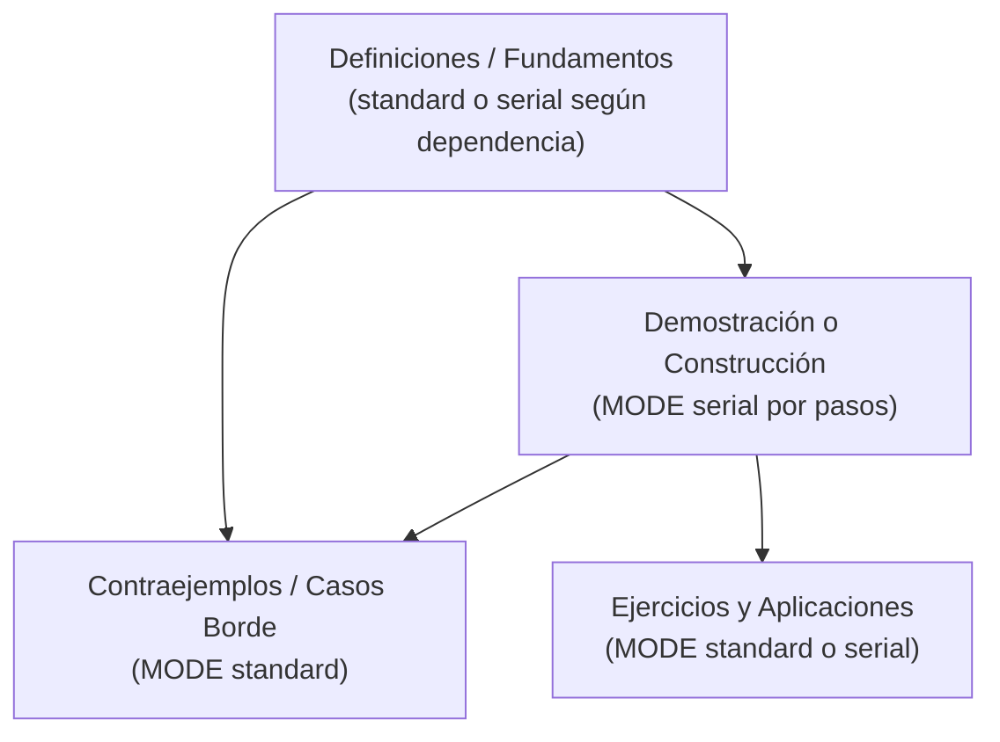

# Morphism SRS — Guía y Estándar de Generación de Cursos y Notas (`to_import/`)

> [!IMPORTANT]
> **Propósito de esta Guía**: Este documento constituye la referencia para autores humanos y agentes de Inteligencia Artificial (Antigravity, Claude, GPT, etc.) encargados de estructurar y compilar cursos y notas en **Morphism SRS**.
> Su objetivo es plasmar los fundamentos cognitivos del sistema y la sintaxis moderna **Morphism DSL (`.mdsl`)** sin sobre-especificar ni forzar estructuras rígidas innecesarias: la decisión pedagógica final siempre pertenece al usuario.

---

## 1. Fundamentos Cognitivos y Modos de Repaso

Morphism SRS es un **sistema de repetición espaciada epistémico basado en grafos dirigidos (DAG) y probabilidad condicional**. 

En lugar de tarjetas aisladas genéricas, las notas se clasifican según cómo se condiciona el conocimiento:

| Modo (`MODE`) | Modelo Probabilístico | Geometría en Grafo | Comportamiento del Repaso |
| :--- | :--- | :--- | :--- |
| **`MODE standard`** | $P(A_i)$ (Independiente) | **Rectángulo Redondeado** | Cada tarjeta se programa y repasa de forma independiente sin mostrar las demás tarjetas de la nota. |
| **`MODE serial`** | $P(A_i \mid A_1, \dots, A_{i-1})$ | **Rombo** | Dependencia acumulativa / progresiva. Al repasar el paso $A_i$, los pasos previos $A_1, \dots, A_{i-1}$ se muestran arriba automáticamente como contexto verificado. |
| **`MODE cloze`** | $P(A_i \mid \{A_j : j \ne i\})$ | **Elipse** | Desambiguación con interferencia mutua. Al repasar la tarjeta $A_i$, todas las demás tarjetas hermanas se muestran como contexto para aislar la pieza evaluada. |

---

### 1.1 ¿Cuándo usar cada Modo?

1. **`MODE standard` (Conceptos independientes)**:
   - Se utiliza cuando las tarjetas no dependen deductivamente unas de otras.
   - **Notas multi-tarjeta**: Si varios conceptos pertenecen a una misma familia temática (por ejemplo, conceptos topológicos como *abierto, cerrado, conexo, compacto*), resulta natural agruparlos en una sola nota `standard` con varias tarjetas independientes (`CARD 1`, `CARD 2`, etc.), en vez de dispersarlos en micro-notas aisladas o amontonarlos en una sola tarjeta gigante.

2. **`MODE serial` (Dependencia acumulativa / progresiva)**:
   - Se rige por la regla de la cadena de probabilidad condicional:
     $$P(A_1, A_2, \dots, A_n) = P(A_1) \cdot P(A_2 \mid A_1) \cdots P(A_n \mid A_1, \dots, A_{n-1})$$
   - **Demostraciones paso a paso**: Permite que el usuario avance lógicamente sin que un fallo en un paso avanzado invalide el progreso en los pasos elementales iniciales.
   - **Definiciones progresivas**: `serial` **no es exclusivo de teoremas**. También se utiliza para definiciones construidas por etapas progresivas que dependen acumulativamente del peldaño anterior (por ejemplo, la definición de la Integral de Lebesgue: funciones simples $\to$ funciones medibles no negativas $\to$ funciones en $L^1$).

3. **`MODE cloze` (Desambiguación de conceptos con interferencia)**:
   - Se utiliza para desambiguar conceptos muy similares o estrechamente ligados donde evaluar un elemento en el vacío genera confusión, pero presentarlo en presencia de sus conceptos hermanos aísla de forma precisa la diferencia evaluada.

---

### 1.2 Demostraciones y Enunciados de Teoremas

En el aprendizaje matemático riguroso, **memorizar enunciados de teoremas en el vacío suele ser contraproducente**: carece del anclaje mnemotécnico que proporciona la demostración (el *"por qué funciona"*).

- **La demostración va al frente**: El `FRONT` de la primera tarjeta (`CARD 1`) de una nota `serial` puede enunciar el teorema o planteamiento general junto con la pregunta del primer paso.
- **No forzar notas de enunciado separadas**: Casi nunca es necesario crear una nota previa dedicada exclusivamente al enunciado. En caso de requerirse una nota de enunciado o síntesis, esta debe ser posterior o complementaria a la demostración, nunca un prerrequisito artificial.

---

### 1.3 Ejercicios y Contraejemplos
- **Ejercicios**: En `FRONT` se presenta el problema o certamen de manera completa. En `BACK` se coloca la pauta o desarrollo riguroso, incentivando al estudiante a resolverlo mentalmente o en papel antes de revelar.
- **Contraejemplos**: Evalúan qué ocurre cuando falla una hipótesis clave de un teorema o definición.

---

## 2. Anatomía de un Flujo en Morphism

El flujo epistémico típico de un curso se organiza de manera flexible en el DAG:



---

## 3. Especificación Formal de Sintaxis `.mdsl`

### 3.1 Cabecera de Curso y Carpetas
La directiva `COURSE` moderna permite fijar el nombre, UUID universal y la jerarquía de carpetas en una única declaración:

```text
COURSE "Nombre del Curso" UUID a1b2c3d4-e5f6-7a8b-9c0d-1e2f3a4b5c6d FOLDER "Categoría"/"Subcategoría"
```
- **`UUID uuid`** *(opcional)*: Identificador UUIDv4 persistente para sincronización y reimportaciones.
- **`FOLDER "Cat1"/"Cat2"`** *(opcional)*: Ruta jerárquica entre comillas separada por barras.
- Ambas directivas son opcionales si se importa el archivo directamente dentro de un curso activo.

### 3.2 Directivas de Nota y Tarjeta
- `NEW NOTE "Título de la Nota"`: Inicia un nodo en el DAG.
- `MODE standard | serial | cloze`: Fija el modo de repaso.
- `TAGS tag_1, tag_2`: Etiquetas en `snake_case`.
- `RETENTION 0.85`: Retención objetivo FSRS opcional en $[0.70, 0.99]$.
- `CARD n "Título de la Tarjeta o Paso"`: Inicia la tarjeta $n$-ésima.
- `FRONT`: Pregunta, enunciado o planteamiento del paso.
- `BACK`: Respuesta o deducción del paso.
- `LINK "Nota Origen" -> "Nota Destino"`: Arista dirigida en el DAG.
  *(**Ubicación flexible**: Puede ubicarse en cualquier parte del archivo `.mdsl` — por ejemplo inmediatamente después de definir la nota dependiente, entre notas, o al final del archivo en un bloque `# Aristas`; el compilador resuelve todas las dependencias globalmente).*

### 3.3 Imágenes y Diagramas (Sintaxis Explicita)
Para evitar ambigüedad en el tratamiento de gráficos vectoriales e imágenes, Morphism DSL distingue 3 directivas explícitas:

1. **`[IMAGE "imagen.png"]`** — Incluye una imagen convencional (PNG, JPG, WebP) o SVG sin teñido.
2. **`[VECTOR "vectorial_image.svg"]`** — Incluye un gráfico vectorial simple que preserva íntegramente sus propios trazos y colores originales.
3. **`[DIAGRAM "commutative_diagram.svg"]`** — Incluye un diagrama conmutativo vectorial adaptativo. El compilador lo envuelve automáticamente en una máscara CSS dinámica (`commutative-diagram-mask`) teñida con el color del texto de la tarjeta, adaptando los trazos tanto al tema oscuro como al claro.

*(También se admiten etiquetas `` o sintaxis Markdown ``).*

### 3.4 Tipografía Matemática ($\LaTeX$) y Macros Offline
- Delimitar fórmulas con `$...$` (inline) o `$$...$$` (display).
- **Cero escapes**: Escribir barras invertidas directamente (`\frac`, `\mathbb{R}`, `\sigma`). El compilador previene colisiones con HTML transformando `<` y `>` a `\lt` y `\gt` dentro de bloques matemáticos.
- **Macros disponibles**: `\RR`, `\CC`, `\NN`, `\ZZ`, `\QQ`, `\norm{x}`, `\abs{x}`, `\parens{x}`, `\ph`, `\ps`, `\ch`, `\ta`, `\gm`, `\al`, `\be`, `\eps`, `\lthen`, `\liff`.

---

## 4. Plantilla de Ejemplo `.mdsl`

```text
COURSE "Teoría de la Medida y Análisis Real" UUID f47ac10b-58cc-4372-a567-0e02b2c3d479 FOLDER "Matemáticas"/"Análisis"

# ------------------------------------------------------------------------------
# 1. Definiciones en Bloque (Conceptos independientes en una sola nota)
# ------------------------------------------------------------------------------
NEW NOTE "Definición de Espacio Medible y Sigma-Álgebra"
MODE standard
TAGS teoria_de_la_medida, espacio_medible, sigma_algebra, definicion

CARD 1 "Axiomas de Sigma-Álgebra"
FRONT
Sea $X$ un conjunto. ¿Cuál es la definición formal de una <b>$\sigma$-álgebra</b> $\mathcal{M} \subseteq \mathcal{P}(X)$ y de un <b>espacio medible</b> $(X, \mathcal{M})$?
BACK
Una colección $\mathcal{M} \subseteq \mathcal{P}(X)$ es una <b>$\sigma$-álgebra</b> en $X$ si satisface:
<ol>
  <li><b>Vacío:</b> $\emptyset \in \mathcal{M}$.</li>
  <li><b>Complementos:</b> $E \in \mathcal{M} \implies E^c = X \setminus E \in \mathcal{M}$.</li>
  <li><b>Uniones contables:</b> $\{E_n\}_{n=1}^\infty \subseteq \mathcal{M} \implies \bigcup_{n=1}^\infty E_n \in \mathcal{M}$.</li>
</ol>
El par $(X, \mathcal{M})$ es un <b>espacio medible</b> y los elementos $E \in \mathcal{M}$ son <b>conjuntos medibles</b>.

CARD 2 "Propiedades Derivadas"
FRONT
A partir de los axiomas de $\sigma$-álgebra, verifique por qué el espacio total $X$ y las intersecciones contables pertenecen a $\mathcal{M}$.
BACK
<ul>
  <li>$X = \emptyset^c \in \mathcal{M}$ por complementos.</li>
  <li>Por De Morgan: $\bigcap_{n=1}^\infty E_n = \left(\bigcup_{n=1}^\infty E_n^c\right)^c \in \mathcal{M}$.</li>
</ul>

# ------------------------------------------------------------------------------
# 2. Demostración Paso a Paso (La Card 1 plantea el teorema y primer paso)
# ------------------------------------------------------------------------------
NEW NOTE "Demostración: Teorema de Carathéodory"
MODE serial
TAGS teoria_de_la_medida, caratheodory, demostraciones

CARD 1 "Paso 1: Planteamiento, Vacío y Complementos"
FRONT
<strong>Teorema de Carathéodory:</strong> Sea $\mu^*$ una medida exterior en $X$. Un conjunto $E \subseteq X$ es $\mu^*$-medible si para todo $A \subseteq X$:
$$\mu^*(A) = \mu^*(A \cap E) + \mu^*(A \cap E^c)$$
La colección $\mathcal{M}$ de conjuntos $\mu^*$-medibles es una $\sigma$-álgebra y $\mu = \mu^*|_{\mathcal{M}}$ es una medida completa.<br><br>
<strong>Paso 1:</strong> Demuestre que $\emptyset \in \mathcal{M}$ y que $E \in \mathcal{M} \implies E^c \in \mathcal{M}$.
BACK
Como $\mu^*(\emptyset) = 0$, para cualquier conjunto de prueba $A$:
$$\mu^*(A \cap \emptyset) + \mu^*(A \cap \emptyset^c) = \mu^*(A)$$
luego $\emptyset \in \mathcal{M}$. Para el complemento, la condición es simétrica entre $E$ y $E^c$:
$$\mu^*(A) = \mu^*(A \cap E) + \mu^*(A \cap E^c) = \mu^*(A \cap (E^c)^c) + \mu^*(A \cap E^c)$$
luego $E \in \mathcal{M} \implies E^c \in \mathcal{M}$.

CARD 2 "Paso 2: Uniones Finitas y Aditividad Finita"
FRONT
Demuestre que si $E_1, E_2 \in \mathcal{M}$ con $E_1 \cap E_2 = \emptyset$, entonces $E_1 \cup E_2 \in \mathcal{M}$ y $\mu^*(A \cap (E_1 \cup E_2)) = \mu^*(A \cap E_1) + \mu^*(A \cap E_2)$.
BACK
Aplicando medibilidad de $E_1$ al conjunto de prueba $A \cap (E_1 \cup E_2)$:
$$\mu^*(A \cap (E_1 \cup E_2)) = \mu^*(A \cap E_1) + \mu^*(A \cap E_2)$$
Sumando $\mu^*(A \cap (E_1 \cup E_2)^c) = \mu^*(A \cap E_1^c \cap E_2^c)$ y usando la medibilidad de $E_2$ en $A \cap E_1^c$, se obtiene $\mu^*(A)$, probando que $E_1 \cup E_2 \in \mathcal{M}$.

CARD 3 "Paso 3: Uniones Contables y Sigma-Aditividad"
FRONT
Demuestre la pertenencia de uniones contables disjuntas $\{E_j\}_{j=1}^\infty \subseteq \mathcal{M}$ y la $\sigma$-aditividad.
BACK
Para $G_n = \bigcup_{j=1}^n E_j$, $\mu^*(A) \ge \sum_{j=1}^n \mu^*(A \cap E_j) + \mu^*(A \cap E^c)$. Tomando $n \to \infty$ y usando la subaditividad contable de $\mu^*$:
$$\mu^*(A) \ge \sum_{j=1}^\infty \mu^*(A \cap E_j) + \mu^*(A \cap E^c) \ge \mu^*(A \cap E) + \mu^*(A \cap E^c)$$
lo que prueba $E \in \mathcal{M}$. Con $A = E$ se obtiene $\mu^*(E) = \sum_{j=1}^\infty \mu^*(E_j)$. $\blacksquare$

# ------------------------------------------------------------------------------
# 3. Aristas en el Grafo
# ------------------------------------------------------------------------------
LINK "Definición de Espacio Medible y Sigma-Álgebra" -> "Demostración: Teorema de Carathéodory"
```
